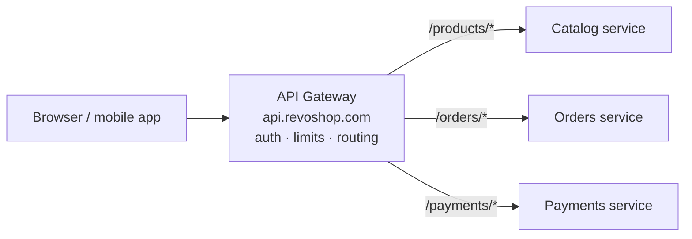

::part[Learn the Concept]{n="1"}

## 🎯 What you'll learn

- What an **API gateway** is: the single front door in front of your services
- Why clients should talk to **one** address, not to each service directly
- The shared jobs a gateway does: **routing**, **auth**, **rate limiting**, TLS
- How **routing** works (matching a request path to the right service)
- When a gateway helps and when it's overkill

## 🔤 Key words

| Word | In simple words | Bahasa Indonesia |
|---|---|---|
| **API gateway** | One entry point that forwards requests to the right service | Pintu masuk tunggal |
| **Route** | The rule that says which service handles which path | Aturan pengarahan |
| **Reverse proxy** | A server that receives requests and passes them to others | Penerus permintaan |
| **Rate limiting** | Capping how many requests a caller may make | Membatasi jumlah permintaan |
| **Cross-cutting concern** | A job many services share (auth, logging, limits) | Urusan lintas layanan |
| **Backend** | The internal service that actually does the work | Layanan di belakang |

## 🧠 The big idea

An API gateway is the **front desk of a big office building**. Visitors don't wander the halls trying doors until they find the right department. They come to **one** front desk, show their ID (auth), and the receptionist points them to the right room. The receptionist also stops people who show up 500 times an hour (rate limiting) and keeps a visitor log.

Without a front desk, every department would need its own guard, its own ID check, its own logbook — and every visitor would need a map of the whole building. The gateway does those shared jobs **once**, at the entrance, so the rooms behind it can focus on their actual work.

## ❓ Why it matters

Once you have several services, a question appears: **who do clients talk to?** If the browser or mobile app calls each service directly, you get a mess:

- The client needs to know **every service's address** — and those addresses change as you move things around. Change your internal map and every app breaks.
- **Every service** has to re-implement the same shared jobs: checking the login token, enforcing rate limits, terminating HTTPS, adding CORS headers, writing access logs. Five services means five copies of the same security code — and if one gets it wrong, that's your hole.
- There's **no single place** to add a company-wide rule ("block this abusive IP", "require auth on everything").

A gateway fixes all of that by being the one public address. Clients call `api.revoshop.com` and never learn the internal layout. The gateway checks auth and limits **once**, then forwards the request to whichever service handles it. Your services stay small and private, free to move and change behind the front door. The trade: it's one more thing to run, and if the gateway is down, everything is unreachable — so it must be simple, fast and highly available.

## 📖 Step by step

### 1. One public door, many private rooms

Clients see only the gateway. The services have no public address at all — they live on a private network and only the gateway can reach them.

### 2. Routing: sending each request to the right service

The gateway holds a **routing table**: a list of path patterns and which service each goes to.

| Path starts with | Goes to |
|---|---|
| `/products` | Catalog service |
| `/orders` | Orders service |
| `/payments` | Payments service |

A request to `/orders/42` matches the `/orders` rule and is forwarded to the Orders service. When two rules could match, the **more specific (longer) one wins** — `/orders/history` should beat a general `/orders` if you have both, the same way a more exact street address beats "somewhere on that street".

### 3. The shared jobs it handles

Doing these **once** at the gateway keeps them out of every service:

- **TLS termination** — HTTPS ends at the gateway; internal calls can be plain HTTP on the private network.
- **Authentication** — check the login token once; forward the user's id to the service so it doesn't re-parse the token.
- **Rate limiting** — cap requests per client (you built a sliding-window limiter in Week 1 — this is where it naturally lives).
- **Logging & tracing** — attach a request id at the door so one request can be followed across services (next lesson).
- **CORS, request size limits, basic input checks** — one consistent policy for everyone.

### 4. What it should *not* do

A gateway routes and guards; it should **not** hold business logic. If it starts deciding prices, validating orders or stitching data from three services together, it becomes a second monolith — a bottleneck every team must edit and redeploy. Keep it thin: match, check, forward.

### 5. Where you've already met one

Caddy, which you put in front of RevoShop in Week 1, is a small reverse proxy doing part of this job (HTTPS + forwarding). A full API gateway adds routing across many services, auth and rate limiting. In AWS you'd use **Amazon API Gateway** or an **Application Load Balancer** with routing rules; the idea is identical to the front desk.

### Choosing your setup

- ✅ Several services and one or more client apps → a gateway gives you one address and one place for shared rules.
- ✅ A single service (a monolith) → a thin reverse proxy (like Caddy) for HTTPS is plenty; you don't need a full gateway yet.
- 🚫 Don't put business logic in the gateway — keep it thin.
- 🚫 Don't let clients call internal services directly and skip the gateway; that reopens every problem it solved.

## ⚠️ Common mistakes

- Letting clients keep the services' real addresses, so the internal map leaks and can't change.
- Re-implementing auth and rate limiting **in every service** instead of once at the gateway.
- Growing a **fat gateway** full of business logic — a new monolith and a single bottleneck.
- Forgetting the gateway is now a single point of failure: it must be simple and highly available.
- Trusting requests *inside* the network blindly — the gateway guards the door, but sensitive services should still check who's calling.

## 🏆 Best practices

- [ ] Give clients **one** public address; keep services private behind the gateway.
- [ ] Do shared jobs once at the gateway: TLS, auth, rate limiting, logging.
- [ ] Keep a clear **routing table**; let the most specific route win.
- [ ] Keep the gateway **thin** — routing and guarding only, no business logic.
- [ ] Make it highly available; it's the front door to everything.

:::revoshop
1. **Draw today's door.** RevoShop runs behind Caddy. What is Caddy doing for you right now (HTTPS? forwarding to one app?) and what would a full gateway add if you split into services?
2. **Write a routing table.** Imagine RevoShop split into Catalog, Orders and Payments. Write the path → service table a gateway would use. Which paths are public (`/products`) and which need auth (`/orders`)?
3. **Move the limiter.** Your login rate limiter lives inside the app today. If you had a gateway, why would that be a better home for it? What would each service no longer need to do?
4. **Keep it thin.** Name one thing that would be tempting to add to the gateway but really belongs in a service, and say why.
:::

::part[Explain & Design]{n="2"}

## 🗣️ Explain it

Explain to a teammate why the mobile app should call **one** gateway address instead of calling the Catalog, Orders and Payments services directly. Use the office front-desk analogy, and name two shared jobs the gateway saves every service from doing.

## 📐 Design it

Design RevoShop's gateway routing table and its shared policies. List the routes (path → service), mark which require auth, say where rate limiting and HTTPS happen, and name one thing you'll deliberately keep *out* of the gateway.

:::quiz
Show a possible answer

Routes: `/products/*` → Catalog (public, read-only), `/orders/*` → Orders (auth required), `/payments/*` → Payments (auth required), `/auth/*` → Auth (public, rate-limited hard). HTTPS terminates at the gateway; internal calls are plain HTTP on the private network. The gateway checks the login token once and forwards the user id; it rate-limits `/auth/login` (5 per 15 min) and applies a general per-IP cap. Kept **out** of the gateway: order total calculation and stock checks — those are Orders/Catalog business logic; putting them in the gateway would turn it into a monolith and a bottleneck.
:::

### 📝 Self-review checklist

- [ ] Clients use one address; services stay private
- [ ] Shared jobs (auth, limits, TLS) happen once at the gateway
- [ ] The gateway holds no business logic

::ai-review{task="design"}

::part[Toy Exercise]{n="3"}

:::exercise{path="exercises/m5/w5/04-gateway-routing" ai="no-ai" title="Route requests to the right backend"}
Write `pick_backend(path, routes)`, the heart of a gateway's routing table: given a request path and a list of `(prefix, backend)` rules, forward the request to the backend with the **longest matching prefix** — or return `None` (a 404) when nothing matches.
:::

:::hints
- A rule matches when `path.startswith(prefix)`.
- Among all matching rules, choose the one with the **longest** prefix (the most specific).
- If no rule matches, return `None`.
:::

## ✅ Quick check

:::quiz
Why should clients call one gateway address instead of each service directly?

So clients never learn (or depend on) the internal service map, which is free to change; and so shared jobs like auth, rate limiting and HTTPS are done once at the door instead of copied — and possibly done wrong — in every service. One address, one place for shared rules.
:::

:::quiz
Two routes could match `/orders/history`: a rule for `/orders` and a rule for `/orders/history`. Which wins, and why?

The `/orders/history` rule wins — the longest (most specific) matching prefix. A general rule shouldn't swallow a request that a more exact rule was written to handle, just like a precise street address beats "somewhere on that street".
:::

## 📚 Keep learning

- [microservices.io: API Gateway pattern](https://microservices.io/patterns/apigateway.html)
- [Amazon API Gateway](https://docs.aws.amazon.com/apigateway/latest/developerguide/welcome.html)
- [Caddy: reverse proxy](https://caddyserver.com/docs/caddyfile/directives/reverse_proxy)
