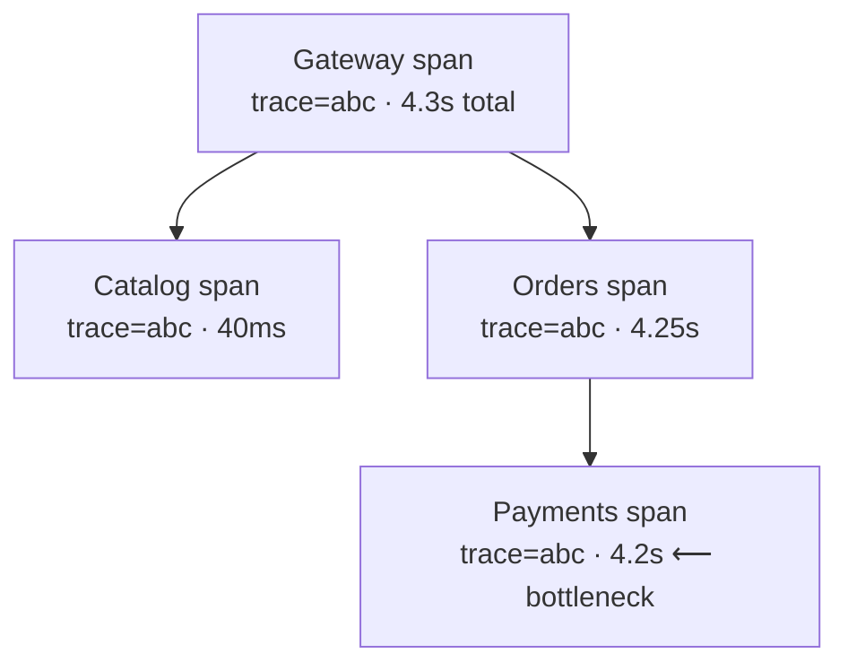

::part[Pelajari Konsepnya]{n="1"}

## 🎯 Yang akan kamu pelajari

- Kenapa log biasa tidak bisa bekerja kalau request melalui **beberapa service**
- Apa itu **trace**, **span**, dan **trace id**
- Cara satu trace id yang sama membiarkan kamu ikuti **satu request** di seluruh sistem
- Cara trace menunjukkan **di mana** waktu hilang (service mana yang paling lambat)
- Apa yang harus kamu catat di span supaya trace benar-benar berguna

## 🔤 Istilah penting

| Istilah | Artinya (sederhana) |
|---|---|
| **Trace** | Perjalanan satu request melintasi semua service |
| **Span** | Satu langkah perjalanan itu (satu potongan kerja di satu service) |
| **Trace id** | Satu id yang sama dipakai oleh setiap span dari request yang sama |
| **Parent span** | Span yang memanggil span ini (hubungan siapa memanggil siapa) |
| **Latency** | Berapa lama satu langkah memakan waktu |
| **Bottleneck** | Langkah paling lambat, yang menahan semuanya |
| **Observability** | Kemampuan untuk melihat apa yang sedang dilakukan sistem kamu |

## 🧠 Ide besarnya

Distributed tracing itu seperti **sistem pelacakan paket di kurir**. Saat kamu kirim paket, ia dapat nomor pelacakan, dan setiap pergantian tangan — kantor pos lokal, truk, pusat sortir, ojek pengantar — scan nomor itu. Nanti kamu buka halaman pelacakan dan lihat **seluruh perjalanan**, dengan waktu di setiap tempat, jadi kamu tahu pasti di mana paket itu berada.

Request melalui service-mu bekerja sama. Ia dapat satu **trace id** di pintu masuk. Setiap service yang dilakuinya mencatat **span**-nya sendiri (bagian perjalanannya) yang ditandai dengan trace id yang sama. Kalau kamu kumpulkan semua span dengan id yang sama, kamu dapat cerita lengkapnya: service mana yang terlibat, dalam urutan apa, dan berapa lama masing-masing.

## ❓ Kenapa ini penting

Di monolith, kalau request lambat kamu baca satu file log dari awal sampai akhir dan lihat seluruh request. Kalau request melalui beberapa service, ini rusak sepenuhnya:

- Setiap service punya log **sendiri**. Cerita satu request sekarang tersebar di lima file.
- Kalau banyak beban, ribuan request bercampur di setiap log. Baris mana yang milik request **kamu** yang lambat? Tanpa id yang sama, kamu tidak tahu.
- "Checkout lambat" — tapi *service mana* yang lambat? Catalog? Orders? Payments? Jaringan di antara mereka? Log biasa tidak bisa jawab; kamu tinggal nebak.

Trace jawab langsung. Karena setiap span membawa trace id yang sama, alat tracing-mu (seperti **Jaeger** atau **Langfuse** untuk aplikasi LLM) jahit mereka jadi satu timeline — waterfall yang menunjukkan setiap service sebagai bar. Satu pandangan langsung menunjukkan bar raksasa: "Payments pakai 4,2 detik, sisanya hanya 40 milidetik." Sekarang kamu tahu pasti di mana lihat, bukan menambah print statement di lima codebase dan berharap. Tracing ubah "itu lambat di suatu tempat" jadi "itu lambat *di sini*" — perbedaan antara benerin dalam sepuluh menit dan habiskan sehari.

## 📖 Langkah demi langkah

### 1. Trace, span, trace id

- **Trace** adalah perjalanan request yang keseluruhan.
- **Span** adalah satu bagian kerja di dalamnya — biasanya satu service yang menangani request, atau satu panggilan database. Span mencatat: apa itu, kapan mulai, berapa lama, dan **parent**-nya (siapa yang panggil).
- **Trace id** adalah nomor pelacakan bersama yang ditandai di setiap span dari request yang sama.



Trace id `abc` yang sama di setiap span → alat bisa buat pohon ini. Bar Payments yang panjang adalah bottleneck, jelas terlihat sekilas.

### 2. Meneruskan trace id

Keajaiban adalah trace id **ikut request**. Kalau gateway panggil Orders, ia taruh trace id di header (standar W3C itu `traceparent`). Kalau Orders panggil Payments, ia terus pindahkan header yang sama. Jadi setiap service, tanpa perlu koordinasi, tandai kerjanya dengan id yang sama.

```python
# Very simplified idea of what a tracing library does for you automatically.
incoming_trace_id = request.headers.get("traceparent")  # arrived with the request
# ... do this service's work, record a span with incoming_trace_id ...
# when calling the next service, pass it on:
requests.post(payments_url, headers={"traceparent": incoming_trace_id})
```

Di dunia nyata library (OpenTelemetry) kerjakan plumbing ini untuk kamu — kamu tidak perlu copy-paste header tangan. Tapi itulah triknya: **satu id, diteruskan, di setiap lompatan.**

### 3. Baca trace untuk cari bottleneck

Tampilan trace adalah **waterfall**: waktu jalan kiri ke kanan, setiap span adalah bar, child span duduk di bawah parent. Untuk cari kenapa request lambat, cari **bar terpanjang** dan apakah child-nya jelaskan:

- Bar raksasa dengan child kecil → kerja service itu sendiri lambat (query lambat, pihak ketiga lambat).
- Bar parent panjang hanya karena satu child panjang → masalah lebih dalam; ikuti terus.
- Banyak bar kecil berturut-turut → mungkin terlalu banyak panggilan (service banyak bicara), bukan satu langkah lambat.

### 4. Apa yang taruh di span

Span kosong (hanya durasi) lebih baik dari tidak ada, tapi span berguna juga catat **attribute**: route HTTP, status code, order id, apakah ada error. Lalu kamu bisa tanya pertanyaan nyata — "tunjukkan trace di mana checkout gagal" — bukan hanya menatap durasi. Jangan taruh secret atau data personal lengkap di span; ini telemetri yang banyak orang bisa lihat.

### 5. Di mana ia cocok dengan log dan metric

Ketiga ini bekerja bersama (tiga "pilar observability"):

| Alat | Jawab | Contoh |
|---|---|---|
| **Metric** | Ada yang salah, seberapa banyak? | "error rate naik ke 5%" |
| **Trace** | *Di mana* dalam request ada yang salah/lambat? | "Payments span itu 4,2s" |
| **Log** | Detail pasti di titik itu | "Midtrans kirim 503 jam 14:02" |

Metric tahu *bahwa* ada kebakaran; trace tahu *ruangan mana*; log tahu *apa yang terbakar*. Kamu akan pelajari metric lebih dalam di Week 7.

### Pilih setup-mu

- ✅ Sistem apa saja di mana request melalui lebih dari satu service → tracing bayar sendiri waktu pertama ada yang lambat.
- ✅ Aplikasi LLM: trace setiap langkah (retrieval, prompt, model call) untuk lihat cost dan latency — Langfuse lakukan ini.
- 🚫 Monolith kecil tunggal → log bagus dengan request id mungkin cukup untuk sekarang; tambah tracing saat kamu pisah.
- 🚫 Jangan hand-roll propagasi trace — pakai OpenTelemetry jadi standar dan otomatis.

## ⚠️ Kesalahan umum

- Andalkan log terpisah per-service dan coba sejajarkan timestamp dengan mata — tidak mungkin saat banyak beban.
- Jangan **teruskan trace id** di panggilan internal, jadi setiap service mulai trace baru yang terpisah.
- Catat span tanpa attribute, jadi kamu lihat durasi tapi tidak bisa tahu *request mana* atau *kenapa*.
- Taruh **secret atau data personal** di span — telemetri terlihat luas.
- Trace semuanya di full volume selamanya — sistem traffic tinggi **sample** (simpan sebagian) untuk kontrol cost.

## 🏆 Praktik terbaik

- [ ] Beri setiap request **satu trace id** di pintu depan dan teruskan di setiap lompatan.
- [ ] Pakai **OpenTelemetry** jadi propagasi dan pencatatan span otomatis dan standar.
- [ ] Taruh **attribute** berguna di span (route, status, id) — jangan pernah secret atau data personal.
- [ ] Baca trace sebagai **waterfall**: cari bar terpanjang, lalu ikuti child-nya.
- [ ] Gabung metric (ada yang salah?), trace (di mana?), dan log (apa tepatnya?).

:::revoshop
1. **Ikuti satu checkout.** Trace checkout RevoShop di kepala kamu: request → auth → muat cart → cek stok → buat order → panggil Midtrans. Kalau lambat, bagaimana kamu tahu *langkah mana* yang lambat dari log-mu hari ini?
2. **Tambah request id.** RevoShop sudah lakukan structured logging (Module 2 W6). Apakah setiap baris log untuk satu request punya id yang bisa kamu grep? Request id itu benih trace id — ide yang sama di skala monolith.
3. **Nebak bottleneck.** Untuk toko online sungguhan, langkah mana paling mungkin jadi perlahan, dan kenapa — query database-mu, atau panggilan ke payment provider eksternal?
4. **Beri nama attribute.** Untuk span "panggil Midtrans", daftar tiga attribute layak catat (misalnya status code, order id, durasi), dan satu hal kamu **harus tidak** catat.
:::

::part[Jelaskan & Rancang]{n="2"}

## 🗣️ Jelaskan

Teman kerja bilang "checkout lambat, aku tambah print statement ke semua lima service". Jelaskan, pakai analogi pelacakan paket, bagaimana satu trace id dan tampilan trace cari langkah lambat lebih cepat — dan kenapa sejajarkan log terpisah berdasar timestamp tidak bekerja saat banyak beban.

## 📐 Rancang

Rancang trace untuk checkout RevoShop melintasi gateway, Orders, Catalog, dan Payments. Daftar span dan link parent-child mereka, bilang bagaimana trace id berpindah antar service, beri nama tiga attribute yang kamu catat, dan jelaskan tampilan waterfall kalau Payments jadi bottleneck.

:::quiz
Lihat contoh jawaban

Span: `gateway` (root) → `orders` (child) → `catalog: check stock` dan `payments: charge` (child dari orders). Gateway buat trace id dan teruskan di header `traceparent`; Orders teruskan header yang sama ke Catalog dan Payments, jadi semua empat span punya satu trace id. Attribute layak catat: route HTTP, status code, order id (dan di span payments, response code provider dan durasi). Jangan catat detail kartu atau token auth. Kalau Payments bottleneck, waterfall tampilkan bar `catalog` kecil dan bar `payments` raksasa isi hampir seluruh lebar di bawah `orders` — langkah lambat jelas tanpa ubah kode apa pun.
:::

### 📝 Checklist review mandiri

- [ ] Setiap span punya satu trace id yang diteruskan antar service
- [ ] Span punya attribute berguna, jangan secret
- [ ] Aku bisa tunjuk bottleneck dengan cari bar terpanjang

::ai-review{task="design"}

::part[Latihan Kecil]{n="3"}

:::exercise{path="exercises/m5/w5/05-trace-bottleneck" ai="no-ai" title="Cari bottleneck di trace"}
Diberikan span-span dari satu trace, tulis `slowest_step(spans)` untuk cari satu span paling lambat dan `time_by_service(spans)` untuk jumlahkan waktu tiap service habiskan — dua pertanyaan yang tampilan trace jawab sekilas.
:::

:::hints
- Untuk `slowest_step`, lacak `duration_ms` maksimal saat kamu loop; kalau seri, simpan **yang pertama** dilihat (jangan ganti saat sama).
- Untuk `time_by_service`, pakai dict dan tambah setiap `duration_ms` span ke `totals[span.service]`.
- `defaultdict(int)` atau `dict.get(service, 0)` sama-sama bekerja untuk jumlah yang berjalan.
:::

## ✅ Cek cepat

:::quiz
Kenapa kamu tidak bisa hanya baca log service terpisah dan sejajarkan berdasar timestamp untuk debug satu request lambat?

Saat banyak beban, ribuan request bercampur di log tiap service, jadi kamu tidak bisa tahu baris mana dari request satu kamu — dan jam di mesin berbeda tidak persis sejalan. Satu trace id sama mengikat persis span satu request, jadi alat bisa bangun lagi perjalanan satu itu tidak peduli sistem seberapa sibuk.
:::

:::quiz
Trace checkout tampilkan span Payments 4,2 detik dan span di mana-mana lainnya 40 milidetik. Kamu lihat ke mana, dan apa itu aturkan habis?

Kamu lihat ke langkah Payments — itu bottleneck. Span kecil di tempat lain aturkan habis database, Catalog, dan jaringan antara lompatan cepat. Tanpa ubah kode apa pun, trace tunjuk lurus ke panggilan payment provider.
:::

## 📚 Lanjut belajar

- [OpenTelemetry: Traces](https://opentelemetry.io/docs/concepts/signals/traces/)
- [W3C Trace Context (traceparent header)](https://www.w3.org/TR/trace-context/)
- [Jaeger: distributed tracing](https://www.jaegertracing.io/docs/latest/)
