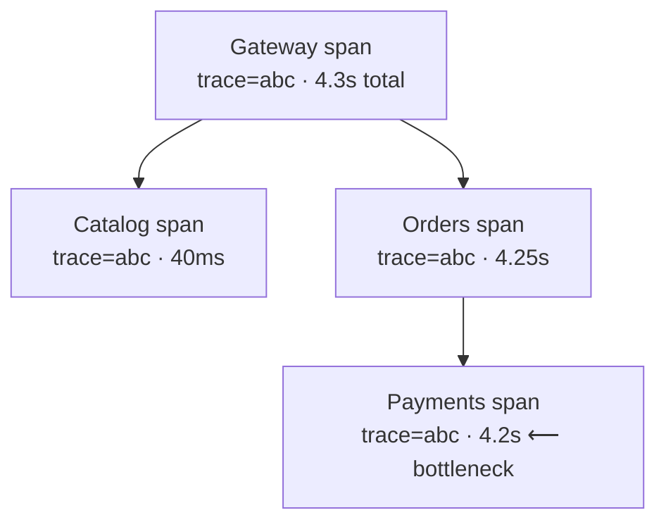

::part[Learn the Concept]{n="1"}

## 🎯 What you'll learn

- Why plain logs fall apart once a request crosses **several services**
- What a **trace**, a **span** and a **trace id** are
- How one shared trace id lets you follow **one request** across the whole system
- How a trace shows you **where** the time went (which service is the bottleneck)
- What to record on a span so a trace is actually useful

## 🔤 Key words

| Word | In simple words | Bahasa Indonesia |
|---|---|---|
| **Trace** | The whole journey of one request across all services | Perjalanan satu permintaan |
| **Span** | One step of that journey (one service's piece of work) | Satu langkah kerja |
| **Trace id** | One id shared by every span of the same request | Penanda satu permintaan |
| **Parent span** | The span that caused this one (who called whom) | Langkah yang memanggil |
| **Latency** | How long a step took | Lama waktu |
| **Bottleneck** | The slowest step, the one holding everything up | Titik paling lambat |
| **Observability** | Being able to see what your system is doing | Kemampuan mengamati |

## 🧠 The big idea

Distributed tracing is **package tracking for a request**. When you post a parcel, it gets a tracking number, and every hand-off — the local post office, the truck, the sorting center, the delivery rider — scans that same number. Later you open the tracking page and see the **whole journey**, with a timestamp at each stop, so you can tell exactly where the parcel is sitting.

A request through your services works the same way. It gets one **trace id** at the front door. Every service it touches records its own **span** (its leg of the trip) stamped with that same trace id. Put all the spans with the same id together and you get the full story: which services were involved, in what order, and how long each one took.

## ❓ Why it matters

In a monolith, when a request is slow you read one log file, top to bottom, and see the whole request. Once the request crosses several services, that breaks completely:

- Each service has its **own** log. The story of one request is now scattered across five files.
- Under load, thousands of requests interleave in each log. Which lines belong to **your** slow request? Without a shared id, you can't tell.
- "The checkout is slow" — but *which* service is slow? Catalog? Orders? Payments? The network between them? Plain logs can't answer; you're guessing.

A trace answers it directly. Because every span carries the same trace id, your tracing tool (like **Jaeger** or **Langfuse** for LLM apps) stitches them into one timeline — a waterfall showing each service as a bar. One glance shows the giant bar: "Payments took 4.2 seconds, everything else was 40 milliseconds." Now you know exactly where to look, instead of adding print statements across five codebases and hoping. Tracing turns "it's slow somewhere" into "it's slow *here*" — which is the difference between fixing it in ten minutes and losing a day.

## 📖 Step by step

### 1. Trace, span, trace id

- A **trace** is the whole request's journey.
- A **span** is one piece of work inside it — usually one service handling the request, or one database call. A span records: what it was, when it started, how long it took, and its **parent** (who called it).
- The **trace id** is the shared tracking number stamped on every span of the same request.



Same trace id `abc` on every span → the tool can draw this tree. The long Payments bar is the bottleneck, obvious at a glance.

### 2. Passing the trace id along

The magic is that the trace id **travels with the request**. When the gateway calls Orders, it puts the trace id in a header (the standard is W3C `traceparent`). When Orders calls Payments, it passes the same header on. So every service, without coordinating, tags its work with the same id.

```python
# Very simplified idea of what a tracing library does for you automatically.
incoming_trace_id = request.headers.get("traceparent")  # arrived with the request
# ... do this service's work, record a span with incoming_trace_id ...
# when calling the next service, pass it on:
requests.post(payments_url, headers={"traceparent": incoming_trace_id})
```

In real life a library (OpenTelemetry) does this plumbing for you — you don't hand-copy headers. But that's the whole trick: **one id, passed along, on every hop.**

### 3. Reading a trace to find the bottleneck

A trace view is a **waterfall**: time runs left to right, each span is a bar, child spans sit under their parent. To find why a request was slow, look for the **longest bar** and whether its children explain it:

- One giant bar with tiny children → *that* service's own work is slow (a slow query, a slow third party).
- A parent bar that's long only because one child is long → the problem is deeper down; follow it.
- Lots of small bars back-to-back → maybe too many calls (the service is chatty), not one slow step.

### 4. What to put on a span

A bare span (just a duration) is better than nothing, but a useful span also records **attributes**: the HTTP route, the status code, the order id, whether it was an error. Then you can ask real questions — "show me traces where checkout failed" — instead of only staring at durations. Never put secrets or full personal data on a span; it's telemetry many people can see.

### 5. Where it fits with logs and metrics

These three work together (the "three pillars of observability"):

| Tool | Answers | Example |
|---|---|---|
| **Metrics** | Is something wrong, and how much? | "error rate jumped to 5%" |
| **Traces** | *Where* in the request is it wrong/slow? | "Payments span is 4.2s" |
| **Logs** | The exact detail at that point | "Midtrans returned 503 at 14:02" |

Metrics tell you *that* there's a fire; the trace tells you *which room*; the log tells you *what's burning*. You'll go deeper on metrics and alarms in Week 7.

### Choosing your setup

- ✅ Any system where a request crosses more than one service → tracing pays for itself the first time something is slow.
- ✅ LLM apps: trace each step (retrieval, prompt, model call) to see cost and latency — Langfuse does this.
- 🚫 A single small monolith → good logs with a request id may be enough for now; add tracing when you split.
- 🚫 Don't hand-roll trace propagation — use OpenTelemetry so it's standard and automatic.

## ⚠️ Common mistakes

- Relying on separate per-service logs and trying to line up timestamps by eye — hopeless under load.
- Not **passing the trace id along** on internal calls, so each service starts a fresh, disconnected trace.
- Recording spans with no attributes, so you can see durations but can't tell *which* request or *why*.
- Putting **secrets or personal data** on spans — telemetry is widely visible.
- Tracing everything at full volume forever — high-traffic systems **sample** (keep a fraction) to control cost.

## 🏆 Best practices

- [ ] Give every request **one trace id** at the front door and pass it on every hop.
- [ ] Use **OpenTelemetry** so propagation and span recording are automatic and standard.
- [ ] Put useful **attributes** on spans (route, status, ids) — never secrets or personal data.
- [ ] Read traces as a **waterfall**: find the longest bar, then follow its children.
- [ ] Combine metrics (is it wrong?), traces (where?) and logs (what exactly?).

:::revoshop
1. **Follow one checkout.** Trace a RevoShop checkout in your head: request → auth → load cart → check stock → create order → call Midtrans. If it's slow, how would you tell *which* step is slow from today's logs alone?
2. **Add a request id.** RevoShop already does structured logging (Module 2 W6). Does every log line for one request share an id you could grep? That request id is the seed of a trace id — it's the same idea at monolith scale.
3. **Guess the bottleneck.** For a real online store, which step is most likely the slow one, and why — your database query, or the call to the external payment provider?
4. **Name the attributes.** For the "call Midtrans" span, list three attributes worth recording (e.g. status code, order id, duration) and one thing you must **never** record.
:::

::part[Explain & Design]{n="2"}

## 🗣️ Explain it

A teammate says "checkout is slow, I'll add print statements to all five services". Explain, using the package-tracking analogy, how one trace id and a trace view would find the slow step faster — and why lining up separate logs by timestamp doesn't work under load.

## 📐 Design it

Design the trace for a RevoShop checkout across a gateway, Orders, Catalog and Payments. List the spans and their parent-child links, say how the trace id travels between services, name three attributes you'd record, and describe how the waterfall would look if Payments were the bottleneck.

:::quiz
Show a possible answer

Spans: `gateway` (root) → `orders` (child) → `catalog: check stock` and `payments: charge` (children of orders). The gateway mints the trace id and passes it in the `traceparent` header; Orders passes the same header to Catalog and Payments, so all four spans share one trace id. Attributes worth recording: HTTP route, status code, order id (and on the payments span, the provider's response code and duration). Never record the card details or the auth token. If Payments is the bottleneck, the waterfall shows a tiny `catalog` bar and a huge `payments` bar filling almost the whole width under `orders` — the slow step is obvious without touching any code.
:::

### 📝 Self-review checklist

- [ ] Every span shares one trace id passed between services
- [ ] Spans have useful attributes, no secrets
- [ ] I can point to the bottleneck by finding the longest bar

::ai-review{task="design"}

::part[Toy Exercise]{n="3"}

:::exercise{path="exercises/m5/w5/05-trace-bottleneck" ai="no-ai" title="Find the bottleneck in a trace"}
Given the spans of one trace, write `slowest_step(spans)` to find the single slowest span and `time_by_service(spans)` to total the time each service spent — the two questions a trace view answers at a glance.
:::

:::hints
- For `slowest_step`, track the max `duration_ms` as you loop; on a tie, keep the **first** one seen (don't replace on equal).
- For `time_by_service`, use a dict and add each span's `duration_ms` to `totals[span.service]`.
- A `defaultdict(int)` or `dict.get(service, 0)` both work for the running totals.
:::

## ✅ Quick check

:::quiz
Why can't you just read the separate service logs and line them up by timestamp to debug one slow request?

Under load, thousands of requests interleave in each service's log, so you can't tell which lines belong to your one request — and clocks between machines don't line up perfectly. A shared trace id ties exactly the spans of one request together, so the tool can rebuild that single journey no matter how busy the system is.
:::

:::quiz
A checkout trace shows a 4.2-second Payments span and 40-millisecond spans everywhere else. Where do you look, and what does that rule out?

You look at the Payments step — it's the bottleneck. The tiny spans elsewhere rule out the database, Catalog and the network between the fast hops. Without changing any code, the trace pointed you straight at the payment provider call.
:::

## 📚 Keep learning

- [OpenTelemetry: Traces](https://opentelemetry.io/docs/concepts/signals/traces/)
- [W3C Trace Context (traceparent header)](https://www.w3.org/TR/trace-context/)
- [Jaeger: distributed tracing](https://www.jaegertracing.io/docs/latest/)
