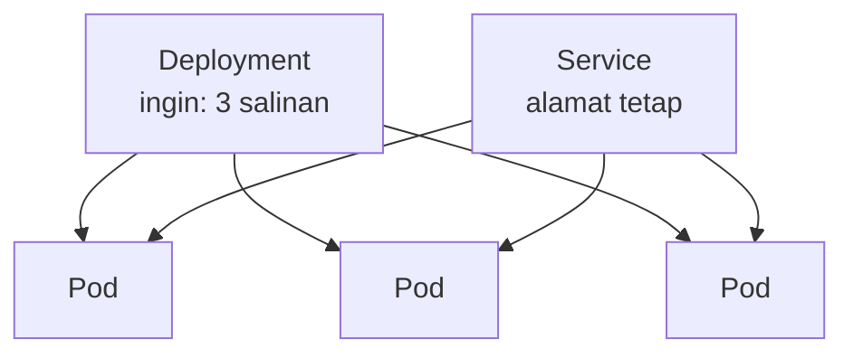

::part[Pelajari Konsepnya]{n="1"}

## 🎯 Yang akan kamu pelajari

- Masalah apa yang diselesaikan **orchestrator** saat kamu sudah punya banyak container
- Perbedaan antara mengatakan komputer **bagaimana** vs mendeskripsikan **apa** yang kamu inginkan (imperative vs declarative)
- Bagian inti Kubernetes: **pod**, **deployment**, **service**
- Ide yang menjalankan semuanya: **control loop** (desired state vs actual state)
- Kenapa "self-healing" dan "scaling" muncul dari satu ide itu saja, tanpa usaha ekstra

## 🔤 Istilah penting

| Istilah | Artinya (sederhana) |
|---|---|
| **Orchestrator** | Perangkat lunak yang menjalankan dan mengelola banyak container untukmu |
| **Kubernetes (K8s)** | Orchestrator paling umum dipakai |
| **Pod** | Unit terkecil yang dijalankan K8s: satu (atau beberapa) container bersamaan |
| **Deployment** | Aturan: "jaga N salinan pod ini tetap berjalan" |
| **Service** | Alamat tetap di depan pod yang datang dan pergi |
| **Desired state** | Keadaan yang kamu katakan ingin kamu miliki |
| **Control loop** | Pemeriksaan terus-menerus: jadikan actual sesuai desired |

## 🧠 Ide besarnya

Kubernetes itu seperti **manajer restoran untuk container-mu**. Kamu tidak bilang manajer "jalan ke dapur, cari juru masak, tempatkan tamu itu." Kamu bilang **keadaan akhir yang diinginkan**: "Aku ingin tiga pelayan di lantai setiap saat." Manajer kemudian mengawasi lantai terus-menerus. Seorang pelayan pulang sakit? Manajer lihat dua tersisa dan panggil satu lagi. Pelanggan banyak datang? Kamu bilang "jadi lima," dan manajer tambah staf. Kamu deskripsikan *hasil yang kamu inginkan*; manajer terus membuatnya nyata.

Itulah seluruh inti Kubernetes. Kamu serahkan padanya rencana tertulis — "jalankan 3 salinan RevoShop, dapat dijangkau di alamat ini" — dan ia bekerja tanpa henti untuk menjaga kenyataan sesuai rencana, tidak peduli apa yang rusak.

## ❓ Kenapa ini penting

Di Minggu 5 kamu belajar memisahkan jadi layanan. Tapi bayangkan menjalankannya untuk sungguhan: lima layanan, masing-masing butuh beberapa salinan untuk keandalan, tersebar di beberapa mesin. Dengan tangan, kamu harus:

- putuskan container mana berjalan di mesin mana (dan seimbangkan ulang saat satu penuh),
- jalankan ulang container apa pun yang crash — jam 3 pagi, tiap kali,
- ganti setiap container di mesin yang mati, pindahkan ke tempat lain,
- luncurkan versi baru tanpa putus permintaan, dan batalkan jika buruk,
- beri setiap kelompok salinan satu alamat tetap, meskipun salinan individual datang dan pergi.

Mengerjakan semua itu dengan manual di lusinan container adalah pekerjaan penuh waktu yang tidak bisa dilakukan siapa pun dengan andal. **Orchestrator** melakukannya otomatis. Kamu deskripsikan apa yang diinginkan *sekali*, dan Kubernetes menangani penempatan, restart, scaling, peluncuran dan jaringan — terus-menerus, tanpa kamu mengawasi.

Tangkapannya: Kubernetes **kuat tapi berat**. Ia punya kurva pembelajaran nyata dan banyak bagian yang bergerak. Untuk aplikasi kecil, satu container di satu server (apa yang kamu lakukan di Minggu 4) atau layanan terkelola sering kali cukup. Kubernetes pantas dengan kompleksitasnya saat kamu sungguh-sungguh punya banyak layanan dan membutuhkannya untuk pulih dan berkembang sendiri. Tahu *kapan tidak* menjangkaunya sama pentingnya dengan tahu cara kerjanya — materi ini tentang memahaminya, bukan mengadopsinya untuk RevoShop.

## 📖 Langkah demi langkah

### 1. Imperative vs declarative — mentalitas kunci

| | Imperative ("bagaimana") | Declarative ("apa") |
|---|---|---|
| Kamu bilang | "mulai container, lalu satu lagi, sekarang jalankan ulang yang mati" | "Aku ingin 3 berjalan, selalu" |
| Siapa mengerjakan langkahnya | kamu, tiap kali | Kubernetes, terus-menerus |
| Setelah crash | kamu harus perhatikan dan bertindak | ia pulih sendiri otomatis |

Perintah Docker yang kamu jalankan dengan tangan adalah imperative — tiap perintah adalah satu langkah yang kamu picu. Kubernetes adalah **declarative**: kamu tulis keadaan akhir yang diinginkan di file YAML, serahkan, dan K8s mencari tahu langkah untuk mencapai dan *jaga* itu. Ini bedanya memberi arahan berkendara giliran demi giliran versus bilang sopir tujuannya dan biarkan ia tangani lalu lintas.

### 2. Bagian yang akan kamu temui pertama kali

- **Pod** — hal terkecil yang dijalankan Kubernetes. Biasanya **satu container** (aplikasimu) ditambah mungkin satu pembantu kecil. Pod **dapat dibuang**: dibuat dan dihancurkan bebas, seperti cangkir kertas, bukan dicuci dan dipakai ulang seperti mug. Kamu jarang kelola pod langsung.
- **Deployment** — aturan yang bilang "jaga **3** salinan pod ini berjalan, pakai image ini." Ini yang kamu tulis. Ia buat pod dan ganti apa pun yang mati.
- **Service** — **alamat tetap** di depan sekumpulan pod. Pod datang dan pergi dengan IP internal yang berubah; Service beri mereka satu nama tetap sehingga aplikasi lain bisa jangkau "API RevoShop" tanpa tahu pod mana yang ada sekarang. (Ini pekerjaan yang sama yang dilakukan load balancer di track Arsitektur.)



### 3. Control loop (mesinnya)

Semuanya berjalan di satu ide sederhana diulang selamanya:

```text
loop selamanya:
    desired = apa yang kamu minta        # contoh: 3 pod
    actual  = apa yang sungguh berjalan  # contoh: 2 pod (satu crash)
    jika actual != desired:
        ambil satu langkah untuk perbaiki # mulai 1 pod
```

Kubernetes terus-menerus bandingkan **desired state** (rencanamu) dengan **actual state** (kenyataan) dan ambil langkah kecil untuk tutup celahnya. Loop tunggal itu tempat semua keajaiban berasal:

- **Self-healing:** pod crash → actual turun ke 2 → loop mulai yang baru → kembali ke 3. Kamu tidak berbuat apa pun.
- **Scaling:** kamu ubah desired dari 3 ke 10 → loop mulai 7 lagi.
- **Rollout:** kamu ubah image → loop perlahan ganti pod lama dengan yang baru, jaga hitungan tetap sehingga pengguna tidak terputus.
- **Mesin mati:** pod-nya hilang → actual turun → loop jadwalkan ulang ke mesin sehat.

### 4. Apa yang Kubernetes *bukan*

- Bukan tombol "buat aplikasiku cepat" ajaib — ia jalankan dan kelola container; aplikasimu tetap harus bagus.
- Bukan diperlukan untuk aplikasi kecil — satu server atau platform terkelola lebih sederhana dan sering kali cukup.
- Bukan sesuatu yang kamu jalankan pod demi pod — kamu tulis keadaan yang diinginkan dan biarkan loop bekerja.

### Pilih setup kamu

- ✅ Banyak layanan, butuh pulih sendiri, scaling dan rollout otomatis di beberapa mesin → orchestrator pantas.
- ✅ Tim yang sudah tahu Kubernetes dan sudah menjalankannya.
- 🚫 Satu aplikasi kecil, satu server, satu pengelola (RevoShop hari ini) → satu container atau layanan terkelola lebih sederhana; jangan tambah Kubernetes untuk dirinya sendiri.
- 🚫 "Perusahaan besar pakai ini" — salin alat mereka tanpa masalah mereka hanya beli kompleksitas mereka.

## ⚠️ Kesalahan umum

- Ambil Kubernetes di hari pertama untuk aplikasi kecil, lalu tenggelam di YAML bukannya bangun produk.
- Pikir **imperative** langkah demi langkah ("mulai pod ini") bukannya state **declarative** ("aku ingin 3") — melawan alat.
- Perlakukan pod sebagai hewan peliharaan untuk tetap hidup, bukannya salinan yang dapat dibuang yang loop ganti.
- Bicara ke pod individual lewat IP mereka yang berubah bukannya lewat **Service** tetap.
- Harap Kubernetes perbaiki aplikasi yang tidak andal — ia jalankan ulang crash, tidak cegah bug.

## 🏆 Praktik terbaik

- [ ] Deskripsikan **desired state** secara declarative; biarkan control loop capai itu.
- [ ] Ambil orchestrator hanya saat kamu sungguh-sungguh punya banyak layanan untuk jalankan dan pulih.
- [ ] Perlakukan pod sebagai **dapat dibuang**; jangan simpan data penting hanya di satu.
- [ ] Jangkau service lewat alamat **Service** tetap, bukan IP pod individual.
- [ ] Jaga aplikasi sehat sendiri (health check, shutdown terhormat) — loop bekerja terbaik dengan aplikasi berperilaku baik.

:::revoshop
1. **Hitung salinannya.** RevoShop berjalan sebagai satu container hari ini. Untuk bertahan satu mesin mati, berapa banyak salinan yang kamu inginkan, dan masalah baru apa yang muncul (petunjuk: counter rate-limit Redis-mu dan state in-memory apa pun)?
2. **Desired state di kertas.** Tulis desired state RevoShop dalam kata-kata: berapa banyak salinan API, image apa, alamat tetap apa. Paragraf itu adalah apa yang Deployment + Service encode.
3. **Cek self-healing.** Jika container RevoShop crash jam 3 pagi hari ini, apa yang terjadi? Apa yang terjadi di bawah orchestrator? Siapa bangun di setiap kasus?
4. **Panggilan jujur.** Untuk toko pengelola-tunggal, apakah Kubernetes pantas kompleksitasnya sekarang, atau server tunggal Minggu 4 / platform terkelola cocok lebih baik? Bilang kenapa.
:::

::part[Jelaskan & Rancang]{n="2"}

## 🗣️ Jelaskan

Jelaskan ke rekan kerja perbedaan antara imperative ("mulai container, jalankan ulang saat crash") dan declarative ("jaga 3 berjalan") pakai analogi manajer restoran — dan kenapa declarative adalah apa yang membuat self-healing dan scaling otomatis.

## 📐 Rancang

Di kertas, deskripsikan desired state untuk layanan kecil (katakanlah, API RevoShop): berapa banyak salinan pod, image apa, dan alamat tetap di depannya. Lalu jalan melalui apa yang control loop lakukan di tiga situasi: satu pod crash, kamu ubah desired dari 3 ke 6, dan seluruh mesin mati.

:::quiz
Lihat jawaban mungkin

Desired: Deployment **3** pod menjalankan `revoshop-api:v1.4`, di belakang Service bernama `revoshop-api` (satu alamat tetap). Perilaku control loop: (1) pod crash → actual = 2 → loop mulai satu pod baru → kembali ke 3, tidak perlu manusia; (2) desired ubah ke 6 → loop mulai 3 pod lagi dan Service sekarang seimbangkan di semua 6; (3) mesin mati → pod di atasnya hilang → actual turun → loop jadwalkan ulang ke mesin sehat dan pulih hitungannya. Di ketiga kasus, kamu hanya pernah ubah (atau tulis) desired state; loop yang kerjakan langkahnya.
:::

### 📝 Checklist review mandiri

- [ ] Aku deskripsikan *apa* (desired state), bukan *bagaimana*
- [ ] Service beri satu alamat tetap di atas pod yang berubah
- [ ] Aku jalan melalui control loop untuk crash, scale, dan mesin-mati

::ai-review{task="design"}

::part[Latihan Kecil]{n="3"}

:::exercise{path="exercises/m5/w6/01-reconcile" ai="no-ai" title="Tulis control loop Kubernetes"}
Tulis `reconcile(desired, actual)`, satu ide di balik Kubernetes: bandingkan berapa banyak salinan yang *kamu inginkan* dengan berapa banyak yang *berjalan*, dan kembalikan langkah untuk tutup celahnya — mulai pod yang hilang, hentikan yang ekstra.
:::

:::hints
- Jika `actual < desired`, kamu perlu **mulai** `desired - actual` pod.
- Jika `actual > desired`, kamu perlu **hentikan** `actual - desired` pod.
- Jika sama, kembalikan hasil "sudah sesuai" — tidak ada langkah.
:::

## ✅ Cek cepat

:::quiz
Kubernetes disebut "declarative". Apa arti itu, dan kenapa self-healing terjadi darinya gratis?

Declarative berarti kamu deskripsikan keadaan akhir yang diinginkan ("3 salinan berjalan"), bukan langkah untuk sampai ke sana. Kubernetes jalankan control loop yang terus-menerus bandingkan desired vs actual dan ambil langkah untuk tutup celah apa pun. Jadi saat pod crash, actual turun di bawah desired dan loop yang sama cukup mulai pengganti — self-healing bukan fitur terpisah, ini loop yang kerjakan tugasnya yang normal.
:::

:::quiz
Kenapa bicara ke Service bukannya langsung ke IP pod?

Pod dapat dibuang — dibuat dan dihancurkan terus-menerus, masing-masing dengan IP pendek berbeda. Service adalah nama tetap di depan pod apa pun yang ada sekarang, sehingga pemanggil jangkau "API" tanpa peduli pod mana yang hidup sekarang atau IP mereka apa.
:::

## 📚 Lanjut belajar

- [Kubernetes: What is Kubernetes?](https://kubernetes.io/docs/concepts/overview/)
- [Kubernetes: Pods](https://kubernetes.io/docs/concepts/workloads/pods/)
- [Kubernetes: Deployments](https://kubernetes.io/docs/concepts/workloads/controllers/deployment/)
