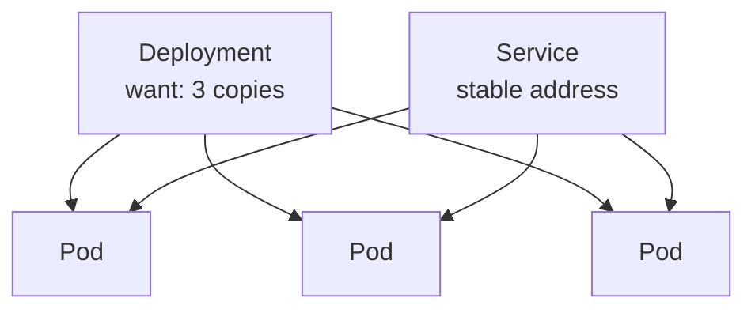

::part[Learn the Concept]{n="1"}

## 🎯 What you'll learn

- What problem an **orchestrator** solves once you have many containers
- The difference between telling a computer **how** vs describing **what** you want (imperative vs declarative)
- The core Kubernetes pieces: **pod**, **deployment**, **service**
- The idea that runs it all: the **control loop** (desired state vs actual state)
- Why "self-healing" and "scaling" fall out of that one idea for free

## 🔤 Key words

| Word | In simple words | Bahasa Indonesia |
|---|---|---|
| **Orchestrator** | Software that runs and manages many containers for you | Pengatur banyak kontainer |
| **Kubernetes (K8s)** | The most common orchestrator | Orkestrator paling umum |
| **Pod** | The smallest unit K8s runs: one (or a few) containers together | Unit terkecil |
| **Deployment** | A rule: "keep N copies of this pod running" | Aturan jumlah salinan |
| **Service** | A stable address in front of pods that come and go | Alamat tetap |
| **Desired state** | What you told K8s you want | Keadaan yang diinginkan |
| **Control loop** | The constant check: make actual match desired | Loop penyesuai |

## 🧠 The big idea

Kubernetes is a **restaurant manager for your containers**. You don't tell the manager "walk to the kitchen, hire a cook, seat that guest." You tell them the **end state**: "I want three waiters on the floor at all times." The manager then watches the floor constantly. A waiter goes home sick? The manager notices two are left and calls in one more. A rush comes? You say "make it five," and the manager staffs up. You describe the *result you want*; the manager keeps making it true.

That's the whole heart of Kubernetes. You hand it a written plan — "run 3 copies of RevoShop, reachable at this address" — and it works tirelessly to keep reality matching the plan, no matter what breaks.

## ❓ Why it matters

In Week 5 you learned to split into services. But now imagine running them for real: five services, each needing several copies for reliability, spread across several machines. By hand, you'd have to:

- decide which container runs on which machine (and rebalance when one fills up),
- restart any container that crashes — at 3 a.m., every time,
- replace every container on a machine that dies, moving them elsewhere,
- roll out a new version without dropping requests, and roll back if it's bad,
- give each group of copies one stable address, even as individual copies come and go.

Doing all that manually across a dozen containers is a full-time job nobody can do reliably. An **orchestrator** does it automatically. You describe what you want *once*, and Kubernetes handles placement, restarts, scaling, rollouts and networking — continuously, without you watching.

The catch: Kubernetes is **powerful but heavy**. It has a real learning curve and a lot of moving parts. For a small app, a single container on a server (what you did in Week 4) or a managed service is often plenty. Kubernetes earns its complexity when you genuinely have many services and need them to heal and scale on their own. Knowing *when not* to reach for it is as important as knowing how it works — this lesson is about understanding it, not adopting it for RevoShop.

## 📖 Step by step

### 1. Imperative vs declarative — the key mindset

| | Imperative ("how") | Declarative ("what") |
|---|---|---|
| You say | "start a container, then another, now restart the dead one" | "I want 3 running, always" |
| Who does the steps | you, every time | Kubernetes, continuously |
| After a crash | you must notice and act | it self-heals automatically |

Docker commands you ran by hand are imperative — each command is one step you trigger. Kubernetes is **declarative**: you write down the desired end state in a YAML file, hand it over, and K8s figures out the steps to reach and *keep* it. It's the difference between giving driving directions turn by turn versus telling a driver the destination and letting them handle traffic.

### 2. The pieces you'll meet first

- **Pod** — the smallest thing Kubernetes runs. Usually **one container** (your app) plus maybe a tiny helper. Pods are **disposable**: they're created and destroyed freely, like paper cups, not washed and reused like mugs. You rarely manage pods directly.
- **Deployment** — the rule that says "keep **3** copies of this pod running, using this image." This is what you actually write. It creates the pods and replaces any that die.
- **Service** — a **stable address** in front of a set of pods. Pods come and go with changing internal IPs; the Service gives them one steady name so other apps can reach "the RevoShop API" without knowing which pods exist right now. (It's the same job the load balancer did in your Architecture track.)



### 3. The control loop (the engine)

Everything runs on one simple idea repeated forever:

```text
loop forever:
    desired = what you asked for      # e.g. 3 pods
    actual  = what is really running  # e.g. 2 pods (one crashed)
    if actual != desired:
        take a step to fix it          # start 1 pod
```

Kubernetes constantly compares **desired state** (your plan) with **actual state** (reality) and takes small steps to close the gap. That single loop is where all the magic comes from:

- **Self-healing:** a pod crashes → actual drops to 2 → the loop starts a new one → back to 3. You did nothing.
- **Scaling:** you change desired from 3 to 10 → the loop starts 7 more.
- **Rollout:** you change the image → the loop gradually replaces old pods with new ones, keeping the count steady so users aren't dropped.
- **Machine dies:** its pods vanish → actual drops → the loop reschedules them onto healthy machines.

### 4. What Kubernetes is *not*

- Not a magic "make my app fast" button — it runs and manages containers; your app still has to be good.
- Not required for small apps — a single server or a managed platform is simpler and often enough.
- Not something you hand-run pod by pod — you write the desired state and let the loop work.

### Choosing your setup

- ✅ Many services, needing automatic healing, scaling and rollouts across several machines → an orchestrator earns its keep.
- ✅ A team that already knows Kubernetes and has it running.
- 🚫 One small app, one server, one maintainer (RevoShop today) → a single container or a managed service is simpler; don't add Kubernetes for its own sake.
- 🚫 "It's what big companies use" — copying their tools without their problems just buys their complexity.

## ⚠️ Common mistakes

- Reaching for Kubernetes on day one for a small app, then drowning in YAML instead of building the product.
- Thinking in **imperative** steps ("start this pod") instead of **declarative** state ("I want 3") — fighting the tool.
- Treating pods as pets to keep alive, instead of disposable copies the loop replaces.
- Talking to individual pods by their changing IP instead of through the stable **Service**.
- Expecting Kubernetes to fix an app that isn't reliable — it restarts crashes, it doesn't prevent bugs.

## 🏆 Best practices

- [ ] Describe the **desired state** declaratively; let the control loop reach it.
- [ ] Reach for an orchestrator only when you truly have many services to run and heal.
- [ ] Treat pods as **disposable**; never store important data only inside one.
- [ ] Reach services through a stable **Service** address, not individual pod IPs.
- [ ] Keep apps healthy on their own (health checks, graceful shutdown) — the loop works best with well-behaved apps.

:::revoshop
1. **Count the copies.** RevoShop runs as one container today. To survive one machine dying, how many copies would you want, and what new problem appears (hint: your Redis rate-limit counter and any in-memory state)?
2. **Desired state on paper.** Write RevoShop's desired state in words: how many API copies, which image, what stable address. That paragraph is what a Deployment + Service encode.
3. **Self-healing check.** If a RevoShop container crashes at 3 a.m. today, what happens? What would happen under an orchestrator? Who gets woken up in each case?
4. **The honest call.** For a single-maintainer shop, is Kubernetes worth its complexity right now, or is Week 4's single server / a managed platform the better fit? Say why.
:::

::part[Explain & Design]{n="2"}

## 🗣️ Explain it

Explain to a teammate the difference between imperative ("start a container, restart it when it dies") and declarative ("keep 3 running") using the restaurant-manager analogy — and why declarative is what makes self-healing and scaling automatic.

## 📐 Design it

On paper, describe the desired state for a small service (say, RevoShop's API): how many pod copies, which image, and the stable address in front of them. Then walk through what the control loop does in three situations: one pod crashes, you change desired from 3 to 6, and a whole machine dies.

:::quiz
Show a possible answer

Desired: a Deployment of **3** pods running `revoshop-api:v1.4`, behind a Service named `revoshop-api` (one stable address). Control loop behaviour: (1) a pod crashes → actual = 2 → the loop starts one new pod → back to 3, no human needed; (2) desired changed to 6 → the loop starts 3 more pods and the Service now balances across all 6; (3) a machine dies → the pods on it disappear → actual drops → the loop reschedules them onto healthy machines and restores the count. In all three, you only ever changed (or wrote) the desired state; the loop did the steps.
:::

### 📝 Self-review checklist

- [ ] I described the *what* (desired state), not the *how*
- [ ] The Service gives one stable address over changing pods
- [ ] I traced the control loop for crash, scale, and machine-death

::ai-review{task="design"}

::part[Toy Exercise]{n="3"}

:::exercise{path="exercises/m5/w6/01-reconcile" ai="no-ai" title="Write Kubernetes' control loop"}
Write `reconcile(desired, actual)`, the one idea behind Kubernetes: compare how many copies you *want* with how many are *running*, and return the steps to close the gap — start missing pods, stop extra ones.
:::

:::hints
- If `actual < desired`, you need to **start** `desired - actual` pods.
- If `actual > desired`, you need to **stop** `actual - desired` pods.
- If they're equal, return the "already matches" result — no steps.
:::

## ✅ Quick check

:::quiz
Kubernetes is called "declarative". What does that mean, and why does self-healing come from it for free?

Declarative means you describe the end state you want ("3 copies running"), not the steps to get there. Kubernetes runs a control loop that constantly compares desired vs actual and takes steps to close any gap. So when a pod crashes, actual drops below desired and the same loop simply starts a replacement — self-healing isn't a separate feature, it's just the loop doing its normal job.
:::

:::quiz
Why talk to a Service instead of a pod's IP address directly?

Pods are disposable — they're created and destroyed constantly, each with a different, short-lived IP. A Service is a stable name in front of whatever pods currently exist, so callers reach "the API" without caring which pods are alive right now or what their IPs are.
:::

## 📚 Keep learning

- [Kubernetes: What is Kubernetes?](https://kubernetes.io/docs/concepts/overview/)
- [Kubernetes: Pods](https://kubernetes.io/docs/concepts/workloads/pods/)
- [Kubernetes: Deployments](https://kubernetes.io/docs/concepts/workloads/controllers/deployment/)
