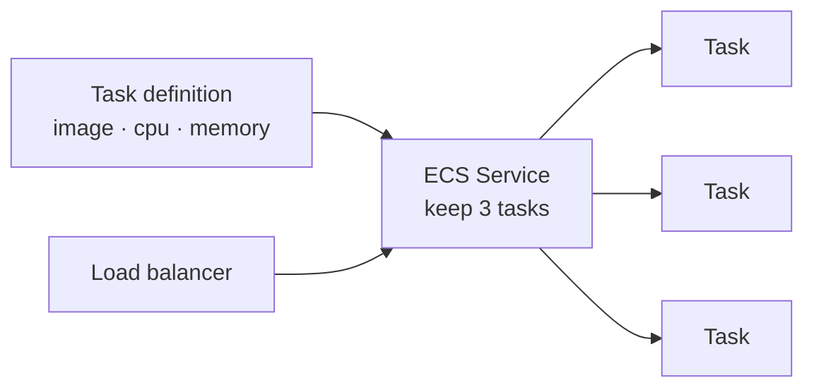

::part[Pelajari Konsepnya]{n="1"}

## 🎯 Yang akan kamu pelajari

- Tiga cara utama menjalankan kontainer di AWS: **ECS**, **Fargate**, **EKS**
- Apa itu "**kontainer tanpa server**" (Fargate) dan kenapa menghilangkan banyak pekerjaan
- Cara memilih berdasarkan **berapa banyak yang ingin kamu kelola**
- Kenapa "pakai yang paling sederhana yang bisa selesaikan masalah" lebih baik daripada "pakai Kubernetes"
- Di mana RevoShop cocok ditempatkan

## 🔤 Istilah penting

| Istilah | Artinya (sederhana) |
|---|---|
| **ECS** | Orkestrator kontainer milik Amazon (lebih sederhana daripada Kubernetes) |
| **Fargate** | Menjalankan kontainer **tanpa server** yang perlu kamu kelola |
| **EKS** | **Kubernetes** terkelola di AWS |
| **Task** | Kata ECS untuk satu kontainer berjalan (atau sekelompok kecil) |
| **Task definition** | Resepnya: image, CPU, memori, variabel lingkungan |
| **Control plane** | "Kepala" pengatur Kubernetes |
| **Serverless** | Kamu tidak perlu melihat atau mengelola mesinnya |

## 🧠 Ide besarnya

Bayangkan **menyewa tempat memasak, dengan jumlah bantuan yang berbeda**:

- **EC2 (Minggu 4):** kamu menyewa dapur kosong. Kamu beli peralatan, nyalakan kompor, bersihkan, perbaiki yang rusak. Kontrol penuh, pekerjaan paling banyak.
- **ECS di Fargate:** kamu cukup kasih resep dan bahan-bahanmu; staff dan dapur muncul saat dibutuhkan, memasak, lalu pergi. Kamu **tidak pernah lihat dapurnya**. Pekerjaan paling sedikit.
- **EKS (Kubernetes):** kamu dapat dapur profesional lengkap dengan tata letak standar yang dikenal setiap chef di dunia (Kubernetes), dan AWS jaga bangunannya — tapi kamu masih jalankan dapurnya.

Keahliannya bukan "pakai dapur paling canggih." Itu memilih setup **paling sedikit** yang menghasilkan makanan — karena setiap hal ekstra yang kamu urus adalah waktu yang tidak dihabiskan untuk produk.

## ❓ Kenapa ini penting

Materi lalu kamu belajar konsep Kubernetes. Pemikiran wajar berikutnya: "jadi aku harus jalankan RevoShop di Kubernetes." Biasanya — tidak. Menjalankan Kubernetes sungguhan sendiri berarti urus **control plane**, upgrade, networking, patch keamanan: pekerjaan serius yang berkelanjutan. Untuk kebanyakan app itu seperti membeli dapur industri hanya untuk membuat roti.

AWS kasih kamu **tangga** pilihan, dan langkah cerdas adalah naik hanya setinggi yang perlu:

- Kalau kamu hanya mau kontainermu berjalan andal dan scale, **ECS di Fargate** lakukannya dengan hampir tanpa pekerjaan operasi — tanpa server untuk patch, tanpa cluster untuk diawasi. Di sini kebanyakan tim mulai, dan di sini RevoShop cocok.
- Kalau kamu khusus butuh Kubernetes — karena timmu sudah tahu, kamu mau tata letak *yang sama* di berbagai cloud, atau kamu butuh ekosistem besar tools-nya — **EKS** kasih kamu Kubernetes terkelola sehingga minimal AWS urus bagian tersulit (control plane) untuk kamu.
- **EC2 biasa** (Minggu 4) bagus untuk satu kontainer sederhana, tapi kamu kembali urus mesinnya sendiri.

Memilih dengan baik menyelamatkan kamu dari kesalahan cloud paling umum: ambil tools berat untuk masalah yang tidak ada, terus habiskan hidup urus tools alih-alih kirim fitur. "Membosankan dan terkelola" menang daripada "canggih dan urus tangan" untuk hampir semua orang.

## 📖 Langkah demi langkah

### 1. Tangga, berdasarkan berapa banyak kamu urus

| Pilihan | Kamu urus | AWS urus | Bagus saat |
|---|---|---|---|
| **EC2** | mesin **dan** kontainer | hardware | satu kontainer sederhana; kamu mau kontrol penuh (Minggu 4) |
| **ECS di Fargate** | cuma resep kontainer | mesin **dan** penempatan | kamu mau "cukup jalan" dengan operasi minimal |
| **ECS di EC2** | mesin; ECS tempatkan kontainer | hardware | kamu butuh mesin spesifik tapi mau penempatan ECS |
| **EKS (Fargate atau EC2)** | workload Kubernetes | K8s control plane | kamu khusus butuh Kubernetes |

Baca dari atas ke bawah sebagai "berapa banyak ini pakai hidupku?" — Fargate adalah titik manis untuk kebanyakan: kamu beri task definition, AWS cari compute, jalankan, scale, ganti yang crash.

### 2. ECS dalam satu gambar

ECS pakai kata sederhana: **task definition** itu resepnya (image, CPU, memori, env, secret), **task** itu satu salinan berjalan, dan **service** jaga N task berjalan di belakang load balancer — ide yang sama "jaga N salinan hidup" seperti Kubernetes Deployment, tapi kata-katanya lebih sederhana.

Di **Fargate**, kamu tidak pilih atau lihat server apa pun — AWS jalankan setiap task di kapasitas yang diurusnya, dan kamu bayar untuk CPU dan memori tiap task pakai saat berjalan.

### 3. Kapan Kubernetes (EKS) benar-benar tepat

EKS adalah pilihan tepat saat jawab "apa kita khusus butuh *Kubernetes*?" adalah ya sungguhan:

- Timmu sudah jalankan Kubernetes dan tahu dengan baik.
- Kamu mau setup deploy **yang sama** di AWS, cloud lain, dan local kind (portabilitas).
- Kamu butuh tools dari ekosistem Kubernetes besar (Helm, operator, controller spesifik).

Kalau tidak ada satupun benar, EKS cuma kompleksitas ekstra — pilih ECS/Fargate.

### 4. Jawaban RevoShop

RevoShop adalah satu app kecil dengan satu pengelola. Itu **tidak** butuh Kubernetes. Di AWS itu berjalan senang sebagai **service ECS di Fargate**: build image (Minggu 1), push, tulis task definition, dan biarkan ECS jaga beberapa salinan hidup di belakang load balancer — dengan RDS dan Redis terkelola pegang data. Tanpa cluster untuk dioperasi, tanpa patch jam 3 pagi. Itu "hal paling sederhana yang selesaikan masalah," dan itu pilihan engineering yang benar, bukan kompromi.

### Memilih setup-mu

- ✅ Kebanyakan app, tim kecil, "cukup jalankan kontainerku" → **ECS di Fargate**.
- ✅ Kamu benar-benar butuh Kubernetes (keahlian, portabilitas, ekosistem) → **EKS**.
- ✅ Satu kontainer sederhana, kontrol penuh diinginkan → **EC2** (Minggu 4).
- 🚫 Ambil EKS karena "Kubernetes adalah standar" tanpa kebutuhan sungguhan → kamu akan urus cluster alih-alih bangun produk.

## ⚠️ Kesalahan umum

- Ambil **EKS/Kubernetes** untuk app kecil yang ECS/Fargate bisa jalankan dengan fraksi pekerjaan.
- Pikir Fargate adalah "ajaib dan gratis" — ia hapus *server untuk diurus*, bukan *biaya*; kamu tetap bayar per CPU/memory-detik, dan itu harus diukur dan diawasi.
- Bingung ECS (AWS-only, sederhana) dengan EKS (Kubernetes, portabel) — mereka selesaikan tugas yang sama dengan kompleksitas berbeda.
- Pilih platform sebelum tanya "berapa banyak aku mau operasi?" — pertanyaan itu harus dorong keputusan.

## 🏆 Praktik terbaik

- [ ] Mulai dari **bawah tangga** dan naik cuma saat punya alasan konkrit.
- [ ] Lebih suka **Fargate** sehingga tidak ada server untuk patch atau scale manual.
- [ ] Pilih **EKS** cuma saat kamu khusus butuh Kubernetes (keahlian, portabilitas, ekosistem).
- [ ] Jaga data di layanan terkelola (RDS, Redis terkelola), bukan di dalam task/pod yang bisa dibuang.
- [ ] Ukur task (CPU/memori) dengan sengaja dan awasi biaya — serverless masih tagih.

:::revoshop
1. **Tempatkan RevoShop.** Mengingat RevoShop adalah satu app dengan satu pengelola, rung mana di tangga yang cocok — EC2, ECS/Fargate, atau EKS? Tulis satu kalimat *kenapa*.
2. **Sketsa task definition.** Daftar apa yang task definition ECS RevoShop pegang: image, CPU, memori, variabel lingkungan, dan tempat secret berasal (hint: Parameter Store / Secrets Manager Minggu 3).
3. **Uji Kubernetes.** Lewati tiga pertanyaan "apa kamu benar-benar butuh Kubernetes?" untuk RevoShop. Berapa yang ya? Apa itu bilang padamu?
4. **Realitas biaya.** Fargate punya "tidak ada server untuk diurus." Itu berarti gratis? Apa yang benar-benar kamu bayar, dan apa yang terjadi tagihan kalau jalankan 10 task ukuran besar?
:::

::part[Jelaskan & Rancang]{n="2"}

## 🗣️ Jelaskan

Rekan kerja bilang "mari jalankan RevoShop di EKS, Kubernetes adalah standar industri." Jelaskan tangganya (EC2 → ECS/Fargate → EKS), apa itu benar-benar biaya *waktu operasi* jalankan EKS, dan kenapa ECS di Fargate adalah pilihan tepat untuk toko satu-orang — pakai analogi "menyewa dapur".

## 📐 Rancang

Rancang bagaimana RevoShop jalankan di kontainer AWS. Pilih rung di tangga dan pembelaannya, sketsa service ECS (berapa task, di belakang apa, data hidup di mana), dan jawab tiga pertanyaan "apa kita butuh Kubernetes?" untuk bertahan *tidak* pakai EKS.

:::quiz
Lihat jawaban mungkin

**Rung: ECS di Fargate.** RevoShop adalah satu app kecil dengan satu pengelola, jadi operasi control plane Kubernetes adalah beban murni. Rancangan: **service** ECS yang jaga 2 task hidup di belakang Application Load Balancer; setiap **task** jalankan image RevoShop dengan CPU/memori ukuran kecil, lingkungan dari Parameter Store dan secret dari Secrets Manager; PostgreSQL di **RDS** dan Redis terkelola pegang semua state (task tetap stateless dan bisa dibuang). Tiga pertanyaan Kubernetes — tim sudah jalankan K8s? butuh portabilitas lintas-cloud? butuh ekosistem K8s? — semuanya **tidak**, jadi EKS akan tambah kompleksitas tanpa manfaat. Fargate berarti tidak ada server untuk patch; trade-nya adalah biaya per-detik yang harus diukur dan diawasi.
:::

### 📝 Checklist review mandiri

- [ ] Aku pilih pilihan paling sederhana yang cocok
- [ ] Data hidup di layanan terkelola, bukan task yang bisa dibuang
- [ ] Aku bisa pertahankan *tidak* pakai Kubernetes dengan tiga pertanyaan

::ai-review{task="design"}

::part[Latihan Kecil]{n="3"}

### 🧠 Putuskan (tanpa kode)

Untuk setiap skenario, pilih **EC2**, **ECS di Fargate**, atau **EKS**, dan tulis satu kalimat kenapa. Terus cek dirimu lawan alasan di materi ini.

1. Developer solo dan proyek sampingan: satu kontainer, mau pekerjaan operasi minimal.
2. Perusahaan 30 engineer sudah jalankan Kubernetes di cloud lain, pindah ke AWS dan mau setup *yang sama*.
3. Pelajar yang mau kontrol penuh satu VM untuk belajar Linux dan Docker dengan tangan.
4. Startup lima layanan kecil, tidak ada pengalaman Kubernetes, cuma mau mereka jalankan dan scale andal.

:::quiz
Lihat jawaban saran

1. **ECS di Fargate** — tidak ada server untuk urus, operasi paling sedikit untuk satu kontainer. (EKS akan berlebihan.)
2. **EKS** — mereka sudah kenal Kubernetes dan mau portabilitas lintas-cloud; K8s terkelola kasih mereka setup yang sama di AWS.
3. **EC2** — tujuannya *adalah* urus mesin tangan; itu belajarnya.
4. **ECS di Fargate** — lima layanan yang "cukup jalankan" tanpa pengalaman K8s; Fargate kasih itu dengan operasi minimal. Mereka bisa pindah ke EKS nanti *kalau* kebutuhan Kubernetes sungguhan muncul.
:::

## ✅ Cek cepat

:::quiz
"Serverless" berarti apa untuk Fargate — dan apa yang *tidak* berarti?

Berarti tidak ada **server untuk kamu urus**: AWS sediain dan jalankan compute, patch, dan scale, jadi kamu cuma kasih task definition. *Tidak* berarti gratis atau mudah — kamu tetap bayar per CPU dan memory-detik task kamu pakai, dan kamu tetap pilih ukuran task dan awasi tagihan.
:::

:::quiz
Timmu tidak punya pengalaman Kubernetes dan cuma mau lima layanan kecil jalankan andal di AWS. ECS/Fargate atau EKS, dan kenapa?

ECS di Fargate. Ia jalankan dan scale kontainermu dengan hampir tanpa pekerjaan operasi dan tanpa cluster untuk dioperasi. EKS hanya bayar saat kamu *khusus* butuh Kubernetes — keahlian ada, portabilitas lintas-cloud, atau ekosistemnya — tidak satupun berlaku di sini. Pilih EKS akan berarti urus control plane alih-alih kirim fitur.
:::

## 📚 Lanjut belajar

- [Amazon ECS: What is ECS?](https://docs.aws.amazon.com/AmazonECS/latest/developerguide/Welcome.html)
- [AWS Fargate](https://docs.aws.amazon.com/AmazonECS/latest/userguide/what-is-fargate.html)
- [Amazon EKS: What is EKS?](https://docs.aws.amazon.com/eks/latest/userguide/what-is-eks.html)
