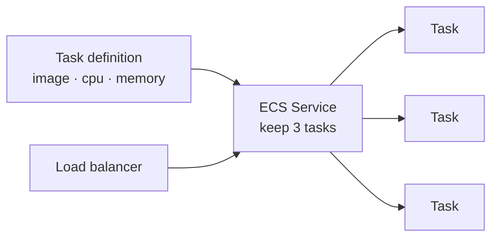

::part[Learn the Concept]{n="1"}

## 🎯 What you'll learn

- The three main ways to run containers on AWS: **ECS**, **Fargate**, **EKS**
- What "**serverless containers**" means (Fargate) and why it removes so much work
- How to choose based on **how much you want to manage**
- Why "use the least powerful thing that solves your problem" beats "use Kubernetes"
- Where RevoShop would fit

## 🔤 Key words

| Word | In simple words | Bahasa Indonesia |
|---|---|---|
| **ECS** | Amazon's own container orchestrator (simpler than Kubernetes) | Orkestrator kontainer AWS |
| **Fargate** | Run containers with **no servers** for you to manage | Kontainer tanpa server |
| **EKS** | Managed **Kubernetes** on AWS | Kubernetes terkelola AWS |
| **Task** | ECS's word for a running container (or a small group) | Kontainer berjalan (ECS) |
| **Task definition** | The recipe: image, CPU, memory, env vars | Resep sebuah task |
| **Control plane** | The "manager" brain of Kubernetes | Otak pengatur K8s |
| **Serverless** | You don't see or manage the machines | Tanpa urus server |

## 🧠 The big idea

Think of it as **renting a place to cook, with different amounts of help**:

- **EC2 (Week 4):** you rent an empty kitchen. You buy the equipment, run the stove, clean up, fix what breaks. Total control, most work.
- **ECS on Fargate:** you just hand over your recipe and your dishes; staff and kitchen appear as needed, cook, and disappear. You **never see the kitchen**. Least work.
- **EKS (Kubernetes):** you get a full professional kitchen with the standard layout every chef in the world knows (Kubernetes), and AWS maintains the building — but you still run the kitchen.

The skill isn't "use the fanciest kitchen." It's picking the **least** setup that gets your food out — because every extra thing you manage is time not spent on the product.

## ❓ Why it matters

Last lesson you learned Kubernetes *concepts*. A natural next thought is "so I should run RevoShop on Kubernetes." Usually — no. Running real Kubernetes yourself means operating the **control plane**, upgrades, networking, security patches: a serious ongoing job. For most apps that's like buying an industrial kitchen to make toast.

AWS gives you a **ladder** of options, and the smart move is to climb only as high as you must:

- If you just want your containers to run reliably and scale, **ECS on Fargate** does it with almost no operations work — no servers to patch, no cluster to babysit. This is where most teams should start, and where RevoShop belongs.
- If you specifically need Kubernetes — because your team already knows it, you want to run the *same* setup across clouds, or you need its huge ecosystem of tools — **EKS** gives you managed Kubernetes so at least AWS runs the hardest part (the control plane) for you.
- **Plain EC2** (Week 4) is fine for one simple container, but you're back to managing the machine yourself.

Choosing well saves you from the most common cloud mistake: adopting heavy tooling for problems you don't have, then spending your life maintaining the tooling instead of shipping features. "Boring and managed" beats "powerful and hand-run" for almost everyone.

## 📖 Step by step

### 1. The ladder, by how much you manage

| Option | You manage | AWS manages | Good when |
|---|---|---|---|
| **EC2** | the machine **and** the containers | the hardware | one simple container; you want full control (Week 4) |
| **ECS on Fargate** | just the container recipe | machines **and** placement | you want it to "just run" with minimal ops |
| **ECS on EC2** | the machines; ECS places containers | the hardware | you need specific machines but want ECS placement |
| **EKS (Fargate or EC2)** | the Kubernetes workloads | the K8s control plane | you specifically need Kubernetes |

Read it top to bottom as "how much of my life is this?" — Fargate is the sweet spot for most: you give a task definition, AWS finds the compute, runs it, scales it, replaces crashes.

### 2. ECS in one picture

ECS uses simple words: a **task definition** is the recipe (image, CPU, memory, env, secrets), a **task** is one running copy, and a **service** keeps N tasks running behind a load balancer — the same "keep N copies alive" idea as a Kubernetes Deployment, with less jargon.

On **Fargate**, you don't pick or see any servers — AWS runs each task on capacity it manages, and you pay for the CPU and memory each task uses while it runs.

### 3. When Kubernetes (EKS) is actually right

EKS is the right call when the answer to "do we specifically need *Kubernetes*?" is a real yes:

- Your team already runs Kubernetes and knows it well.
- You want the **same** deployment setup across AWS, another cloud, and local kind (portability).
- You need tools from the large Kubernetes ecosystem (Helm, operators, specific controllers).

If none of those is true, EKS is just extra complexity — pick ECS/Fargate.

### 4. The RevoShop answer

RevoShop is one small app with one maintainer. It does **not** need Kubernetes. On AWS it would run happily as an **ECS service on Fargate**: build the image (Week 1), push it, write a task definition, and let ECS keep a couple of copies alive behind a load balancer — with RDS and a managed Redis holding the data. No cluster to operate, no 3 a.m. patching. That's the "least powerful thing that solves the problem," and it's the correct engineering choice, not a compromise.

### Choosing your setup

- ✅ Most apps, small teams, "just run my containers" → **ECS on Fargate**.
- ✅ You genuinely need Kubernetes (skills, portability, ecosystem) → **EKS**.
- ✅ One simple container, full control wanted → **EC2** (Week 4).
- 🚫 Reaching for EKS because "Kubernetes is the standard" without a real need → you'll maintain a cluster instead of building your product.

## ⚠️ Common mistakes

- Adopting **EKS/Kubernetes** for a small app that ECS/Fargate would run with a fraction of the work.
- Thinking Fargate is "magic and free" — it removes *servers to manage*, not *cost*; you still pay per CPU/memory-second, and it must be sized and watched.
- Confusing ECS (AWS-only, simple) with EKS (Kubernetes, portable) — they solve the same job at different complexity.
- Choosing the platform before asking "how much do I want to operate?" — that question should drive the decision.

## 🏆 Best practices

- [ ] Start at the **bottom of the ladder** and climb only when you have a concrete reason.
- [ ] Prefer **Fargate** so there are no servers to patch or scale by hand.
- [ ] Pick **EKS** only when you specifically need Kubernetes (skills, portability, ecosystem).
- [ ] Keep data in managed services (RDS, managed Redis), not inside disposable tasks/pods.
- [ ] Size tasks (CPU/memory) deliberately and watch cost — serverless still bills.

:::revoshop
1. **Place RevoShop.** Given RevoShop is one app with one maintainer, which rung of the ladder fits — EC2, ECS/Fargate, or EKS? Write one sentence of *why*.
2. **Task definition sketch.** List what RevoShop's ECS task definition would hold: image, CPU, memory, environment variables, and where secrets come from (hint: Week 3's Parameter Store / Secrets Manager).
3. **The Kubernetes test.** Go through the three "do you actually need Kubernetes?" questions for RevoShop. How many are a yes? What does that tell you?
4. **Cost reality.** Fargate has "no servers to manage." Does that mean it's free? What do you actually pay for, and what happens to the bill if you run 10 oversized tasks?
:::

::part[Explain & Design]{n="2"}

## 🗣️ Explain it

A teammate says "let's run RevoShop on EKS, Kubernetes is the industry standard." Explain the ladder (EC2 → ECS/Fargate → EKS), what running EKS actually costs in *operations time*, and why ECS on Fargate is the right call for a one-person shop — using the "renting a kitchen" analogy.

## 📐 Design it

Design how RevoShop runs on AWS containers. Pick a rung of the ladder and justify it, sketch the ECS service (how many tasks, behind what, where data lives), and answer the three "do we need Kubernetes?" questions to defend *not* using EKS.

:::quiz
Show a possible answer

**Rung: ECS on Fargate.** RevoShop is one small app with one maintainer, so operating a Kubernetes control plane would be pure overhead. Design: an ECS **service** keeping 2 tasks alive behind an Application Load Balancer; each **task** runs the RevoShop image with CPU/memory sized small, environment from Parameter Store and secrets from Secrets Manager; PostgreSQL on **RDS** and a managed Redis hold all state (tasks stay stateless and disposable). The three Kubernetes questions — team already runs K8s? need cross-cloud portability? need the K8s ecosystem? — are all **no**, so EKS would add complexity with no benefit. Fargate means no servers to patch; the trade is per-second cost that must be sized and watched.
:::

### 📝 Self-review checklist

- [ ] I chose the least powerful option that fits
- [ ] Data lives in managed services, not disposable tasks
- [ ] I can defend *not* using Kubernetes with the three questions

::ai-review{task="design"}

::part[Toy Exercise]{n="3"}

### 🧠 Decide it (no code)

For each scenario, pick **EC2**, **ECS on Fargate**, or **EKS**, and write one sentence of why. Then check yourself against the reasoning in this lesson.

1. A solo developer's side project: one container, wants minimal operations work.
2. A 30-engineer company already running Kubernetes on another cloud, moving to AWS and wanting the *same* setup.
3. A student who wants full control of a single VM to learn Linux and Docker by hand.
4. A startup with five small services, no Kubernetes experience, that just wants them to run and scale reliably.

:::quiz
Show suggested answers

1. **ECS on Fargate** — no servers to manage, least operations for one container. (EKS would be overkill.)
2. **EKS** — they already know Kubernetes and want portability across clouds; managed K8s gives them the same setup on AWS.
3. **EC2** — the goal *is* to manage the machine by hand; that's the learning.
4. **ECS on Fargate** — five services that "just need to run" with no K8s experience; Fargate delivers that with minimal ops. They can move to EKS later *if* a real Kubernetes need appears.
:::

## ✅ Quick check

:::quiz
What does "serverless" mean for Fargate — and what does it *not* mean?

It means there are **no servers for you to manage**: AWS provides and runs the compute, patches it, and scales it, so you only hand over a task definition. It does **not** mean free or effortless — you still pay per CPU and memory-second your tasks use, and you still choose task sizes and watch the bill.
:::

:::quiz
Your team has no Kubernetes experience and just wants five small services to run reliably on AWS. ECS/Fargate or EKS, and why?

ECS on Fargate. It runs and scales your containers with almost no operations work and no cluster to operate. EKS only pays off when you *specifically* need Kubernetes — existing skills, cross-cloud portability, or its ecosystem — none of which applies here. Choosing EKS would mean maintaining a control plane instead of shipping features.
:::

## 📚 Keep learning

- [Amazon ECS: What is ECS?](https://docs.aws.amazon.com/AmazonECS/latest/developerguide/Welcome.html)
- [AWS Fargate](https://docs.aws.amazon.com/AmazonECS/latest/userguide/what-is-fargate.html)
- [Amazon EKS: What is EKS?](https://docs.aws.amazon.com/eks/latest/userguide/what-is-eks.html)
