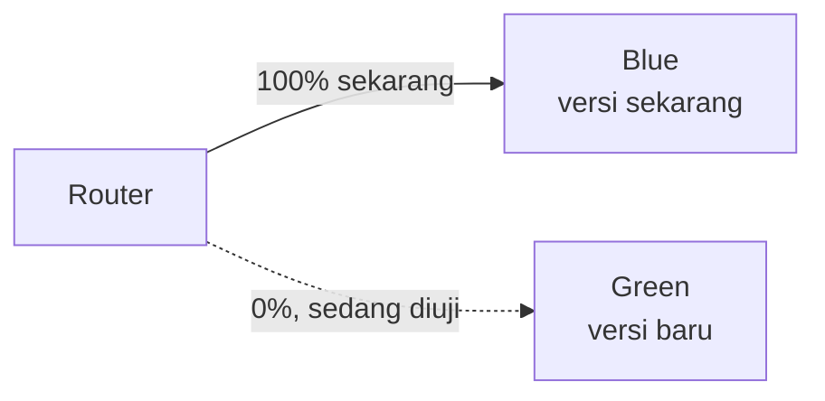
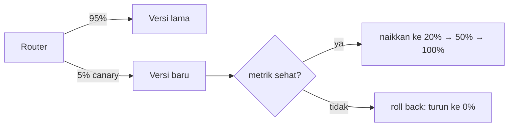

::part[Pelajari Konsepnya]{n="1"}

## 🎯 Yang akan kamu pelajari

- Kenapa merilis versi baru ke **semua orang sekaligus** adalah risiko besar
- **Rollback** — tombol undo, dan apa yang membuat rollback cepat atau lambat
- **Blue/green** — dua salinan, alihkan semua traffic sekaligus, alihkan balik dalam sekejap
- **Canary** — kirim ke beberapa user dulu, naikkan hanya kalau metrik tetap sehat
- Bagaimana keduanya membatasi **dampak** dari rilis yang gagal

## 🔤 Istilah penting

| Istilah | Artinya (sederhana) |
|---|---|
| **Release** | Membuat versi baru hidup untuk user |
| **Rollback** | Kembali ke versi lama |
| **Blast radius** | Berapa banyak user yang terkena dampak rilis gagal |
| **Blue/green** | Dua salinan lengkap; alihkan traffic di antara keduanya |
| **Canary** | Kirim versi baru ke sebagian kecil user dulu |
| **Promote** | Naikkan porsi traffic yang menggunakan canary |

## 🧠 Ide besarnya

Merilis ke semua orang sekaligus adalah **big-bang release**: kalau versi baru rusak, *semua* user rusak di saat yang sama. Strategi yang lebih aman mengurangi risiko dengan dua cara berbeda:

- **Blue/green** adalah punya **dua dapur identik**. "Blue" sedang melayani pelanggan sekarang. Kamu siapkan "green" dengan menu baru lengkap, uji saat tidak ada pelanggan, lalu **alihkan seluruh ruang makan ke green sekaligus**. Kalau masakan green buruk, alihkan semua orang kembali ke blue — dalam sekejap, karena blue masih berdiri.
- **Canary** adalah membiarkan **beberapa pelanggan mencoba resep baru dulu**. Kamu sajikan hidangan baru ke 5% meja dan lihat reaksi mereka. Senang? Sajikan ke 20%, lalu 50%, lalu semua. Tidak senang? Tarik — dan hanya 5% yang pernah mencobanya. (Namanya berasal dari kenari yang dulu dibawa ke tambang batu bara: burung kecil bereaksi pada bahaya *pertama kali*, memperingatkan para penambang.)

Keduanya menang atas big bang karena rilis gagal bisa dibalik dalam sekejap (blue/green) atau hanya menjangkau beberapa orang (canary).

## ❓ Kenapa ini penting

Tidak peduli sebaik apa test-mu, beberapa bug hanya muncul dengan user nyata, data nyata, dan traffic nyata. Jadi pertanyaannya bukan "apakah versi buruk pernah sampai production?" — tapi "kalau sampai, **berapa banyak user yang terdampak, dan seberapa cepat aku bisa undo?**" Angka itu adalah **blast radius**, dan strategi ini tentang menjaganya tetap kecil.

Deploy ke semua orang punya blast radius terburuk: 100% user, semua sekaligus, dan rollback berarti buru-buru redeploy versi lama saat semua orang menderita. Di Minggu 2 kamu belajar fondasi yang membuat rollback cepat *mungkin*: build satu image immutable per commit dan simpan yang lama, jadi "roll back" cuma "jalankan image sebelumnya lagi." Pelajaran ini membangun di atas itu:

- **Blue/green** membuat rollback **sekejap** — versi lama (blue) masih fully running, jadi undo adalah switch traffic, bukan rebuild. Biayanya: kamu sejenak jalankan dua salinan lengkap, dan kamu harus handle database dengan hati-hati (kedua versi bisa pakai database yang sama).
- **Canary** membuat blast radius **kecil sekali** — versi buruk menjangkau 5% sebelum alarm-mu (pelajaran lalu!) menangkap rising error rate dan stop rollout. Biayanya: rilis lebih lambat dan kamu *butuh* metrik bagus untuk judge canary otomatis.

Di sini modul utuh berkumpul: kamu butuh immutable artifact (Minggu 2), cara untuk shift traffic (load balancer / gateway), dan observability (minggu ini) untuk lihat canary. Dapatkan ini dengan benar dan rilis berhenti jadi acara menakutkan yang kamu lakukan jam 2 pagi, jadi jadi acara membosankan, bisa dibalik, non-event di siang hari — yang persis tujuannya.

## 📖 Langkah demi langkah

### 1. Rollback: dasarnya

Rollback = jalankan versi sebelumnya lagi. Cepat **hanya kalau** kamu siap:

- Kamu simpan image immutable lama (Minggu 2) → redeploy dengan digest. ✅
- Database masih bekerja dengan kode lama → karena migrasi-mu **backward compatible** (expand/contract, Minggu 2). ✅
- Kamu sudah **praktik** → jadi itu rutin, bukan panik.

Kalau migrasi tidak bisa diundo, kamu tidak bisa simple roll back — kamu harus **roll forward** (kirim fix). Itulah kenapa backward-compatible migration sangat penting.

### 2. Blue/green: alihkan semua sekaligus

Langkah: green di-deploy dan diuji tanpa traffic nyata → alihkan router jadi 100% pergi ke green → lihat → kalau buruk, alihkan balik ke blue sekejap. Blue tetap running untuk safety net, lalu jadi target untuk rilis *berikutnya*.

- ✅ Rollback instant (blue masih ada); zero downtime saat flip.
- ⚠️ Kamu jalankan dua salinan lengkap sejenak (biaya); database shared, jadi schema change harus cocok untuk **kedua** versi.

### 3. Canary: naikkan hanya kalau sehat

Langkah: kirim slice kecil (misalnya 5%) ke versi baru → **lihat error rate dan latency-nya** (golden signal) → kalau sehat, promote ke 20%, 50%, 100%; kalau metrik jadi lebih buruk, roll back ke 0%. Seluruh judgement bergantung pada observability yang kamu siapkan pelajaran lalu — tanpa metrik, canary cuma slow big bang.

- ✅ Blast radius kecil: versi buruk hanya menjangkau canary share sebelum ketangkap.
- ⚠️ Rilis lebih lambat; butuh metrik solid dan cukup traffic agar slice kecil bermakna.

### 4. Pilih di antara keduanya

| | Blue/green | Canary |
|---|---|---|
| Kecepatan rollback | instant (alihkan balik) | cepat (turun canary ke 0%) |
| Blast radius kalau buruk | semua (setelah flip) sampai kamu balik lagi | hanya canary share |
| Biaya | dua salinan lengkap sejenak | routing complexity sedikit |
| Butuh | traffic switch | metrik bagus + cukup traffic |
| Bagus untuk | fast, clean cut-over dengan undo instant | tangkap bug subtle dengan dampak user minimal |

Banyak tim gabungkan keduanya atau pakai managed rollout features (ECS, Kubernetes dan load balancer support pattern ini). Kamu tidak perlu hand-build plumbing-nya.

### Pilih setupmu

- ✅ Mau undo instant dan bisa jalankan dua salinan sejenak → blue/green.
- ✅ Mau blast radius terkecil dan punya metrik bagus + traffic → canary.
- ✅ Aplikasi low-traffic → blue/green sering lebih sederhana (canary's 5% bisa terlalu sedikit request untuk judge).
- 🚫 Jangan coba canary tanpa metrik — tidak punya cara tahu kalau canary sehat.
- 🚫 Jangan deploy schema change yang break versi yang mungkin kamu roll back.

## ⚠️ Kesalahan umum

- Big-bang deploy ke 100% tanpa cara cepat balik.
- Coba **roll back** setelah migrasi yang tidak bisa diundo — buat migration backward compatible dulu.
- Jalankan **canary tanpa metrik** — tidak tahu kalau sehat, jadi cuma slow full release.
- Lupa **shared database** di blue/green — schema change harus cocok untuk blue dan green.
- Tidak pernah **praktik** rollback, jadi panik saat incident nyata.

## 🏆 Praktik terbaik

- [ ] Simpan image immutable lama dan **backward-compatible migration** jadi rollback cepat dan aman.
- [ ] Pilih **blue/green** untuk undo instant, **canary** untuk blast radius terkecil.
- [ ] Judge canary lewat **metrik** (error rate, latency) — otomasi promote dan rollback.
- [ ] Pastikan schema change cocok untuk **kedua** versi lama dan baru saat rilis.
- [ ] **Praktik** rollback sebelum butuh; buat rilis membosankan.

:::revoshop
1. **Rilis hari ini.** Bagaimana versi RevoShop baru go live sekarang, dan berapa blast radius kalau rusak? Seberapa cepat kamu bisa roll back?
2. **Blue/green atau canary?** RevoShop traffic cukup kecil. Strategi mana yang cocok lebih, dan kenapa 5% canary mungkin susah untuk judge di toko kecil?
3. **Perangkap migrasi.** Kamu mau rename column database dan kirim kode yang pakai nama baru. Kenapa itu buat rollback dangerous, dan bagaimana expand/contract (Minggu 2) perbaiki?
4. **Pasang alarm.** Kalau jalankan canary, metrik apa dari pelajaran lalu yang decide "promote" vs "roll back", dan di threshold berapa?
:::

::part[Jelaskan & Rancang]{n="2"}

## 🗣️ Jelaskan

Jelaskan blue/green dan canary ke teammate pakai analogi dua dapur dan taste-test, dan bilang apa yang setiap satu butuh untuk kerja (blue/green: traffic switch dan schema yang aman untuk shared-DB; canary: metrik bagus dan cukup traffic).

## 📐 Rancang

Rancang proses rilis yang aman untuk RevoShop. Pilih blue/green atau canary (justify untuk toko lebih kecil), deskripsikan bagaimana traffic shift, metrik mana decide sukses, rollback cara kerja, dan bagaimana kamu jaga database aman untuk versi yang mungkin kamu roll back ke.

:::quiz
Lihat contoh jawaban

Untuk toko traffic lebih kecil, **blue/green** cocok lebih bersih: 5% canary mungkin lihat terlalu sedikit request untuk judge reliably. Proses: deploy versi baru sebagai *green* dan smoke-test tanpa traffic nyata; alihkan router 100% ke green; lihat golden signal (5xx rate, p95 latency, checkout success) ~10 menit; kalau alarm menyala, alihkan balik ke *blue*, yang masih running (rollback instant). Simpan *blue* sampai yakin, lalu jadi target rilis berikutnya. Database safety: pakai expand/contract migration jadi schema cocok untuk **kedua** blue dan green — tambah nullable column dan tulis kedua lama dan baru, jadi roll back ke blue tidak pernah kena schema yang tidak bisa pakai. Image lama disimpan lewat digest (Minggu 2), jadi rollback apapun cuma redeploy/flip, bukan rebuild.
:::

### 📝 Checklist review mandiri

- [ ] Ada jalan rollback cepat, sudah dipraktik
- [ ] Database aman untuk versi yang mungkin kamu roll back ke
- [ ] Sukses/rollback decide lewat metrik, bukan perasaan

::ai-review{task="design"}

::part[Latihan Kecil]{n="3"}

:::exercise{path="exercises/m5/w7/04-canary-decision" ai="no-ai" title="Drive rollout canary"}
Tulis `canary_decision(error_rate, threshold, percent)`, logic kontrol dari canary: lihat error rate versi baru dan decide apakah **roll back**, **promote** ke traffic lebih, atau deklarasikan **done** di 100%.
:::

:::hints
- Keamanan dulu: kalau `error_rate > threshold`, return `"rollback"` tidak peduli percent.
- Selain itu, kalau sehat dan sudah 100% (`percent >= 100`), return `"done"`.
- Selain itu sehat tapi belum fully rolled out — return `"promote"`.
:::

## ✅ Cek cepat

:::quiz
Apa "blast radius" dari rilis, dan bagaimana blue/green dan canary setiap satu kurangi dia?

Blast radius adalah berapa banyak user rilis buruk sakiti (dan berapa lama). Blue/green kurangi *durasi*: versi lama masih running, jadi alihkan traffic balik instant daripada rebuild. Canary kurangi *jangkauan*: versi baru pergi ke hanya slice kecil user dulu, jadi kalau buruk, metrik-mu tangkap saat hanya itu slice yang terdampak — lalu turun ke 0%.
:::

:::quiz
Kenapa kamu tidak bisa safely roll back setelah migrasi yang rename column dan hapus yang lama?

Versi app sebelumnya masih expect **old** column name. Sekali kamu rename/hapus dia, roll back ke kode lama itu kena database yang tidak punya apa yang dibutuhkan, jadi break. Backward-compatible (expand/contract) migration hindari ini: kamu tambah column baru, tulis kedua, dan hanya hapus yang lama di rilis *nanti* — jadi versi yang mungkin kamu roll back ke masih bekerja.
:::

## 📚 Lanjut belajar

- [Martin Fowler: BlueGreenDeployment](https://martinfowler.com/bliki/BlueGreenDeployment.html)
- [Martin Fowler: CanaryRelease](https://martinfowler.com/bliki/CanaryRelease.html)
- [AWS: Deployment strategies](https://docs.aws.amazon.com/whitepapers/latest/overview-deployment-options/introduction.html)
