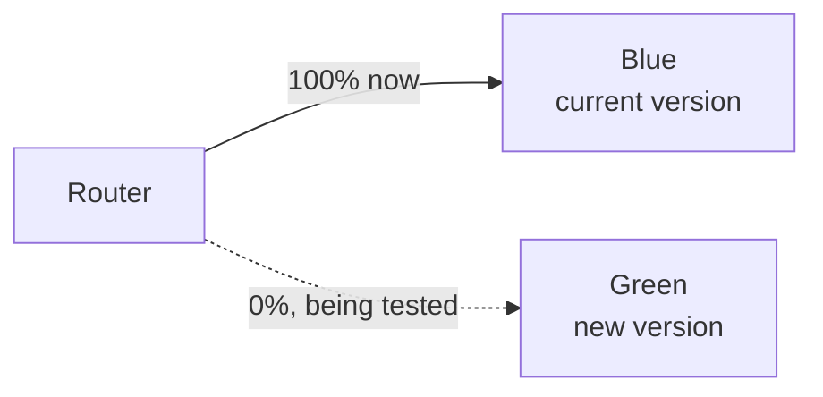
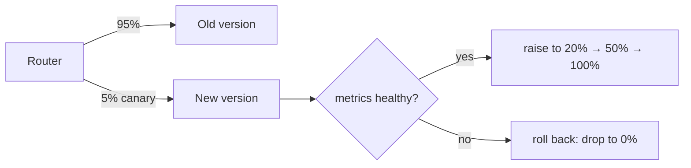

::part[Learn the Concept]{n="1"}

## 🎯 What you'll learn

- Why releasing a new version to **everyone at once** is risky
- **Rollback** — the undo button, and what makes it fast or slow
- **Blue/green** — two copies, flip all traffic at once, flip back instantly
- **Canary** — release to a few users first, grow only if metrics stay healthy
- How these limit the **blast radius** of a bad release

## 🔤 Key words

| Word | In simple words | Bahasa Indonesia |
|---|---|---|
| **Release** | Making a new version live for users | Merilis versi baru |
| **Rollback** | Going back to the previous version | Kembali ke versi lama |
| **Blast radius** | How many users a bad release hurts | Luas dampak |
| **Blue/green** | Two full copies; flip traffic between them | Dua salinan, tukar |
| **Canary** | Send the new version to a small share first | Uji ke sebagian kecil |
| **Promote** | Increase the canary's share of traffic | Naikkan porsinya |

## 🧠 The big idea

Deploying to everyone at once is a **big-bang release**: if the new version is broken, *all* your users are broken at the same moment. The safer strategies shrink that risk in two different ways:

- **Blue/green** is having **two identical kitchens**. "Blue" is serving customers now. You set up "green" with the new menu fully, test it while no customers are there, then **flip the whole dining room to green at once**. If green's food is bad, you flip everyone straight back to blue — instantly, because blue is still standing.
- **Canary** is letting **a few diners try the new recipe first**. You serve the new dish to 5% of tables and watch their reaction. Happy? Serve it to 20%, then 50%, then everyone. Frowns? Pull it — and only 5% ever tasted it. (The name comes from canaries once carried into coal mines: the little bird reacted to danger *first*, warning the miners.)

Both beat the big bang because a bad release either flips back instantly (blue/green) or only ever reaches a few people (canary).

## ❓ Why it matters

No matter how good your tests are, some bugs only show up with real users, real data and real traffic. So the question isn't "will a bad version ever reach production?" — it's "when one does, **how many users does it hurt, and how fast can I undo it?**" That number is the **blast radius**, and these strategies are about keeping it small.

A plain deploy-to-everyone has the worst blast radius: 100% of users, all at once, and rollback means scrambling to redeploy the old version while everyone suffers. In Week 2 you learned the foundation that makes fast rollback *possible*: build one immutable image per commit and keep the old ones, so "roll back" is just "run the previous image again." This lesson builds on that:

- **Blue/green** makes rollback **instant** — the old version (blue) is still fully running, so undoing is a traffic switch, not a rebuild. The cost: you briefly run two full copies, and you must handle the database carefully (both versions may share it).
- **Canary** makes the blast radius **tiny** — a bad version reaches 5% before your alarms (last lesson!) catch the rising error rate and stop the rollout. The cost: releases are slower and you *need* good metrics to judge the canary automatically.

This is where the whole module comes together: you need immutable artifacts (Week 2), a way to shift traffic (load balancers / gateway), and observability (this week) to watch the canary. Get these right and a release stops being a scary event you do at 2 a.m. and becomes a boring, reversible, daytime non-event — which is exactly the goal.

## 📖 Step by step

### 1. Rollback: the foundation

Rollback = run the previous version again. It's fast **only if** you prepared:

- You kept the old immutable image (Week 2) → redeploy it by digest. ✅
- The database still works with the old code → because your migrations are **backward compatible** (expand/contract, Week 2). ✅
- You've **practised** it → so it's routine, not a panic.

If a migration can't be undone, you can't simply roll back — you must **roll forward** (ship a fix). That's why backward-compatible migrations matter so much.

### 2. Blue/green: flip all at once

Steps: green is deployed and tested with no real traffic → flip the router so 100% goes to green → watch → if bad, flip back to blue instantly. Blue stays running for a while as your safety net, then becomes the target for the *next* release.

- ✅ Instant rollback (blue is still there); zero downtime during the flip.
- ⚠️ You run two full copies briefly (cost); the database is shared, so schema changes must suit **both** versions.

### 3. Canary: grow only if healthy

Steps: send a small slice (say 5%) to the new version → **watch its error rate and latency** (the golden signals) → if healthy, promote to 20%, 50%, 100%; if the metrics get worse, roll back to 0%. The whole judgement rests on the observability you set up last lesson — without metrics, a canary is just a slow big bang.

- ✅ Tiny blast radius: a bad version hits only the canary share before it's caught.
- ⚠️ Slower releases; needs solid metrics and enough traffic for the small slice to be meaningful.

### 4. Choosing between them

| | Blue/green | Canary |
|---|---|---|
| Rollback speed | instant (flip back) | fast (drop canary to 0%) |
| Blast radius if bad | everyone (after the flip) until you flip back | only the canary share |
| Cost | two full copies briefly | a bit of routing complexity |
| Needs | a traffic switch | good metrics + enough traffic |
| Great for | fast, clean cut-over with instant undo | catching subtle bugs with minimal user impact |

Many teams combine them or use managed rollout features (ECS, Kubernetes and load balancers support these patterns). You don't have to hand-build the plumbing.

### Choosing your setup

- ✅ Want instant undo and can run two copies briefly → blue/green.
- ✅ Want the smallest blast radius and have good metrics + traffic → canary.
- ✅ Low-traffic app → blue/green is often simpler (canary's 5% may be too few requests to judge).
- 🚫 Don't attempt canary without metrics — you'd have no way to tell if the canary is healthy.
- 🚫 Don't deploy schema changes that break the version you might roll back to.

## ⚠️ Common mistakes

- Big-bang deploys to 100% with no fast way back.
- Trying to **roll back** after an irreversible migration — make migrations backward compatible first.
- Running a **canary with no metrics** — you can't tell if it's healthy, so it's just a slow full release.
- Forgetting the **shared database** in blue/green — a schema change must work for both blue and green.
- Never **practising** rollback, so it's a panic during a real incident.

## 🏆 Best practices

- [ ] Keep old immutable images and **backward-compatible migrations** so rollback is fast and safe.
- [ ] Prefer **blue/green** for instant undo, **canary** for the smallest blast radius.
- [ ] Judge canaries on **metrics** (error rate, latency) — automate promotion and rollback on them.
- [ ] Make sure schema changes suit **both** the old and new version during a release.
- [ ] **Practise** rollback before you need it; make releases boring.

:::revoshop
1. **Today's release.** How does a new RevoShop version go live right now, and what's the blast radius if it's broken? How fast could you roll back?
2. **Blue/green or canary?** RevoShop is fairly low-traffic. Which strategy fits better, and why might a 5% canary be hard to judge on a small store?
3. **The migration trap.** You want to rename a database column and ship code that uses the new name. Why does that make rollback dangerous, and how would expand/contract (Week 2) fix it?
4. **Wire in the alarms.** If you ran a canary, which metrics from last lesson would decide "promote" vs "roll back", and at what thresholds?
:::

::part[Explain & Design]{n="2"}

## 🗣️ Explain it

Explain blue/green and canary to a teammate using the two-kitchens and taste-test analogies, and say what each one needs to work (blue/green: a traffic switch and a shared-DB-safe schema; canary: good metrics and enough traffic).

## 📐 Design it

Design a safe release process for RevoShop. Pick blue/green or canary (justify it for a smaller store), describe how traffic shifts, which metrics decide success, how rollback works, and how you keep the database safe for the version you might roll back to.

:::quiz
Show a possible answer

For a lower-traffic store, **blue/green** is the cleaner fit: a 5% canary might see too few requests to judge reliably. Process: deploy the new version as *green* and smoke-test it with no real traffic; flip the router 100% to green; watch the golden signals (5xx rate, p95 latency, checkout success) for ~10 minutes; if an alarm fires, flip straight back to *blue*, which is still running (instant rollback). Keep *blue* up until you're confident, then it becomes the next release's target. Database safety: use expand/contract migrations so the schema works for **both** blue and green — add a nullable column and write both old and new, so rolling back to blue never hits a schema it can't use. Old images are kept by digest (Week 2), so any rollback is a redeploy/flip, not a rebuild.
:::

### 📝 Self-review checklist

- [ ] There's a fast, practised rollback path
- [ ] The database is safe for the version I might roll back to
- [ ] Success/rollback is decided by metrics, not vibes

::ai-review{task="design"}

::part[Toy Exercise]{n="3"}

:::exercise{path="exercises/m5/w7/04-canary-decision" ai="no-ai" title="Drive a canary rollout"}
Write `canary_decision(error_rate, threshold, percent)`, the control logic of a canary: watch the new version's error rate and decide whether to **roll back**, **promote** it to more traffic, or declare it **done** at 100%.
:::

:::hints
- Safety first: if `error_rate > threshold`, return `"rollback"` no matter the percent.
- Otherwise, if it's healthy and already at 100% (`percent >= 100`), return `"done"`.
- Otherwise it's healthy but not fully rolled out yet — return `"promote"`.
:::

## ✅ Quick check

:::quiz
What is the "blast radius" of a release, and how do blue/green and canary each shrink it?

The blast radius is how many users a bad release hurts (and for how long). Blue/green shrinks the *duration*: the old version is still running, so you flip traffic back instantly instead of rebuilding. Canary shrinks the *reach*: the new version goes to only a small share of users first, so if it's bad, your metrics catch it while it has hurt just that slice — then you drop it to 0%.
:::

:::quiz
Why can't you safely roll back after a migration that renames a column and deletes the old one?

The previous version of the app still expects the **old** column name. Once you've renamed/deleted it, rolling back to that old code hits a database that no longer has what it needs, so it breaks. Backward-compatible (expand/contract) migrations avoid this: you add the new column, write both, and only remove the old one in a *later* release — so the version you might roll back to still works.
:::

## 📚 Keep learning

- [Martin Fowler: BlueGreenDeployment](https://martinfowler.com/bliki/BlueGreenDeployment.html)
- [Martin Fowler: CanaryRelease](https://martinfowler.com/bliki/CanaryRelease.html)
- [AWS: Deployment strategies](https://docs.aws.amazon.com/whitepapers/latest/overview-deployment-options/introduction.html)
