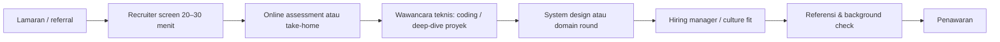

::part[Pelajari Konsepnya]{n="1"}

## 🎯 Yang akan kamu pelajari

- **Tahap-tahap** khas dalam proses hiring teknologi dan apa yang dinilai di masing-masing
- **Recruiter screen**: pitch, motivasi, logistik, dan ekspektasi gaji
- **Tes online** (coding test) dan **take-home assignment** (tugas di rumah)
- Wawancara teknis: deep-dive proyek, live coding, system design, spesifik frontend/backend
- Budaya kerja dan values round, **reference check**, penawaran dan background check
- Cara bertanya yang baik, follow-up, dan belajar dari penolakan

## 🔤 Istilah penting

| Istilah | Artinya (sederhana) |
|---|---|
| **Recruiter screen** | Wawancara singkat di awal tentang kesesuaian, motivasi, dan logistik |
| **Online assessment** | Tes kode otomatis dengan batas waktu |
| **Take-home** | Proyek kecil yang kamu kerjakan di rumahmu sendiri |
| **Deep-dive** | Wawancara tentang proyek yang pernah kamu bangun |
| **Culture round** | Percakapan tentang cara kamu bekerja dengan orang lain |
| **Reference check** | Perusahaan menghubungi orang yang pernah bekerja denganmu |
| **Offer** | Proposal pekerjaan resmi: posisi, gaji, tanggal mulai |
| **Follow-up** | Pesan singkat dan sopan setelah setiap tahap |

## 🧠 Ide besarnya

Proses hiring itu seperti **serangkaian pintu**, masing-masing punya kunci yang berbeda. Pintu recruiter mengecek *kesesuaian dan logistik*, pintu coding mengecek *pemecahan masalah*, pintu proyek mengecek *kedalaman dan kejujuran*, pintu tim mengecek *kolaborasi*. Kalau kamu tahu pintu mana yang sedang dihadapi, kamu bisa membawa kunci yang tepat.

## ❓ Kenapa ini penting

Biasanya calon gagal di tahap yang tidak mereka persiapkan, bukan tahap yang membutuhkan skill mereka yang tidak ada: misalnya menghabiskan waktu dengan soal algoritma untuk round take-home, padahal apa yang sebenarnya perlu adalah pitch dua menit yang bagus di recruiter call.

Tahu urutan pintu-pintunya — dan kunci apa yang pas untuk masing-masing — adalah persiapan termurah yang bisa kamu lakukan.

Untuk **pekerjaan remote di luar**, bersiaplah untuk dua hal ekstra di prosesnya: pertanyaan tentang zona waktu kamu dan cara kamu berkomunikasi tulis, plus celah yang lebih lama antara tahap karena liburan dan perbedaan waktu. Dua hal itu normal; rencanakan follow-up-mu di sekitar mereka daripada mengira itu penolakan.

## 📖 Langkah demi langkah

### 1. Proses yang khas

Startup mungkin mengompresi ini ke 2–3 tahap; perusahaan besar mungkin menambah round lagi. **Tanya recruiter** tentang tahap-tahapnya dan apa yang dicakup setiap tahap — itu normal dan diharapkan.

### 2. Recruiter screen

Siapkan jawaban 90 detik untuk "ceritakan tentang dirimu" dan rentang gaji yang bisa kamu sebutkan tanpa ragu. Dua hal itu menentukan sebagian besar screen.

| Apa yang mereka cek | Siapkan |
|---|---|
| Bisa kamu jelaskan dirimu dan proyekmu dengan singkat? | **pitch 60–90 detik**: siapa kamu → apa yang kamu bangun → apa yang kamu cari |
| Kenapa perusahaan/posisi ini? | 2 alasan spesifik (produk, stack, tim, pertumbuhan) |
| Logistik | tanggal mulai / notice period, lokasi/mode kerja, visa (untuk remote) |
| Ekspektasi gaji | **rentang** yang sudah diteliti (ada pelajaran tentang negosiasi) atau tanya budget mereka dulu |

### 3. Tes online dan take-home

- **Coding assessment** (HackerRank, Codility, dan sejenisnya): soal DSA level mudah–menengah dalam batas waktu. Latih dengan timer; baca semua soal dulu; handle edge case; jangan tinggalkan test yang tidak dijalankan.
- **Take-home assignment**: perlakukan seperti mini proyek production.

| Checklist take-home |
|---|
| Klarifikasi scope dan ekspektasi waktu lewat email sebelum mulai |
| README: cara menjalankan, cara test, keputusan dan trade-off, apa yang akan kamu lakukan kalau punya lebih banyak waktu |
| Test untuk logika inti; linting; commit yang bersih |
| Jangan over-engineer; penuhi requirement dengan baik |
| Catatan jujur tentang penggunaan AI tool kalau diizinkan/diminta |

### 4. Wawancara teknis

- **Project deep-dive**: "jelaskan CareerPilot" — pakai D-T-C (decision, trade-off, change).
- **Live coding**: pelajaran berikutnya.
- **System design (junior level)**: "rancang URL shortener / job board" — pelajaran 05.
- **Domain round**: backend (SQL, API, auth, caching), frontend (React rendering, state, accessibility, performance).

### 5. Culture / hiring manager

Pertanyaan behavioral (pelajaran 03): konflik, kegagalan, feedback, ownership. Juga: cara kamu belajar, kenapa kamu ganti karir, apa yang kamu inginkan dalam 2 tahun.

### 6. Pertanyaan kamu (selalu siapkan 3–5)

Pertanyaan yang baik juga adalah bukti: bertanya cara mereka handle deploy atau code review menunjukkan kamu sudah pikir tentang kerja, bukan hanya tentang dapat diterima.

- "Seperti apa hari pertama 90 junior engineer yang baru di tim?"
- "Bagaimana code review dilakukan? Bagaimana pekerjaan direncanakan — sprint, Kanban?"
- "Tantangan teknis terbesar apa yang sedang dihadapi tim sekarang?"
- "Bagaimana kamu mengukur kesuksesan posisi ini dalam 6 bulan pertama?"
- "Apa yang terjadi dengan junior-junior yang bergabung sebelumnya — bagaimana mereka berkembang?"

### 7. Setelah setiap tahap

- Kirim pesan terima kasih singkat (email/LinkedIn) dalam 24 jam — 3 kalimat.
- Tulis **interview notes** di CareerPilot: pertanyaan yang ditanya, jawaban kamu, apa yang berjalan baik, apa yang perlu diperbaiki.
- Kalau ditolak: minta feedback dengan sopan (mungkin tidak dapat), jaga hubungan, lamar lagi nanti kalau sesuai.

### 8. Penawaran dan check

- **Referensi**: siapkan 2–3 orang (mentor bootcamp, manager sebelumnya) dan beri tahu mereka dulu.
- **Penawaran**: minta tertulis; review tipe kontrak (PKWT fixed-term vs PKWTT permanent), masa coba, gaji (gross), benefit (BPJS, THR, asuransi kesehatan), mode kerja, notice period. Detail di pelajaran tentang negosiasi.

### Memilih setup-mu

Setiap opsi di sini adalah trade-off:

| Tipe assessment | ✅ untuk kamu | ❌ untuk kamu |
|---|---|---|
| Take-home | tunjukkan kebiasaan engineering asli, tidak stress | memakan waktu; pekerjaan tidak dibayar |
| Live coding | cepat, interaktif, bisa dapat hint | stress; kurang realistis |
| Project deep-dive | sesuai kekuatanmu | ketahuan kalau tidak dalam |
| Pair programming | tunjukkan kolaborasi | lingkungan tidak kenal |

## ⚠️ Kesalahan umum

- Mencela employer atau bootcamp lama.
- Tidak cek kamera/mic/screen share sebelum wawancara remote.
- Perlakukan recruiter sebagai gatekeeper yang perlu dilewati — mereka sering advocacy-mu.
- Terima penawaran lisan dan hentikan proses lain sebelum penawaran tertulis.

## 🏆 Praktik terbaik

- [ ] Tanya tentang proses dan apa yang dinilai setiap tahap.
- [ ] Siapkan pitch 60–90 detik, 2 alasan per perusahaan, dan rentang gaji yang sudah diteliti.
- [ ] Perlakukan take-home seperti pekerjaan production dengan README yang bagus.
- [ ] Pakai D-T-C untuk pertanyaan proyek; think out loud di round teknis.
- [ ] Selalu bawa pertanyaan; catat setelah setiap round.
- [ ] Follow-up singkat; bersikap baik dengan penolakan.
- [ ] Minta penawaran tertulis dan baca kontrak sebelum terima.

::part[Jelaskan & Rancang]{n="2"}

## 🗣️ Jelaskan

Jelaskan ide "serangkaian pintu" dan kunci apa yang akan kamu bawa ke recruiter screen vs take-home.

## 📐 Rancang

Tulis pitch 90-detik kamu, jawaban "Kenapa kamu ingin bekerja di sini?" untuk satu perusahaan target, dan 5 pertanyaan yang akan kamu tanyakan ke interviewer.

:::quiz
Lihat struktur pitch

1. **Siapa (10 detik):** "Aku full-stack developer yang fokus di Python dan TypeScript; aku pindah ke software dari [bidang sebelumnya]."
2. **Bukti (40 detik):** "Baru-baru ini aku bangun CareerPilot — Flask API dan Next.js app untuk track job application. Yang paling aku bangga adalah pipeline rule dan test-nya: 113 API acceptance test dan Playwright E2E test di CI. Aku juga bangun RevoShop, e-commerce API dengan payment Midtrans."
3. **Kekuatan (20 detik):** "Aku suka membuat sistem yang reliable — testing, fix performance issue seperti N+1 query yang ubah endpoint dari 21 query jadi 2."
4. **Cari (20 detik):** "Aku cari junior backend atau full-stack role di mana bisa ship fitur asli dengan code review dan mentoring — yang adalah kenapa tim [perusahaan] menarik perhatian aku."
:::

### 📝 Checklist review mandiri

- [ ] Pitch kurang dari 90 detik
- [ ] Jawaban tentang perusahaan spesifik
- [ ] Pertanyaan tunjukkan rasa ingin tahu tentang tim dan pertumbuhan

::ai-review{task="explain"}

::part[Latihan Kecil]{n="3"}

## 🛠️ Lakukan

1. Record pitch kamu di video; tonton; potong filler word; record ulang.
2. Siapkan template repo untuk take-home (bagian README, setup test, config lint).
3. Buat template interview notes di CareerPilot notes.

## ✅ Selesai saat

- [ ] Pitch direcord kurang dari 90 detik
- [ ] Template starter take-home siap
- [ ] Daftar pertanyaan tersimpan

## 📖 Kamus (glosarium)

| Istilah | Bahasa Indonesia |
|---|---|
| Recruiter screen | Wawancara awal dengan rekruter |
| Take-home assignment | Tugas yang dikerjakan di rumah |
| Reference check | Pemeriksaan referensi |
| Offer letter | Surat penawaran kerja |
| Notice period | Masa pemberitahuan pengunduran diri |
