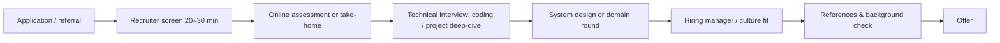

::part[Learn the Concept]{n="1"}

## 🎯 What you'll learn

- The typical **stages** of a tech hiring process and what each one evaluates
- The **recruiter screen**: pitch, motivation, logistics and salary expectations
- **Online assessments** (coding tests) and **take-home assignments**
- Technical interviews: project deep-dive, live coding, system design, frontend/backend specifics
- Culture/values rounds, **reference checks**, offer and background checks
- Asking good questions, following up, and learning from rejections

## 🧠 The big idea

The hiring process is a **series of doors**, each with a different lock. The recruiter door checks *fit and logistics*, the coding door checks *problem solving*, the project door checks *depth and honesty*, the team door checks *collaboration*. Knowing which lock you're facing tells you which key to bring.

## ❓ Why does this matter?

Candidates often fail not because they lack skill but because they prepared for the wrong stage — grinding algorithms for a take-home, or rambling in a 20-minute recruiter call. Preparation per stage raises pass rates cheaply.

## 💥 What happens if we DON'T?

- "Tell me about yourself" → a 6-minute life story.
- A take-home submitted without a README or tests.
- A salary expectation blurted out with no research.
- Silence after the interview; no notes, so the same mistakes repeat.

## 📖 How it works, step by step

### 1. A typical process

Startups may compress this into 2–3 steps; larger companies may add rounds. **Ask the recruiter** for the stages and what each covers — that's normal and expected.

### 2. Recruiter screen

| They check | Prepare |
|---|---|
| Can you explain yourself and your projects briefly? | a **60–90 s pitch**: who you are → what you built → what you want |
| Why this company/role? | 2 specific reasons (product, stack, team, growth) |
| Logistics | start date / notice period, location/work mode, visa (remote) |
| Salary expectations | a researched **range** (negotiation lesson) or ask for their budget first |

### 3. Online assessments and take-homes

- **Coding assessments** (HackerRank, Codility and similar): easy–medium DSA problems in a time limit. Practice with a timer; read all problems first; handle edge cases; don't leave tests unrun.
- **Take-home assignments**: treat them like a mini production project.

| Take-home checklist |
|---|
| Clarify scope and time expectations by email before starting |
| README: how to run, how to test, decisions and trade-offs, what you'd do with more time |
| Tests for the core logic; linting; clean commits |
| Don't over-engineer; meet the requirements well |
| Honest note on AI tool use if allowed/asked |

### 4. Technical interviews

- **Project deep-dive**: "walk me through CareerPilot" — use D-T-C (decision, trade-off, change).
- **Live coding**: next lesson.
- **System design (junior level)**: "design a URL shortener / a job board" — lesson 05.
- **Domain rounds**: backend (SQL, APIs, auth, caching), frontend (React rendering, state, accessibility, performance).

### 5. Culture / hiring manager

Behavioral questions (lesson 03): conflict, failure, feedback, ownership. Also: how you learn, why you switched careers, what you want in 2 years.

### 6. Your questions (always prepare 3–5)

- "What does a new junior engineer's first 90 days look like?"
- "How are code reviews done? How is work planned — sprints, Kanban?"
- "What's the biggest technical challenge the team faces right now?"
- "How do you measure success for this role in the first 6 months?"
- "What happened to the last juniors who joined — how did they grow?"

### 7. After each stage

- Send a short thank-you note (email/LinkedIn) within 24 h — 3 sentences.
- Write **interview notes** in CareerPilot: questions asked, your answers, what went well, what to fix.
- If rejected: ask politely for feedback (you may not get it), keep the relationship, reapply later if appropriate.

### 8. Offers and checks

- **References**: prepare 2–3 people (bootcamp mentor, previous manager) and tell them in advance.
- **Offer**: get it in writing; review contract type (PKWT fixed-term vs PKWTT permanent), probation, salary (gross), benefits (BPJS, THR, health insurance), work mode, notice period. Details in the negotiation lesson.

## ⚖️ Trade-offs

| Assessment type | ✅ for you | ❌ for you |
|---|---|---|
| Take-home | show real engineering habits, less pressure | time-consuming; unpaid work |
| Live coding | quick, interactive, hints possible | stress; less realistic |
| Project deep-dive | plays to your strengths | exposes shallow understanding |
| Pair programming | shows collaboration | unfamiliar environment |

## 🏆 Best practices

- [ ] Ask for the process and what each stage evaluates.
- [ ] Prepare a 60–90 s pitch, 2 reasons per company, and a researched salary range.
- [ ] Treat take-homes like production work with a great README.
- [ ] Use D-T-C for project questions; think out loud in technical rounds.
- [ ] Always bring questions; take notes after each round.
- [ ] Follow up briefly; be gracious with rejections.
- [ ] Get offers in writing and read the contract before accepting.

## 🏭 How it's used in industry

- Structured interviews with scoring rubrics are common in mature companies to reduce bias — interviewers grade specific signals per round.
- Many startups in Indonesia use a short process (screen → technical/take-home → user interview → offer) to move fast.
- Hiring committees often compare notes: consistent, honest answers across rounds matter.

## ⚠️ Common mistakes

- Badmouthing previous employers or bootcamps.
- Not testing your camera/mic/screen share before remote interviews.
- Treating recruiters as gatekeepers to rush past — they're often your advocate.
- Accepting a verbal offer and stopping other processes before the written offer.

::part[Explain & Design]{n="2"}

## 🗣️ Explain it

Explain the "series of doors" idea and which "key" you'd bring to a recruiter screen vs a take-home.

## 📐 Design it

Write your 90-second pitch, your answer to "Why do you want to work here?" for one target company, and 5 questions you'll ask interviewers.

:::quiz
Show a pitch structure

1. **Who (10 s):** "I'm a full-stack developer focused on Python and TypeScript; I moved into software from [previous field]."
2. **Proof (40 s):** "Recently I built CareerPilot — a Flask API and Next.js app to track job applications. The part I'm proudest of is the pipeline rules and tests: 113 API acceptance tests and Playwright E2E tests in CI. I also built RevoShop, an e-commerce API with Midtrans payments."
3. **Strength (20 s):** "I like making systems reliable — testing, fixing performance issues like an N+1 query that took an endpoint from 21 queries to 2."
4. **Want (20 s):** "I'm looking for a junior backend or full-stack role where I can ship real features with code review and mentorship — which is why [company]'s team caught my attention."
:::

### 📝 Self-review checklist

- [ ] Pitch under 90 seconds
- [ ] Company answer is specific
- [ ] Questions show curiosity about the team and growth

::ai-review{task="explain"}

::part[Practice]{n="3"}

## 🛠️ Do it

1. Record your pitch on video; watch it; cut filler words; re-record.
2. Prepare a take-home template repo (README sections, test setup, lint config).
3. Create interview notes templates in CareerPilot notes.

## ✅ Done when

- [ ] Pitch recorded under 90 seconds
- [ ] Take-home starter template ready
- [ ] Questions list saved

## 📖 Kamus (glossary)

| Term | Bahasa Indonesia |
|---|---|
| Recruiter screen | Wawancara awal dengan rekruter |
| Take-home assignment | Tugas yang dikerjakan di rumah |
| Reference check | Pemeriksaan referensi |
| Offer letter | Surat penawaran kerja |
| Notice period | Masa pemberitahuan pengunduran diri |
