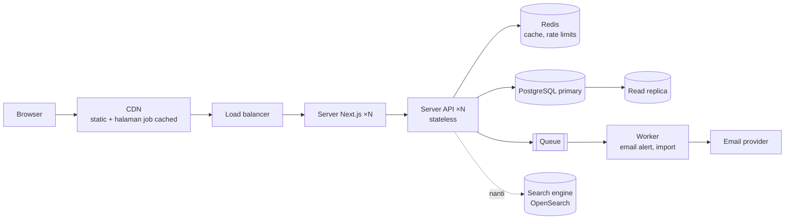

::part[Pelajari Konsepnya]{n="1"}

## 🎯 Yang akan kamu pelajari

- Apa yang diharapkan dari sesi desain sistem untuk **junior** vs senior
- **Kerangka 5 langkah**: persyaratan → estimasi → API & data → arsitektur → deep dive & trade-off
- Menggambar diagram yang jelas dengan cepat (kotak, panah, label)
- Scaling building block yang sudah kamu kenal: caching, indexes, queues, CDN, replica
- Berbicara dalam **trade-off**
- Contoh yang dikerjakan: *rancang job board seperti CareerPilot untuk 1 juta pengguna*

## 🔤 Istilah penting

| Istilah | Artinya (sederhana) |
|---|---|
| **System design round** | "Bagaimana kamu membangun ini?" — diskusi, bukan coding |
| **Functional requirement** | Apa yang harus bisa dilakukan sistem |
| **Non-functional requirement** | Seberapa baik: kecepatan, uptime, scale |
| **Estimate** | Angka kasar pengguna, request, atau storage |
| **Data model** | Tabel dan hubungan mereka |
| **Bottleneck** | Bagian yang membatasi semua yang lain |
| **Replica** | Salinan database untuk membaca |
| **Queue** | Pekerjaan yang diserahkan untuk dikerjakan nanti |
| **Trade-off** | Apa yang kamu korbankan untuk apa yang kamu dapat |

## 🧠 Ide besarnya

Wawancara desain sistem itu seperti **merencanakan rumah dengan klien**, bukan membangunnya. Kamu bertanya berapa orang yang tinggal di sana dan apa yang mereka butuhkan, membuat sketsa ruangan, menjelaskan kenapa dapur berada di sebelah ruang makan, dan membahas apa yang berubah jika mereka menambah lantai nanti. Tidak ada yang mengharapkan diagram perpipaan dari junior — mereka mengharapkan pertanyaan yang masuk akal dan penalaran yang jelas.

## ❓ Kenapa ini penting

Sekarang lebih banyak perusahaan yang menyertakan sesi desain ringan bahkan untuk junior ("rancang backend untuk URL shortener"), dan wawancara full-stack sering menanyakan "bagaimana kamu membangun fitur ini dari ujung ke ujung?".

Kamu sudah membangun sebagian besar piece di CareerPilot. Sesi ini mengecek apakah kamu bisa **menjelaskan dan memperluas** mereka: bertanya pertanyaan yang masuk akal, membuat sketsa yang jelas, dan mengatakan kenapa kamu memilih satu opsi daripada yang lain.

Gambar perencanaan rumah menetapkan ekspektasi yang tepat: kamu merencanakan dengan klien, bukan memasang bata. Tidak ada yang mengharapkan diagram perpipaan dari junior — mereka mengharapkan pertanyaan yang bagus dan penalaran yang jelas.

## 📖 Langkah demi langkah

### 1. Ekspektasi per level

| Junior | Senior |
|---|---|
| Menjelaskan persyaratan, desain yang benar dan sederhana | mengemudi persyaratan yang ambigu |
| API dan model data yang bersih | scaling mendalam, consistency, failure mode |
| Kenal building block dan kapan menggunakannya | mengukur trade-off, biaya, operasi |
| Jujur tentang batas ("Saya akan research X") | pilihan berbasis pengalaman |

### 2. Kerangka 5 langkah (35–45 menit)

Habiskan lima menit pertama untuk persyaratan dan angka. Calon yang menggambar kotak langsung berakhir dengan redesign di tengah-tengah.

| Langkah | Output |
|---|---|
| 1. **Persyaratan** (5 menit) | functional (fitur) + non-functional (pengguna, latency, availability, consistency) + out of scope |
| 2. **Estimasi** (3 menit) | baca/tulis kasar per detik, storage per tahun — besaran saja |
| 3. **API & model data** (8 menit) | 4–6 endpoint utama, tabel/koleksi dan indeks utama |
| 4. **Arsitektur tingkat tinggi** (10 menit) | diagram: klien, CDN, load balancer, app server, database, cache, queue, worker, layanan eksternal |
| 5. **Deep dive & trade-off** (10+ menit) | satu atau dua area yang dipilih pewawancara: scaling pembacaan, search, notifikasi, kegagalan |

### 3. Contoh yang dikerjakan: job board (CareerPilot di 1M pengguna)

**Persyaratan**
- Functional: cari job (keyword, lokasi, remote), lihat job, simpan/apply, track aplikasi, email alert untuk search tersimpan.
- Non-functional: 1M pengguna terdaftar, ~100k daily active, search p95 < 300 ms, halaman job SEO-friendly, alert boleh telat beberapa menit.
- Out of scope: pembayaran, pesan dengan recruiter.

**Estimasi (kasar)**
- 100k DAU × 20 page view = 2M views/hari ≈ **25 req/s rata-rata, ~100–250 req/s peak** (pembacaan mendominasi).
- 50k job baru/bulan × ~5 KB ≈ 250 MB/bulan — tiny untuk PostgreSQL.
- Aplikasi: 100k DAU × 0.5/hari = 50k tulis/hari ≈ 1 tulis/s.

→ Sistem yang **berat pembacaan**; satu primary PostgreSQL sudah cukup untuk tulis; fokus pada caching dan search.

**API**

```text
GET  /api/v1/jobs?q=&location=&remote=&cursor=     search (paginated)
GET  /api/v1/jobs/{id}                              job detail
POST /api/v1/applications                           apply / save
GET  /api/v1/applications?status=&cursor=          my applications
POST /api/v1/saved-searches                         create alert
```

**Model data (core)**
- `jobs(id, company_id, title, description, location, remote, salary_min, salary_max, posted_at, status)` — indeks `(status, posted_at)`; full-text index pada title/description (PostgreSQL `tsvector`) untuk mulai.
- `applications(id, user_id, job_id, status, created_at)` — unique `(user_id, job_id)`, indeks `(user_id, status, created_at)`.
- `saved_searches(id, user_id, query_json, last_notified_at)`.

**Arsitektur**



**Deep dive**
- *Search cepat:* mulai dengan PostgreSQL full-text + indeks; cache query populer di Redis selama 60 s; pindah ke OpenSearch/Elasticsearch saat ranking relevansi, facet, atau volume membutuhkannya.
- *Halaman job & SEO:* render di server dan cache di CDN dengan revalidasi berbasis tag saat job berubah.
- *Alert:* worker terjadwal menemukan job baru yang match saved search dalam batch, enqueue email; idempotency key per (search, job) untuk hindari duplikat; retry dengan backoff.
- *Kegagalan:* server app stateless di belakang load balancer; backup database dan replica; jika email provider down, queue memegang pesan.

### 4. Bahasa trade-off

Frasa seperti "Saya akan cache ini selama 60 detik, menerima data yang sedikit usang untuk melindungi database" adalah persis apa yang dinilai — keputusan plus biayanya.

> "Saya akan mulai dengan pencarian full-text PostgreSQL karena ini menjaga sistem sederhana dan volume kita kecil. Trade-off adalah relevance dan facet yang lebih lemah. Jika search menjadi diferensiator inti atau query melambat, saya akan tambahkan OpenSearch yang diberi feed oleh event perubahan — dengan biaya sistem lain untuk dioperasikan dan eventual consistency antara DB dan indeks."

Pola: **pilihan → kenapa untuk persyaratan ini → biaya → kapan kamu akan ubah**.

### 5. Building block cheat sheet

| Butuh | Block |
|---|---|
| Sajikan file statis/gambar cepat secara global | CDN |
| Banyak pembacaan yang sama | cache (Redis, CDN, HTTP caching) |
| Pekerjaan lambat atau dapat dicoba ulang | queue + worker |
| Kapasitas pembacaan lebih | read replica, caching |
| Lindungi dari penyalahgunaan | rate limiting, auth |
| Banyak app server | layanan stateless + load balancer; session di cookie/Redis |
| Search dan ranking | database full-text → search engine |
| File (CV) | object storage (S3) + signed URL |

### Memilih setup kamu

Setiap opsi di sini adalah trade-off:

| Keputusan | Opsi A | Opsi B |
|---|---|---|
| Monolith vs microservice | sederhana, cepat build (✅ untuk sebagian besar jawaban junior) | scaling/tim independen, ops lebih banyak |
| SQL vs NoSQL | relasi, transaksi (job, aplikasi) | schema fleksibel, horizontal scale untuk workload spesifik |
| Offset vs cursor pagination | sederhana, lompat ke halaman | stabil dan cepat di kedalaman |
| Sync vs async | hasil langsung | resilient, smooths spike, eventual |

## ⚠️ Kesalahan umum

- Arsitektur buzzword tanpa persyaratan.
- Mengabaikan model data.
- Satu diagram raksasa tanpa penjelasan.
- Memperlakukan pertanyaan pewawancara sebagai kritik daripada panduan.

## 🏆 Praktik terbaik

- [ ] Selalu mulai dengan persyaratan dan scale; tuliskan.
- [ ] Lakukan math kasar untuk putuskan apa yang penting (berat pembacaan? berat tulis?).
- [ ] Definisikan API dan model data sebelum menggambar infrastruktur.
- [ ] Mulai sederhana; tambah komponen hanya dengan alasan terikat persyaratan.
- [ ] Label panah dengan apa yang mengalir (HTTP, event, SQL).
- [ ] Jelaskan trade-off dan kapan kamu akan evolusi desain.
- [ ] Cek dengan pewawancara: "Haruskah saya lebih dalam di search atau di alert?"
- [ ] Gunakan proyek kamu sendiri sebagai titik referensi ("di CareerPilot saya gunakan…").

::part[Jelaskan & Rancang]{n="2"}

## 🗣️ Jelaskan

Jelaskan analogi perencanaan rumah dan kenapa junior harus usulkan monolith dengan PostgreSQL terlebih dahulu.

## 📐 Rancang

Rancang **URL shortener untuk link share CareerPilot** (`cp.link/abc123` → halaman aplikasi atau job) menggunakan kerangka 5 langkah: persyaratan, estimasi kasar, API, model data, diagram arsitektur dan dua trade-off.

:::quiz
Lihat jawaban yang mungkin

- **Persyaratan:** buat short link untuk halaman share job/aplikasi; redirect cepat; expiry opsional; hitung klik. 10M redirect/bulan, 100k link/bulan. Redirect p95 < 50 ms; availability tinggi; analytics boleh telat.
- **Estimasi:** ~4 redirect/s rata-rata, peak ~50/s; link: 100k × 200 byte ≈ 20 MB/bulan.
- **API:** `POST /links {target_url, expires_at?}` → `{code}` (authenticated) · `GET /{code}` → `301/302` redirect · `GET /links/{code}/stats`.
- **Data:** `links(code PK, target_url, owner_id, created_at, expires_at)`; `click_counts(code, day, count)`.
- **Generasi kode:** random 7-char base62 (62⁷ ≈ 3.5 trillion) dengan unique constraint dan retry di collision — tidak butuh koordinasi.
- **Arsitektur:** edge/CDN → service redirect kecil → Redis cache (code → URL) → PostgreSQL; klik di-publish ke queue → worker aggregate per hari.
- **Trade-off:** `302` (jadi klik dihitung dan target bisa berubah) vs `301` (browser cache → load lebih rendah, kehilangan analytics). Async click counting (redirect cepat, hitungan telat) vs sync increment (akurat, lebih lambat, DB tulis per redirect).
:::

### 📝 Checklist review mandiri

- [ ] Persyaratan sebelum komponen
- [ ] Angka kasar justify desain
- [ ] Dua trade-off eksplisit

::ai-review{task="design"}

::part[Latihan]{n="3"}

## 🛠️ Lakukan

1. Praktik kerangka pada 3 prompt (timer 40 menit setiap): URL shortener, sistem notifikasi untuk status aplikasi berubah, upload file untuk CV.
2. Gambar diagram dengan tool sederhana (Excalidraw, draw.io atau kertas) dan jelaskan mereka dengan keras.
3. Tulis design doc satu halaman untuk fitur email alert CareerPilot.

## ✅ Selesai saat

- [ ] 3 desain timed dengan diagram dan trade-off
- [ ] Satu design doc tertulis
- [ ] Kamu bisa jelaskan arsitektur CareerPilot dan bagaimana ia scale 100×

## 📖 Kamus (glosarium)

| Istilah | Bahasa Indonesia |
|---|---|
| System design | Desain sistem |
| Non-functional requirement | Kebutuhan non-fungsional (kinerja, ketersediaan) |
| Read replica | Replika basis data untuk baca |
| Load balancer | Penyeimbang beban |
| Trade-off | Kompromi/pertukaran untung-rugi |
