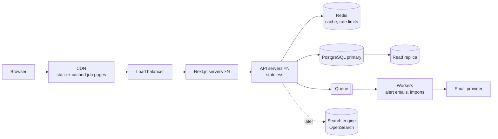

::part[Learn the Concept]{n="1"}

## 🎯 What you'll learn

- What system design rounds expect from **juniors** vs seniors
- A **5-step framework**: requirements → estimates → API & data → architecture → deep dive & trade-offs
- Drawing a clear diagram quickly (boxes, arrows, labels)
- Scaling building blocks you already know: caching, indexes, queues, CDNs, replicas
- Talking in **trade-offs**
- A worked example: *design a job board like CareerPilot for 1 million users*

## 🧠 The big idea

A system design interview is **planning a house with a client**, not building it. You ask how many people live there and what they need, sketch the rooms, explain why the kitchen is next to the dining room, and discuss what changes if they add a floor later. No one expects plumbing diagrams from a junior — they expect sensible questions and clear reasoning.

## ❓ Why does this matter?

More companies include a light design round even for juniors ("design the backend for a URL shortener"), and full-stack roles often ask "how would you build this feature end to end?". You've already built most of the pieces in CareerPilot — the round checks whether you can **explain and extend** them.

## 💥 What happens if we DON'T?

- Jumping straight to "Kubernetes, Kafka, microservices" for an app with 1,000 users.
- Drawing boxes without saying what data flows between them.
- Freezing because "I've never designed Netflix".

## 📖 How it works, step by step

### 1. Expectations by level

| Junior | Senior |
|---|---|
| Clarifies requirements, simple correct design | drives ambiguous requirements |
| Clean API and data model | deep scaling, consistency, failure modes |
| Knows building blocks and when to use them | quantifies trade-offs, costs, operations |
| Honest about limits ("I'd research X") | experience-based choices |

### 2. The 5-step framework (35–45 minutes)

| Step | Output |
|---|---|
| 1. **Requirements** (5 min) | functional (features) + non-functional (users, latency, availability, consistency) + out of scope |
| 2. **Estimates** (3 min) | rough reads/writes per second, storage per year — orders of magnitude only |
| 3. **API & data model** (8 min) | 4–6 key endpoints, main tables/collections and indexes |
| 4. **High-level architecture** (10 min) | diagram: clients, CDN, load balancer, app servers, database, cache, queue, workers, external services |
| 5. **Deep dive & trade-offs** (10+ min) | one or two areas the interviewer picks: scaling reads, search, notifications, failures |

### 3. Worked example: a job board (CareerPilot at 1M users)

**Requirements**
- Functional: search jobs (keyword, location, remote), view job, save/apply, track applications, email alerts for saved searches.
- Non-functional: 1M registered users, ~100k daily actives, search p95 < 300 ms, job pages SEO-friendly, alerts can be minutes late.
- Out of scope: payments, messaging with recruiters.

**Estimates (rough)**
- 100k DAU × 20 page views = 2M views/day ≈ **25 req/s average, ~100–250 req/s peak** (reads dominate).
- 50k new jobs/month × ~5 KB ≈ 250 MB/month — tiny for PostgreSQL.
- Applications: 100k DAU × 0.5/day = 50k writes/day ≈ 1 write/s.

→ A **read-heavy** system; a single PostgreSQL primary is fine for writes; focus on caching and search.

**API**

```text
GET  /api/v1/jobs?q=&location=&remote=&cursor=     search (paginated)
GET  /api/v1/jobs/{id}                              job detail
POST /api/v1/applications                           apply / save
GET  /api/v1/applications?status=&cursor=          my applications
POST /api/v1/saved-searches                         create alert
```

**Data model (core)**
- `jobs(id, company_id, title, description, location, remote, salary_min, salary_max, posted_at, status)` — index `(status, posted_at)`; full-text index on title/description (PostgreSQL `tsvector`) to start.
- `applications(id, user_id, job_id, status, created_at)` — unique `(user_id, job_id)`, index `(user_id, status, created_at)`.
- `saved_searches(id, user_id, query_json, last_notified_at)`.

**Architecture**



**Deep dives**
- *Fast search:* start with PostgreSQL full-text + indexes; cache popular queries in Redis for 60 s; move to OpenSearch/Elasticsearch when relevance ranking, facets or volume demand it.
- *Job pages & SEO:* server-render and cache at the CDN with tag-based revalidation when a job changes.
- *Alerts:* a scheduled worker finds new jobs matching saved searches in batches, enqueues emails; idempotency key per (search, job) to avoid duplicates; retries with backoff.
- *Failures:* stateless app servers behind a load balancer; database backups and a replica; if the email provider is down, the queue holds messages.

### 4. Trade-off language

> "I'd start with PostgreSQL full-text search because it keeps the system simple and our volume is small. The trade-off is weaker relevance and facets. If search becomes a core differentiator or queries slow down, I'd add OpenSearch fed by change events — at the cost of another system to operate and eventual consistency between the DB and the index."

Pattern: **choice → why for these requirements → cost → when you'd change it**.

### 5. Building blocks cheat sheet

| Need | Block |
|---|---|
| Serve static files/images fast globally | CDN |
| Many identical reads | cache (Redis, CDN, HTTP caching) |
| Slow or retryable work | queue + workers |
| More read capacity | read replicas, caching |
| Protect from abuse | rate limiting, auth |
| Many app servers | stateless services + load balancer; sessions in cookies/Redis |
| Search and ranking | database full-text → search engine |
| Files (CVs) | object storage (S3) + signed URLs |

## ⚖️ Trade-offs

| Decision | Option A | Option B |
|---|---|---|
| Monolith vs microservices | simple, fast to build (✅ for most juniors' answers) | independent scaling/teams, more ops |
| SQL vs NoSQL | relations, transactions (jobs, applications) | flexible schema, horizontal scale for specific workloads |
| Offset vs cursor pagination | simple, jump to page | stable and fast at depth |
| Sync vs async | immediate result | resilient, smooths spikes, eventual |

## 🏆 Best practices

- [ ] Always start with requirements and scale; write them down.
- [ ] Do rough math to decide what matters (read-heavy? write-heavy?).
- [ ] Define API and data model before drawing infrastructure.
- [ ] Start simple; add components only with a reason tied to requirements.
- [ ] Label arrows with what flows (HTTP, events, SQL).
- [ ] Explain trade-offs and when you'd evolve the design.
- [ ] Check in with the interviewer: "Should I go deeper on search or on alerts?"
- [ ] Use your own projects as reference points ("in CareerPilot I used…").

## 🏭 How it's used in industry

- Design discussions happen in real teams through design docs/RFCs using the same structure: context, requirements, options, decision, trade-offs.
- Junior design rounds often use familiar products (URL shortener, chat, job board, food delivery) to check reasoning rather than scale expertise.
- Interviewers value candidates who know when *not* to add complexity.

## ⚠️ Common mistakes

- Buzzword architecture without requirements.
- Ignoring the data model.
- One giant diagram with no explanation.
- Treating the interviewer's questions as criticism instead of guidance.

::part[Explain & Design]{n="2"}

## 🗣️ Explain it

Explain the house-planning analogy and why a junior should propose a monolith with PostgreSQL first.

## 📐 Design it

Design a **URL shortener for CareerPilot share links** (`cp.link/abc123` → an application or job page) using the 5-step framework: requirements, rough estimates, API, data model, architecture diagram and two trade-offs.

:::quiz
Show a possible answer

- **Requirements:** create short link for a job/application share page; redirect fast; optional expiry; count clicks. 10M redirects/month, 100k links/month. Redirect p95 < 50 ms; availability high; analytics can lag.
- **Estimates:** ~4 redirects/s average, peaks ~50/s; links: 100k × 200 bytes ≈ 20 MB/month.
- **API:** `POST /links {target_url, expires_at?}` → `{code}` (authenticated) · `GET /{code}` → `301/302` redirect · `GET /links/{code}/stats`.
- **Data:** `links(code PK, target_url, owner_id, created_at, expires_at)`; `click_counts(code, day, count)`.
- **Code generation:** random 7-char base62 (62⁷ ≈ 3.5 trillion) with a unique constraint and retry on collision — no coordination needed.
- **Architecture:** edge/CDN → small redirect service → Redis cache (code → URL) → PostgreSQL; clicks published to a queue → worker aggregates per day.
- **Trade-offs:** `302` (so clicks are counted and targets can change) vs `301` (browsers cache → less load, lost analytics). Async click counting (fast redirects, counts lag) vs sync increments (accurate, slower, DB write per redirect).
:::

### 📝 Self-review checklist

- [ ] Requirements before components
- [ ] Rough numbers justify the design
- [ ] Two explicit trade-offs

::ai-review{task="design"}

::part[Practice]{n="3"}

## 🛠️ Do it

1. Practice the framework on 3 prompts (timer 40 min each): URL shortener, notification system for application status changes, file upload for CVs.
2. Draw diagrams with a simple tool (Excalidraw, draw.io or paper) and explain them out loud.
3. Write a one-page design doc for CareerPilot's email alerts feature.

## ✅ Done when

- [ ] 3 timed designs with diagrams and trade-offs
- [ ] One design doc written
- [ ] You can explain CareerPilot's architecture and how it would scale 100×

## 📖 Kamus (glossary)

| Term | Bahasa Indonesia |
|---|---|
| System design | Desain sistem |
| Non-functional requirement | Kebutuhan non-fungsional (kinerja, ketersediaan) |
| Read replica | Replika basis data untuk baca |
| Load balancer | Penyeimbang beban |
| Trade-off | Kompromi/pertukaran untung-rugi |
