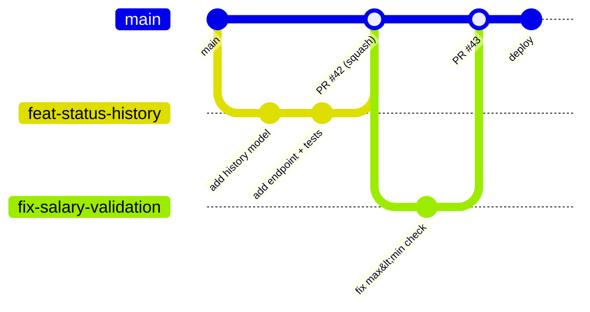

::part[Pelajari Konsepnya]{n="1"}

## 🎯 Yang akan kamu pelajari

- Alur Git tim: **GitHub Flow / trunk-based development**, feature flag, protected branch
- **Pull request** yang di-review dengan cepat: ukuran, deskripsi, check
- **Code review**: cara mereview, cara menerima feedback, etika berkomentar
- **Agile** dalam praktik: Scrum ceremony, Kanban board, user story, perkiraan
- Stand-up, kapan meminta bantuan, dan menulis hal-hal penting
- **90 hari pertama** sebagai junior

## 🔤 Istilah penting

| Istilah | Artinya (sederhana) |
|---|---|
| **GitHub Flow** | Branch → pull request → review → merge ke main |
| **Trunk-based** | Branch pendek, sering di-merge ke main |
| **Protected branch** | Branch yang dilindungi dari push langsung |
| **Pull request (PR)** | Permintaan untuk merge kode kamu |
| **Code review** | Rekan kerja membaca perubahanmu sebelum di-merge |
| **Scrum / Kanban** | Dua cara mengatur pekerjaan tim |
| **Stand-up** | Rapat singkat harian |
| **Estimate** | Perkiraan usaha, bukan janji |
| **Onboarding** | Minggu-minggu pertama belajar di tim baru |

## 🧠 Ide besarnya

Tim software adalah **estafet lari**, bukan sprint solo. Kecepatan datang dari "baton pass" yang rapi: batch kerja kecil, catatan jelas tentang apa berubah dan kenapa, dan rekan kerja yang cek setiap passing dengan teliti (code review) tanpa menjatuhkan baton. Pelari brilian yang menahan baton memperlambat seluruh tim.

## ❓ Kenapa ini penting

Bootcamp dan portofolio adalah kerja solo; pekerjaan nyata tidak. Interviewer tanya "bagaimana kamu pakai Git di tim?" dan "bagaimana kamu terima review comment?" — dan di bulan pertama, kebiasaan kolaborasi lebih penting daripada kecepatan.

Tim remote meningkatkan taruhannya: kalau tidak ada yang duduk di sebelahmu, deskripsi pull request yang jelas, keputusan tertulis, dan pertanyaan di waktu yang tepat *adalah* pekerjaan yang terlihat. Pelari brilian yang menahan baton memperlambat estafet — dan di tim remote, tidak ada yang melihat dia lari.

## 📖 Cara kerjanya, langkah demi langkah

### 1. Alur branching



| Alur | Cara kerjanya | Dipakai oleh |
|---|---|---|
| **GitHub Flow** | branch pendek dari `main` → PR → review + CI → merge → deploy | sebagian besar startup/tim produk |
| **Trunk-based** | merge sangat kecil ke `main` sering banget (jam–1 hari), fitur belum selesai di balik **feature flag** | tim bergerak cepat |
| **Git Flow** | branch `develop`, `release/*`, `hotfix/*` | software berversi dengan rilis terjadwal; jarang sekarang di web app |

Proteksi `main`: wajib review, wajib CI check, tidak boleh force push.

```bash
git switch -c feat/application-notes
# … small commits …
git fetch origin && git rebase origin/main     # or merge main — follow the team's convention
git push -u origin feat/application-notes
```

### 2. Pull request yang berhasil di-merge

PR kecil di-review dalam hitungan menit; PR 40-file dapat "LGTM" tanpa dibaca sungguhan. Memisahkan kerjamu adalah kebaikan yang juga beri feedback lebih baik.

- **Kecil**: targetkan < 300–400 baris berubah; pisahkan refactor dari fitur.
- **Template deskripsi**:

```markdown
## What
Add notes to applications (create, list newest first, delete).

## Why
Users track recruiter calls per application (issue #38).

## How
- `NoteService` with ownership checks; `POST/GET /applications/:id/notes`, `DELETE /notes/:id`
- Migration `0007_notes`

## Testing
- Unit tests for ownership and validation; acceptance tests `-k notes` pass
- Manually tested in the web app (screenshot below)

## Notes for reviewers
The delete endpoint returns 404 for other users' notes on purpose (don't reveal existence).
```

- Review diff-mu sendiri sebelum minta review; buat CI hijau lebih dulu; link issue-nya; tambah screenshot untuk UI.

### 3. Code review

**Sebagai reviewer** (ya, junior juga review):

| Fokus pada | Kurangi pada |
|---|---|
| kebenaran, edge case, security, test | gaya pribadi yang tidak di-enforce linter |
| keterbacaan dan penamaan | menulis ulang sesuai cara pilihan kamu |
| konsistensi dengan codebase | nitpick tanpa label |

Gaya komentar: spesifik, ramah, dengan alasan, dan berlabel.

```text
suggestion: `applied_on` is only set when empty — could we add a test for moving applied → screening → applied? (not allowed today, but the rule is easy to break later)
question: why 404 instead of 403 here? (I think it's deliberate, just checking)
nit: typo in the docstring
```

Prefix konvensional (`nit:`, `question:`, `suggestion:`, `issue:`/`blocking:`) membuat tingkat keparahan jelas.

**Menerima review**: asumsikan maksud baik; balas setiap komentar (perbaiki, atau jelaskan dan diskusi); jangan argue di thread panjang — panggil 5 menit; terima kasih ke reviewer; push perbaikan sebagai commit baru saat review.

### 4. Agile dalam praktik

| Konsep | Yang terlihat |
|---|---|
| **User story** | "Sebagai pencari kerja, saya bisa tambah catatan ke aplikasi jadi ingat panggilan recruiter." + kriteria penerimaan |
| **Backlog** | daftar story/bug yang diprioritaskan |
| **Scrum** | sprint 1–2 minggu; planning, stand-up harian (≈15 min), review/demo, retrospective |
| **Kanban** | alur terus-menerus; kolom board (To do → In progress → Review → Done); batas WIP |
| **Estimate** | story point atau ukuran baju; tentang kompleksitas relatif dan risiko, bukan jam |
| **Definition of Done** | code di-review, ada test, CI hijau, docs update, di-deploy/feature-flagged |

**Format stand-up**: kemarin → hari ini → blocker. Bikin singkat; detail ke follow-up.

### 5. Meminta bantuan

Aturan bagus: coba 30 menit, tulis apa yang sudah dicoba, lalu tanya dengan konteks itu. Terlalu cepat sia-siakan waktu mereka; terlalu lambat sia-siakan waktu kamu.

Aturan praktis untuk junior: coba **30–60 menit**, lalu tanya — dengan konteks:

```text
I'm stuck running the API locally: `alembic upgrade head` fails with "relation users already exists".
Tried: dropping the local DB, re-running migrations, checking DATABASE_URL (points to localhost:5491).
Guess: my DB was created with create_all() before migrations existed.
Could someone pair for 10 min?
```

Tulis jawaban (wiki tim/README) jadi orang berikutnya tidak perlu tanya.

### 6. 90 hari pertama

- **Hari 1–30**: setup lingkungan (perbaiki docs setup saat kamu pakai), ship bug fix kecil, pelajari domain, temui orang.
- **Hari 31–60**: punya fitur kecil end to end; review PR orang lain; tanya feedback di 1:1.
- **Hari 61–90**: ambil fitur sedang, perbaiki sesuatu (test, docs, query lambat), sepakati goal pertumbuhan dengan manager.

### Pilih setupmu

Setiap pilihan punya trade-off:

| | ✅ | ❌ |
|---|---|---|
| Squash merge | history `main` rapi | hilang commit individual |
| Rebase sebelum merge | history linear | rewrite shared branch berisiko |
| Long-lived feature branch | isolasi kerja besar | conflict pedih; integrasi lambat |
| Feature flag | merge cepat, rilis lambat | cleanup flag dan kombinasi test |
| Strict Scrum | ritme terprediksi | overhead ceremony untuk tim kecil |

## ⚠️ Kesalahan umum

- Campur perubahan formatting dengan logic di satu PR.
- Review "LGTM" tanpa baca.
- Kerja di `main` lokal dan push langsung.
- Diam saat perkiraan jelas salah.

## 🏆 Praktik terbaik

- [ ] Branch pendek, PR kecil, CI hijau sebelum review.
- [ ] Deskripsi PR: apa, kenapa, gimana, testing, catatan ke reviewer.
- [ ] Review dengan ramah dan spesifik; label berat komentar; review dalam sehari.
- [ ] Balas setiap review komentar; jangan ambil hati.
- [ ] Pesan commit jelas; ikuti konvensi merge/rebase tim.
- [ ] Board selalu update; naikkan blocker di stand-up awal.
- [ ] Minta bantuan dengan konteks setelah batas waktu; dokumentasikan jawaban.
- [ ] Jangan pernah force-push ke branch bersama; jangan pernah commit secret.

::part[Jelaskan & Rancang]{n="2"}

## 🗣️ Jelaskan

Jelaskan analogi estafet lari ke rekan kerja yang ingin selesaikan fitur besar sendiri di satu branch "biar tidak repot reviewer".

## 📐 Rancang

Ambil stretch goal CareerPilot *"Kanban board dengan drag-and-drop dan optimistic update"* dan pisah jadi urutan PR kecil (setiap bisa di-merge dan aman), dengan deskripsi satu baris, ukuran kasar, dan gimana sembunyikan kerja yang belum selesai.

:::quiz
Lihat kemungkinan pemisahan

1. **PR 1 (S):** `feat(api): allowed transitions endpoint` — `GET /applications/:id/transitions`, test. Aman: endpoint baru, belum dipakai.
2. **PR 2 (S):** `feat(web): BFF route handler untuk board data` — GET list grouped by status, PATCH status; test. Belum dipakai UI.
3. **PR 3 (M):** `feat(web): static board page di balik BOARD_ENABLED flag` — kolom dan kartu dari data server, belum drag; nav link disembunyikan kecuali flag.
4. **PR 4 (M):** `feat(web): drag-and-drop dengan alternatif keyboard` — library dnd, menu "Move to" untuk keyboard user; component test.
5. **PR 5 (M):** `feat(web): optimistic move dengan rollback` — TanStack Query mutation, error toast; test untuk rollback.
6. **PR 6 (S):** `test(e2e): board journey` — test Playwright.
7. **PR 7 (S):** `chore: enable board by default, hapus flag` + docs/screenshot.
:::

### 📝 Checklist self-review

- [ ] Setiap PR bisa di-merge sendiri
- [ ] UI belum selesai disembunyikan di balik flag
- [ ] Test datang bersama kode yang dicek

::ai-review{task="design"}

::part[Latihan Kecil]{n="3"}

## 🛠️ Lakukan

1. Proteksi `main` di repo CareerPilot (wajib PR + CI).
2. Tambah template PR (`.github/pull_request_template.md`) dan bagian CONTRIBUTING ke README.
3. Lakukan fitur berikutnya sebagai 2–3 PR kecil dengan deskripsi lengkap; review masing-masing sendiri esok hari seolah itu PR orang lain.
4. Review PR classmate dengan labeled comment (atau diskusi PR open-source biar pelajar gaya).

## ✅ Selesai saat

- [ ] `main` terlindungi dan template PR sudah ada
- [ ] 3 PR kecil di-merge dengan deskripsi dan CI hijau
- [ ] Satu review peer diberikan dengan labeled, ramah comment

## 📖 Kamus (glosarium)

| Istilah | Bahasa Indonesia |
|---|---|
| Pull request | Permintaan penggabungan kode |
| Code review | Tinjauan kode |
| Feature flag | Bendera fitur |
| Sprint | Siklus kerja singkat (1–2 minggu) |
| Stand-up | Rapat harian singkat |
| Blocker | Penghambat pekerjaan |
