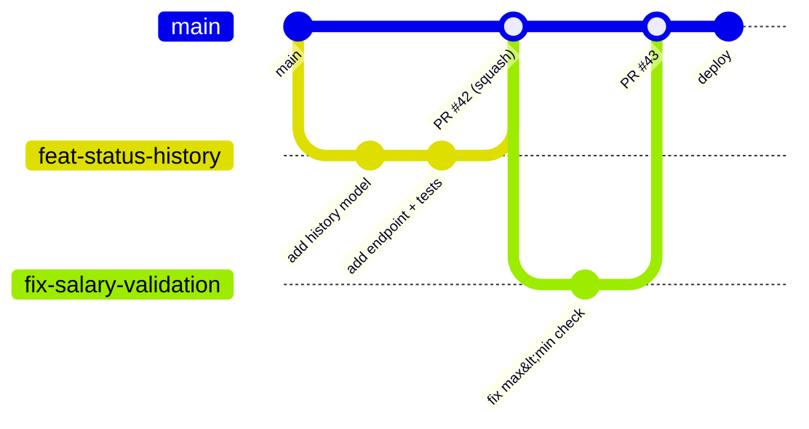

::part[Learn the Concept]{n="1"}

## 🎯 What you'll learn

- Team Git workflows: **GitHub Flow / trunk-based development**, feature flags, protected branches
- **Pull requests** that get reviewed quickly: size, description, checks
- **Code review**: how to review, how to receive feedback, comment etiquette
- **Agile** in practice: Scrum ceremonies, Kanban boards, user stories, estimates
- Stand-ups, asking for help at the right time, and writing things down
- Your **first 90 days** as a junior

## 🧠 The big idea

A software team is a **relay race**, not a solo sprint. Speed comes from clean handoffs: small batches of work, clear notes on what changed and why, and teammates who check each other's baton passes (code review) without dropping it. A brilliant runner who hoards the baton slows the whole team.

## ❓ Why does this matter?

Bootcamp and portfolio work is mostly solo. Jobs aren't. Interviewers ask "how do you work with Git in a team?" and "how do you handle review comments?" — and in your first months, collaboration habits matter more than raw speed.

## 💥 What happens if we DON'T?

- A 3,000-line PR after two weeks: reviewers skim, bugs slip, merge conflicts everywhere.
- "Fixed stuff" commit messages and empty PR descriptions.
- Taking review comments personally, or leaving comments like "this is wrong".
- Stuck silently for two days on an environment problem a teammate could solve in 5 minutes.

## 📖 How it works, step by step

### 1. Branching workflows



| Workflow | How | Used by |
|---|---|---|
| **GitHub Flow** | short-lived branches from `main` → PR → review + CI → merge → deploy | most startups/product teams |
| **Trunk-based** | very small, frequent merges to `main` (hours–1 day), unfinished features behind **feature flags** | high-velocity teams |
| **Git Flow** | `develop`, `release/*`, `hotfix/*` branches | versioned software with scheduled releases; less common for web apps now |

Protected `main`: required reviews, required CI checks, no force pushes.

```bash
git switch -c feat/application-notes
# … small commits …
git fetch origin && git rebase origin/main     # or merge main — follow the team's convention
git push -u origin feat/application-notes
```

### 2. Pull requests that get merged

- **Small**: aim for < 300–400 changed lines; split refactors from features.
- **Description template**:

```markdown
## What
Add notes to applications (create, list newest first, delete).

## Why
Users track recruiter calls per application (issue #38).

## How
- `NoteService` with ownership checks; `POST/GET /applications/:id/notes`, `DELETE /notes/:id`
- Migration `0007_notes`

## Testing
- Unit tests for ownership and validation; acceptance tests `-k notes` pass
- Manually tested in the web app (screenshot below)

## Notes for reviewers
The delete endpoint returns 404 for other users' notes on purpose (don't reveal existence).
```

- Self-review your diff before requesting review; make CI green first; link the issue; add screenshots for UI.

### 3. Code review

**As a reviewer** (yes, juniors review too):

| Focus on | Less on |
|---|---|
| correctness, edge cases, security, tests | personal style the linter doesn't enforce |
| readability and naming | rewriting in your preferred way |
| consistency with the codebase | nitpicks without labels |

Comment style: specific, kind, with reasons, and labeled.

```text
suggestion: `applied_on` is only set when empty — could we add a test for moving applied → screening → applied? (not allowed today, but the rule is easy to break later)
question: why 404 instead of 403 here? (I think it's deliberate, just checking)
nit: typo in the docstring
```

Conventional prefixes (`nit:`, `question:`, `suggestion:`, `issue:`/`blocking:`) make severity clear.

**Receiving review**: assume good intent; reply to every comment (fix, or explain and discuss); don't argue in long threads — call for 5 minutes; thank reviewers; push fixes as new commits during review.

### 4. Agile in practice

| Concept | What it looks like |
|---|---|
| **User story** | "As a job seeker, I can add notes to an application so I remember recruiter calls." + acceptance criteria |
| **Backlog** | prioritized list of stories/bugs |
| **Scrum** | 1–2 week sprints; planning, daily stand-up (≈15 min), review/demo, retrospective |
| **Kanban** | continuous flow; board columns (To do → In progress → Review → Done); WIP limits |
| **Estimates** | story points or t-shirt sizes; about relative complexity and risk, not hours |
| **Definition of Done** | code reviewed, tests, CI green, docs updated, deployed/feature-flagged |

**Stand-up** format: yesterday → today → blockers. Keep it short; take details to a follow-up.

### 5. Asking for help

Rule of thumb for juniors: try for **30–60 minutes**, then ask — with context:

```text
I'm stuck running the API locally: `alembic upgrade head` fails with "relation users already exists".
Tried: dropping the local DB, re-running migrations, checking DATABASE_URL (points to localhost:5491).
Guess: my DB was created with create_all() before migrations existed.
Could someone pair for 10 min?
```

Write down answers (team wiki/README) so the next person doesn't need to ask.

### 6. First 90 days

- **Days 1–30**: set up the environment (improve the setup docs as you go), ship a small bug fix, learn the domain, meet people.
- **Days 31–60**: own small features end to end; review others' PRs; ask for feedback in 1:1s.
- **Days 61–90**: take a medium feature, improve something (tests, docs, a slow query), agree on growth goals with your manager.

## ⚖️ Trade-offs

| | ✅ | ❌ |
|---|---|---|
| Squash merge | clean `main` history | loses individual commits |
| Rebase before merge | linear history | rewriting shared branches is risky |
| Long-lived feature branches | isolate big work | painful conflicts; late integration |
| Feature flags | merge early, release later | flag clean-up and testing combinations |
| Strict Scrum | predictable rhythm | ceremony overhead for small teams |

## 🏆 Best practices

- [ ] Short-lived branches, small PRs, CI green before review.
- [ ] PR descriptions: what, why, how, testing, notes for reviewers.
- [ ] Review kindly and specifically; label comment severity; review within a day.
- [ ] Respond to every review comment; don't take it personally.
- [ ] Clear commit messages; follow the team's merge/rebase conventions.
- [ ] Keep the board updated; raise blockers in stand-up early.
- [ ] Ask for help with context after a time box; document answers.
- [ ] Never force-push to shared branches; never commit secrets.

## 🏭 How it's used in industry

- Research such as the DORA reports links small batch sizes, fast code review and trunk-based practices with higher delivery performance.
- Many companies use GitHub/GitLab PR templates, CODEOWNERS and required checks.
- Teams frequently adapt Scrum into lighter hybrids ("Scrumban") — ask how *this* team works.

## ⚠️ Common mistakes

- Mixing formatting changes with logic changes in one PR.
- "LGTM" reviews without reading.
- Working on `main` locally and pushing directly.
- Staying silent when estimates are clearly wrong.

::part[Explain & Design]{n="2"}

## 🗣️ Explain it

Explain the relay race analogy to a teammate who wants to finish a big feature alone in one branch "to avoid bothering reviewers".

## 📐 Design it

Take CareerPilot's stretch goal *"Kanban board with drag-and-drop and optimistic updates"* and split it into a sequence of small PRs (each mergeable and safe), with a one-line description, rough size and how you'd keep unfinished work hidden.

:::quiz
Show a possible split

1. **PR 1 (S):** `feat(api): allowed transitions endpoint` — `GET /applications/:id/transitions`, tests. Safe: new endpoint, unused.
2. **PR 2 (S):** `feat(web): BFF route handlers for board data` — GET list grouped by status, PATCH status; tests. Unused by UI yet.
3. **PR 3 (M):** `feat(web): static board page behind BOARD_ENABLED flag` — columns and cards from server data, no drag yet; nav link hidden unless flag.
4. **PR 4 (M):** `feat(web): drag-and-drop with keyboard alternative` — dnd library, "Move to" menu for keyboard users; component tests.
5. **PR 5 (M):** `feat(web): optimistic moves with rollback` — TanStack Query mutation, error toast; tests for rollback.
6. **PR 6 (S):** `test(e2e): board journey` — Playwright test.
7. **PR 7 (S):** `chore: enable board by default, remove flag` + docs/screenshot.
:::

### 📝 Self-review checklist

- [ ] Every PR is mergeable on its own
- [ ] Unfinished UI hidden behind a flag
- [ ] Tests land with the code they cover

::ai-review{task="design"}

::part[Practice]{n="3"}

## 🛠️ Do it

1. Protect `main` in your CareerPilot repo (require PR + CI).
2. Add a PR template (`.github/pull_request_template.md`) and a CONTRIBUTING section to the README.
3. Do your next feature as 2–3 small PRs with full descriptions; review each one yourself the next day as if it were someone else's.
4. Review a classmate's PR with labeled comments (or an open-source PR's discussion to learn the style).

## ✅ Done when

- [ ] Protected `main` and PR template in place
- [ ] 3 small PRs merged with descriptions and green CI
- [ ] One peer review given with labeled, kind comments

## 📖 Kamus (glossary)

| Term | Bahasa Indonesia |
|---|---|
| Pull request | Permintaan penggabungan kode |
| Code review | Tinjauan kode |
| Feature flag | Saklar fitur |
| Sprint | Siklus kerja singkat (1–2 minggu) |
| Stand-up | Rapat harian singkat |
| Blocker | Penghambat pekerjaan |
