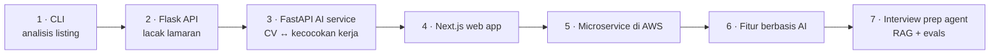

## 🚀 Pitchnya

> **CareerPilot membantu pencari kerja melacak lamaran, memahami apa yang diinginkan pasar, dan mempersiapkan interview — dengan AI.**

Kamu akan membangunnya dalam **7 fase**, satu per modul. Di akhirnya adalah produk full-stack yang diuji, bertenaga AI, dan sudah di-deploy — plus cerita yang bisa kamu ceritakan di setiap interview: *"Aku membangun ini saat mencari kerja, dan aku sendiri yang memakai."*

Kalimat terakhir itu lebih berharga daripada proyek tutorial yang sempurna. Pewawancara akan ingat orang yang memecahkan masalahnya sendiri.

## 🗺️ 7 fase

Setiap fase adalah satu lantai dari gedung yang sama, bukan gedung baru: CLI menjadi API, API mendapat web app, web app mendapat AI, dan semuanya pindah ke cloud. Tidak ada yang dibuang.



| Fase | Modul | Kamu membangun | Skill yang dilihat recruiter |
|---|---|---|---|
| **1** | M1 | **CLI** yang analisis listing kerja dari CSV: skill teratas, statistik gaji, filter | Python, algoritma, testing |
| **2** | M2 | **REST API (Flask)**: perusahaan, lamaran, pipeline status, catatan, JWT auth, test, Docker, deployed | Backend, SQL, auth, testing, deployment |
| **3** | M3 | **AI service (FastAPI)**: skor kecocokan CV vs job description + feedback dari LLM | FastAPI, Pydantic, LLM API, embedding |
| **4** | M4 | **Web app (Next.js)**: dashboard, pipeline board, halaman kecocokan CV, test E2E | React, TypeScript, Tailwind, Playwright |
| **5** | M5 | **Cloud**: pisahkan jadi `core-api` + `ai-service` + `worker`; CI/CD; Terraform; monitoring | Docker, GitHub Action, AWS, IaC |
| **6** | M6 | **Fitur baru dengan workflow AI berbasis spec** (misal: pengingat follow-up + catatan riset perusahaan) | AI-assisted engineering, code review |
| **7** | M7 | **Interview prep agent**: pertanyaan dari job description, feedback jawaban, RAG atas catatan-mu, evals, tracing | Agent, RAG, evals, observability |

## 📁 Strategi repository

Tentukan ini sekali saja, di awal. Memindahkan kode antara repository kemudian seperti mengubah alamat rumah setelah undangan sudah dicetak.

Gunakan **satu repository GitHub publik** (sebuah *monorepo*) agar recruiter bisa lihat evolusi selengkapnya:

```text
careerpilot/
├── README.md              ← halaman depan portofolio (screenshot, arsitektur, cara menjalankan)
├── docs/                  ← diagram arsitektur, keputusan (ADR), catatan fase
├── cli/                   ← Fase 1
├── api/                   ← Fase 2 (Flask)
├── ai-service/            ← Fase 3 (FastAPI)
├── web/                   ← Fase 4 (Next.js)
├── worker/                ← Fase 5
└── infra/                 ← Fase 5 (Terraform, CI/CD)
```

- Commit kecil dan sering, dengan pesan jelas: `feat(cli): add salary statistics`, `fix(cli): handle empty salary`.
- Tag setiap fase: `git tag phase-1`. Sejarahmu jadi bukti progres yang stabil.
- Jaga rahasia dari hari pertama (`.env` di `.gitignore`).

## 🧠 Cara memakai AI di proyek ini

Aturan sederhana: AI boleh membantu kamu mengetik, tidak boleh membantu kamu menghindari pemahaman. Kalau kamu tidak bisa jelaskan satu baris di interview, tidak boleh ada di portofoliomu.

| Fase | Kebijakan AI | Alasannya |
|---|---|---|
| 1–2 | 🚫🤖 **Tidak ada AI untuk menulis kode.** AI boleh untuk jelaskan error *setelah* 20 menit stuck, dan untuk review kode selesai. | Kamu membangun fondasi yang akan dipertanyakan pewawancara. |
| 3–5 | 🤖✅ AI boleh untuk boilerplate dan config; logika inti kamu. | Cepat di bagian membosankan, memahami bagian penting. |
| 6–7 | 🤖✅ Didesain dengan AI-assisted — dengan spec, review dan test. | Itulah alur kerja profesional yang kamu pelajari. |

**Aturan emas untuk setiap fase:** kamu harus bisa jelaskan setiap file di repo.

## ✅ Checklist siap portofolio (setiap fase)

- [ ] README: apa yang dilakukan, **screenshot atau GIF**, cara menjalankan, cara test, tech stack
- [ ] Diagram arsitektur (diagram Mermaid di README sudah cukup)
- [ ] Test lulus di lokal (dan di CI sejak Fase 2)
- [ ] Tidak ada secret yang di-commit; `.env.example` disiapkan
- [ ] Link deployed (sejak Fase 2)
- [ ] Satu postingan LinkedIn "build in public"
- [ ] Kamu bisa jawab: *Bagian tersulit apa? Apa yang akan kamu lakukan beda?*

## ▶️ Mulai

Buka **[Fase 1 — Job Listings Analyzer CLI](/projects/careerpilot/01-phase-1-job-listings-cli)** setelah selesai Module 1 Week 1 Lesson 04.
