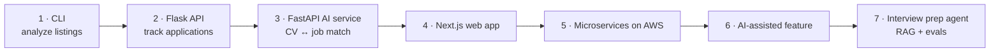

## 🚀 The pitch

> **CareerPilot helps job seekers track applications, understand what the market wants, and prepare for interviews — with AI.**

You'll build it in **7 phases**, one per module. By the end, it's a deployed, tested, AI-powered full-stack product — and a story you can tell in every interview: *"I built this while job hunting, and I used it myself."*

## 🗺️ The 7 phases



| Phase | Module | You build | Skills recruiters see |
|---|---|---|---|
| **1** | M1 | **CLI** that analyzes job listings from CSV: top skills, salary stats, filters | Python, algorithms, testing |
| **2** | M2 | **REST API (Flask)**: companies, applications, status pipeline, notes, JWT auth, tests, Docker, deployed | Backend, SQL, auth, testing, deployment |
| **3** | M3 | **AI service (FastAPI)**: CV vs job description match score + LLM feedback | FastAPI, Pydantic, LLM APIs, embeddings |
| **4** | M4 | **Web app (Next.js)**: dashboard, pipeline board, CV match page, E2E tests | React, TypeScript, Tailwind, Playwright |
| **5** | M5 | **Cloud**: split into `core-api` + `ai-service` + `worker`; CI/CD; Terraform; monitoring | Docker, GitHub Actions, AWS, IaC |
| **6** | M6 | **New feature with a spec-driven AI workflow** (e.g. follow-up reminders + company research notes) | AI-assisted engineering, code review |
| **7** | M7 | **Interview prep agent**: questions from the job description, answer feedback, RAG over your notes, evals, tracing | Agents, RAG, evals, observability |

## 📁 Repository strategy

Use **one public GitHub repository** (a *monorepo*) so recruiters can see the whole evolution:

```text
careerpilot/
├── README.md              ← the portfolio front page (screenshots, architecture, how to run)
├── docs/                  ← architecture diagrams, decisions (ADRs), phase notes
├── cli/                   ← Phase 1
├── api/                   ← Phase 2 (Flask)
├── ai-service/            ← Phase 3 (FastAPI)
├── web/                   ← Phase 4 (Next.js)
├── worker/                ← Phase 5
└── infra/                 ← Phase 5 (Terraform, CI/CD)
```

- Commit small and often, with clear messages: `feat(cli): add salary statistics`, `fix(cli): handle empty salary`.
- Tag each phase: `git tag phase-1`. Your history becomes proof of steady progress.
- Keep secrets out of git from day one (`.env` in `.gitignore`).

## 🧠 How to use AI on this project

| Phase | AI policy | Why |
|---|---|---|
| 1–2 | 🚫🤖 **No-AI for writing code.** AI allowed for explaining errors *after* 20 minutes stuck, and for reviewing finished code. | You're building the foundation interviewers will probe. |
| 3–5 | 🤖✅ AI-allowed for boilerplate and config; core logic by you. | Speed on the boring parts, understanding on the important parts. |
| 6–7 | 🤖✅ AI-assisted by design — with specs, reviews and tests. | That's the professional workflow you're learning. |

**Golden rule for every phase:** you must be able to explain every file in the repo.

## ✅ Portfolio-ready checklist (every phase)

- [ ] README: what it does, **screenshot or GIF**, how to run, how to test, tech stack
- [ ] Architecture diagram (a Mermaid diagram in the README is enough)
- [ ] Tests pass locally (and in CI from Phase 2)
- [ ] No secrets committed; `.env.example` provided
- [ ] Deployed link (from Phase 2)
- [ ] One LinkedIn "build in public" post
- [ ] You can answer: *What was the hardest part? What would you do differently?*

## ▶️ Start

Open **[Phase 1 — Job Listings Analyzer CLI](/projects/careerpilot/01-phase-1-job-listings-cli)** after finishing Module 1 Week 1 Lesson 04.
