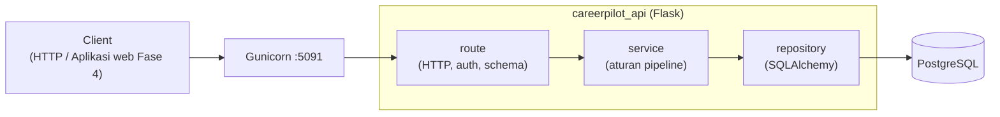
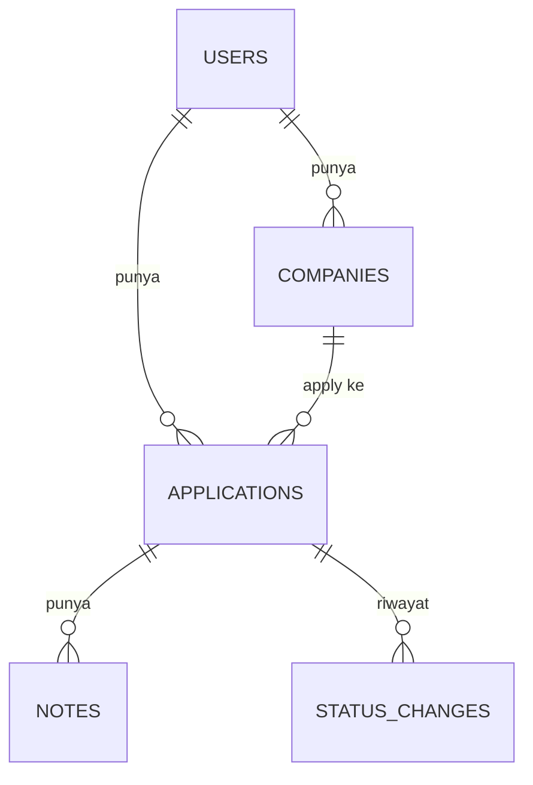
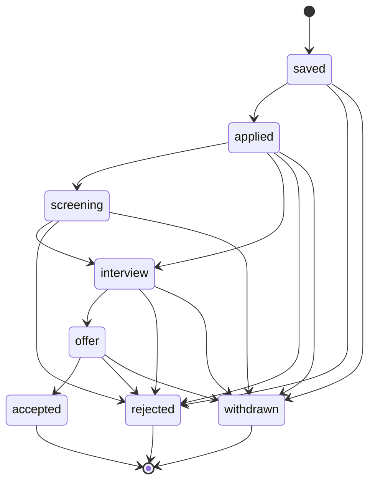

## 🎯 Tujuan

Fase 1 menganalisis pasar kerja. Fase 2 melacak **pencarian kerja pribadimu**: REST API kualitas production tempat pencari kerja mencatat perusahaan, memindahkan aplikasi melalui pipeline perekrutan, menyimpan catatan, dan melihat progresnya.

```text
POST /api/v1/applications/12/status   {"status": "interview"}

200 OK
{
  "data": {
    "id": 12,
    "company": {"id": 3, "name": "Kopi Data"},
    "role": "Backend Engineer",
    "status": "interview",
    "applied_on": "2026-09-02",
    ...
  }
}
```

API ini adalah **backend yang akan dipakai semua fase berikutnya**: layanan AI (Fase 3) akan mencetak nilai CV terhadap aplikasi-aplikasi ini, dan aplikasi web (Fase 4) adalah frontend-nya. Bangun seolah-olah kamu akan hidup dengan itu — karena kamu akan.

## 🔤 Istilah penting

| Istilah | Artinya (sederhana) |
|---|---|
| **Pipeline** | Urutan status yang dilalui aplikasi (apply → interview → offer) |
| **JWT** | Token yang membuktikan siapa kamu tanpa menyimpan password di setiap request |
| **Repository** | Kode yang mengambil data dari database, tidak tahu tentang HTTP |
| **Service** | Kode yang tahu aturan bisnis (siapa boleh status apa), bukan database atau HTTP |
| **Acceptance test** | Test yang mengecek seluruh API dari HTTP request sampai database, seperti user sungguhan |
| **N+1 query** | Bug di mana 1 request membuat 21 query database alih-alih 1 |
| **Migrations** | Script yang mengubah struktur database, disimpan di git agar mudah di-version |
| **Gunicorn** | Server yang menjalankan Flask di production, bukan dev server bawaan Flask |

## 👤 Cerita pengguna

1. Sebagai pencari kerja, aku bisa **daftar dan login**, dan tidak ada yang bisa lihat dataku.
2. Aku bisa simpan **perusahaan** yang aku minati (tanpa duplikat).
3. Aku bisa tambah **aplikasi** (posisi, link, rentang gaji) dan pindahkan melalui **pipeline**: simpan → apply → screening → interview → tawar → terima, atau tolak/cabut kapan saja.
4. Aku bisa lihat **riwayat** setiap perubahan status dan simpan **catatan** (panggilan rekruter, soal coding).
5. Aku bisa **filter, cari, dan halaman** aplikasi serta lihat **statistik** pencarian kerjaku.

## 🏗️ Arsitektur

Bentuknya seperti restoran lagi: route menerima pesanan, service tahu aturannya, repository mengambil bahan. Jaga masing-masing hanya mengerjakan pekerjaannya sendiri dan fase ini tetap mudah dikembangkan.



Pakai struktur berlapis dari pelajaran Module 2 Minggu 4 nomor 06: route tahu HTTP, service tahu aturannya (seperti transisi yang boleh), repository tahu SQL.



## 📦 Starter kit

:::exercise{path="exercises/projects/careerpilot/phase-2" ai="no-ai" title="Starter kit Fase 2 — 113 acceptance test"}
Kit berisi stub `create_app`, dependensi (`pyproject.toml`), PostgreSQL lokal `compose.yaml` di port **5492**, `.env.example`, dan **113 acceptance test** yang menjelaskan kontrak API di bawah. Test membuat schema database baru setiap test dan menjalankan **migrasi Alembic-mu**, jadi schema-mu harus berasal dari migrasi, bukan `db.create_all()`.

1. Salin kit ke repo `careerpilot`-mu sebagai `api/`.
2. `flask --app careerpilot_api db init` setelah kamu punya app factory.
3. Kerjakan checkpoint demi checkpoint: `uv run pytest -k auth`, `-k companies`, …
:::

## 📋 Kontrak API

Kontrak ini adalah janji kepada siapa pun yang memanggil API — termasuk Fase 4 frontend-mu sendiri. Ubah nanti dan sesuatu yang lain rusak, jadi tentukan bentuknya di sini, dengan sengaja.

### Konvensi

| Topik | Aturan |
|---|---|
| Base path | `/api/v1` (health check di `/health/live`, `/health/ready`) |
| Success body | `{"data": ...}` — list aplikasi juga termasuk `"meta": {"page", "per_page", "total"}` |
| Error body | `{"error": {"code": "...", "message": "..."}}`; validation error tambah `"fields": {"field": ["message", ...]}` |
| Validation | `422 validation_failed` — juga untuk body non-JSON dan **field yang tidak dikenal** |
| Auth | `Authorization: Bearer <token>`; hilang, malformed, signature salah atau token expired → `401 unauthorized` |
| Ownership | resource user lain → `404 not_found` (jangan ungkap kalau ada) |
| Rute/method tidak dikenal | JSON `404 not_found` / `405 method_not_allowed` |
| Tracing | setiap response punya `X-Request-ID` (pakai incoming yang aman) |
| Dibuat | `201` dengan header `Location` untuk perusahaan dan aplikasi |
| Timestamp | ISO 8601 (`created_at`, `updated_at`, `changed_at`); tanggal `YYYY-MM-DD` |

### Auth

| Endpoint | Body | Sukses | Error |
|---|---|---|---|
| `POST /auth/register` | `email` (trim, lowercase, valid), `password` (8–128), `name` (1–100, trim) | `201 {"data": {id, email, name}}` | `422`, `409 email_taken` (case-insensitive) |
| `POST /auth/login` | `email`, `password` | `200 {"data": {access_token, token_type: "Bearer", expires_in}}` | `401 invalid_credentials` — **sama** untuk email tidak ada dan password salah |
| `GET /me` | — | `200 {"data": {id, email, name}}` | `401` |

Password harus di-hash (test mencari password dalam plaintext di setiap tabel).

### Perusahaan (per user)

| Endpoint | Catatan |
|---|---|
| `POST /companies` | `name` (1–200, trim), `website` (opsional, `http(s)://`) → `201` + `Location` |
| `GET /companies` | urut nama, case-insensitive |
| `GET / PATCH / DELETE /companies/<id>` | `PATCH` sebagian; `DELETE` → `204` |
| Konflik | `409 company_exists` (nama sama untuk user yang sama, case-insensitive — user lain boleh pakai), `409 company_in_use` (delete punya aplikasi) |

### Aplikasi

| Endpoint | Catatan |
|---|---|
| `POST /applications` | `company_id` (harus **punya**, kalau tidak `422` di `company_id`), `role` (1–200), opsional `job_url`, `salary_min`, `salary_max` (≥ 0, min ≤ max), `applied_on`. Mulai sebagai `saved`. |
| `GET /applications` | `?status=&company_id=&q=&page=&per_page=` — `q` cari role case-insensitive; terbaru duluan; `per_page` default 20, max 100; param tidak valid → `422`. **≤ 5 SQL query** per request (tanpa N+1). |
| `GET /applications/<id>` | `{id, company: {id, name}, role, job_url, salary_min, salary_max, status, applied_on, created_at, updated_at}` |
| `PATCH /applications/<id>` | sebagian; `status` **tidak** boleh di sini (`422`); min ≤ max masih dijalankan dengan nilai yang ada |
| `DELETE /applications/<id>` | `204`; hapus catatan dan riwayatnya |
| `POST /applications/<id>/status` | `{"status"}` → `200` dengan aplikasinya; status tidak dikenal `422`; tidak diizinkan `409 invalid_transition` (tidak ada yang berubah) |
| `GET /applications/<id>/history` | tertua duluan: `[{from_status, to_status, changed_at}]`, dimulai dengan `null → saved` |

**Pipeline-nya**



Pindah ke `applied` atur `applied_on` ke hari ini (UTC) **hanya kalau kosong**. `accepted`, `rejected` dan `withdrawn` adalah akhir.

### Catatan & statistik

| Endpoint | Catatan |
|---|---|
| `POST /applications/<id>/notes` | `body` (1–5000, trim) → `201 {"data": {id, body, created_at}}` |
| `GET /applications/<id>/notes` | terbaru duluan |
| `DELETE /notes/<id>` | `204`; user lain → `404` |
| `GET /stats` | `{"data": {total, active, by_status: {semua 8 status, zero termasuk}}}` — `active` = bukan akhir |

## 🧭 Checkpoint

Setiap checkpoint mencatat kapan kamu sudah belajar cukup untuk mulainya.

| # | Checkpoint | Mulai setelah | Selesai saat |
|---|---|---|---|
| **C1** | Platform: factory, config dari env, Flask-Migrate, JSON error, request id, health check | W4 L04, W6 L05 (health) | `-k platform` pass |
| **C2** | Auth: register, login, `/me`, JWT error loader | W5 L05 | `-k auth` pass |
| **C3** | Perusahaan dengan ownership & konflik | W5 L04, L06 | `-k companies` pass |
| **C4** | Aplikasi, service pipeline, riwayat, filter, paging, tanpa N+1 | W4 L05, W5 L01 | `-k applications` pass |
| **C5** | Catatan & statistik | W5 | 113 acceptance test pass |
| **C6** | Test & kualitas milikmu | W6 L01–L03 | unit test untuk aturan pipeline; coverage report; `ruff` + `mypy` bersih; skenario Locust dengan p95 per endpoint di README |
| **C7** | Production-ready | W6 L04–L08 | fail-fast setting; `gunicorn.conf.py`; `Dockerfile` multi-stage (non-root, healthcheck); `compose.prod.yaml`; JSON log dengan request id; GitHub Actions CI (lint, type, test di Postgres, build image) **hijau** |
| **C8** | Deployed & portofolio siap | W6 L05 | URL live (PaaS atau VPS); README dengan diagram arsitektur, tabel API, cara jalankan/test, keputusan desain (D-T-C); `git tag phase-2`; post LinkedIn |

Setelah setiap checkpoint: commit, push, dan tulis *apa yang kubuat / apa yang sulit / apa yang kupelajari* di **Catatanku**.

## 🧪 Kriteria penerimaan

Anggap ini checklist inspeksi: setiap baris benar artinya fase selesai, dan kamu bisa bilang begitu di interview tanpa ragu.

- [ ] 113 acceptance test lokal pass **dan di CI**
- [ ] Schema hanya dari migrasi; `downgrade base` bekerja
- [ ] Aturan pipeline hidup di **service** dengan test unit-nya sendiri — route tidak berisi logika transisi
- [ ] Tidak ada secret di repo; aplikasi menolak start di production tanpa `JWT_SECRET_KEY` yang kuat
- [ ] Image Docker jalan sebagai non-root; log JSON di stdout
- [ ] Hasil load test dan setidaknya satu improvement performa yang kamu ukur (misal index, perbaiki query)
- [ ] Kamu bisa jelaskan setiap file — lihat pertanyaan interview di bawah

## 🏆 Tujuan tambahan

1. **OpenAPI docs** dengan flask-smorest (W5 L07) di `/docs`.
2. **Refresh token + logout** dengan token revocation (W5 L05).
3. **Pengingat follow-up**: tanggal `next_action_on` dan `GET /applications?due=today`.
4. **Keyset pagination** untuk endpoint list (W5 L01) dan bandingkan `EXPLAIN ANALYZE` dengan offset di 50.000 baris.
5. **Import dari Fase 1**: `POST /imports/jobs` terima CSV Fase 1 untuk buat aplikasi simpan dalam jumlah besar, dalam satu transaksi.
6. **Rate limit** upaya login per email/IP.

## 🧠 Kebijakan AI

🚫🤖 **Tanpa AI untuk menulis kode** di fase ini (lihat [overview](/projects/careerpilot/00-overview)). AI boleh jelaskan error setelah 20 menit tersesat, dan review kode yang selesai. Ini proyek yang akan ditanya di setiap interview backend — setelah RevoShop, kamu tahu kenapa itu penting.

## ❓ Pertanyaan yang mungkin diajukan interviewer tentang Fase 2

- Kenapa logika transisi di service dan bukan di route atau database?
- Kenapa return `404` alih-alih `403` untuk aplikasi user lain?
- Bagaimana kamu cegah dua request membuat status change yang bertentangan bersamaan? *(Petunjuk: `SELECT … FOR UPDATE` atau `UPDATE … WHERE status = :current` bersyarat.)*
- Kenapa test menjalankan migrasi-mu alih-alih `create_all()`?
- Bagaimana kamu temukan dan perbaiki N+1 query di endpoint list?
- Apa yang ditunjukkan load test, dan apa yang kamu ubah?
- Apa yang terjadi kalau production start tanpa `JWT_SECRET_KEY`?

Pakai framework D-T-C dari [Pertahankan RevoShop-mu](/modules/m2/w6/09-defend-your-revoshop) dan tulis jawaban-mu di **Catatanku**.

## 📣 Bagikan

:::linkedin{type="build"}
🚀 CareerPilot Fase 2 sudah live: API tracker aplikasi kerja yang aku pakai untuk pencarian kerjaku sendiri.

Apa yang dikerjakan:
📋 lacak perusahaan dan aplikasi melalui pipeline perekrutan (simpan → apply → interview → tawar)
🕓 riwayat status lengkap dan catatan untuk setiap aplikasi
📊 statistik pencarian kerja

Cara dibangun:
- Flask + PostgreSQL + migrasi Alembic, JWT auth, user terisolasi satu sama lain
- 113 acceptance test + unit test, berjalan di GitHub Actions di PostgreSQL sungguhan
- Docker (multi-stage, non-root), JSON log dengan request id, load test dengan Locust

Satu hal yang kupelajari: [misal. bagaimana N+1 query mengubah 1 request jadi 21 SQL query, dan bagaimana aku perbaiki].

Live: [link] · Repo: [link]

#Python #Flask #PostgreSQL #BackendDevelopment #BuildInPublic
:::
