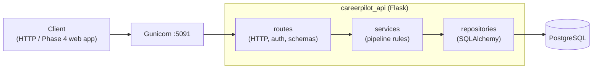
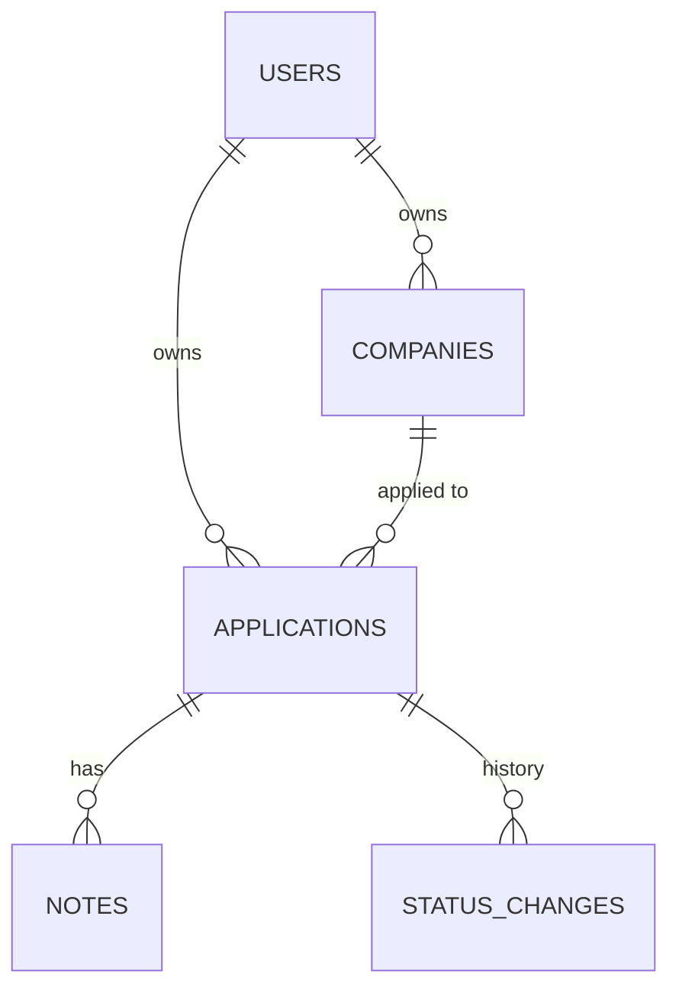
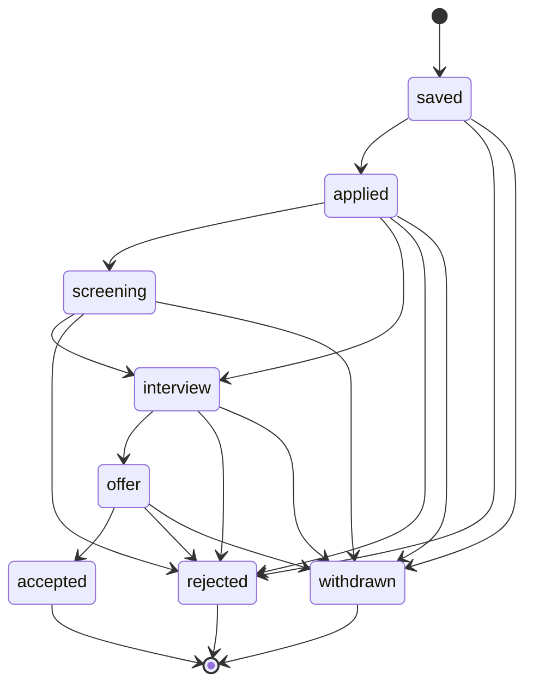

## 🎯 Goal

Phase 1 analyzed the job market. Phase 2 tracks **your own job hunt**: a production-quality REST API where a job seeker records companies, moves applications through a hiring pipeline, keeps notes, and sees their progress.

```text
POST /api/v1/applications/12/status   {"status": "interview"}

200 OK
{
  "data": {
    "id": 12,
    "company": {"id": 3, "name": "Kopi Data"},
    "role": "Backend Engineer",
    "status": "interview",
    "applied_on": "2026-09-02",
    ...
  }
}
```

This API is the **backend every later phase builds on**: the AI service (Phase 3) will score CVs against these applications, and the web app (Phase 4) is its frontend. Build it like you'll live with it — because you will.

## 👤 User stories

1. As a job seeker, I can **register and log in**, and nobody else can see my data.
2. I can save **companies** I'm interested in (no duplicates).
3. I can add **applications** (role, link, salary range) and move them through a **pipeline**: saved → applied → screening → interview → offer → accepted, or rejected/withdrawn at any point.
4. I can see the **history** of every status change and keep **notes** (recruiter calls, take-home tests).
5. I can **filter, search and page** through applications and see **stats** of my job hunt.

## 🏗️ Architecture



Use the layered structure from Module 2 Week 4 lesson 06: routes know HTTP, services know the rules (like allowed transitions), repositories know SQL.



## 📦 Starter kit

:::exercise{path="exercises/projects/careerpilot/phase-2" ai="no-ai" title="Phase 2 starter kit — 113 acceptance tests"}
The kit contains a `create_app` stub, dependencies (`pyproject.toml`), a local PostgreSQL `compose.yaml` on port **5492**, `.env.example`, and **113 acceptance tests** that describe the API contract below. The tests create a fresh database schema per test and run **your Alembic migrations**, so your schema must come from migrations, not `db.create_all()`.

1. Copy the kit into your `careerpilot` repo as `api/`.
2. `flask --app careerpilot_api db init` once you have an app factory.
3. Work checkpoint by checkpoint: `uv run pytest -k auth`, `-k companies`, …
:::

## 📋 API contract

### Conventions

| Topic | Rule |
|---|---|
| Base path | `/api/v1` (health checks at `/health/live`, `/health/ready`) |
| Success body | `{"data": ...}` — lists of applications also include `"meta": {"page", "per_page", "total"}` |
| Error body | `{"error": {"code": "...", "message": "..."}}`; validation errors add `"fields": {"field": ["message", ...]}` |
| Validation | `422 validation_failed` — also for non-JSON bodies and **unknown fields** |
| Auth | `Authorization: Bearer <token>`; missing, malformed, wrong-signature or expired token → `401 unauthorized` |
| Ownership | other users' resources → `404 not_found` (don't reveal they exist) |
| Unknown route / method | JSON `404 not_found` / `405 method_not_allowed` |
| Tracing | every response has `X-Request-ID` (reuse a safe incoming one) |
| Created | `201` with `Location` header for companies and applications |
| Timestamps | ISO 8601 (`created_at`, `updated_at`, `changed_at`); dates as `YYYY-MM-DD` |

### Auth

| Endpoint | Body | Success | Errors |
|---|---|---|---|
| `POST /auth/register` | `email` (trimmed, lower-cased, valid), `password` (8–128), `name` (1–100, trimmed) | `201 {"data": {id, email, name}}` | `422`, `409 email_taken` (case-insensitive) |
| `POST /auth/login` | `email`, `password` | `200 {"data": {access_token, token_type: "Bearer", expires_in}}` | `401 invalid_credentials` — **identical** for unknown email and wrong password |
| `GET /me` | — | `200 {"data": {id, email, name}}` | `401` |

Passwords must be hashed (the tests search every table for the plain password).

### Companies (per user)

| Endpoint | Notes |
|---|---|
| `POST /companies` | `name` (1–200, trimmed), `website` (optional, `http(s)://`) → `201` + `Location` |
| `GET /companies` | sorted by name, case-insensitive |
| `GET / PATCH / DELETE /companies/<id>` | `PATCH` is partial; `DELETE` → `204` |
| Conflicts | `409 company_exists` (same name for the same user, case-insensitive — other users may reuse it), `409 company_in_use` (delete with applications) |

### Applications

| Endpoint | Notes |
|---|---|
| `POST /applications` | `company_id` (must be **yours**, else `422` on `company_id`), `role` (1–200), optional `job_url`, `salary_min`, `salary_max` (≥ 0, min ≤ max), `applied_on`. Starts as `saved`. |
| `GET /applications` | `?status=&company_id=&q=&page=&per_page=` — `q` searches role case-insensitively; newest first; `per_page` default 20, max 100; invalid params → `422`. **≤ 5 SQL queries** per request (no N+1). |
| `GET /applications/<id>` | `{id, company: {id, name}, role, job_url, salary_min, salary_max, status, applied_on, created_at, updated_at}` |
| `PATCH /applications/<id>` | partial; `status` is **not** allowed here (`422`); min ≤ max still enforced with existing values |
| `DELETE /applications/<id>` | `204`; removes its notes and history |
| `POST /applications/<id>/status` | `{"status"}` → `200` with the application; unknown status `422`; not allowed `409 invalid_transition` (nothing changes) |
| `GET /applications/<id>/history` | oldest first: `[{from_status, to_status, changed_at}]`, starting with `null → saved` |

**The pipeline**



Moving to `applied` sets `applied_on` to today (UTC) **only if it's empty**. `accepted`, `rejected` and `withdrawn` are final.

### Notes & stats

| Endpoint | Notes |
|---|---|
| `POST /applications/<id>/notes` | `body` (1–5000, trimmed) → `201 {"data": {id, body, created_at}}` |
| `GET /applications/<id>/notes` | newest first |
| `DELETE /notes/<id>` | `204`; other users → `404` |
| `GET /stats` | `{"data": {total, active, by_status: {all 8 statuses, zeros included}}}` — `active` = not final |

## 🧭 Checkpoints

Each checkpoint lists when you've learned enough to start it.

| # | Checkpoint | Start after | Done when |
|---|---|---|---|
| **C1** | Platform: factory, config from env, Flask-Migrate, JSON errors, request ids, health checks | W4 L04, W6 L05 (health) | `-k platform` passes |
| **C2** | Auth: register, login, `/me`, JWT error loaders | W5 L05 | `-k auth` passes |
| **C3** | Companies with ownership & conflicts | W5 L04, L06 | `-k companies` passes |
| **C4** | Applications, pipeline service, history, filters, pagination, no N+1 | W4 L05, W5 L01 | `-k applications` passes |
| **C5** | Notes & stats | W5 | all 113 acceptance tests pass |
| **C6** | Your own tests & quality | W6 L01–L03 | unit tests for the pipeline rules; coverage report; `ruff` + `mypy` clean; Locust scenario with p95 per endpoint in the README |
| **C7** | Production-ready | W6 L04–L08 | fail-fast settings; `gunicorn.conf.py`; multi-stage `Dockerfile` (non-root, healthcheck); `compose.prod.yaml`; JSON logs with request ids; GitHub Actions CI (lint, types, tests on Postgres, image build) **green** |
| **C8** | Deployed & portfolio-ready | W6 L05 | live URL (PaaS or VPS); README with architecture diagram, API table, how to run/test, design decisions (D-T-C); `git tag phase-2`; LinkedIn post |

After each checkpoint: commit, push, and write *what I built / what was hard / what I learned* in **My notes**.

## 🧪 Acceptance criteria

- [ ] All 113 acceptance tests pass locally **and in CI**
- [ ] The schema comes only from migrations; `downgrade base` works
- [ ] Pipeline rules live in a **service** with its own unit tests — routes don't contain transition logic
- [ ] No secrets in the repo; the app refuses to start in production without a strong `JWT_SECRET_KEY`
- [ ] Docker image runs as non-root; logs are JSON on stdout
- [ ] A load test result and at least one performance improvement you measured (e.g. an index, fixing a query)
- [ ] You can explain every file — see the interview questions below

## 🏆 Stretch goals

1. **OpenAPI docs** with flask-smorest (W5 L07) at `/docs`.
2. **Refresh tokens + logout** with token revocation (W5 L05).
3. **Follow-up reminders**: `next_action_on` date and `GET /applications?due=today`.
4. **Keyset pagination** for the list endpoint (W5 L01) and compare `EXPLAIN ANALYZE` with offset at 50,000 rows.
5. **Import from Phase 1**: `POST /imports/jobs` accepting the Phase 1 CSV to create saved applications in bulk, in one transaction.
6. **Rate limit** login attempts per email/IP.

## 🧠 AI policy

🚫🤖 **No-AI for writing code** in this phase (see the [overview](/projects/careerpilot/00-overview)). AI may explain an error after 20 minutes stuck, and review code you've finished. This is the project you'll be asked about in every backend interview — after RevoShop, you know why that matters.

## ❓ Questions an interviewer might ask about Phase 2

- Why is the transition logic in a service and not in the route or the database?
- Why return `404` instead of `403` for another user's application?
- How do you prevent two requests from creating conflicting status changes at the same time? *(Hint: `SELECT … FOR UPDATE` or a conditional `UPDATE … WHERE status = :current`.)*
- Why do the tests run your migrations instead of `create_all()`?
- How did you find and fix the N+1 query on the list endpoint?
- What did the load test show, and what did you change?
- What happens if production starts without `JWT_SECRET_KEY`?

Use the D-T-C framework from [Defend Your RevoShop](/modules/m2/w6/09-defend-your-revoshop) and write your answers in **My notes**.

## 📣 Share it

:::linkedin{type="build"}
🚀 CareerPilot Phase 2 is live: a job-application tracker API I'm using for my own job hunt.

What it does:
📋 track companies and applications through a hiring pipeline (saved → applied → interview → offer)
🕓 full status history and notes for every application
📊 stats on my job hunt

How it's built:
- Flask + PostgreSQL + Alembic migrations, JWT auth, users isolated from each other
- 113 acceptance tests + unit tests, running in GitHub Actions on real PostgreSQL
- Docker (multi-stage, non-root), JSON logs with request ids, load tested with Locust

One thing I learned: [e.g. how an N+1 query turned 1 request into 21 SQL queries, and how I fixed it].

Live: [link] · Repo: [link]

#Python #Flask #PostgreSQL #BackendDevelopment #BuildInPublic
:::
