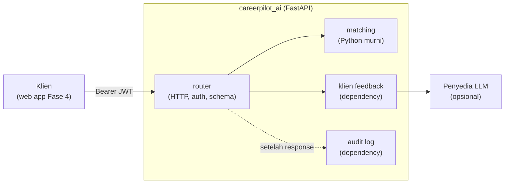

## 🎯 Tujuan

Fase 2 melacak pencarian kerjamu. Fase 3 membantumu **memperbaikinya**: tempel CV dan deskripsi pekerjaan, dapatkan **skor kecocokan** beserta skill yang sudah kamu punya dan yang belum, lalu baca **feedback AI** yang muncul kata demi kata.

```text
POST /v1/match      {"cv_text": "...", "job_text": "..."}

200 OK
{
  "data": {
    "score": 57,
    "level": "partial",
    "matched_skills": ["docker", "git", "postgresql", "python"],
    "missing_skills": ["aws", "fastapi", "sql"]
  }
}
```

Skornya adalah **kode biasa yang kamu tulis dan test sendiri**. AI hanya menulis teks feedback. Ini kebiasaan bagus untuk fitur AI apa pun: taruh bagian yang bisa dicek di kode biasa, dan biarkan model mengerjakan bagian yang butuh bahasa.

## 👤 User story

1. Sebagai pencari kerja, aku bisa mengirim CV dan deskripsi pekerjaan lalu melihat **skor 0 sampai 100** dan level (strong, partial, weak).
2. Aku bisa melihat skill mana yang **sudah cocok** dan mana yang **belum ada**.
3. Aku bisa meminta **feedback** dan membacanya saat ditulis, bukan setelah menunggu lama.
4. Hanya user yang login yang bisa memakai layanan ini, dengan **token yang sama** seperti API Fase 2.
5. Kalau AI mati, aku tetap mendapat skorku, dan layanan menjelaskan dengan jelas apa yang gagal.

## 🏗️ Arsitektur



Pakai susunan dari Module 3 Minggu 3 lesson 02: router tahu HTTP, `matching` tahu aturan dan tak tahu apa pun soal HTTP, dan dua hal yang menyentuh dunia luar (klien AI dan audit log) adalah **dependency** yang bisa kamu ganti di test.

Tiga keputusan untuk ditulis di README-mu (pakai kerangka D-T-C):

- **Kenapa skor itu kode biasa, bukan panggilan LLM?** (Petunjuk: biaya, kecepatan, hasil yang pasti, testing.)
- **Kenapa layanan FastAPI terpisah, bukan route Flask baru?** (Petunjuk: Module 3 W3 lesson 04.)
- **Kenapa layanan ini mempercayai token tanpa memanggil API Fase 2?** (Petunjuk: lesson JWT, tanda tangan dan secret bersama.)

## 📦 Starter kit

:::exercise{path="exercises/projects/careerpilot/phase-3" ai="ai-allowed" title="Starter kit Fase 3 — 70 acceptance test"}
Kit berisi stub `create_app`, `matching` dan `deps`, kosakata skill, `pyproject.toml`, `.env.example`, dan **70 acceptance test** yang menjelaskan kontrak di bawah. Tanpa database dan tanpa API key: test mengganti klien AI dan audit log dengan fake.

1. Salin kit ke repo `careerpilot`-mu sebagai `ai-service/`.
2. Kerjakan checkpoint demi checkpoint: `uv run pytest -k platform`, `-k auth`, `-k matching`, …
3. Jalankan sungguhan dengan `uv run uvicorn --factory careerpilot_ai:create_app --env-file .env --port 5093`.
:::

## 📋 Kontrak API

### Konvensi

| Topik | Aturan |
|---|---|
| Base path | `/v1` (health check di `/health`) |
| Body sukses | `{"data": ...}` |
| Body error | `{"error": {"code": "...", "message": "..."}}`; error validasi menambah `"fields": {"field": ["pesan", ...]}` |
| Validasi | `422 validation_failed` — juga untuk body non-JSON dan **field yang tak dikenal** |
| Auth | `Authorization: Bearer <token>`; JWT HS256 dengan `sub` dan `exp`; token hilang, rusak, tanda tangan salah, kedaluwarsa, tanpa `sub`, atau `alg: none` → `401 unauthorized`. Auth dicek **sebelum** body |
| Route / method tak dikenal | JSON `404 not_found` / `405 method_not_allowed` |
| Tracing | setiap response punya `X-Request-ID` (pakai ulang yang masuk hanya jika cocok dengan `[A-Za-z0-9._-]{1,64}`) |
| Settings | `create_app({"jwt_secret": ...})` — override mengalahkan environment (`JWT_SECRET`). Secret yang hilang, atau lebih pendek dari 32 karakter, menghentikan app saat startup |
| Dokumen | `/docs` dan `/openapi.json` menampilkan kedua endpoint |

### Aturan matching

| Aturan | Detail |
|---|---|
| Skill | daftar di `careerpilot_ai/skills.py` |
| Menemukan skill | tak peka huruf besar-kecil, **hanya kata utuh** (`sql` tidak ada di `PostgreSQL` atau `NoSQL`, `git` tidak ada di `GitHub`); skill multi-kata cocok sebagai frasa |
| Skor | `round(100 * matched / skill di job)` |
| Level | `strong` ≥ 75, `partial` ≥ 40, selain itu `weak` |
| Daftar | `matched_skills` dan `missing_skills`, keduanya terurut |
| Job tanpa skill dikenal | `422` dengan kode `no_skills_found` dan `fields.job_text` |

### Endpoint

| Endpoint | Body | Sukses | Error |
|---|---|---|---|
| `GET /health` | — | `200 {"status": "ok"}` (tanpa token) | — |
| `POST /v1/match` | `cv_text`, `job_text`: string, di-trim, 20–20.000 karakter, tanpa field lain | `200 {"data": {score, level, matched_skills, missing_skills}}` | `401`, `422 validation_failed`, `422 no_skills_found` |
| `POST /v1/feedback` | sama dengan match | `200 text/event-stream` (di bawah) | error yang sama, dikembalikan sebagai JSON biasa **sebelum** streaming dimulai |

### Stream feedback

- Header: `Cache-Control: no-cache` dan `X-Accel-Buffering: no`.
- Tiap token: `data: {"token": "..."}` diikuti baris kosong. Pakai JSON agar token dengan baris baru tak merusak event.
- Akhir normal: `data: [DONE]`.
- Jika AI gagal di tengah jalan (status sudah `200`): kirim `data: {"error": "feedback_failed"}` lalu berhenti. Tanpa `[DONE]`.
- Prompt yang kamu berikan ke klien AI berisi deskripsi pekerjaan, CV, skor, dan skill yang kurang. Prompt **tidak boleh pernah** berisi token user.
- Klien AI bawaan bekerja **offline** (template sederhana). Penyedia sungguhan adalah stretch goal.

### Audit log

Setelah response dikirim (`BackgroundTasks`), catat satu event. Kalau penyimpanan audit gagal, user tetap mendapat response normal.

| Kapan | Event |
|---|---|
| `/v1/match` berhasil | `{"user": <sub>, "endpoint": "match", "score": <n>}` |
| stream `/v1/feedback` berakhir | `{"user": <sub>, "endpoint": "feedback", "status": "ok" atau "error"}` |
| Setiap `401` atau `422` | tidak ada |

Event tidak pernah berisi teks CV atau job. CV adalah data pribadi.

## 🧭 Checkpoint

| # | Checkpoint | Mulai setelah | Selesai jika |
|---|---|---|---|
| **C1** | Platform: factory, settings dari env (gagal cepat), error JSON, request id, health, dokumen | W3 L02 | `-k platform` lulus |
| **C2** | Auth: verifikasi Bearer JWT lewat tanda tangan, dalam satu dependency | W2 L04 | `-k auth` lulus |
| **C3** | Matching: skill, skor, level — Python murni dengan unit test-mu sendiri | W1 L02 | `-k matching` lulus |
| **C4** | `POST /v1/match`: validasi, kontrak, audit di background | W3 L01, L03 | `-k match_api` lulus |
| **C5** | `POST /v1/feedback`: stream SSE, error di tengah jalan, klien bawaan offline | W3 L03 | semua 70 acceptance test lulus |
| **C6** | Test dan kualitas milikmu | W3 L01 | unit test untuk kasus tepi matching; `ruff` + `mypy` bersih; minimal satu test buatanmu yang memakai `dependency_overrides` |
| **C7** | Siap portofolio | — | `Dockerfile` (non-root); README dengan diagram arsitektur, tiga keputusan di atas, GIF streaming; `git tag phase-3`; postingan LinkedIn |

Setelah tiap checkpoint: commit, push, dan tulis *apa yang kubangun / apa yang sulit / apa yang kupelajari* di **Catatanku**.

## 🧪 Kriteria penerimaan

- [ ] Semua 70 acceptance test lulus secara lokal
- [ ] Modul matching punya unit test sendiri dan tidak mengimpor apa pun dari FastAPI
- [ ] Klien AI dan audit log adalah dependency, dan test-mu sendiri menggantinya
- [ ] Tidak ada secret di repo; app menolak start tanpa `JWT_SECRET` yang kuat
- [ ] Tidak ada teks CV di log atau event audit
- [ ] Token dari API Fase 2 bekerja di layanan ini (secret sama) — kamu sudah mencobanya manual
- [ ] Kamu bisa menjelaskan setiap file — lihat pertanyaan wawancara di bawah

## 🏆 Stretch goal

1. **Penyedia LLM sungguhan** di balik antarmuka `.stream(prompt)` yang sama, dipilih lewat `LLM_API_KEY`. Layanan tetap harus bekerja tanpanya.
2. **Matching lebih baik:** sinonim (`postgres` = `postgresql`), dan bobot untuk skill wajib.
3. **Embedding:** bandingkan makna teks CV dan job dengan kemiripan vektor, dan tampilkan di samping skor biasamu. Biarkan skor biasa yang dicek oleh test.
4. **Rate limit** `/v1/feedback` per user, karena tiap panggilan berbiaya.
5. **Batalkan panggilan AI** saat klien putus.

## 🧠 Kebijakan AI

🤖✅ **AI diperbolehkan** untuk boilerplate dan konfigurasi di fase ini (lihat [ikhtisar](/projects/careerpilot/00-overview)). Logika inti — matching, auth, dan stream — milikmu. Aturannya: kalau kamu tak bisa menjelaskan satu baris di wawancara, baris itu tak layak ada di portofoliomu.

## ❓ Pertanyaan yang mungkin ditanyakan pewawancara tentang Fase 3

- Kenapa skor kecocokan itu kode biasa, bukan panggilan LLM?
- Kenapa feedback di-stream, dan apa yang terjadi pada status code jika model gagal di tengah jalan?
- Kenapa klien AI berada di balik dependency? Apa yang jadi mudah di test-mu karena itu?
- Kenapa layanan ini bisa mempercayai token tanpa memanggil API Fase 2? Apa risikonya, dan bagaimana kamu mencabut token?
- Kenapa prompt tidak boleh berisi token user, dan audit log tidak boleh berisi CV?
- Apa yang rusak jika proxy mem-buffer stream-mu?
- Kapan kamu memakai `BackgroundTasks`, dan kapan antrean?

Pakai kerangka D-T-C dari [Defend Your RevoShop](/modules/m2/w6/09-defend-your-revoshop) dan tulis jawabanmu di **Catatanku**.

## 📣 Bagikan

:::linkedin{type="build"}
🤖 CareerPilot Fase 3: layanan AI yang memberi tahu seberapa cocok CV-ku dengan sebuah pekerjaan.

Fungsinya:
🎯 skor kecocokan (0–100) dengan skill yang kupunya dan yang belum
✍️ feedback AI yang muncul kata demi kata

Cara membangunnya:
- FastAPI + Pydantic, JWT yang sama dengan API Flask-ku
- Skornya Python biasa yang dites. AI hanya menulis teks feedback.
- Klien AI di-inject, jadi 70 acceptance test-ku jalan tanpa API key
- Server-Sent Events, dengan event error yang rapi jika model gagal di tengah jalan

Satu hal yang kupelajari: [mis. kenapa status code sudah 200 saat stream gagal, dan bagaimana aku melaporkan error-nya].

Repo: [link]

#Python #FastAPI #AI #BackendDevelopment #BuildInPublic
:::
