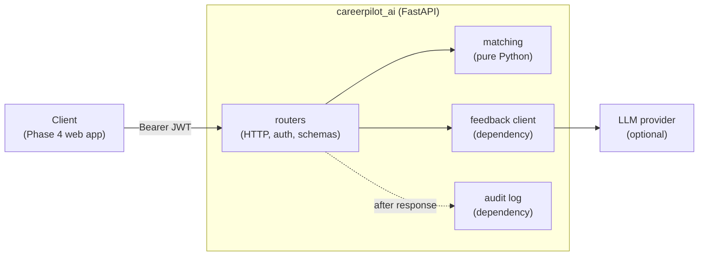

## 🎯 Goal

Phase 2 tracks your job hunt. Phase 3 helps you **improve it**: paste a CV and a job description, get a **match score** with the skills you have and the skills you miss, and read **AI feedback** that appears word by word.

```text
POST /v1/match      {"cv_text": "...", "job_text": "..."}

200 OK
{
  "data": {
    "score": 57,
    "level": "partial",
    "matched_skills": ["docker", "git", "postgresql", "python"],
    "missing_skills": ["aws", "fastapi", "sql"]
  }
}
```

The score is **plain code you write and test**. The AI only writes the feedback text. That is a good habit for any AI feature: put the part you can check in normal code, and let the model do the part that needs language.

## 👤 User stories

1. As a job seeker, I can send my CV and a job description and see a **score from 0 to 100** and a level (strong, partial, weak).
2. I can see which skills I **already match** and which are **missing**.
3. I can ask for **feedback** and read it as it is written, not after a long wait.
4. Only logged-in users can use the service, with the **same token** as the Phase 2 API.
5. If the AI is down, I still get my score, and the service tells me clearly what failed.

## 🏗️ Architecture



Use the layout from Module 3 Week 3 lesson 02: routers know HTTP, `matching` knows the rules and nothing about HTTP, and the two things that touch the outside world (the AI client and the audit log) are **dependencies** you can replace in tests.

Three decisions to write down in your README (use the D-T-C framework):

- **Why is the score plain code and not an LLM call?** (Hint: cost, speed, determinism, testing.)
- **Why a separate FastAPI service and not a new Flask route?** (Hint: Module 3 W3 lesson 04.)
- **Why does the service trust a token without calling the Phase 2 API?** (Hint: JWT lesson, signature and shared secret.)

## 📦 Starter kit

:::exercise{path="exercises/projects/careerpilot/phase-3" ai="ai-allowed" title="Phase 3 starter kit — 70 acceptance tests"}
The kit contains `create_app`, `matching` and `deps` stubs, the skill vocabulary, `pyproject.toml`, `.env.example`, and **70 acceptance tests** that describe the contract below. No database and no API key are needed: the tests replace the AI client and the audit log with fakes.

1. Copy the kit into your `careerpilot` repo as `ai-service/`.
2. Work checkpoint by checkpoint: `uv run pytest -k platform`, `-k auth`, `-k matching`, …
3. Run it for real with `uv run uvicorn --factory careerpilot_ai:create_app --env-file .env --port 5093`.
:::

## 📋 API contract

### Conventions

| Topic | Rule |
|---|---|
| Base path | `/v1` (health check at `/health`) |
| Success body | `{"data": ...}` |
| Error body | `{"error": {"code": "...", "message": "..."}}`; validation errors add `"fields": {"field": ["message", ...]}` |
| Validation | `422 validation_failed` — also for non-JSON bodies and **unknown fields** |
| Auth | `Authorization: Bearer <token>`; HS256 JWT with `sub` and `exp`; missing, malformed, wrong-signature, expired, no-`sub` or `alg: none` token → `401 unauthorized`. Auth is checked **before** the body |
| Unknown route / method | JSON `404 not_found` / `405 method_not_allowed` |
| Tracing | every response has `X-Request-ID` (reuse an incoming one only if it matches `[A-Za-z0-9._-]{1,64}`) |
| Settings | `create_app({"jwt_secret": ...})` — overrides beat the environment (`JWT_SECRET`). A missing secret, or one shorter than 32 characters, stops the app at startup |
| Docs | `/docs` and `/openapi.json` list both endpoints |

### Matching rules

| Rule | Detail |
|---|---|
| Skills | the list in `careerpilot_ai/skills.py` |
| Finding a skill | case-insensitive, **whole words only** (`sql` is not in `PostgreSQL` or `NoSQL`, `git` is not in `GitHub`); multi-word skills match as a phrase |
| Score | `round(100 * matched / skills in the job)` |
| Level | `strong` ≥ 75, `partial` ≥ 40, otherwise `weak` |
| Lists | `matched_skills` and `missing_skills`, both sorted |
| Job with no known skill | `422` with code `no_skills_found` and `fields.job_text` |

### Endpoints

| Endpoint | Body | Success | Errors |
|---|---|---|---|
| `GET /health` | — | `200 {"status": "ok"}` (no token) | — |
| `POST /v1/match` | `cv_text`, `job_text`: strings, trimmed, 20–20,000 characters, no other fields | `200 {"data": {score, level, matched_skills, missing_skills}}` | `401`, `422 validation_failed`, `422 no_skills_found` |
| `POST /v1/feedback` | same as match | `200 text/event-stream` (below) | the same errors, returned as normal JSON **before** streaming starts |

### The feedback stream

- Headers: `Cache-Control: no-cache` and `X-Accel-Buffering: no`.
- Each token: `data: {"token": "..."}` followed by a blank line. Use JSON so a token with a newline cannot break the event.
- Normal end: `data: [DONE]`.
- If the AI fails halfway (the status is already `200`): send `data: {"error": "feedback_failed"}` and stop. No `[DONE]`.
- The prompt you give the AI client contains the job description, the CV, the score and the missing skills. It must **never** contain the user's token.
- The default AI client works **offline** (a simple template). A real provider is a stretch goal.

### The audit log

After the response is sent (`BackgroundTasks`), record one event. If the audit store fails, the user still gets a normal response.

| When | Event |
|---|---|
| `/v1/match` succeeded | `{"user": <sub>, "endpoint": "match", "score": <n>}` |
| `/v1/feedback` stream ended | `{"user": <sub>, "endpoint": "feedback", "status": "ok" or "error"}` |
| Any `401` or `422` | nothing |

Events never contain the CV or job text. CVs are personal data.

## 🧭 Checkpoints

| # | Checkpoint | Start after | Done when |
|---|---|---|---|
| **C1** | Platform: factory, settings from env (fail fast), JSON errors, request ids, health, docs | W3 L02 | `-k platform` passes |
| **C2** | Auth: verify a Bearer JWT by signature, in one dependency | W2 L04 | `-k auth` passes |
| **C3** | Matching: skills, score, level — pure Python with your own unit tests | W1 L02 | `-k matching` passes |
| **C4** | `POST /v1/match`: validation, contract, audit in the background | W3 L01, L03 | `-k match_api` passes |
| **C5** | `POST /v1/feedback`: SSE stream, error mid-stream, offline default client | W3 L03 | all 70 acceptance tests pass |
| **C6** | Your own tests & quality | W3 L01 | unit tests for matching edge cases; `ruff` + `mypy` clean; at least one test using `dependency_overrides` that you wrote |
| **C7** | Portfolio-ready | — | `Dockerfile` (non-root); README with the architecture diagram, the three decisions above, a GIF of streaming; `git tag phase-3`; LinkedIn post |

After each checkpoint: commit, push, and write *what I built / what was hard / what I learned* in **My notes**.

## 🧪 Acceptance criteria

- [ ] All 70 acceptance tests pass locally
- [ ] The matching module has its own unit tests and imports nothing from FastAPI
- [ ] The AI client and the audit log are dependencies, and your own tests replace them
- [ ] No secret in the repo; the app refuses to start without a strong `JWT_SECRET`
- [ ] No CV text appears in logs or audit events
- [ ] A token from the Phase 2 API works on this service (same secret) — you tried it by hand
- [ ] You can explain every file — see the interview questions below

## 🏆 Stretch goals

1. **A real LLM provider** behind the same `.stream(prompt)` interface, chosen by `LLM_API_KEY`. The service must still work without it.
2. **Better matching:** synonyms (`postgres` = `postgresql`), and weights for must-have skills.
3. **Embeddings:** compare the meaning of CV and job text with vector similarity, and show it next to your plain score. Keep the plain score as the one the tests check.
4. **Rate limit** `/v1/feedback` per user, because each call costs money.
5. **Cancel the AI call** when the client disconnects.

## 🧠 AI policy

🤖✅ **AI is allowed** for boilerplate and configuration in this phase (see the [overview](/projects/careerpilot/00-overview)). The core logic — matching, auth and the stream — is yours. Rule: if you cannot explain a line in an interview, it does not belong in your portfolio.

## ❓ Questions an interviewer might ask about Phase 3

- Why is the match score plain code and not an LLM call?
- Why stream the feedback, and what happens to the status code if the model fails halfway?
- Why does the AI client sit behind a dependency? What did that make easy in your tests?
- Why can this service trust a token without calling the Phase 2 API? What is the risk, and how would you revoke a token?
- Why must the prompt never contain the user's token, and the audit log never the CV?
- What would break if a proxy buffered your stream?
- When would you use `BackgroundTasks`, and when a queue?

Use the D-T-C framework from [Defend Your RevoShop](/modules/m2/w6/09-defend-your-revoshop) and write your answers in **My notes**.

## 📣 Share it

:::linkedin{type="build"}
🤖 CareerPilot Phase 3: an AI service that tells me how well my CV fits a job.

What it does:
🎯 a match score (0–100) with the skills I have and the ones I'm missing
✍️ AI feedback that streams in word by word

How it's built:
- FastAPI + Pydantic, JWT shared with my Flask API
- The score is plain, tested Python. The AI only writes the feedback text.
- The AI client is injected, so my 70 acceptance tests run with no API key
- Server-Sent Events, with a clean error event if the model fails halfway

One thing I learned: [e.g. why the status code is already 200 when a stream fails, and how I report the error].

Repo: [link]

#Python #FastAPI #AI #BackendDevelopment #BuildInPublic
:::
