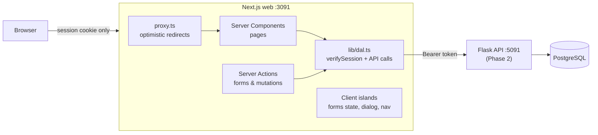

## 🎯 Tujuan

API Phase 2-mu sudah berjalan — tapi hanya kamu dan `curl` yang bisa menggunakannya. Phase 4 memberinya **wajah produk yang nyata**: aplikasi web yang cepat, bisa diakses, aman, yang bisa kamu tunjukkan di interview frontend atau full-stack, dan benar-benar bisa kamu pakai untuk mencari kerja.

```text
Dashboard · CareerPilot
┌──────────────────────────────────────────────────────────┐
│ Dashboard   Applications   Companies            Log out  │
├──────────────────────────────────────────────────────────┤
│ Welcome, Sari                                            │
│ Total 12   Active 8   Interview 3   Offer 1   Rejected 3 │
└──────────────────────────────────────────────────────────┘
```

## 👤 User stories

1. Sebagai pencari kerja, saya bisa **membuat akun, login dan logout**; session saya aman dan data saya pribadi.
2. Saya melihat **dashboard** dengan angka-angka pencarian kerja saya.
3. Saya mengelola **perusahaan** yang saya minati.
4. Saya **menambah aplikasi**, **filter dan cari** mereka, dan menavigasi daftar yang panjang — dan saya bisa membagikan atau bookmark daftar yang ter-filter.
5. Di halaman aplikasi saya **memindahkannya melalui pipeline** (hanya langkah berikutnya yang valid), melihat **riwayatnya**, menyimpan **catatan**, dan bisa **menghapusnya** setelah konfirmasi.

## 🏗️ Arsitektur

API itu dapur; phase ini membangun ruang makan. Tidak ada yang berubah di Phase 2 — kamu menambahkan bagian yang benar-benar dilihat pelanggan.



- Token akses Flask hidup **hanya** di cookie yang terenkripsi, httpOnly (W5 L02). Browser tidak pernah melihatnya.
- Halaman adalah **Server Component** yang memanggil API melalui **Data Access Layer**; mutasi adalah **Server Action** (W5 L01). Route Handler hanya jika kamu menambahkan fetch di sisi klien (misalnya papan drag-and-drop).
- `"use client"` hanya untuk bagian interaktif: form state, dialog delete, link nav yang aktif.

## 📦 Starter kit

:::exercise{path="exercises/projects/careerpilot/phase-4" ai="ai-allowed" title="Starter kit Phase 4 — 23 Playwright acceptance test"}
Kit berisi konfigurasi Playwright yang menyalakan **mock Phase 2 API-mu di memory** (port 5093) dan **production build aplikasimu** (port 3091), plus 23 acceptance test yang menjelaskan kontrak UI di bawah. Buat aplikasinya dengan `create-next-app` di `careerpilot/web`, copy kit-nya, dan ikuti README-nya.
:::

## 📋 Kontrak UI

Menulis layar terlebih dahulu itu seperti menggambar denah sebelum membeli furnitur: itu menjaga build tetap fokus dan membuat acceptance test jelas.

Acceptance test mencari hal-hal **seperti user dan screen reader** — dengan label, role, dan teks. Gunakan nama-nama ini persis (styling sepenuhnya terserah kamu).

### Global

| Item | Kontrak |
|---|---|
| Judul | `"{halaman} · CareerPilot"` via metadata `title.template` — misalnya `Dashboard · CareerPilot`, halaman aplikasi `"{role} at {company} · CareerPilot"` |
| Navigasi | `<nav aria-label="Main">` dengan link **Dashboard**, **Applications**, **Companies**; yang sekarang punya `aria-current="page"`; tombol **Log out** |
| Halaman terlindungi | `/dashboard`, `/applications`, `/applications/new`, `/applications/[id]`, `/companies` → `/login?next=<path>` saat belum login |
| Flash message | setelah redirect: `role="status"` dengan **Application created** / **Application deleted** |
| Error | masalah level form di `role="alert"`; field yang tidak valid dapat `aria-invalid="true"` |
| Status | ditampilkan sebagai **Saved, Applied, Screening, Interview, Offer, Accepted, Rejected, Withdrawn** |

### Auth

| Halaman | Kontrak |
|---|---|
| `/register` | field **Name**, **Email**, **Password**; tombol **Create account** → logged in di `/dashboard`; email duplikat (case apapun) → alert **An account with this email already exists**; field tidak valid → `aria-invalid` |
| `/login` | field **Email**, **Password**; tombol **Log in** → `next` (hanya path relatif yang aman) atau `/dashboard`; kredensial salah → alert **Invalid email or password**; user yang sudah login dikirim ke `/dashboard` |
| Session | httpOnly cookie, `sameSite` lax, `secure` kecuali `COOKIE_SECURE=false`; API token tidak boleh muncul di `document.cookie`, `localStorage`, `sessionStorage` **atau nilai cookie apapun** (enkripsi, misalnya jose `EncryptJWT`) |
| Log out | menghapus session → `/login`; halaman terlindungi redirect lagi |

### Dashboard `/dashboard`

Heading **Dashboard**, teks **Welcome, {name}** (dari `GET /me`), dan stats dari `GET /stats` di elemen dengan `data-testid`: `stat-total`, `stat-active`, dan `stat-{status}` untuk semua 8 status.

### Companies `/companies`

Heading **Companies**; field **Company name**, **Website**; tombol **Add company** (bersihkan form saat sukses); `<ul aria-label="Companies">` diurutkan berdasarkan nama (API melakukannya); duplikat → alert **You already have a company with this name**; website tidak valid → `aria-invalid` di **Website**; setiap item punya tombol dengan nama aksesibel **Delete {name}**; perusahaan dengan aplikasi → alert **This company still has applications**.

### Daftar aplikasi `/applications`

| Item | Kontrak |
|---|---|
| Header | heading **Applications**, link **New application** |
| Filter | form dengan select **Status** (`All` = nilai kosong, lalu 8 status berdasarkan nilai), input **Search** dan tombol **Apply filters**, disimpan di URL sebagai `?status=&q=` (reload menjaganya) |
| Tabel | satu baris per aplikasi dengan role (link ke halamannya), nama perusahaan dan label status; terbaru duluan |
| Kosong | **No applications yet** (tanpa filter) · **No applications match your filters** (dengan filter) |
| Pagination | 20 per halaman; `<nav aria-label="Pagination">` dengan **Page X of Y**, link **Previous page** / **Next page** (tersembunyi saat tidak tersedia), `?page=` di URL |

### Aplikasi baru `/applications/new`

Heading **New application**; field **Company** (select perusahaan-mu), **Role**, **Job URL**, **Minimum salary**, **Maximum salary**; tombol **Save application**. Role wajib; max < min → **Maximum must be at least the minimum** di **Maximum salary**; nilai yang diketik disimpan setelah error. Tanpa perusahaan → teks **Add a company first** dengan link **Companies**. Sukses → halaman aplikasi dengan **Application created**.

### Halaman aplikasi `/applications/[id]`

| Item | Kontrak |
|---|---|
| Header | `h1` = role; nama perusahaan terlihat; label status di `data-testid="status"` |
| Pipeline | select **Move to** mencantumkan **hanya status berikutnya yang diizinkan** (pipeline Phase 2) + tombol **Update status**; status final menampilkan **This application is closed** sebagai gantinya |
| Riwayat | `<ol aria-label="Status history">`, paling tua duluan, item seperti **Saved → Applied** |
| Catatan | textarea **New note**, tombol **Add note** (bersihkan saat sukses), `<ul aria-label="Notes">` terbaru duluan, masing-masing dengan tombol **Delete note** |
| Hapus | tombol **Delete application** membuka `alertdialog` bernama **Delete "{role}"?** dengan **Cancel** dan **Delete** → `/applications` dengan **Application deleted** |
| Tidak ditemukan | id yang tidak dikenal **dan aplikasi pengguna lain** → HTTP **404** dengan heading **Application not found** |

## 🧭 Checkpoint

| # | Checkpoint | Mulai setelah | Selesai saat |
|---|---|---|---|
| **C1** | Setup: `create-next-app`, strict TS, ESLint, Tailwind, port 3091, validasi env (`lib/env.ts`), root layout dengan title template, layout `(app)` dengan nav Main | M4 W4 L01–L03 | app build; nav dan judul bekerja melawan API-mu |
| **C2** | Auth: register, login, logout, encrypted session cookie, `proxy.ts`, DAL, `next` yang aman | M4 W5 L01–L02 | `e2e/acceptance/auth.spec.ts` lulus |
| **C3** | Dashboard & perusahaan | M4 W4 L04–L05, W5 L01 | `companies.spec.ts` lulus, dan 3 dari 4 test di `dashboard-navigation.spec.ts` (test 404 datang di C5) |
| **C4** | Daftar aplikasi (URL filter, pagination) & form buat | M4 W4 L06, W5 L01, L07 | `applications.spec.ts -g list` dan `-g create` lulus |
| **C5** | Halaman aplikasi: transisi, riwayat, catatan, dialog delete, 404 | M4 W5 L03, L08 | **semua 23 acceptance test lulus** |
| **C6** | Kualitas: component test (Vitest + Testing Library) untuk form dan dialog-mu; 3+ E2E test milikmu; `lint` + `typecheck` bersih; GitHub Actions menjalankan kedua suite | M4 W6 L01–L03, L06 | CI hijau di pull request |
| **C7** | Production: `output: "standalone"`, multi-stage non-root Dockerfile, `/api/health`, `compose.yaml` menjalankan web + API + Postgres bersama, Lighthouse di halaman job, Web Vitals reporting | M4 W6 L04, L05, L07 | `docker compose up` bekerja end to end; LCP/CLS "good" di Lighthouse mobile |
| **C8** | Di-deploy & siap portfolio | M4 W6 L05 | live URL (misalnya Vercel + API-mu yang di-deploy); README dengan screenshot/GIF, diagram arsitektur, perintah test, keputusan (D-T-C); `git tag phase-4`; LinkedIn post |

Setelah setiap checkpoint: commit, push, dan tulis *apa yang kubuat / apa yang sulit / apa yang kupelajari* di **My notes**.

## 🧪 Kriteria acceptance

- [ ] Semua 23 acceptance test lulus lokal **dan di CI**, melawan production build
- [ ] Aplikasi juga bekerja melawan Phase 2 API **real**-mu (demo-kan)
- [ ] Token Flask tidak pernah menjangkau JavaScript browser; setiap Server Action mengecek session
- [ ] Hanya komponen interaktif kecil yang Client Component (jelaskan setiap `"use client"`)
- [ ] Penggunaan keyboard saja bekerja: focus terlihat, dialog focus handling, field berlabel
- [ ] Component test dan E2E test milikmu ada dan berjalan di CI
- [ ] Image Docker standalone, non-root, dengan health check; tanpa secret di image
- [ ] Kamu bisa menjelaskan setiap file

## 🏆 Stretch goals

1. **Kanban board** di `/board`: drag aplikasi antar kolom yang diizinkan dengan **TanStack Query** optimistic update dan rollback, melalui BFF Route Handler (W4 L07, W5 L05).
2. **shadcn/ui + dark mode** dengan design system kecil dan Storybook stories (W5 L08).
3. **React Hook Form + Zod** halaman edit `/applications/[id]/edit` yang berbagi satu schema (W5 L07).
4. **Job search** halaman menggunakan data Phase 1 dengan URL filter dan `"use cache"` (W4 L06).
5. **Refresh token** jika kamu membuatnya di Phase 2: rotate di DAL tanpa logout user.
6. **i18n**: Bahasa Indonesia dan English dengan locale di URL.

## 🧠 Kebijakan AI

🤖✅ **AI diizinkan untuk boilerplate dan konfigurasi** (setup Tailwind, Dockerfile skeleton, CI YAML, markup berulang) — lihat [overview](/projects/careerpilot/00-overview). **Kamu tulis**: kode session dan DAL, Server Action, transisi UI logic dan test-mu. Sebelum commit output AI, jelaskan baris demi baris di **My notes**.

## ❓ Pertanyaan yang mungkin ditanya interviewer tentang Phase 4

- Kenapa simpan API token di cookie terenkripsi httpOnly daripada `localStorage`? Apa yang dilindungi `sameSite: "lax"`?
- Apa yang dicek `proxy.ts`, dan kenapa sendiri tidak cukup?
- Komponen mana yang Client Component dan kenapa? Apa yang akan rusak jika halaman aplikasi adalah satu Client Component besar?
- Bagaimana filter tetap ada setelah reload, dan kenapa itu lebih baik daripada React state?
- Bagaimana UI tetap konsisten dengan aturan pipeline API? Apa yang terjadi jika API menolak transisi?
- Kenapa aplikasi pengguna lain mengembalikan 404 dan bukan 403?
- Bagaimana kamu test dialog delete? Apa yang ada di E2E suite-mu vs component test-mu?
- Apa yang Lighthouse tunjukkan, dan apa yang kamu ubah?

## 📣 Bagikan

:::linkedin{type="build"}
🚀 CareerPilot Phase 4: aplikasi pelacak pencarian kerja saya sekarang punya web app yang nyata.

Apa yang dilakukannya:
📊 dashboard pencarian kerja saya
📋 aplikasi melalui hiring pipeline — hanya langkah berikutnya yang valid, riwayat lengkap, catatan
🔎 filter dan cari yang hidup di URL, jadi saya bisa bookmark "interviews bulan ini"

Cara dibuatnya:
- Next.js App Router + TypeScript: Server Component, Server Action, data access layer
- Session aman: API token tetap di cookie httpOnly terenkripsi, tidak pernah di browser
- 23 Playwright acceptance test + component test saya sendiri (Vitest + Testing Library) di CI
- Image Docker standalone, health check, performa dicheck Lighthouse

Satu hal yang kupelajari: [misalnya mengapa "sembunyikan tombol" bukan authorization].

Live: [link] · Repo: [link]

#NextJS #React #TypeScript #WebDevelopment #BuildInPublic
:::
