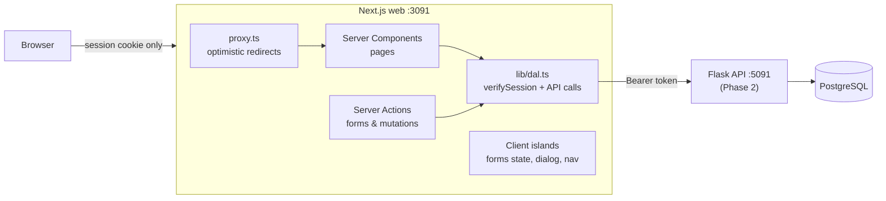

## 🎯 Goal

Your Phase 2 API works — but only you and `curl` can use it. Phase 4 gives it a **real product face**: a fast, accessible, secure web app you can show in any frontend or full-stack interview, and actually use for your job hunt.

```text
Dashboard · CareerPilot
┌──────────────────────────────────────────────────────────┐
│ Dashboard   Applications   Companies            Log out  │
├──────────────────────────────────────────────────────────┤
│ Welcome, Sari                                            │
│ Total 12   Active 8   Interview 3   Offer 1   Rejected 3 │
└──────────────────────────────────────────────────────────┘
```

## 👤 User stories

1. As a job seeker, I can **create an account, log in and log out**; my session is secure and my data is private.
2. I see a **dashboard** with the numbers of my job hunt.
3. I manage the **companies** I'm interested in.
4. I **add applications**, **filter and search** them, and page through long lists — and I can share or bookmark a filtered list.
5. On an application's page I **move it through the pipeline** (only valid next steps), see its **history**, keep **notes**, and can **delete** it after confirming.

## 🏗️ Architecture

The API stays the kitchen; this phase builds the dining room. Nothing about Phase 2 changes — you're adding the part customers actually see.



- The Flask access token lives **only** in an encrypted, httpOnly session cookie (W5 L02). The browser never sees it.
- Pages are **Server Components** that call the API through a **Data Access Layer**; mutations are **Server Actions** (W5 L01). Route Handlers only if you add client-side fetching (e.g. a drag-and-drop board).
- `"use client"` only for interactive leaves: form state, the delete dialog, active nav links.

## 📦 Starter kit

:::exercise{path="exercises/projects/careerpilot/phase-4" ai="ai-allowed" title="Phase 4 starter kit — 23 Playwright acceptance tests"}
The kit contains a Playwright config that starts an in-memory **mock of your Phase 2 API** (port 5093) and a **production build of your app** (port 3091), plus 23 acceptance tests describing the UI contract below. Create the app with `create-next-app` in `careerpilot/web`, copy the kit in, and follow the kit's README.
:::

## 📋 UI contract

Writing the screens down first is like drawing a floor plan before buying furniture: it keeps the build focused and makes the acceptance tests obvious.

The acceptance tests find things **the way users and screen readers do** — by labels, roles and text. Use exactly these names (styling is completely up to you).

### Global

| Item | Contract |
|---|---|
| Titles | `"{page} · CareerPilot"` via a metadata `title.template` — e.g. `Dashboard · CareerPilot`, application page `"{role} at {company} · CareerPilot"` |
| Navigation | `<nav aria-label="Main">` with links **Dashboard**, **Applications**, **Companies**; the current one has `aria-current="page"`; a **Log out** button |
| Protected pages | `/dashboard`, `/applications`, `/applications/new`, `/applications/[id]`, `/companies` → `/login?next=<path>` when logged out |
| Flash messages | after redirects: `role="status"` with **Application created** / **Application deleted** |
| Errors | form-level problems in `role="alert"`; invalid fields get `aria-invalid="true"` |
| Statuses | shown as **Saved, Applied, Screening, Interview, Offer, Accepted, Rejected, Withdrawn** |

### Auth

| Page | Contract |
|---|---|
| `/register` | fields **Name**, **Email**, **Password**; button **Create account** → logged in on `/dashboard`; duplicate email (any case) → alert **An account with this email already exists**; invalid fields → `aria-invalid` |
| `/login` | fields **Email**, **Password**; button **Log in** → `next` (safe relative paths only) or `/dashboard`; wrong credentials → alert **Invalid email or password**; logged-in users are sent to `/dashboard` |
| Session | httpOnly cookie, `sameSite` lax, `secure` unless `COOKIE_SECURE=false`; the API token must not appear in `document.cookie`, `localStorage`, `sessionStorage` **or any cookie value** (encrypt it, e.g. jose `EncryptJWT`) |
| Log out | deletes the session → `/login`; protected pages redirect again |

### Dashboard `/dashboard`

Heading **Dashboard**, text **Welcome, {name}** (from `GET /me`), and stats from `GET /stats` in elements with `data-testid`: `stat-total`, `stat-active`, and `stat-{status}` for all 8 statuses.

### Companies `/companies`

Heading **Companies**; fields **Company name**, **Website**; button **Add company** (clears the form on success); `<ul aria-label="Companies">` sorted by name (the API does it); duplicate → alert **You already have a company with this name**; invalid website → `aria-invalid` on **Website**; each item has a button with the accessible name **Delete {name}**; company with applications → alert **This company still has applications**.

### Applications list `/applications`

| Item | Contract |
|---|---|
| Header | heading **Applications**, link **New application** |
| Filters | a form with **Status** select (`All` = empty value, then the 8 statuses by value), **Search** input and **Apply filters** button, stored in the URL as `?status=&q=` (reload keeps them) |
| Table | one row per application with the role (link to its page), company name and status label; newest first |
| Empty | **No applications yet** (no filters) · **No applications match your filters** (with filters) |
| Pagination | 20 per page; `<nav aria-label="Pagination">` with **Page X of Y**, links **Previous page** / **Next page** (hidden when unavailable), `?page=` in the URL |

### New application `/applications/new`

Heading **New application**; fields **Company** (select of your companies), **Role**, **Job URL**, **Minimum salary**, **Maximum salary**; button **Save application**. Role required; max < min → **Maximum must be at least the minimum** on **Maximum salary**; typed values are kept after errors. No companies → text **Add a company first** with a link **Companies**. Success → the application's page with **Application created**.

### Application page `/applications/[id]`

| Item | Contract |
|---|---|
| Header | `h1` = role; the company name is visible; status label in `data-testid="status"` |
| Pipeline | select **Move to** listing **only allowed next statuses** (Phase 2 pipeline) + button **Update status**; final statuses show **This application is closed** instead |
| History | `<ol aria-label="Status history">`, oldest first, items like **Saved → Applied** |
| Notes | textarea **New note**, button **Add note** (clears on success), `<ul aria-label="Notes">` newest first, each with a **Delete note** button |
| Delete | button **Delete application** opens an `alertdialog` named **Delete "{role}"?** with **Cancel** and **Delete** → `/applications` with **Application deleted** |
| Not found | unknown ids **and other users' applications** → HTTP **404** with heading **Application not found** |

## 🧭 Checkpoints

| # | Checkpoint | Start after | Done when |
|---|---|---|---|
| **C1** | Setup: `create-next-app`, strict TS, ESLint, Tailwind, port 3091, env validation (`lib/env.ts`), root layout with title template, `(app)` layout with Main nav | M4 W4 L01–L03 | app builds; nav and titles work against your API |
| **C2** | Auth: register, login, logout, encrypted session cookie, `proxy.ts`, DAL, safe `next` | M4 W5 L01–L02 | `e2e/acceptance/auth.spec.ts` passes |
| **C3** | Dashboard & companies | M4 W4 L04–L05, W5 L01 | `companies.spec.ts` passes, and 3 of 4 tests in `dashboard-navigation.spec.ts` (the 404 test comes in C5) |
| **C4** | Applications list (URL filters, pagination) & create form | M4 W4 L06, W5 L01, L07 | `applications.spec.ts -g list` and `-g create` pass |
| **C5** | Application page: transitions, history, notes, delete dialog, 404s | M4 W5 L03, L08 | **all 23 acceptance tests pass** |
| **C6** | Quality: component tests (Vitest + Testing Library) for your forms and dialog; 3+ E2E tests of your own; `lint` + `typecheck` clean; GitHub Actions running both suites | M4 W6 L01–L03, L06 | CI green on a pull request |
| **C7** | Production: `output: "standalone"`, multi-stage non-root Dockerfile, `/api/health`, `compose.yaml` running web + API + Postgres together, Lighthouse on the job pages, Web Vitals reporting | M4 W6 L04, L05, L07 | `docker compose up` works end to end; LCP/CLS "good" in Lighthouse mobile |
| **C8** | Deployed & portfolio-ready | M4 W6 L05 | live URL (e.g. Vercel + your deployed API); README with screenshots/GIF, architecture diagram, test commands, decisions (D-T-C); `git tag phase-4`; LinkedIn post |

After each checkpoint: commit, push, and write *what I built / what was hard / what I learned* in **My notes**.

## 🧪 Acceptance criteria

- [ ] All 23 acceptance tests pass locally **and in CI**, against a production build
- [ ] The app also works against your **real** Phase 2 API (demo it)
- [ ] The Flask token never reaches browser JavaScript; every Server Action checks the session
- [ ] Only small interactive components are Client Components (explain each `"use client"`)
- [ ] Keyboard-only use works: visible focus, dialog focus handling, labelled fields
- [ ] Your own component and E2E tests exist and run in CI
- [ ] Docker image is standalone, non-root, with a health check; no secrets in the image
- [ ] You can explain every file

## 🏆 Stretch goals

1. **Kanban board** at `/board`: drag applications between allowed columns with **TanStack Query** optimistic updates and rollback, through BFF Route Handlers (W4 L07, W5 L05).
2. **shadcn/ui + dark mode** with a small design system and Storybook stories (W5 L08).
3. **React Hook Form + Zod** edit page `/applications/[id]/edit` sharing one schema (W5 L07).
4. **Job search** page using Phase 1 data with URL filters and `"use cache"` (W4 L06).
5. **Refresh tokens** if you built them in Phase 2: rotate them in the DAL without logging the user out.
6. **i18n**: Bahasa Indonesia and English with locale in the URL.

## 🧠 AI policy

🤖✅ **AI-allowed for boilerplate and configuration** (Tailwind setup, Dockerfile skeleton, CI YAML, repetitive markup) — see the [overview](/projects/careerpilot/00-overview). **You write**: the session and DAL code, Server Actions, the transition UI logic and your tests. Before committing AI output, explain it line by line in **My notes**.

## ❓ Questions an interviewer might ask about Phase 4

- Why keep the API token in an encrypted httpOnly cookie instead of `localStorage`? What does `sameSite: "lax"` protect against?
- What does `proxy.ts` check, and why isn't it enough on its own?
- Which components are Client Components and why? What would break if the application page were one big Client Component?
- How do filters survive a reload, and why is that better than React state?
- How does the UI stay consistent with the API's pipeline rules? What happens if the API rejects a transition?
- Why does another user's application return 404 and not 403?
- How do you test the delete dialog? What's in your E2E suite vs your component tests?
- What did Lighthouse show, and what did you change?

## 📣 Share it

:::linkedin{type="build"}
🚀 CareerPilot Phase 4: my job-hunt tracker now has a real web app.

What it does:
📊 a dashboard of my job hunt
📋 applications through a hiring pipeline — only valid next steps, full history, notes
🔎 filters and search that live in the URL, so I can bookmark "interviews this month"

How it's built:
- Next.js App Router + TypeScript: Server Components, Server Actions, a data access layer
- Secure sessions: the API token stays in an encrypted httpOnly cookie, never in the browser
- 23 Playwright acceptance tests + my own component tests (Vitest + Testing Library) in CI
- Standalone Docker image, health checks, Lighthouse-checked performance

One thing I learned: [e.g. why "hiding the button" isn't authorization].

Live: [link] · Repo: [link]

#NextJS #React #TypeScript #WebDevelopment #BuildInPublic
:::
