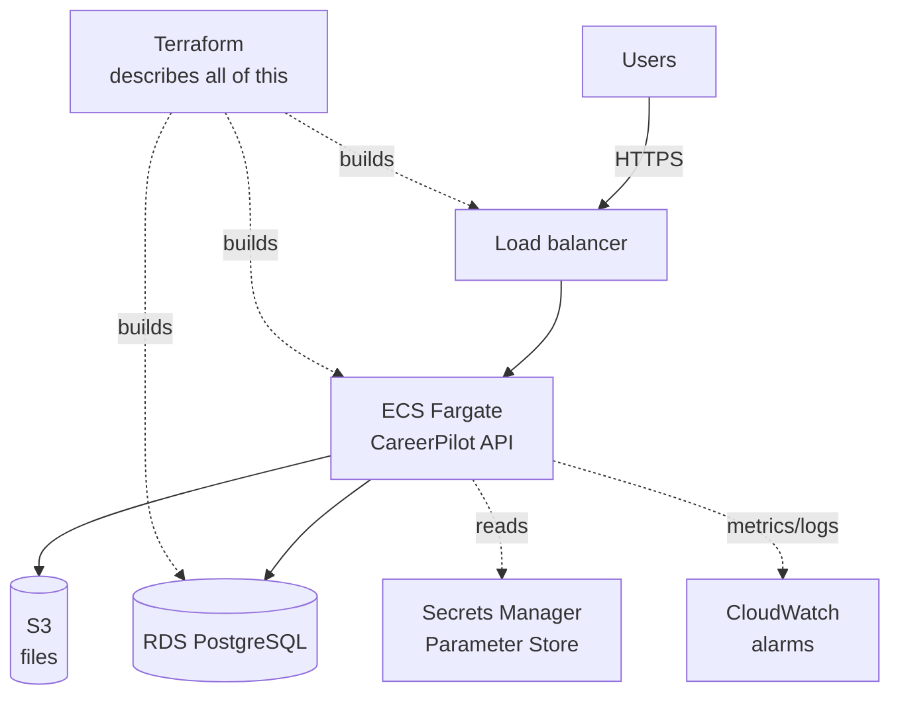

## 🎯 Tujuan

CareerPilot API (Phase 2) dan web app (Phase 4)-mu berjalan di laptop. Phase 5 menempatkannya **di internet, seperti cara tim nyata**: container berjalan di AWS, database terkelola, seluruh setup ditulis sebagai kode yang bisa kamu rebuild atau hapus dalam satu perintah, dan alarm yang memberitahu saat ada yang rusak.

Ini adalah kapstone Module 5. Semua yang kamu pelajari minggu ini ada di sini: container (W1), CI/CD (W2), AWS (W3–W4), dan pemikiran microservices minggu ini, pilihan orkestrasi, Terraform, observability, dan disiplin biaya (W5–W7).

```text
Sebelum (Phase 4)                      Setelah Phase 5
────────────────────────────────     ─────────────────────────────────────────────
berjalan di laptop                    berjalan di AWS, bisa diakses URL nyata
kamu mulai dengan tangan              ECS menjaganya tetap berjalan dan ganti crash
SQLite / Postgres lokal               RDS PostgreSQL terkelola dengan backup
"berfungsi di mesin saya"             dibangun dari satu image, di-deploy CI/CD
setup dengan klik / tangan            didefinisikan Terraform, rebuild satu perintah
tidak tahu kalau down                 CloudWatch alarm memberitahu
mudah lupa dan kena tagihan           terraform destroy tidak meninggalkan apa-apa
```

:::warning[Uang dan paket gratis — baca dulu]
Ini satu-satunya project di handbook yang bisa **menghabiskan uang sungguhan** kalau tidak hati-hati. Akun AWS baru dapat paket gratis berbasis kredit yang berakhir setelah 6 bulan atau kredit habis. Sebelum mulai: set **budget alarm** (Module 5 · W3), tag setiap resource, dan rencanakan **`terraform destroy` segera setelah selesai**. Deployment kecil yang dihapus dengan bersih harganya beberapa rupiah. Instance RDS yang lupa berarti biaya nyata selama berbulan-bulan. Teardown bukan opsional — itu bagian dari project.
:::

## 👤 User stories

- **Sebagai pengunjung,** saya bisa membuka CareerPilot di URL nyata melalui HTTPS dan menggunakannya.
- **Sebagai developer,** saat saya push ke `main`, CI build image dan deploy — saya tidak perlu deploy manual.
- **Sebagai operator,** kalau app mulai gagal, alarm menjangkau saya daripada saya tahu dari user.
- **Sebagai pemilik,** saya bisa rebuild seluruh environment dari kode, dan hapus semuanya dengan satu perintah.

## 🏗️ Arsitektur



Semuanya di gambar itu adalah satu atau lebih **Terraform resource**. Kamu tidak meng-klik ini bersama-sama di console — kamu mendeskripsikannya di kode dan membiarkan `terraform apply` membangunnya.

> Kenapa ECS Fargate dan bukan Kubernetes? CareerPilot adalah satu app kecil dengan satu maintainer. Seperti yang W6 jelaskan, Fargate menjalankan container-mu tanpa server untuk dioperasikan — rung yang tepat dari tangga. EKS/Kubernetes akan menjadi kompleksitas yang kamu maintain tanpa manfaat.

## 📋 Yang "selesai" terlihat seperti

- CareerPilot **API berjalan sebagai ECS Fargate service** di belakang load balancer, bisa diakses melalui HTTPS.
- Database adalah **RDS PostgreSQL**, bukan sesuatu yang berjalan di dalam container yang bisa dibuang.
- **Secret** (JWT key, DB password, API key apapun) berasal dari Secrets Manager / Parameter Store — tidak pernah hard-code, tidak pernah di git.
- **Seluruh environment adalah Terraform**: `terraform apply` membangunnya, `terraform destroy` menghapusnya, dan parameterized paling tidak untuk environment `dev`.
- **CI/CD** (dari W2) membangun image dan deploy versi baru saat push ke `main`.
- Paling tidak **dua CloudWatch alarm** pada gejala yang dihadapi user (rate 5xx error, latency) yang benar-benar akan memberi notifikasi.
- **Teardown + cost review**: kamu bisa buktikan environment tidak ada biaya setelah `destroy`.

## 🧭 Checkpoint

### C0 · Prasyarat (30 min)

- CareerPilot API-mu sudah di-containerize (Dockerfile produksi yang bersih — reuse pola Ship-RevoShop dari W1).
- Kamu punya akun AWS dengan **root MFA dan budget alarm sudah set** (W3 · Account Safety). Jangan skip ini.
- Terraform dan AWS CLI terinstall dan ter-autentikasi.

### C1 · Jaringan (60 min)

Tulis Terraform untuk **VPC**, subnet dan security group (W3 · Regions & VPC). Jaga database di subnet **private** — itu tidak boleh bisa diakses dari internet, hanya dari security group API.

### C2 · Database di RDS (60 min)

Terraform instance **RDS PostgreSQL** (ukuran kecil, misalnya `db.t3.micro`), di subnet private, dengan password-nya disimpan di **Secrets Manager** (bukan di file `.tf`-mu). Output endpoint-nya.

### C3 · API di ECS Fargate (120 min)

Terraform **ECS cluster**, **task definition** (image-mu, CPU/memory, environment dari Parameter Store, secret dari Secrets Manager), **ECS service** menjaga ≥1 task tetap hidup, dan **Application Load Balancer** di depan. Jalankan database migration sebagai one-off task (pola dari W1's Ship lab).

### C4 · Variabel, output, modul (60 min)

Refactor ke W7 · L02: tarik nilai per-environment ke `dev.tfvars`, expose `database_url` dan `site_url` sebagai **output**, dan bundle potongan berulang (service + load balancer-nya) ke dalam **modul**. Bangun semuanya dengan `terraform apply -var-file=dev.tfvars`.

### C5 · CI/CD deploy (60 min)

Perluas pipeline W2-mu: saat push ke `main`, bangun dan push image, lalu update ECS service ke image baru (atau jalankan `terraform apply`). Konfirmasi bahwa perubahan kode mencapai AWS tanpa kamu deploy manual.

### C6 · Observability (60 min)

Tambah **CloudWatch alarm** pada rate 5xx load balancer dan latency target (W7 · L03), wired ke SNS topic yang email kamu. Paksa failure (stop task, atau deploy image rusak) dan konfirmasi alarm fires.

### C7 · Teardown & cost review (30 min)

Jalankan `terraform destroy -var-file=dev.tfvars`, baca preview, dan konfirmasi **semuanya** hilang. Lalu lakukan checklist W7 · L05: check billing console dan setiap region untuk orphan (volume, address, snapshot). Tulis berapa biaya experiment-nya.

## 🧪 Kriteria acceptance

- [ ] Seluruh environment dibuat dengan `terraform apply` dan dihapus dengan `terraform destroy` — tidak ada klik console untuk setup nyata.
- [ ] CareerPilot bisa diakses di URL HTTPS saat environment aktif.
- [ ] Database adalah RDS di subnet **private**; API menjangkaunya, internet tidak.
- [ ] Tidak ada secret di file `.tf` atau git; mereka berasal dari Secrets Manager / Parameter Store.
- [ ] Push ke `main` deploy versi baru melalui CI/CD, bukan manual.
- [ ] Paling tidak dua alarm pada gejala yang dihadapi user fires saat kamu paksa failure.
- [ ] Setelah `destroy`, billing console dan semua region yang dipakai tidak menunjukkan apa-apa yang berjalan.
- [ ] Setiap resource di-**tag** (`project=careerpilot`, `environment=dev`).

## 🏆 Stretch goals

- [ ] Environment kedua (`prod.tfvars`) dibangun dari kode yang sama, hanya nilai yang berbeda.
- [ ] Letakkan Phase 4 **web app** di S3 + CloudFront (W4 · L01) di depan API.
- [ ] Deploy **blue/green atau canary** (W7 · L04) menggunakan ECS built-in deployment feature.
- [ ] Simpan **state** Terraform di S3 backend dengan locking, bukan file lokal.
- [ ] SLO pada login atau search flow, dengan dashboard untuk empat golden signal.

## 🧠 Kebijakan AI

🤖✅ AI boleh membantu dengan **sintaks** Terraform dan AWS, pesan error, dan boilerplate — cloud punya banyak detail kecil. 🚫🤖 **Kamu** harus mengerti dan bisa membela setiap resource yang kamu buat, kenapa ada, apa biayanya, dan cara menghapusnya. Jangan pernah paste AWS credential atau secret ke tool apapun. Seluruh poin fase ini adalah bahwa *kamu* bisa menjalankan dan reasoning tentang infrastruktur nyata — bukan bahwa AI membangun sesuatu yang tidak bisa kamu jelaskan atau aman dihapus.

## ❓ Pertanyaan yang mungkin ditanya interviewer tentang Phase 5

- Kenapa ECS Fargate untuk CareerPilot daripada EKS/Kubernetes? Kapan jawaban itu berubah?
- Secret-mu tinggal di mana, dan bagaimana task yang berjalan mendapatkannya tanpa mereka menyentuh git?
- Jelaskan alur `terraform plan` → `apply` → `destroy`. Apa yang plan lindungi kamu dari?
- Database-mu di subnet private. Bagaimana API menjangkaunya, dan kenapa internet tidak bisa?
- Alarm fires jam 3 pagi mengatakan 5xx di 8%. Apa yang kamu lihat, dalam urutan apa?
- Bagaimana kamu pastikan deployment ini tidak sepi-sepi bill kamu setelah selesai?

## 📣 Bagikan

:::linkedin{type="build"}
☁️ Kapstone Module 5: saya deploy CareerPilot ke AWS — dan tulis semuanya sebagai kode.

Apa yang berjalan sekarang:
- container di **ECS Fargate** (tidak ada server untuk saya kelola) di belakang load balancer, melalui HTTPS
- database **RDS PostgreSQL** terkelola di subnet private
- secret dari **Secrets Manager**, tidak pernah di git
- seluruh environment didefinisikan di **Terraform** — satu perintah bangun, satu perintah hapus
- **CloudWatch alarm** pada error rate dan latency, jadi saya tahu masalah sebelum user
- CI/CD yang ship versi baru di setiap push ke `main`

Bagian yang paling saya bangga: saya bisa hapus semuanya dengan `terraform destroy` dan buktikan tidak ada biaya sesudahnya. Infrastructure as code mengubah "tagihan cloud yang menakutkan menunggu" menjadi sesuatu yang saya penuh kontrol.

Selanjutnya: membuat observable cukup untuk berjalan sungguhan. 📈

#AWS #Terraform #DevOps #CloudEngineering #LearningInPublic
:::
