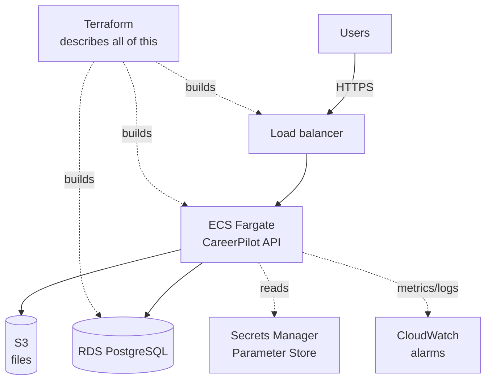

## 🎯 Goal

Your CareerPilot API (Phase 2) and web app (Phase 4) run on your laptop. Phase 5 puts them **on the internet, the way a real team would**: containers running on AWS, a managed database, the whole setup written as code you can rebuild or destroy in one command, and alarms that tell you when something breaks.

This is the capstone of Module 5. Everything you learned this module lands here: containers (W1), CI/CD (W2), AWS (W3–W4), and this week's microservices thinking, orchestration choice, Terraform, observability and cost discipline (W5–W7).

```text
Before (Phase 4)                      After Phase 5
────────────────────────────────     ─────────────────────────────────────────────
runs on your laptop                   runs on AWS, reachable by a real URL
you start it by hand                  ECS keeps it running and replaces crashes
SQLite / local Postgres               managed RDS PostgreSQL with backups
"works on my machine"                 built from one image, deployed by CI/CD
set up by clicking / by hand          defined in Terraform, rebuilt with one command
no idea if it's down                  CloudWatch alarms tell you
easy to forget and get billed         terraform destroy leaves nothing behind
```

:::warning[Money and the free plan — read first]
This is the one project in the handbook that can cost **real money** if you're careless. New AWS accounts get a **credit-based free plan** that ends after 6 months or when credits run out. Before you start: set a **budget alarm** (Module 5 · W3), tag every resource, and plan to **`terraform destroy` the moment you're done**. A small, well-torn-down deployment costs cents. A forgotten RDS instance costs real money for months. The teardown is not optional — it's part of the project.
:::

## 👤 User stories

- **As a visitor,** I can open CareerPilot at a real URL over HTTPS and use it.
- **As the developer,** when I push to `main`, CI builds an image and deploys it — I don't hand-deploy.
- **As the operator,** if the app starts failing, an alarm reaches me instead of me finding out from a user.
- **As the owner,** I can rebuild the whole environment from code, and destroy it completely in one command.

## 🏗️ Architecture



Everything in that picture is one or more **Terraform resources**. You are not clicking this together in the console — you're describing it in code and letting `terraform apply` build it.

> Why ECS Fargate and not Kubernetes? CareerPilot is one small app with one maintainer. As W6 argued, Fargate runs your containers with no servers to operate — the right rung of the ladder. EKS/Kubernetes would be complexity you'd maintain for no benefit.

## 📋 What "done" looks like

- CareerPilot's **API runs as an ECS Fargate service** behind a load balancer, reachable over HTTPS.
- The database is **RDS PostgreSQL**, not something running inside a disposable container.
- **Secrets** (JWT key, DB password, any API keys) come from Secrets Manager / Parameter Store — never hard-coded, never in git.
- The **whole environment is Terraform**: `terraform apply` builds it, `terraform destroy` removes it, and it's parameterized for at least a `dev` environment.
- **CI/CD** (from W2) builds the image and deploys the new version on a push to `main`.
- At least **two CloudWatch alarms** on user-facing symptoms (5xx error rate, latency) that would actually notify you.
- A **teardown + cost review**: you can prove the environment costs almost nothing after `destroy`.

## 🧭 Checkpoints

### C0 · Prerequisites (30 min)

- Your CareerPilot API is containerized (a clean production Dockerfile — reuse the Ship-RevoShop patterns from W1).
- You have an AWS account with **root MFA and a budget alarm** set (W3 · Account Safety). Do not skip this.
- Terraform and the AWS CLI are installed and authenticated.

### C1 · Networking (60 min)

Write Terraform for the **VPC**, subnets and security groups (W3 · Regions & VPC). Keep the database in **private** subnets — it should never be reachable from the internet, only from the API's security group.

### C2 · Database on RDS (60 min)

Terraform an **RDS PostgreSQL** instance (small size, e.g. `db.t3.micro`), in the private subnets, with its password stored in **Secrets Manager** (not in your `.tf` files). Output its endpoint.

### C3 · The API on ECS Fargate (120 min)

Terraform an **ECS cluster**, a **task definition** (your image, CPU/memory, environment from Parameter Store, secrets from Secrets Manager), an **ECS service** keeping ≥1 task alive, and an **Application Load Balancer** in front. Run database migrations as a one-off task (the pattern from W1's Ship lab).

### C4 · Variables, outputs, modules (60 min)

Refactor toward W7 · L02: pull per-environment values into `dev.tfvars`, expose `database_url` and `site_url` as **outputs**, and bundle repeated pieces (the service + its load balancer) into a **module**. Build it all with `terraform apply -var-file=dev.tfvars`.

### C5 · CI/CD deploy (60 min)

Extend your W2 pipeline: on a push to `main`, build and push the image, then update the ECS service to the new image (or run `terraform apply`). Confirm a code change reaches AWS without you deploying by hand.

### C6 · Observability (60 min)

Add **CloudWatch alarms** on the load balancer's 5xx rate and target latency (W7 · L03), wired to an SNS topic that emails you. Force a failure (stop a task, or deploy a broken image) and confirm the alarm fires.

### C7 · Teardown & cost review (30 min)

Run `terraform destroy -var-file=dev.tfvars`, read the preview, and confirm **everything** is gone. Then do the W7 · L05 checklist: check the billing console and every region for orphans (volumes, addresses, snapshots). Write down what the experiment cost.

## 🧪 Acceptance criteria

- [ ] The whole environment is created by `terraform apply` and removed by `terraform destroy` — no console clicking for the real setup.
- [ ] CareerPilot is reachable at an HTTPS URL while the environment is up.
- [ ] The database is RDS in **private** subnets; the API reaches it, the internet cannot.
- [ ] No secrets in `.tf` files or git; they come from Secrets Manager / Parameter Store.
- [ ] A push to `main` deploys a new version via CI/CD, not by hand.
- [ ] At least two alarms on user-facing symptoms fire when you force a failure.
- [ ] After `destroy`, the billing console and all used regions show nothing left running.
- [ ] Every resource is **tagged** (`project=careerpilot`, `environment=dev`).

## 🏆 Stretch goals

- [ ] A second environment (`prod.tfvars`) built from the same code, differing only in values.
- [ ] Put the Phase 4 **web app** on S3 + CloudFront (W4 · L01) in front of the API.
- [ ] A **blue/green or canary** deploy (W7 · L04) using ECS's built-in deployment features.
- [ ] Store Terraform **state** in an S3 backend with locking, instead of a local file.
- [ ] An SLO on the login or search flow, with a dashboard for the four golden signals.

## 🧠 AI policy

🤖✅ AI may help with Terraform and AWS **syntax**, error messages, and boilerplate — the cloud has a lot of small details. 🚫🤖 **You** must understand and be able to defend every resource you create, why it exists, what it costs, and how to tear it down. Never paste an AWS credential or secret into any tool. The whole point of this phase is that *you* can run and reason about real infrastructure — not that an AI built something you can't explain or safely destroy.

## ❓ Questions an interviewer might ask about Phase 5

- Why ECS Fargate for CareerPilot instead of EKS/Kubernetes? When would that answer change?
- Where do your secrets live, and how does the running task get them without them touching git?
- Walk me through `terraform plan` → `apply` → `destroy`. What does the plan protect you from?
- Your database is in a private subnet. How does the API reach it, and why can't the internet?
- An alarm fires at 3 a.m. saying 5xx is at 8%. What do you look at, in what order?
- How do you make sure this deployment doesn't quietly bill you after you're done?

## 📣 Share it

:::linkedin{type="build"}
☁️ Module 5 capstone: I deployed CareerPilot to AWS — and wrote the whole thing as code.

What it runs on now:
- containers on **ECS Fargate** (no servers for me to babysit) behind a load balancer, over HTTPS
- a managed **RDS PostgreSQL** database in private subnets
- secrets from **Secrets Manager**, never in git
- the *entire* environment defined in **Terraform** — one command to build, one to destroy
- **CloudWatch alarms** on error rate and latency, so I hear about problems before users do
- CI/CD that ships a new version on every push to `main`

The part I'm proudest of: I can tear it all down with `terraform destroy` and prove it costs nothing afterwards. Infrastructure as code turned "a scary cloud bill waiting to happen" into something I fully control.

Next: making it observable enough to run for real. 📈

#AWS #Terraform #DevOps #CloudEngineering #LearningInPublic
:::
