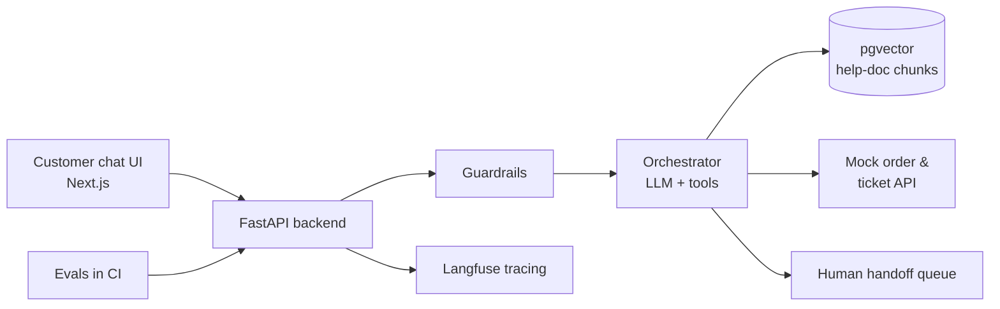

## 🧠 Nada gurinya

> **SupportDesk AI menjawab pertanyaan pelanggan dari dokumentasi perusahaan, mengecek status pesanan dan tiket dengan tools, dan menyerahkan ke manusia kalau kurang percaya diri.**

Ini adalah **proyek AI mandirimu**: yang membuktikan kamu bisa membangun fitur AI yang benar-benar dikirim perusahaan — bukan hanya demo chatbot.

## 🏢 Perusahaannya (fiksi)

Perusahaan buatan membuat data pelanggan asli tetap aman di portofoliomu, sambil menampilkan keterampilan yang sama.

**Warung Kita Online** — marketplace e-commerce kecil Indonesia. Kamu akan menulis (atau buat-ubah) ~30 artikel help-center: pengiriman, retur, pembayaran, keamanan akun, kebijakan penjual. Data fiksi berarti tidak ada masalah privasi dan kontrol penuh atas test case.

## ✨ Fitur-fiturnya

| Fitur | Apa yang membuktikannya |
|---|---|
| **RAG atas artikel help** dengan **kutipan sumber** | Retrieval (mencari informasi), chunking (potong-potong dokumen), membumikan jawaban di sumber asli |
| **Tool calling**: cek status pesanan, cek status tiket, buat tiket (mock API) | Function calling (panggil fungsi), structured output (output terstruktur), validasi input |
| **Guardrail**: tolak pertanyaan di luar topik, deteksi prompt injection, sembunyikan data pribadi | Keamanan dan keselamatan AI |
| **Human handoff** kalau kepercayaan diri rendah atau pengguna minta | Merancang untuk kegagalan |
| **Admin view**: percakapan, thumbs up/down, jawaban yang gagal | Pikiran produk, feedback loop |
| **Evaluasi** di CI: dataset test dengan perilaku yang diharapkan | Mengukur kualitas, bukan menebak |
| **Tracing** (Langfuse) | Observabilitas: latency, biaya, langkah mana yang gagal |
| **Deployed** dengan CI/CD | Kepemilikan end-to-end |

## 🏗️ Arsitektur (target)

Perhatikan betapa banyak yang berupa pekerjaan backend biasa — retrieval, tools, evaluation dan handover. Model adalah satu bagian dari sistem, bukan seluruh sistemnya.

## 📅 Kapan

Ringkasan terperinci dengan checkpoint dibuka di **Module 7** (setelah Week 4, *RAG in Depth*). Prasyarat: Module 3 (FastAPI), Module 4 (Next.js), Module 7 Weeks 1–4.

Sampai saat itu, mulai kumpulkan ide di **My notes**: apa yang membuat support bot dapat dipercaya? Apa yang **tidak boleh** dilakukannya?
