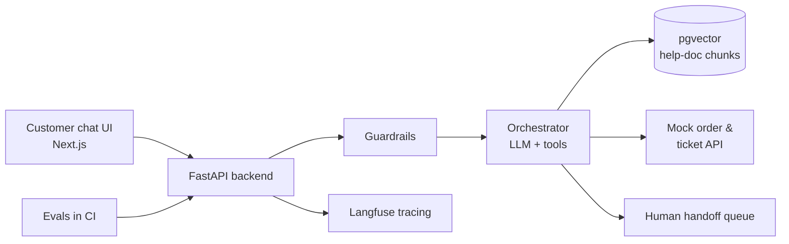

## 🧠 The pitch

> **SupportDesk AI answers customer questions from a company's help docs, checks order and ticket status with tools, and hands off to a human when it isn't confident.**

This is your **standalone AI project**: the one that proves you can build the kind of AI feature companies actually ship — not just a chatbot demo.

## 🏢 The fictional company

Using a made-up company keeps real customer data out of your portfolio while letting you show exactly the same skills.

**Warung Kita Online** — a small Indonesian e-commerce marketplace. You'll write (or generate and edit) ~30 help-center articles: shipping, returns, payments, account security, seller policies. Fictional data means no privacy problems and full control over test cases.

## ✨ Features

| Feature | What it proves |
|---|---|
| **RAG over help docs** with **citations** | Retrieval, chunking, grounding answers in sources |
| **Tool calling**: check order status, check ticket status, create a ticket (mock API) | Function calling, structured output, validation |
| **Guardrails**: refuse off-topic requests, detect prompt injection, mask personal data | AI security and safety |
| **Human handoff** when confidence is low or the user asks | Designing for failure |
| **Admin view**: conversations, thumbs up/down, failed answers | Product thinking, feedback loops |
| **Evals** in CI: a test dataset of questions with expected behavior | Measuring quality, not guessing |
| **Tracing** (Langfuse) | Observability: latency, cost, which step failed |
| **Deployed** with CI/CD | End-to-end ownership |

## 🏗️ Architecture (target)

Notice how much of this is ordinary backend work — retrieval, tools, evaluation and handover. The model is one part of the system, not the system.

## 📅 When

The detailed brief with checkpoints unlocks in **Module 7** (after Week 4, *RAG in Depth*). Prerequisites: Module 3 (FastAPI), Module 4 (Next.js), Module 7 Weeks 1–4.

Until then, start collecting ideas in **My notes**: what makes a support bot trustworthy? What should it **never** do?
