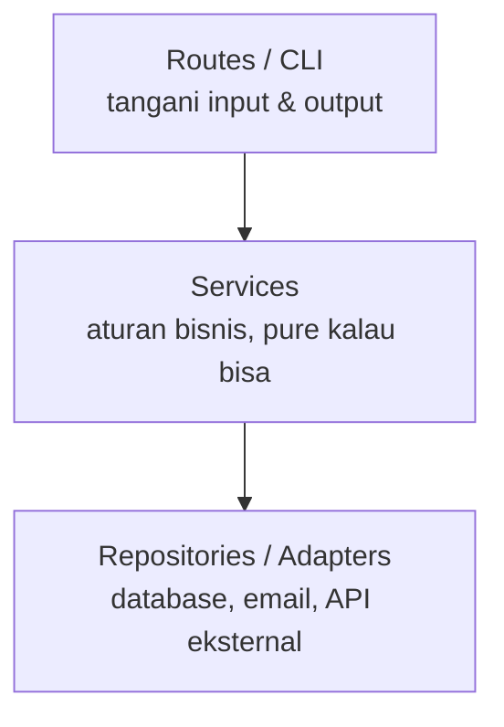

::part[Pelajari Konsepnya]{n="1"}

## 🎯 Yang akan kamu pelajari

- **Cohesion**: seberapa baik hal-hal di dalam satu modul saling terkait
- **Coupling**: seberapa banyak modul saling bergantung pada detail satu sama lain
- Mengapa tujuannya **cohesion tinggi, coupling rendah**
- Memberikan dependensi dari luar (**dependency injection**) agar kode mudah ditest
- Mengenali tanda-tandanya: god module, global tersembunyi, "shotgun surgery"

## 🔤 Istilah penting

| Istilah | Artinya (sederhana) |
|---|---|
| **Cohesion** | Seberapa baik hal-hal di dalam satu modul saling terkait |
| **Coupling** | Seberapa banyak satu modul bergantung pada detail modul lain |
| **Module** | Satu file atau paket dengan tujuan tertentu |
| **Interface** | Permukaan kecil dan stabil yang boleh dipakai oleh yang lain |
| **Dependency injection** | Memberikan apa yang dibutuhkan fungsi dari luar, bukan membuatnya di dalam |
| **God module** | Satu file yang tahu dan mengerjakan segalanya |
| **Shotgun surgery** | Satu perubahan kecil mengharuskan edit di banyak file |
| **Hidden global** | Nilai bersama yang diakses kode tanpa disadari |

## 🧠 Ide besarnya

Bayangkan restoran yang berjalan baik:

- **Cohesion tinggi**: dapur mengerjakan memasak, kasir mengerjakan pembayaran. Setiap area punya satu tujuan yang jelas.
- **Coupling rendah**: pelayan menyerahkan slip pesanan. Pelayan tidak perlu tahu resep dapur, dan dapur bisa mengganti tungku tanpa melatih ulang pelayannya.

Di kode: setiap modul seharusnya punya **satu tujuan yang jelas** (cohesion), dan berbicara ke yang lain melalui **interface kecil dan stabil** (coupling rendah).

## ❓ Kenapa ini penting

Biaya sebenarnya dari software adalah perubahan. Kalau mengubah cara email dikirim memerlukan edit di checkout, di laporan, di panel admin, dan di dua belas test, sistemnya **tightly coupled**.

Struktur yang baik membuat perubahan **tetap lokal**: satu alasan untuk berubah berarti satu tempat untuk edit. Itu restoran lagi — dapur bisa membeli tungku baru tanpa melatih ulang pelayannya, karena semua yang mereka tukarkan hanya slip pesanan.

## 📖 Langkah demi langkah

### 1. Cohesion: kelompokkan berdasarkan alasan berubah

| Cohesion rendah ❌ | Cohesion tinggi ✅ |
|---|---|
| `utils.py` dengan date helper, email, format harga, dan CSV parsing | `dates.py`, `email_sender.py`, `money.py`, `csv_import.py` |
| Kelas `User` yang juga membuat PDF invoice | `User` berisi data user; `InvoiceRenderer` membuat PDF |

Tanyakan: *"Apakah hal-hal ini berubah untuk alasan yang sama?"* Kalau ya, jaga tetap bersama.

### 2. Coupling: bergantung pada lebih sedikit

Jenis coupling, dari terburuk ke lebih baik:

| Coupling | Contoh |
|---|---|
| 🔴 Shared global state | Beberapa modul baca dan tulis `CURRENT_USER` |
| 🔴 Tahu internals | `order._items[0]._price` — jangkau detail pribadi |
| 🟡 Bergantung pada service konkret | Fungsi buat `smtplib.SMTP(...)` di dalam |
| 🟢 Bergantung pada data yang diteruskan | `needs_follow_up(application, today)` |
| 🟢 Bergantung pada interface kecil yang diteruskan | `send_reminders(apps, today, notifier)` dimana notifier punya `.send(to, text)` |

### 3. Dependency injection (DI)

DI terdengar megah tapi sebenarnya sederhana: berikan kode apa yang dibutuhkannya, bukan biarkan ia cari dan ambil sendiri. Satu kebiasaan ini yang membuat test mungkin tanpa database.

Alih-alih buat dependensi **di dalam** fungsi, terima sebagai **parameter**:

```python
from datetime import date
from typing import Protocol


class Notifier(Protocol):
    def send(self, recipient: str, message: str) -> None: ...


def needs_follow_up(application: dict, today: date, after_days: int = 14) -> bool:   # pure rule
    return application["status"] == "applied" and (today - application["applied_on"]).days > after_days


def send_follow_up_reminders(applications: list[dict], today: date, notifier: Notifier) -> int:
    sent = 0
    for application in applications:
        if needs_follow_up(application, today):
            notifier.send(application["email"], f"Follow up with {application['company']}!")
            sent += 1
    return sent
```

Di production kamu berikan `EmailNotifier` yang sungguhan. Di test kamu berikan yang **palsu**:

```python
class FakeNotifier:
    def __init__(self):
        self.sent = []

    def send(self, recipient, message):
        self.sent.append((recipient, message))
```

Tidak perlu mail server, tidak perlu database, dan `today` sudah fixed — test cepat dan hasilnya pasti sama setiap kali.

:term[Dependency injection]{bahasa="injeksi dependensi — memberikan kebutuhan fungsi/objek dari luar, bukan membuatnya di dalam"} terdengar mewah; tapi hanya berarti **"berikan saja"**. FastAPI (Modul 3) punya seluruh sistem yang dibangun atas ide ini.

### 4. Preview layering



Setiap layer hanya berbicara ke yang di bawahnya melalui interface kecil. Ini adalah **layered architecture** yang RevoShop-mu pakai (routes → services → repositories) — Stage E menjelaskan lebih dalam.

### 5. Tanda-tanda yang perlu dikenali

Kamu tidak mengukur coupling dengan tool — kamu melihatnya: "kenapa harus edit enam file untuk ini?" adalah sinyal.

- **Shotgun surgery**: satu perubahan kecil memerlukan edit di banyak file.
- **God module/class**: satu file yang semua import, mengerjakan segalanya.
- **Hidden dependencies**: fungsi yang diam-diam baca jam, global, atau jaringan.
- **Train wrecks**: `order.customer.address.city.name` — tahu terlalu banyak tentang struktur objek lain.

### Pilih setup-mu

Setiap pilihan di sini adalah trade-off:

| Pilihan | ✅ | ❌ |
|---|---|---|
| Inject dependensi | Testable, bisa ganti implementasi | Lebih banyak parameter dilewatkan |
| Buat dependensi di dalam | Parameter lebih sedikit | Sulit ditest, terikat pada satu implementasi |
| Banyak modul cohesive kecil | Perubahan tetap lokal | Lebih banyak file dan import |
| Interface/Protocol di mana-mana | Fleksibilitas maksimal | Indirection yang tidak perlu untuk kode sederhana (YAGNI!) |

- ✅ Inject apa saja yang **lambat, eksternal, atau tidak deterministik**: database, HTTP client, email, jam, angka acak.
- ✅ Jaga aturan bisnis dalam fungsi pure yang terima data biasa.
- 🚫 Jangan inject helper pure sederhana (`format_date`) — tinggal import.
- 🚫 Jangan buat interface untuk sesuatu dengan tepat satu implementasi *dan* tidak perlu ditest.


## ⚠️ Kesalahan umum

- Panggil `date.today()` / `datetime.now()` di dalam logika bisnis → test rusak saat tengah malam atau bulan baru.
- `utils.py` / `helpers.py` tempat pembuangan sampah.
- Mock **segalanya**, jadi test hanya cek bahwa mock dipanggil, bukan perilaku sungguhan.
- Circular import antar modul — tanda jelas coupling ketat.

::part[Jelaskan & Rancang]{n="2"}

## 🗣️ Jelaskan

Jelaskan coupling dan cohesion memakai contoh non-software (sekolah, rumah sakit, tim sepak bola). Lalu jelaskan dalam dua kalimat kenapa berikan `today` sebagai parameter membuat kode lebih mudah ditest.

## 📐 Rancang

Rancang ulang `send_follow_up_reminders()` yang kusut dari bagian "Yang terjadi kalau TIDAK". Daftar modul/fungsi yang akan kamu buat, apa yang masing-masing bergantung pada, dan mana yang bisa di-unit-test **tanpa** database atau email server.

:::quiz
Lihat contoh rancangan

| Bagian | Tanggung jawab | Bergantung pada | Unit-testable sendiri? |
|---|---|---|---|
| `needs_follow_up(application, today)` | aturan bisnis | data biasa | ✅ |
| `build_message(application)` | teks | data biasa | ✅ |
| `ApplicationRepository.list_waiting()` | muat aplikasi | database | ⚠️ integration test |
| `EmailNotifier.send(to, text)` | kirim email | SMTP | ⚠️ integration test |
| `send_follow_up_reminders(repo, notifier, today)` | koordinasi | injected repo + notifier | ✅ dengan palsu |
| `cli.py` / scheduled job | hubungkan implementasi sungguhan, berikan `date.today()` | segalanya | — (tipis) |

Logika bisnis: fully testable. Infrastructure: terisolasi di balik dua interface kecil. Ganti ke WhatsApp = satu kelas notifier baru.
:::

### 📝 Checklist review mandiri

- [ ] Aturan "> 14 hari" tidak punya database, email, atau jam di dalam
- [ ] Service eksternal di-inject
- [ ] Hanya satu tempat tipis yang buat implementasi sungguhan
- [ ] Mengganti saluran notifikasi menyentuh satu bagian

::ai-review{task="design"}

::part[Latihan Kecil]{n="3"}

:::exercise{path="exercises/architecture/a-principles/03-coupling-cohesion" ai="no-ai" title="Untangle the reminder job"}
`reminders.py` punya fungsi yang baca aplikasi dari file JSON, cek aturan follow-up memakai tanggal hari ini yang sungguhan, dan cetak pesan langsung. Test mengharapkan design yang **decoupled**:

- `needs_follow_up(application, today, after_days=14)` — pure
- `build_message(application, today)` — pure
- `send_follow_up_reminders(applications, today, notifier)` — kembalikan berapa banyak dikirim, pakai notifier yang di-inject
- `load_applications(path)` — baca file JSON (satu-satunya fungsi sentuh file system)
:::

:::hints
- Mulai dari fungsi pure — test mereka tidak perlu setup apa saja.
- `notifier` adalah apa saja dengan method `.send(recipient, message)`; test berikan palsu.
- Tanggal di JSON adalah string: `date.fromisoformat("2026-08-20")`.
:::

## ✅ Cek cepat

:::quiz
Apa bedanya coupling dan cohesion?

Cohesion tentang seberapa baik hal-hal **di dalam** satu modul saling terkait. Coupling tentang seberapa banyak **berbeda** modul bergantung pada detail satu sama lain. Tujuannya cohesion tinggi dan coupling rendah.
:::

:::quiz
Kenapa berikan `today` ke dalam fungsi alih-alih panggil `date.today()` di dalam?

Fungsi jadi deterministik: test bisa pakai tanggal fixed apa saja, dan hasil tidak berubah tergantung kapan test dijalankan.
:::


## 📚 Lanjut belajar

- [Python docs: typing.Protocol](https://docs.python.org/3/library/typing.html#typing.Protocol)
- [FastAPI: Dependencies (preview untuk Modul 3)](https://fastapi.tiangolo.com/tutorial/dependencies/)
