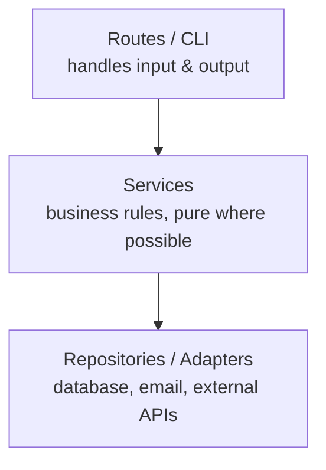

::part[Learn the Concept]{n="1"}

## 🎯 What you'll learn

- **Cohesion**: how well the things inside a module belong together
- **Coupling**: how much modules depend on each other's details
- Why the goal is **high cohesion, low coupling**
- Passing dependencies in (**dependency injection**) to make code testable
- Recognizing the smells: god modules, hidden globals, "shotgun surgery"

## 🔤 Key words

| Word | In simple words | Bahasa Indonesia |
|---|---|---|
| **Cohesion** | How well the things inside one module belong together | Keterkaitan isi modul |
| **Coupling** | How much one module depends on another's details | Ketergantungan antar modul |
| **Module** | One file or package with a purpose | Satu unit kode |
| **Interface** | The small, stable surface others are allowed to use | Permukaan yang dipakai pihak lain |
| **Dependency injection** | Passing in what a piece of code needs, instead of it fetching them | Menyuntikkan kebutuhan |
| **God module** | One file that knows and does everything | Modul serba tahu |
| **Shotgun surgery** | One small change forcing edits in many files | Satu perubahan, banyak berkas |
| **Hidden global** | A shared value code reaches for invisibly | Nilai global tersembunyi |

## 🧠 The big idea

Think of a well-run restaurant:

- **High cohesion**: the kitchen does cooking, the cashier does payments. Each area has one clear purpose.
- **Low coupling**: the waiter hands over an order slip. The waiter doesn't need to know the kitchen's recipes, and the kitchen can change stoves without retraining waiters.

In code: each module should have **one clear purpose** (cohesion), and talk to others through **small, stable interfaces** (low coupling).

## ❓ Why it matters

The real cost of software is change. If changing how emails are sent requires edits in checkout, in reports, in the admin panel and in twelve tests, the system is **tightly coupled**.

Good structure keeps a change **local**: one reason to change means one place to edit. That's the restaurant again — the kitchen can buy a new stove without retraining the waiters, because all they exchange is an order slip.

## 📖 Step by step

### 1. Cohesion: group by reason to change

| Low cohesion ❌ | High cohesion ✅ |
|---|---|
| `utils.py` with date helpers, email sending, price formatting and CSV parsing | `dates.py`, `email_sender.py`, `money.py`, `csv_import.py` |
| A `User` class that also generates PDF invoices | `User` holds user data; `InvoiceRenderer` makes PDFs |

Ask: *"Would these things change for the same reason?"* If yes, keep them together.

### 2. Coupling: depend on less

Types of coupling, from worse to better:

| Coupling | Example |
|---|---|
| 🔴 Shared global state | Several modules read and write `CURRENT_USER` |
| 🔴 Knowing internals | `order._items[0]._price` — reaching into private details |
| 🟡 Depending on a concrete service | Function creates `smtplib.SMTP(...)` inside |
| 🟢 Depending on data passed in | `needs_follow_up(application, today)` |
| 🟢 Depending on a small interface passed in | `send_reminders(apps, today, notifier)` where notifier has `.send(to, text)` |

### 3. Dependency injection (DI)

DI sounds grand but is just this: hand the code what it needs, rather than letting it reach out and grab it. That one habit is what makes tests possible without a database.

Instead of creating dependencies **inside** a function, receive them as **parameters**:

```python
from datetime import date
from typing import Protocol


class Notifier(Protocol):
    def send(self, recipient: str, message: str) -> None: ...


def needs_follow_up(application: dict, today: date, after_days: int = 14) -> bool:   # pure rule
    return application["status"] == "applied" and (today - application["applied_on"]).days > after_days


def send_follow_up_reminders(applications: list[dict], today: date, notifier: Notifier) -> int:
    sent = 0
    for application in applications:
        if needs_follow_up(application, today):
            notifier.send(application["email"], f"Follow up with {application['company']}!")
            sent += 1
    return sent
```

In production you pass a real `EmailNotifier`. In tests you pass a **fake**:

```python
class FakeNotifier:
    def __init__(self):
        self.sent = []

    def send(self, recipient, message):
        self.sent.append((recipient, message))
```

No mail server, no database, and `today` is fixed — the test is fast and deterministic.

:term[Dependency injection]{bahasa="injeksi dependensi — memberikan kebutuhan fungsi/objek dari luar, bukan membuatnya di dalam"} sounds fancy; it's just **"pass it in"**. FastAPI (Module 3) has a whole system built on this idea.

### 4. The layering preview



Each layer only talks to the one below through a small interface. This is the **layered architecture** your RevoShop uses (routes → services → repositories) — Stage E explains it in depth.

### 5. Smells to recognize

You don't measure coupling with a tool — you notice it: "why do I have to edit six files for this?" is the signal.

- **Shotgun surgery**: one small change requires edits in many files.
- **God module/class**: one file everyone imports, doing everything.
- **Hidden dependencies**: a function that secretly reads the clock, a global, or the network.
- **Train wrecks**: `order.customer.address.city.name` — knowing too much about other objects' structure.

### Choosing your setup

Every option here is a trade-off:

| Choice | ✅ | ❌ |
|---|---|---|
| Inject dependencies | Testable, swappable implementations | More parameters to pass around |
| Create dependencies inside | Fewer parameters | Hard to test, locked to one implementation |
| Many small cohesive modules | Changes stay local | More files and imports to navigate |
| Interfaces/Protocols everywhere | Maximum flexibility | Indirection that's unnecessary for simple code (YAGNI!) |

- ✅ Inject anything **slow, external or non-deterministic**: databases, HTTP clients, email, the clock, random numbers.
- ✅ Keep business rules in pure functions that receive plain data.
- 🚫 Don't inject simple pure helpers (`format_date`) — just import them.
- 🚫 Don't create an interface for something with exactly one implementation *and* no testing need.


## ⚠️ Common mistakes

- Calling `date.today()` / `datetime.now()` inside business logic → tests break at midnight or next month.
- `utils.py` / `helpers.py` dumping grounds.
- Mocking **everything**, so tests only check that mocks were called, not real behavior.
- Circular imports between modules — a clear sign of tight coupling.

::part[Explain & Design]{n="2"}

## 🗣️ Explain it

Explain coupling and cohesion using a non-software example (a school, a hospital, a football team). Then explain in two sentences why passing `today` as a parameter makes code easier to test.

## 📐 Design it

Redesign the tangled `send_follow_up_reminders()` from the "What happens if we DON'T" section. List the modules/functions you'd create, what each one depends on, and which ones you can unit-test **without** a database or email server.

:::quiz
Show a possible design

| Piece | Responsibility | Depends on | Unit-testable alone? |
|---|---|---|---|
| `needs_follow_up(application, today)` | business rule | plain data | ✅ |
| `build_message(application)` | text | plain data | ✅ |
| `ApplicationRepository.list_waiting()` | load applications | database | ⚠️ integration test |
| `EmailNotifier.send(to, text)` | deliver email | SMTP | ⚠️ integration test |
| `send_follow_up_reminders(repo, notifier, today)` | coordinate | injected repo + notifier | ✅ with fakes |
| `cli.py` / scheduled job | wire real implementations, pass `date.today()` | everything | — (thin) |

Business logic: fully testable. Infrastructure: isolated behind two small interfaces. Switching to WhatsApp = one new notifier class.
:::

### 📝 Self-review checklist

- [ ] The "> 14 days" rule has no database, email or clock inside
- [ ] External services are injected
- [ ] Only one thin place creates the real implementations
- [ ] Changing the notification channel touches one piece

::ai-review{task="design"}

::part[Toy Exercise]{n="3"}

:::exercise{path="exercises/architecture/a-principles/03-coupling-cohesion" ai="no-ai" title="Untangle the reminder job"}
`reminders.py` has a function that reads applications from a JSON file, checks the follow-up rule using today's real date, and prints messages directly. The tests expect a **decoupled** design:

- `needs_follow_up(application, today, after_days=14)` — pure
- `build_message(application, today)` — pure
- `send_follow_up_reminders(applications, today, notifier)` — returns how many were sent, uses the injected notifier
- `load_applications(path)` — reads the JSON file (the only function touching the file system)
:::

:::hints
- Start with the pure functions — the tests for them don't need any setup.
- `notifier` is anything with a `.send(recipient, message)` method; the tests pass a fake.
- Dates in the JSON are strings: `date.fromisoformat("2026-08-20")`.
:::

## ✅ Quick check

:::quiz
What's the difference between coupling and cohesion?

Cohesion is about how well things **inside** one module belong together. Coupling is about how much **different** modules depend on each other's details. Aim for high cohesion and low coupling.
:::

:::quiz
Why pass `today` into a function instead of calling `date.today()` inside?

The function becomes deterministic: tests can use any fixed date, and results don't change depending on when the test runs.
:::


## 📚 Keep learning

- [Python docs: typing.Protocol](https://docs.python.org/3/library/typing.html#typing.Protocol)
- [FastAPI: Dependencies (preview for Module 3)](https://fastapi.tiangolo.com/tutorial/dependencies/)
