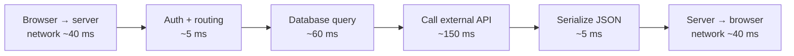

::part[Pelajari Konsepnya]{n="1"}

## 🎯 Yang akan kamu pelajari

- **Latency** (berapa lama satu permintaan) vs **throughput** (berapa banyak permintaan per detik)
- Kenapa kita ukur **p50/p95/p99**, bukan rata-rata
- **Latency budget** satu permintaan: milidetik-nya pergi ke mana
- Perkiraan kasar untuk traffic dan penyimpanan data

## 🔤 Istilah penting

| Istilah | Artinya (sederhana) |
|---|---|
| **Latency** | Berapa lama satu permintaan dari awal sampai selesai |
| **Throughput** | Berapa banyak permintaan yang ditangani setiap detik |
| **p50 / p95 / p99** | Persentil: tengah, 5% yang lambat, 1% paling lambat |
| **Latency budget** | Cara membagi waktu target untuk tiap langkah |
| **Round trip** | Satu permintaan pergi lalu jawabannya kembali |
| **Concurrency** | Berapa banyak permintaan yang sedang diproses bersamaan |
| **Back-of-the-envelope** | Perkiraan kasar yang cepat, bukan presisi |

## 🧠 Ide besarnya

Bayangkan jalan tol dengan beberapa gerbang:

- **Latency**: berapa lama **satu mobil** antri di gerbang.
- **Throughput**: berapa **mobil per jam** yang melewati semua gerbang.

Buka lebih banyak gerbang naikkan throughput, tapi tidak bikin mobil satu pun lebih cepat. Gerbang yang lebih cepat turunkan latency *dan* naikkan throughput. Kamu harus tahu masalah yang sebenarnya ada.

## ❓ Kenapa ini penting

"Apakah cepat?" tidak ada artinya tanpa angka. User **merasakan latency** — halaman yang butuh 3 detik terasa rusak. Bisnis **merasakan throughput** — bisakah kita tahan saat flash sale dengan traffic 10 kali lipat?

Interview system design mulai dari dua angka ini, begitu juga rencana kapasitas asli. Kebingungan mengakibatkan perbaikan yang salah: tambah server padahal masalahnya query yang lambat, atau optimasi kode padahal kamu cukup butuh lebih banyak gerbang.

## 📖 Langkah demi langkah

### 1. Persentil

Rata-rata menyembunyikan penderitaan: kalau 19 user tunggu 80 ms dan satu tunggu 3 detik, rata-rata terlihat baik tapi satu orang pikir aplikasimu rusak.

Urutkan semua waktu response dari satu menit:

| Metrik | Artinya |
|---|---|
| **p50** (median) | setengah permintaan lebih cepat dari ini |
| **p95** | 95% lebih cepat; 1 dari 20 lebih lambat |
| **p99** | 1 dari 100 lebih lambat — yang paling lambat |

Tim menetapkan target seperti: *"p95 latency di bawah 300 ms"*. Itu namanya **SLO** (service level objective).

### 2. Latency budget

Di mana 300 ms untuk satu API call:

Kecepatan kasar yang perlu diingat (urutan besaran, bukan pasti):

| Operasi | Waktu khas |
|---|---|
| Baca dari memory (RAM) | nanodetik |
| Baca dari SSD | ~0,1 ms |
| Sekali pergi-pulang dalam satu data center | ~0,5 ms |
| Query database simple yang terindex | ~1–10 ms |
| Sekali pergi-pulang Jakarta ↔ Singapura | ~15–30 ms |
| Sekali pergi-pulang Jakarta ↔ US West Coast | ~150–200 ms |
| LLM API hasilkan paragraf | ~1–10 **detik** |

Kesimpulannya: **jarak jaringan dan external call dominan**. Itulah kenapa caching (Materi 03) dan pilih region dekat itu penting — dan kenapa fitur AI butuh streaming dan loading state.

### 3. Panggilan urut vs paralel

Tiga API call independen masing-masing 100 ms:
- satu setelah satu → ~300 ms
- paralel bersamaan → ~100 ms (yang paling lambat)

### 4. Throughput dan concurrency

Kalau satu server tangani permintaan dalam 50 ms dan bisa kerjakan 10 permintaan bersamaan:

`throughput ≈ concurrency ÷ waktu per permintaan = 10 ÷ 0,05 s = 200 permintaan/detik`

Dorong lebih dari itu dan permintaan **antri**: latency naik tajam walaupun "kerja" setiap permintaan tidak berubah. Itulah kenapa sistem yang baik pada 150 req/s bisa jatuh pada 250 req/s.

### 5. Perkiraan kasar

Tujuannya bukan presisi, tapi urutan besaran: apakah ini 10 GB atau 10 TB, 50 permintaan per detik atau 5.000? Jawaban itu ubah desain; desimal kedua tidak.

CareerPilot punya **100.000 user aktif harian**, masing-masing bikin ~20 API request sehari:

- permintaan/hari = 100.000 × 20 = **2.000.000**
- rata-rata req/detik = 2.000.000 ÷ 86.400 ≈ **23 req/s**
- puncak (anggap 10× rata-rata di malam hari) ≈ **230 req/s**

Penyimpanan: setiap user upload CV 200 KB sekali, ditambah 50 aplikasi × 2 KB:
- 100.000 × (200 KB + 100 KB) = 30 GB — kecil untuk database/object storage.

:::tip
Bulatkan agresif. Tujuannya adalah **urutan besaran** — apakah 20 req/s (satu server kecil) atau 20.000 req/s (sistem terdistribusi sungguhan)?
:::

### Pilih setup kamu

Setiap opsi di sini adalah trade-off:

| Perbaiki… | Teknik khas | Biaya |
|---|---|---|
| Latency | caching, region/CDN dekat, kurang round trip, query lebih baik | kompleksitas, risiko data basi |
| Throughput | lebih banyak server, proses async, queue | biaya infrastruktur, koordinasi |
| Keduanya | kode efisien, index | waktu engineer |
| Tail latency (p99) | timeout, retry hati-hati, hindari dependency lambat | desain lebih teliti |

- ✅ Perkirakan sebelum pilih arsitektur ("apakah kita butuh lebih dari satu server?").
- ✅ Monitor p95/p99, bukan hanya rata-rata.
- 🚫 Jangan desain untuk skala Google kalau kamu punya 50 user (YAGNI).
- 🚫 Jangan optimasi latency tanpa ukur di mana waktunya benar-benar hilang.

## ⚠️ Kesalahan umum

- Laporkan rata-rata saja.
- Lupa waktu jaringan antar region.
- Panggil external API urut saat independen.
- Bingung "lebih banyak server" (throughput) dengan "permintaan lebih cepat" (latency).

::part[Jelaskan & Rancang]{n="2"}

## 🗣️ Jelaskan

Jelaskan latency vs throughput pakai contoh kafe: satu barista vs tiga barista, mesin espresso yang lebih cepat. Perubahan mana yang perbaiki yang?

## 📐 Rancang

Halaman CareerPilot muat: profil user (80 ms), rekomendasi kerja (400 ms, panggil layanan AI), dan stat aplikasi (60 ms). Independen semua. Round trip jaringan 50 ms.

1. Latency backend halaman kalau panggilan urut? Paralel?
2. Panggilan rekomendasi paling lambat. Usulkan dua cara bikin halaman **terasa** cepat.
3. Perkirakan req/s puncak endpoint rekomendasi dengan 20.000 user harian buka halaman ini 3 kali sehari, puncak = 8× rata-rata.

:::quiz
Lihat jawaban mungkin

1. Urut: 80 + 400 + 60 = **540 ms** (+ jaringan). Paralel: **400 ms** (+ jaringan).
2. (a) Render profil dan stat langsung, **stream/lazy-load** rekomendasi dengan skeleton; (b) **cache** rekomendasi per user beberapa jam atau hitung awal di background job.
3. 20.000 × 3 = 60.000/hari → 60.000 ÷ 86.400 ≈ 0,7 req/s rata-rata → × 8 ≈ **6 req/s** puncak. Kecil — satu server cukup; masalahnya latency, bukan throughput.
:::

### 📝 Checklist review mandiri

- [ ] Saya pakai panggilan paling lambat untuk kasus paralel
- [ ] Ide saya pisahkan "benar cepat" dari "terasa cepat"
- [ ] Perkiraan saya tunjukkan tiap langkah dan bulatkan bijak

::ai-review{task="design"}

::part[Latihan Kecil]{n="3"}

:::exercise{path="exercises/architecture/b-system-design-basics/01-latency-budget" ai="no-ai" title="Kalkulator latency dan kapasitas"}
Implementasi kalkulator kecil di `capacity.py`: persentil dari sampel, latency urut vs paralel, rata-rata dan req/s puncak, dan throughput max satu server. Kamu ulangi angka-angka ini di latihan system design nanti.
:::

## ✅ Cek cepat

:::quiz
Kenapa p99 latency sering lebih penting daripada rata-rata?

Rata-rata sembunyikan outlier lambat. Dengan banyak permintaan per halaman dan per user, kebanyakan user kena minimal satu permintaan tail-latency; p99 tunjukkan penderitaan itu.
:::

:::quiz
Tambah lebih banyak server terutama perbaiki apa — latency atau throughput?

Throughput (lebih banyak permintaan ditangani bersamaan). Hanya bantu latency kalau permintaan antri.
:::

## 📚 Lanjut belajar

- [Google SRE Book: Service Level Objectives](https://sre.google/sre-book/service-level-objectives/)
- [Latency numbers every programmer should know (interactive)](https://colin-scott.github.io/personal_website/research/interactive_latency.html)
