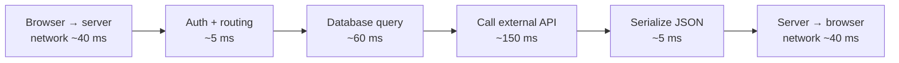

::part[Learn the Concept]{n="1"}

## 🎯 What you'll learn

- **Latency** (how long one request takes) vs **throughput** (how many requests per second)
- Why we measure **p50/p95/p99**, not averages
- A request's **latency budget**: where the milliseconds go
- **Back-of-the-envelope** estimates for traffic and storage

## 🧠 The big idea

A toll road has two different "speeds":

- **Latency**: how long **one car** waits at the toll gate.
- **Throughput**: how many **cars per hour** pass through all gates.

Opening more gates raises throughput but doesn't make any single car faster. A faster gate operator lowers latency *and* raises throughput. You need to know which problem you actually have.

## ❓ Why does this exist?

"Is it fast?" is meaningless without numbers. Users feel **latency** (a page taking 3 s feels broken). Businesses feel **throughput** (can we survive a flash sale with 10× traffic?). System design interviews start with these numbers, and so do real capacity plans.

## 💥 What happens if we DON'T measure properly?

"Our average response time is 120 ms 🎉" — but 5% of requests take 4 seconds. Those are often your **most active** users (big carts, many requests), and each page makes several API calls, so most users hit at least one slow one. The average hid the problem.

## 📖 How it works, step by step

### 1. Percentiles

Sort all response times from one minute:

| Metric | Meaning |
|---|---|
| **p50** (median) | half of requests are faster than this |
| **p95** | 95% are faster; 1 in 20 is slower |
| **p99** | 1 in 100 is slower — the "tail" |

Teams set goals like: *"p95 latency under 300 ms"*. That's an **SLO** (service level objective).

### 2. The latency budget

Where 300 ms goes for one API call:

Rough speeds worth remembering (orders of magnitude, not exact):

| Operation | Typical time |
|---|---|
| Read from memory (RAM) | nanoseconds |
| Read from SSD | ~0.1 ms |
| Round trip inside one data center | ~0.5 ms |
| Simple indexed database query | ~1–10 ms |
| Round trip Jakarta ↔ Singapore | ~15–30 ms |
| Round trip Jakarta ↔ US West Coast | ~150–200 ms |
| LLM API call generating a paragraph | ~1–10 **seconds** |

Takeaways: **network distance and external calls dominate**. That's why caching (Lesson 03) and choosing a nearby region matter — and why AI features need streaming and loading states.

### 3. Sequential vs parallel calls

Three independent API calls of 100 ms each:
- one after another → ~300 ms
- in parallel → ~100 ms (the slowest one)

### 4. Throughput and concurrency

If one server handles a request in 50 ms and can work on 10 requests at once:

`throughput ≈ concurrency ÷ time per request = 10 ÷ 0.05 s = 200 requests/second`

Push more than that and requests **queue**: latency rises sharply even though each request's "work" is unchanged. This is why a system that's fine at 150 req/s can collapse at 250 req/s.

### 5. Back-of-the-envelope estimation

CareerPilot has **100,000 daily active users**, each making ~20 API requests a day:

- requests/day = 100,000 × 20 = **2,000,000**
- average req/second = 2,000,000 ÷ 86,400 ≈ **23 req/s**
- peak (assume 10× average in the evening) ≈ **230 req/s**

Storage: each user uploads a 200 KB CV once, plus 50 applications × 2 KB:
- 100,000 × (200 KB + 100 KB) = 30 GB — small for a database/object storage.

:::tip
Round aggressively. The goal is the **order of magnitude** — is it 20 req/s (one small server) or 20,000 req/s (a serious distributed system)?
:::

## ⚖️ Trade-offs

| Improve… | Typical technique | Cost |
|---|---|---|
| Latency | caching, nearby regions/CDN, fewer round trips, better queries | complexity, stale data risk |
| Throughput | more servers, async processing, queues | infrastructure cost, coordination |
| Both | efficient code, indexes | engineering time |
| Tail latency (p99) | timeouts, retries with care, avoiding slow dependencies | more careful design |

## ✅ When to use it / 🚫 When NOT to use it

- ✅ Estimate before choosing architecture ("do we even need more than one server?").
- ✅ Monitor p95/p99, not only averages.
- 🚫 Don't design for Google scale when you have 50 users (YAGNI).
- 🚫 Don't optimize latency without measuring where the time actually goes.

## 🏭 How it's used in industry

- Dashboards (Grafana, Datadog, CloudWatch) show p50/p95/p99 per endpoint.
- **Load testing** (you'll use Locust in Module 2) finds the throughput where latency starts rising.
- System design interviews begin with exactly these estimates.

## ⚠️ Common mistakes

- Reporting averages only.
- Forgetting network time between regions.
- Calling external APIs sequentially when they're independent.
- Confusing "more servers" (throughput) with "faster requests" (latency).

::part[Explain & Design]{n="2"}

## 🗣️ Explain it

Explain latency vs throughput using a coffee shop (one barista vs three baristas, a faster espresso machine…). Which change improves which?

## 📐 Design it

A CareerPilot page loads: user profile (80 ms), job recommendations (400 ms, calls an AI service), and application stats (60 ms). These are independent. Network round trip is 50 ms.

1. What's the page's backend latency if the calls are sequential? In parallel?
2. The recommendations call is the slowest. Propose two ways to make the page **feel** fast.
3. Estimate peak req/s for the recommendations endpoint with 20,000 daily users opening this page 3 times a day, with peak = 8× average.

:::quiz
Show possible answers

1. Sequential: 80 + 400 + 60 = **540 ms** (+ network). Parallel: **400 ms** (+ network).
2. (a) Render profile and stats immediately and **stream/lazy-load** recommendations with a skeleton; (b) **cache** recommendations per user for a few hours or precompute them in a background job.
3. 20,000 × 3 = 60,000/day → 60,000 ÷ 86,400 ≈ 0.7 req/s average → × 8 ≈ **6 req/s** peak. Tiny — one server is fine; the latency, not the throughput, is the problem.
:::

### 📝 Self-review checklist

- [ ] I used the slowest call for the parallel case
- [ ] My ideas separate "actually faster" from "feels faster"
- [ ] My estimate shows each step and rounds sensibly

::ai-review{task="design"}

::part[Toy Exercise]{n="3"}

:::exercise{path="exercises/architecture/b-system-design-basics/01-latency-budget" ai="no-ai" title="Latency and capacity calculator"}
Implement small calculators in `capacity.py`: percentile from samples, sequential vs parallel latency, average and peak requests per second, and the max throughput of a server. You'll reuse these numbers in system design practice later.
:::

## ✅ Quick check

:::quiz
Why is p99 latency often more important than the average?

Averages hide slow outliers. With many requests per page and per user, most users hit at least one tail-latency request; p99 shows that pain.
:::

:::quiz
Adding more servers mainly improves what — latency or throughput?

Throughput (more requests handled at once). It only helps latency if requests were waiting in a queue.
:::

## 📖 Kamus (glossary)

| Term | Bahasa Indonesia |
|---|---|
| Latency | Latensi — waktu tunggu satu permintaan |
| Throughput | Jumlah permintaan yang bisa diproses per detik |
| Percentile | Persentil |
| Peak traffic | Lalu lintas puncak |
| SLO | Target tingkat layanan |

## 📚 Keep learning

- [Google SRE Book: Service Level Objectives](https://sre.google/sre-book/service-level-objectives/)
- [Latency numbers every programmer should know (interactive)](https://colin-scott.github.io/personal_website/research/interactive_latency.html)
