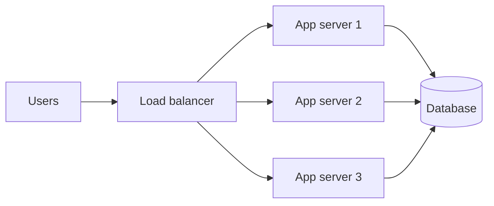

::part[Pelajari Konsepnya]{n="1"}

## 🎯 Yang akan kamu pelajari

- **Vertical scaling** (mesin lebih besar) vs **horizontal scaling** (mesin lebih banyak)
- Kenapa horizontal scaling perlu server **stateless**
- **Ketersediaan** dalam "nines" dan cara menghitungnya
- **Single points of failure** (titik gagal tunggal) dan **redundancy** (cadangan)

## 🔤 Istilah penting

| Istilah | Artinya (sederhana) |
|---|---|
| **Vertical scaling** | Membeli mesin yang lebih besar |
| **Horizontal scaling** | Menambah jumlah mesin yang melakukan pekerjaan sama |
| **Stateless server** | Server yang tidak menyimpan apa-apa penting di antara request |
| **Session state** | Data tentang pengguna yang login, disimpan di tempat bersama |
| **Availability ("nines")** | Berapa banyak waktu sistem berjalan dengan baik |
| **Redundancy** | Cadangan yang siap ambil alih saat sesuatu gagal |
| **Single point of failure** | Satu bagian yang kalau gagal, segalanya berhenti |
| **Failover** | Beralih ke cadangan secara otomatis |

## 🧠 Ide besarnya

Warung kamu mulai ramai:

- **Vertical scaling**: beli kompor yang lebih besar dan ambil koki yang lebih cepat. Mudah — sampai tidak ada kompor yang lebih besar lagi, dan kalau koki itu sakit, warung tutup.
- **Horizontal scaling**: buka lebih banyak counter yang sama dengan lebih banyak koki. Harus diatur lebih rumit, tapi tidak ada batas — dan kalau satu koki sakit, yang lain terus layani.

## ❓ Kenapa ini penting

Traffic bertambah dan hardware rusak. Setiap server, disk, link jaringan dan data centre suatu saat pasti gagal. Sistem dirancang supaya **pertumbuhan** tidak perlu tulis ulang kode, dan **satu kegagalan** tidak matikan semuanya.

Tanpa perencanaan itu:

- Satu server simpan session di memory → tambah server kedua → pengguna tiba-tiba logout saat request jatuh ke server "yang lain".
- Disk server database tunggal penuh jam 2 pagi → seluruh produk down, termasuk halaman yang tidak pernah butuh database.

## 📖 Langkah demi langkah

### 1. Vertical scaling

Lebih banyak CPU, RAM, disk yang lebih cepat di mesin yang sama.

- ✅ Tidak perlu ubah kode; langkah pertama paling sederhana
- ❌ Ada batas keras di atas, harga naik curam di puncak, masih satu mesin yang bisa gagal, sering butuh downtime untuk resize

### 2. Horizontal scaling

- ✅ Tambah server saat traffic bertumbuh; satu server yang gagal bukan outage
- ❌ Butuh load balancer, deploy yang sama di semua, dan app server yang **stateless**

### 3. Stateless servers

Stateless adalah yang membuat counter tambahan bisa berjalan: koki apa pun bisa layani pelanggan apa pun, karena kertas pesanan itu berisi semua yang mereka butuh.

Satu :term[stateless]{bahasa="stateless — server tidak menyimpan data penting di memory atau disk-nya sendiri antara request"} server tidak simpan apa pun yang penting di memory atau disk sendirinya antara request. Server apa pun bisa tangani request apa pun.

Pindahkan state keluar dari app server:

| State | Simpan di |
|---|---|
| Login session | token yang ditandatangani (JWT) atau tempat bersama seperti Redis |
| File yang diupload | object storage (mis. S3) |
| Data | database |
| Background job | queue |

(Ingat dari pelajaran HTTP: HTTP itu sendiri stateless — desain ini sejalan dengan alurnya.)

### 4. Ketersediaan dalam nines

Ubah angkanya jadi manusia: 99,9% adalah sekitar 43 menit down per bulan; 99,99% adalah sekitar 4 menit. Setiap nine tambahan butuh biaya sungguhan, jadi pilih yang benar-benar kamu perlukan.

Availability = fraksi waktu layanan berjalan.

| Ketersediaan | Downtime per tahun | Downtime per bulan |
|---|---|---|
| 99% ("two nines") | ~3,65 hari | ~7,3 jam |
| 99,9% | ~8,8 jam | ~43 menit |
| 99,99% | ~53 menit | ~4,3 menit |
| 99,999% | ~5 menit | ~26 detik |

Setiap nine tambahan butuh **jauh** lebih banyak engineering dan biaya.

### 5. Series vs parallel

**Series** — satu request butuh **semua** komponen (app **dan** database **dan** payment API):

`A_total = A₁ × A₂ × A₃` → 99,9% × 99,9% × 99,9% ≈ **99,7%**

Lebih banyak dependency dalam rantai = availability **lebih rendah** dari mana pun.

**Parallel** (salinan redundan, satu pun cukup):

`A_total = 1 − (1 − A)ⁿ` → dua server masing-masing 99%: 1 − 0,01² = **99,99%**

Redundancy adalah cara bagian yang tidak dapat diandalkan membangun sistem yang dapat diandalkan.

### 6. Single points of failure (SPOF)

Komponen yang kalau gagal maka semuanya down. SPOF umum: satu database, satu load balancer, satu region, satu orang yang tahu cara deploy. 😅 Perbaikan: replika, failover, banyak availability zone — dan dokumentasi.

### Pilih setup-mu

Setiap pilihan di sini adalah trade-off:

| Pilihan | ✅ | ❌ |
|---|---|---|
| Vertikal dulu | Sederhana, murah di skala kecil | Ada batas; masih SPOF |
| Horizontal | Tumbuh jauh, bertahan kegagalan | Kompleksitas: load balancing, state, konsistensi |
| Lebih banyak nines | Lebih sedikit outage | Biaya dan kompleksitas naik curam |
| Banyak dependency | Reuse, kecepatan build | Ketersediaan naik turun |

- ✅ Mulai sederhana (satu server, database terkelola dengan backup) dan desain app server stateless dari hari pertama — murah.
- ✅ Tambah redundancy di tempat outage bayar uang sungguhan atau kepercayaan (pembayaran, login).
- 🚫 Jangan bangun sistem multi-region active-active untuk proyek portfolio.
- 🚫 Jangan janji 99,99% kalau kamu bergantung pada API pihak ketiga yang tawarkan hanya 99,9%.

## ⚠️ Kesalahan umum

- Simpan session atau upload di disk lokal app server.
- Lupa bahwa setiap dependency yang ditambahkan menurunkan ketersediaan total.
- App server redundan tapi database tunggal tanpa backup.
- Anggap "belum pernah gagal" sebagai rencana keandalan.

::part[Jelaskan & Rancang]{n="2"}

## 🗣️ Jelaskan

Jelaskan kenapa dua server murah yang masing-masing 99%-available bisa lebih dapat diandalkan daripada satu server mahal 99,9%-available — pakai contoh kehidupan nyata (dua ATM, dua rute bus…).

## 📐 Rancang

CareerPilot saat ini berjalan di **satu** server yang memegang API Flask, file CV diupload ke disk lokal, user session di memory, dan database PostgreSQL. Traffic bertambah dan bulan lalu kegagalan disk menyebabkan outage 6 jam.

Daftar setiap SPOF dan masalah state, lalu usulkan rencana langkah demi langkah (langkah termurah dulu) untuk mencapai ~99,9% ketersediaan.

:::quiz
Lihat satu rencana kemungkinan

**Masalah:** satu server = SPOF untuk segalanya; CV di disk lokal (hilang saat gagal, tidak bisa scale); session di memory (tidak bisa scale); database di mesin yang sama (bersaing sumber daya, tidak ada failover); backup yang sudah diuji kemungkinan tidak ada.

**Rencana, termurah dulu:**
1. **Database backup** otomatis + restore yang sudah diuji.
2. Pindahkan CV ke **object storage**; ubah session jadi **JWT** atau Redis → app server jadi stateless.
3. Pindahkan PostgreSQL ke **database terkelola** dengan failover otomatis.
4. Jalankan **2+ app server** di belakang **load balancer** di dua availability zone.
5. Tambahkan health check, monitoring dan alert pada p95 latency dan error rate.
:::

### 📝 Checklist review mandiri

- [ ] Saya cari state yang disimpan di server (file, session)
- [ ] Rencana saya perbaiki keamanan data (backup) sebelum scaling mewah
- [ ] Saya buang SPOF satu demi satu

::ai-review{task="design"}

::part[Latihan Kecil]{n="3"}

:::exercise{path="exercises/architecture/b-system-design-basics/02-availability-math" ai="no-ai" title="Kalkulator availability"}
Implementasi `availability.py`: downtime dari availability, series dan parallel availability, dan helper yang bilang berapa salinan redundan yang kamu butuh untuk capai target.
:::

## ✅ Cek cepat

:::quiz
Kenapa app server harus stateless untuk scale horizontal?

Supaya server apa pun bisa tangani request apa pun. Kalau satu server simpan session atau file secara lokal, request yang dialihkan ke server lain tidak bisa lihat itu.
:::

:::quiz
Tiga service masing-masing 99,9% dan semua dibutuhkan untuk satu request. Berapa ketersediaan gabungannya?

0,999³ ≈ 0,997 → kurang lebih **99,7%**.
:::

## 📚 Lanjut belajar

- [AWS Well-Architected: Reliability pillar](https://docs.aws.amazon.com/wellarchitected/latest/reliability-pillar/welcome.html)
- [The Twelve-Factor App: Processes (stateless)](https://12factor.net/processes)
