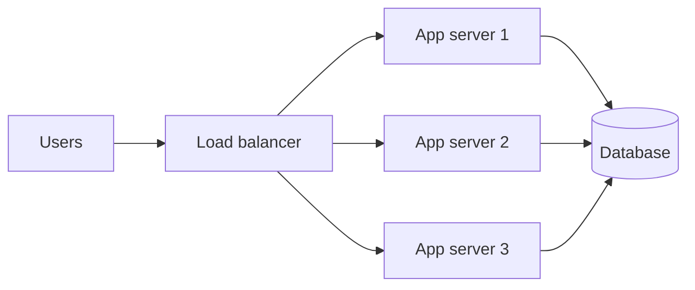

::part[Learn the Concept]{n="1"}

## 🎯 What you'll learn

- **Vertical** scaling (bigger machine) vs **horizontal** scaling (more machines)
- Why horizontal scaling needs **stateless** servers
- **Availability** in "nines" and how to calculate it
- **Single points of failure** and **redundancy**

## 🔤 Key words

| Word | In simple words | Bahasa Indonesia |
|---|---|---|
| **Vertical scaling** | A bigger machine | Membesarkan satu mesin |
| **Horizontal scaling** | More machines doing the same job | Menambah jumlah mesin |
| **Stateless server** | A server that keeps nothing between requests | Server tanpa ingatan |
| **Session state** | Data about a logged-in user, kept somewhere shared | Data sesi pengguna |
| **Availability ("nines")** | How much of the time the system works | Ketersediaan layanan |
| **Redundancy** | A spare that takes over when something fails | Cadangan siap pakai |
| **Single point of failure** | The one part whose failure stops everything | Titik gagal tunggal |
| **Failover** | Switching to the spare automatically | Peralihan ke cadangan |

## 🧠 The big idea

Your warung gets popular:

- **Vertical scaling**: buy a bigger stove and hire a faster cook. Easy — until there's no bigger stove, and if that one cook is sick, you're closed.
- **Horizontal scaling**: open more identical counters with more cooks. More work to coordinate, but no hard limit — and if one cook is sick, the others keep serving.

## ❓ Why it matters

Traffic grows and hardware fails. Every server, disk, network link and data centre eventually breaks. Systems are designed so that **growth** doesn't require a rewrite, and **one failure** doesn't take everything down.

Without that planning:

- One server keeps sessions in memory → you add a second server → users are randomly logged out when a request lands on the "other" one.
- The single database server's disk fills up at 2 a.m. → the whole product is down, including pages that never needed the database.

## 📖 Step by step

### 1. Vertical scaling

More CPU, RAM, faster disks on the same machine.

- ✅ No code changes; simplest first step
- ❌ Hard upper limit, price rises steeply at the top, still one machine that can fail, often needs downtime to resize

### 2. Horizontal scaling

- ✅ Add servers as traffic grows; one failing server isn't an outage
- ❌ Needs a load balancer, identical deploys, and **stateless** app servers

### 3. Stateless servers

Stateless is what makes extra counters possible: any cook can serve any customer, because the order slip carries everything they need.

A :term[stateless]{bahasa="stateless — server tidak menyimpan data sesi pengguna di memorinya sendiri"} server keeps nothing important in its own memory or disk between requests. Any server can handle any request.

Move state out of app servers:

| State | Put it in |
|---|---|
| Login session | signed token (JWT) or a shared store like Redis |
| Uploaded files | object storage (e.g. S3) |
| Data | the database |
| Background jobs | a queue |

(Remember from the HTTP lesson: HTTP itself is stateless — this design goes with the grain.)

### 4. Availability in nines

Put the numbers in human terms: 99.9% is about 43 minutes down per month; 99.99% is about 4 minutes. Each extra nine costs real money, so pick one you actually need.

Availability = fraction of time the service works.

| Availability | Downtime per year | Downtime per month |
|---|---|---|
| 99% ("two nines") | ~3.65 days | ~7.3 hours |
| 99.9% | ~8.8 hours | ~43 minutes |
| 99.99% | ~53 minutes | ~4.3 minutes |
| 99.999% | ~5 minutes | ~26 seconds |

Each extra nine costs **much** more engineering and money.

### 5. Series vs parallel

**Series** — a request needs **all** components (app **and** database **and** payment API):

`A_total = A₁ × A₂ × A₃` → 99.9% × 99.9% × 99.9% ≈ **99.7%**

More dependencies in a chain = **lower** availability than any single one.

**Parallel** (redundant copies, any one is enough):

`A_total = 1 − (1 − A)ⁿ` → two servers at 99% each: 1 − 0.01² = **99.99%**

Redundancy is how unreliable parts build reliable systems.

### 6. Single points of failure (SPOF)

A component whose failure takes everything down. Common SPOFs: one database, one load balancer, one region, one person who knows how to deploy. 😅 Fixes: replicas, failover, multiple availability zones — and documentation.

### Choosing your setup

Every option here is a trade-off:

| Choice | ✅ | ❌ |
|---|---|---|
| Vertical first | Simple, cheap at small scale | Ceiling; still a SPOF |
| Horizontal | Grows far, survives failures | Complexity: load balancing, state, consistency |
| More nines | Fewer outages | Steeply rising cost and complexity |
| Many dependencies | Reuse, speed of building | Availability multiplies downward |

- ✅ Start simple (one server, managed database with backups) and design app servers stateless from day one — it's cheap.
- ✅ Add redundancy where an outage costs real money or trust (payments, login).
- 🚫 Don't build multi-region active-active systems for a portfolio project.
- 🚫 Don't promise 99.99% when you depend on a third-party API that offers 99.9%.

## ⚠️ Common mistakes

- Storing sessions or uploads on the app server's local disk.
- Forgetting that each added dependency lowers overall availability.
- Redundant app servers but a single database with no backups.
- Treating "it hasn't failed yet" as a reliability plan.

::part[Explain & Design]{n="2"}

## 🗣️ Explain it

Explain why two cheap 99%-available servers can together be more reliable than one expensive 99.9% server — using a real-life example (two ATMs, two bus routes…).

## 📐 Design it

CareerPilot currently runs on **one** server that holds the Flask API, uploaded CV files on local disk, user sessions in memory, and a PostgreSQL database. Traffic is growing and last month a disk failure caused a 6-hour outage.

List every SPOF and state problem, then propose a step-by-step plan (cheapest steps first) to reach ~99.9% availability.

:::quiz
Show a possible plan

**Problems:** one server = SPOF for everything; CVs on local disk (lost on failure, can't scale out); sessions in memory (can't scale out); database on the same machine (resource contention, no failover); likely no tested backups.

**Plan, cheapest first:**
1. Automated **database backups** + a tested restore.
2. Move CVs to **object storage**; switch sessions to **JWT** or Redis → app servers become stateless.
3. Move PostgreSQL to a **managed database** with automated failover.
4. Run **2+ app servers** behind a **load balancer** across two availability zones.
5. Add health checks, monitoring and alerts on p95 latency and error rate.
:::

### 📝 Self-review checklist

- [ ] I found state stored on the server (files, sessions)
- [ ] My plan fixes data safety (backups) before fancy scaling
- [ ] I removed the SPOFs one by one

::ai-review{task="design"}

::part[Toy Exercise]{n="3"}

:::exercise{path="exercises/architecture/b-system-design-basics/02-availability-math" ai="no-ai" title="Availability calculator"}
Implement `availability.py`: downtime from availability, series and parallel availability, and a helper that tells you how many redundant copies you need to reach a target.
:::

## ✅ Quick check

:::quiz
Why must app servers be stateless to scale horizontally?

So any server can handle any request. If a server keeps sessions or files locally, requests routed to another server can't see them.
:::

:::quiz
Three services each at 99.9% are all required for a request. What's the combined availability?

0.999³ ≈ 0.997 → about **99.7%**.
:::

## 📚 Keep learning

- [AWS Well-Architected: Reliability pillar](https://docs.aws.amazon.com/wellarchitected/latest/reliability-pillar/welcome.html)
- [The Twelve-Factor App: Processes (stateless)](https://12factor.net/processes)
