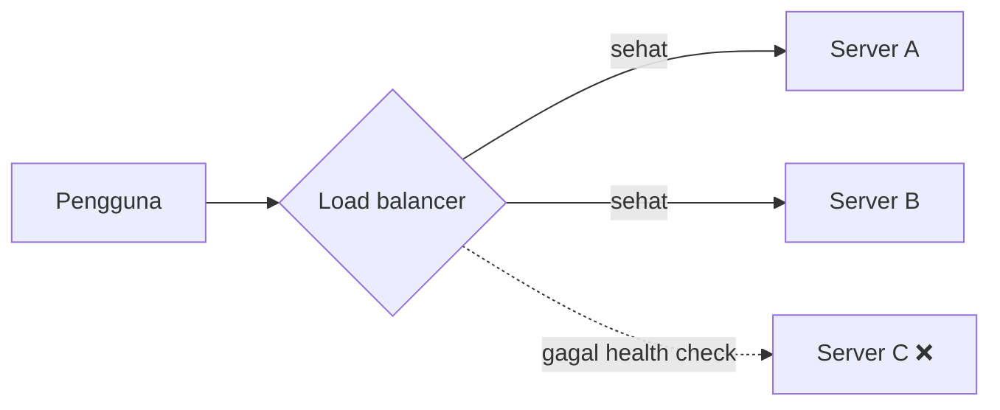

::part[Pelajari Konsepnya]{n="1"}

## 🎯 Yang akan kamu pelajari

- **Load balancer**: membagi traffic dan menghapus server yang tidak sehat
- **Cache**: di mana cache tinggal, **TTL**, cache-aside, dan **invalidation**
- **CDN**: menyajikan konten statis dekat dengan pengguna
- Masalah baru yang masing-masing bawa (data kedaluwarsa, thundering herd)

## 🔤 Istilah penting

| Istilah | Artinya (sederhana) |
|---|---|
| **Load balancer** | Satu pintu masuk yang membagi traffic ke server-server sehat |
| **Health check** | Tes yang memutuskan apakah server boleh menerima traffic |
| **Cache** | Salinan jawaban yang disimpan, supaya tidak perlu kerjaan lambat lagi kali berikutnya |
| **TTL** | Berapa lama salinan cache boleh dipakai |
| **Cache-aside** | Lihat cache dulu; kalau tidak ada, ambil dari sumber dan simpan |
| **Invalidation** | Buang salinan cache karena data sungguhan sudah berubah |
| **Stale data** | Salinan yang sudah ketinggalan zaman |
| **Thundering herd** | Seribu request membangun ulang cache yang habis pada saat bersamaan |
| **CDN** | Salinan file kamu disimpan dekat dengan pengguna di seluruh dunia |

## 🧠 Ide besarnya

| Batu loncatan | Versi kehidupan nyata |
|---|---|
| **Load balancer** | Host di restoran yang menempatkan tamu di meja yang punya kursi kosong |
| **Cache** | Menyiapkan minuman paling populer hari ini di belakang konter, jadi pesanan langsung siap |
| **CDN** | Rantai buka cabang kecil di setiap kota, jadi pelanggan tidak perlu ke kantor pusat |

## ❓ Kenapa ini penting

- Banyak server butuh **satu pintu masuk** yang membagi pekerjaan adil dan lewat server yang rusak → load balancer.
- Menghitung ulang atau mengambil jawaban yang sama itu lambat dan mahal → cache.
- Fisika: cahaya di serat optik butuh waktu, jadi pengguna jauh dari servermu menunggu → CDN.

Masing-masing juga bawa masalah baru: load balancer butuh health check yang bagus atau ia kirimkan pengguna ke server rusak; cache bisa sajikan harga kemarin; CDN terus sajikan file yang sudah kamu ganti.

## 📖 Langkah demi langkah

### 1. Load balancer



| Algoritma | Cara pilih | Bagus untuk |
|---|---|---|
| Round robin | server berikutnya dalam urutan | server identik, request mirip |
| Least connections | server dengan request aktif paling sedikit | durasi request tidak merata |
| Hash (misal user id) | user yang sama → server yang sama | kalau ada afinitas (pakai jarang-jarang) |

**Health check**: load balancer memanggil sesuatu seperti `GET /health` setiap beberapa detik dan berhenti kirim traffic ke server yang gagal. Ini juga cara **deploy tanpa downtime** bekerja: ambil satu server, update, taruh kembali.

### 2. Cache

Bagian sulit dari cache bukan menyimpan — itu memutuskan kapan salinan tidak lagi benar. Setiap cache butuh jawaban untuk "bagaimana ini dibuang?"

Sebuah :term[cache]{bahasa="cache — penyimpanan cepat sementara untuk data yang sering diminta"} menyimpan salinan data di tempat yang lebih cepat dari aslinya.

Cache ada di setiap lapisan:

| Lapisan | Contoh |
|---|---|
| Browser | gambar, CSS, JS dengan header `Cache-Control` |
| CDN | file statis dan bahkan response API dekat pengguna |
| Aplikasi | dict dalam memori, atau **Redis** yang dibagikan semua server |
| Database | cache query atau halaman |

**Cache-aside** (pola paling umum):

```python
def get_job(job_id):
    cached = cache.get(f"job:{job_id}")
    if cached is not None:
        return cached                         # cache HIT: fast
    job = database.find_job(job_id)           # cache MISS: slow path
    cache.set(f"job:{job_id}", job, ttl_seconds=300)
    return job
```

**TTL** (time to live): setiap entry habis setelah N detik. TTL pendek = data lebih segar, miss lebih banyak. TTL panjang = lebih cepat, tapi data lebih tua.

**Invalidation**: kalau data berubah, hapus salinan cache:

```python
def update_job(job_id, changes):
    database.update_job(job_id, changes)
    cache.delete(f"job:{job_id}")             # next read fetches the fresh version
```

:::warning[Bagian sulit]
Memutuskan **kapan** data cache tidak lagi benar terkenal sulit. Aturan jempol: cache data yang sering dibaca, jarang berubah, dan boleh sedikit tua tanpa masalah. Jangan pernah cache data pribadi per-pengguna dengan kunci bersama.
:::

**Eviction**: cache punya memori terbatas. Kalau penuh, hapus sesuatu — biasanya item **least recently used** (LRU).

### 3. CDN

Sebuah CDN (content delivery network) punya server ("edge location") di banyak kota. Pengguna pertama di wilayah memicu fetch dari asalmu; pengguna berikutnya dapat salinan dari edge dekat.

Bagus untuk: gambar, video, bundle CSS/JS, font, file download — dan seluruh frontend statis (kamu akan host build Next.js/Vite di balik **CloudFront** di Module 5).

Trik: taruh **content hash** di nama file (`app.3f9a2c.js`). File berubah → nama baru → tidak ada masalah cache tua, jadi kamu bisa cache setahun. (Build Vite handbook ini lakukan persis itu — lihat di `dist/assets/`.)

### Pilih setup kamu

Setiap pilihan di sini ada trade-off:

| Batu loncatan | ✅ | ❌ Masalah baru |
|---|---|---|
| Load balancer | bagi beban, sembunyikan kegagalan, aktifkan deploy tanpa downtime | dirinya sendiri harus redundan; sticky session kurangi fleksibilitas |
| Cache | hemat latency dan biaya besar-besaran | data tua, bug invalidation, cold start, batas memori |
| CDN | latency rendah di seluruh dunia, serap lonjakan traffic | hapus cache, biaya, debug lebih sulit ("edge mana yang sajikan ini?") |

**Thundering herd**: entry cache populer habis, 1.000 request miss pada saat bersamaan dan semua kena database. Mitigasi: TTL yang sedikit acak, biarkan hanya satu request membangun entry ulang.

- ✅ Load balancer segera ada 2+ app server (managed cloud LB mudah).
- ✅ Cache data mahal, dibaca sering, jarang berubah (daftar job, embedding AI teks sama, kurs tukar).
- ✅ CDN untuk semua aset statis.
- 🚫 Jangan cache sebelum ukur — kamu mungkin sembunyikan index database yang hilang.
- 🚫 Jangan cache data yang harus persis sekarang (saldo bank saat bayar, stok saat checkout).


## ⚠️ Kesalahan umum

- Lupa invalidate setelah update.
- Cache response spesifik pengguna dengan kunci bersama → kebocoran data antar pengguna.
- Tidak ada TTL sama sekali.
- Perlakukan cache sebagai sumber kebenaran (bisa dibuang kapan saja).

::part[Jelaskan & Rancang]{n="2"}

## 🗣️ Jelaskan

Jelaskan invalidation cache ke orang bukan programmer dengan papan menu kafe: apa yang salah kalau papan tidak update saat hidangan habis terjual, dan kenapa update terus-menerus juga mahal.

## 📐 Rancang

Untuk CareerPilot, tentukan apa yang di-cache, di mana, dan dengan strategi TTL/invalidation apa — atau tentukan untuk **tidak** di-cache:

1. Halaman detail job listing publik
2. Papan "application pipeline" pribadi pengguna
3. Skor match "CV vs job" yang dihasilkan AI untuk pasangan (versi CV, job)
4. Bundle JS/CSS frontend
5. Hitungan aplikasi yang diajukan hari ini (ditampilkan di dashboard admin)

:::quiz
Lihat contoh rancangan

1. **Cache CDN/aplikasi**, TTL ~5–10 menit, invalidate saat edit. Publik, banyak baca, jarang berubah.
2. **Jangan cache di lapisan bersama** (atau hanya per-pengguna dengan TTL pendek). Pribadi dan sering berubah; papan cache tua bingungkan pengguna.
3. **Redis**, kunci `match:{cv_hash}:{job_id}`, TTL panjang (hari). Panggilan AI mahal; hasilnya sah sampai CV atau job berubah — versi CV baru dapat hash baru, jadi tidak perlu invalidation eksplisit.
4. **CDN dengan nama file hash**, cache setahun.
5. **TTL pendek (~30–60 s)**. Admin terima jadwal sedikit tua; hemat query hitungan berulang.
:::

### 📝 Checklist review mandiri

- [ ] Data pribadi per-pengguna tidak di-cache dengan kunci bersama
- [ ] Setiap cache punya TTL atau trigger invalidation jelas
- [ ] Saya gunakan content hashing atau kunci berversikan di mana data tidak berubah

::ai-review{task="design"}

::part[Latihan Kecil]{n="3"}

:::exercise{path="exercises/architecture/b-system-design-basics/03-ttl-cache" ai="no-ai" title="Bangun cache TTL"}
Implementasi kelas `TTLCache` kecil dengan `get`, `set`, `delete` dan statistik hit/miss, plus helper `cached_fetch` pakai pola cache-aside. Clock di-**inject** (ingat Coupling & Cohesion?) jadi tes bisa maju waktu tanpa sleep.
:::

:::hints
- Simpan entry sebagai `key → (value, expires_at)`.
- Saat `get`, kalau entry sudah habis, hapus dan hitung miss.
- `clock` adalah fungsi yang return waktu sekarang dalam detik; panggil `self._clock()` kapan pun butuh "sekarang".
:::

### 🏆 Stretch goal

Tambah batas `max_items` dengan **eviction LRU**. Hint: `collections.OrderedDict` dan `move_to_end()`.

## ✅ Cek cepat

:::quiz
Apa pola cache-aside?

Aplikasi cek cache dulu; saat miss ia load dari sumber (misal database), simpan hasil di cache dengan TTL, dan return.
:::

:::quiz
Apa yang health check biarkan load balancer lakukan?

Deteksi server yang mati atau tidak sehat dan berhenti kirim mereka traffic, lalu tambah kembali saat pulih.
:::

:::quiz
Kenapa build tool taruh content hash di nama file statis?

File berubah dapat URL baru, jadi CDN dan browser bisa cache file sangat lama tanpa pernah sajikan versi tua.
:::


## 📚 Lanjut belajar

- [MDN: HTTP caching](https://developer.mozilla.org/en-US/docs/Web/HTTP/Caching)
- [Redis: Caching patterns](https://redis.io/docs/latest/develop/use/patterns/)

## 📣 Bagikan progresmu

:::linkedin{type="concept"}
☕ Cache dijelaskan dengan kafe:

Barista kamu menyiapkan 3 minuman paling populer lebih dulu. Pesanan untuk itu langsung siap (cache hit). Yang lain dibuat segar (cache miss).

Tapi kalau resep berubah, minuman yang sudah siap harus dibuang (cache invalidation) — atau pelanggan dapat versi lama.

Trade-off itu — kecepatan vs kesegaran — keluar di mana-mana di software: browser, CDN, Redis, bahkan aplikasi AI yang cache panggilan model mahal.

Bug cache yang paling membingungkan yang pernah kamu lihat apa?

#SystemDesign #LearningInPublic #BackendDevelopment
:::
