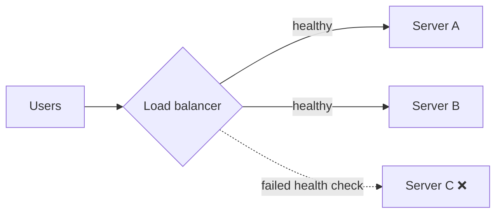

::part[Learn the Concept]{n="1"}

## 🎯 What you'll learn

- **Load balancers**: spreading traffic and removing unhealthy servers
- **Caching**: where caches live, **TTL**, cache-aside, and **invalidation**
- **CDNs**: serving static content close to users
- The new problems each one introduces (stale data, thundering herds)

## 🔤 Key words

| Word | In simple words | Bahasa Indonesia |
|---|---|---|
| **Load balancer** | The one entry point that spreads traffic over healthy servers | Pembagi lalu lintas |
| **Health check** | The test that decides if a server may receive traffic | Cek kesehatan server |
| **Cache** | A saved copy of an answer, to skip the slow work next time | Salinan jawaban |
| **TTL** | How long a cached copy may be used | Masa berlaku cache |
| **Cache-aside** | Look in the cache; if it's missing, fetch and store it | Pola isi cache saat kosong |
| **Invalidation** | Removing a cached copy because the real data changed | Membuang cache lama |
| **Stale data** | A copy that is out of date | Data kedaluwarsa |
| **Thundering herd** | Everyone rebuilding the same expired cache at once | Serbuan saat cache habis |
| **CDN** | Copies of your files kept near users worldwide | Jaringan pengantar konten |

## 🧠 The big idea

| Building block | Real-life version |
|---|---|
| **Load balancer** | A host at a restaurant seating guests at whichever table has space |
| **Cache** | Keeping today's most-ordered drinks already prepared behind the counter |
| **CDN** | A chain opening small branches in every city so customers don't travel to headquarters |

## ❓ Why it matters

- Many servers need **one entry point** that spreads work fairly and skips broken servers → a load balancer.
- Recomputing or re-fetching the same answer is slow and expensive → a cache.
- Physics: light in a fibre takes time, so users far from your server wait → a CDN.

Each one also brings a new problem: a load balancer needs good health checks or it sends users to a broken server; a cache can serve yesterday's price; a CDN can keep serving a file you already replaced.

## 📖 Step by step

### 1. Load balancers



| Algorithm | How it picks | Good for |
|---|---|---|
| Round robin | next server in turn | identical servers, similar requests |
| Least connections | server with fewest active requests | uneven request durations |
| Hash (e.g. by user id) | same user → same server | when some affinity helps (use sparingly) |

**Health checks**: the load balancer calls something like `GET /health` every few seconds and stops sending traffic to servers that fail. This is also how **zero-downtime deploys** work: take one server out, update it, put it back.

### 2. Caching

The hard part of caching isn't storing — it's deciding when a copy stops being true. Every cache needs an answer to "how does this get thrown away?"

A :term[cache]{bahasa="cache — penyimpanan sementara yang cepat untuk data yang sering diminta"} stores a copy of data somewhere faster than the original.

Caches exist at every layer:

| Layer | Example |
|---|---|
| Browser | images, CSS, JS with `Cache-Control` headers |
| CDN | static files and even API responses near users |
| Application | in-memory dict, or **Redis** shared by all servers |
| Database | query/page caches |

**Cache-aside** (the most common pattern):

```python
def get_job(job_id):
    cached = cache.get(f"job:{job_id}")
    if cached is not None:
        return cached                         # cache HIT: fast
    job = database.find_job(job_id)           # cache MISS: slow path
    cache.set(f"job:{job_id}", job, ttl_seconds=300)
    return job
```

**TTL** (time to live): each entry expires after N seconds. Short TTL = fresher data, more misses. Long TTL = faster, but staler.

**Invalidation**: when data changes, delete the cached copy:

```python
def update_job(job_id, changes):
    database.update_job(job_id, changes)
    cache.delete(f"job:{job_id}")             # next read fetches the fresh version
```

:::warning[The hard part]
Deciding **when** cached data is no longer correct is famously difficult. Rule of thumb: cache data that's read often, changes rarely, and can be slightly stale without harm. Never cache per-user private data under a shared key.
:::

**Eviction**: caches have limited memory. When full, remove something — usually the **least recently used** (LRU) item.

### 3. CDNs

A CDN (content delivery network) has servers ("edge locations") in many cities. The first user in a region triggers a fetch from your origin; later users get the copy from the nearby edge.

Best for: images, videos, CSS/JS bundles, fonts, downloadable files — and a whole static frontend (you'll host a Next.js/Vite build behind **CloudFront** in Module 5).

Trick: put a **content hash** in file names (`app.3f9a2c.js`). Changed file → new name → no stale cache problem, so you can cache for a year. (The Vite build of this handbook does exactly that — look in `dist/assets/`.)

### Choosing your setup

Every option here is a trade-off:

| Building block | ✅ | ❌ New problems |
|---|---|---|
| Load balancer | spreads load, hides failures, enables zero-downtime deploys | itself must be redundant; sticky sessions reduce flexibility |
| Cache | huge latency and cost savings | stale data, invalidation bugs, cold starts, memory limits |
| CDN | low latency worldwide, absorbs traffic spikes | purging caches, cost, harder debugging ("which edge served this?") |

**Thundering herd**: a popular cache entry expires, and 1,000 requests miss at the same moment and all hit the database. Mitigations: slightly randomized TTLs, letting only one request rebuild the entry.

- ✅ Load balancer as soon as you have 2+ app servers (managed cloud LBs are easy).
- ✅ Cache expensive, frequently read, rarely changing data (job listings, AI embeddings of the same text, exchange rates).
- ✅ CDN for all static assets.
- 🚫 Don't cache before measuring — you might be hiding a missing database index.
- 🚫 Don't cache data that must be exactly current (bank balances at payment time, stock levels at checkout).


## ⚠️ Common mistakes

- Forgetting to invalidate after updates.
- Caching user-specific responses under a shared key → data leaks between users.
- No TTL at all.
- Treating the cache as the source of truth (it can be evicted any time).

::part[Explain & Design]{n="2"}

## 🗣️ Explain it

Explain cache invalidation to a non-programmer using a café menu board: what goes wrong if the board isn't updated when a dish sells out, and why updating it constantly is also costly.

## 📐 Design it

For CareerPilot, decide what to cache, where, and with which TTL/invalidation strategy — or decide **not** to cache:

1. Public job listing detail pages
2. A user's personal "application pipeline" board
3. The AI-generated "CV vs job" match score for a (CV version, job) pair
4. The frontend's JS/CSS bundle
5. The count of applications submitted today (shown on an admin dashboard)

:::quiz
Show a possible design

1. **CDN/app cache**, TTL ~5–10 min, invalidate on edit. Public, read-heavy, rarely changes.
2. **Don't cache in a shared layer** (or only per-user with a short TTL). Private and changes often; a stale board confuses users.
3. **Redis**, key `match:{cv_hash}:{job_id}`, long TTL (days). Expensive AI call; the result is valid until the CV or job changes — a new CV version gets a new hash, so no explicit invalidation is needed.
4. **CDN with hashed filenames**, cache for a year.
5. **Short TTL (~30–60 s)**. Admins accept being a minute behind; saves repeated counting queries.
:::

### 📝 Self-review checklist

- [ ] Private per-user data isn't cached under shared keys
- [ ] Every cache has a TTL or a clear invalidation trigger
- [ ] I used content hashing/versioned keys where data is immutable

::ai-review{task="design"}

::part[Toy Exercise]{n="3"}

:::exercise{path="exercises/architecture/b-system-design-basics/03-ttl-cache" ai="no-ai" title="Build a TTL cache"}
Implement a small `TTLCache` class with `get`, `set`, `delete` and hit/miss statistics, plus a `cached_fetch` helper using the cache-aside pattern. The clock is **injected** (remember Coupling & Cohesion?) so tests can move time forward without sleeping.
:::

:::hints
- Store entries as `key → (value, expires_at)`.
- On `get`, if the entry is expired, delete it and count a miss.
- `clock` is a function returning the current time in seconds; call `self._clock()` whenever you need "now".
:::

### 🏆 Stretch goal

Add a `max_items` limit with **LRU eviction**. Hint: a `collections.OrderedDict` and `move_to_end()`.

## ✅ Quick check

:::quiz
What's the cache-aside pattern?

The app checks the cache first; on a miss it loads from the source (e.g. database), stores the result in the cache with a TTL, and returns it.
:::

:::quiz
What does a health check let a load balancer do?

Detect servers that are down or unhealthy and stop sending them traffic, then add them back when they recover.
:::

:::quiz
Why do build tools put content hashes in static file names?

A changed file gets a new URL, so CDNs and browsers can cache files for a very long time without ever serving an outdated version.
:::


## 📚 Keep learning

- [MDN: HTTP caching](https://developer.mozilla.org/en-US/docs/Web/HTTP/Caching)
- [Redis: Caching patterns](https://redis.io/docs/latest/develop/use/patterns/)

## 📣 Share your progress

:::linkedin{type="concept"}
☕ Caching explained with a café:

Your barista prepares the 3 most popular drinks in advance. Orders for those are instant (cache hit). Anything else is made fresh (cache miss).

But when the recipe changes, the pre-made drinks must be thrown away (cache invalidation) — or customers get the old version.

That trade-off — speed vs freshness — shows up everywhere in software: browsers, CDNs, Redis, and even AI apps that cache expensive model calls.

What's the most confusing caching bug you've seen?

#SystemDesign #LearningInPublic #BackendDevelopment
:::
