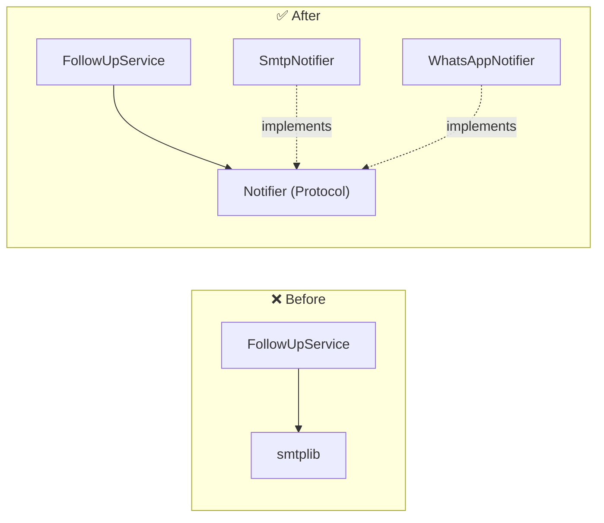

::part[Pelajari Konsepnya]{n="1"}

## 🎯 Yang akan kamu pelajari

- **S**ingle Responsibility, **O**pen/Closed, **L**iskov Substitution, **I**nterface Segregation, **D**ependency Inversion
- Masalah apa yang dicegah setiap prinsip, dengan kode Python sebelum dan sesudah
- Alat Python untuk SOLID: duck typing, `typing.Protocol`, `abc.ABC`, dependency injection
- Bagaimana SOLID terhubung dengan Tahap A (coupling & cohesion) dan design pattern (Tahap D)
- Kapan SOLID itu berlebihan

## 🔤 Istilah penting

| Istilah | Artinya (sederhana) |
|---|---|
| **SOLID** | Lima pedoman desain kelas agar tetap mudah diubah |
| **Single Responsibility** | Satu kelas, satu alasan untuk berubah |
| **Open/Closed** | Tambah perilaku dengan kode baru, bukan edit kode lama |
| **Liskov Substitution** | Subclass harus bekerja di mana induknya bekerja |
| **Interface Segregation** | Banyak interface kecil lebih baik daripada satu besar |
| **Dependency Inversion** | Bergantung pada kontrak, bukan alat yang konkret |
| **Interface / Protocol** | Himpunan metode yang harus ada di sesuatu |
| **Duck typing** | Kalau punya metode yang tepat, Python terima saja |
| **Dependency injection** | Serahkan alat dari luar, jangan buat di dalam |

## 🧠 Ide besarnya

SOLID adalah **himpunan aturan praktis untuk menarik garis** dalam kode kamu, supaya kebutuhan baru berarti **menambah** kode di satu tempat, bukan **mengubah** kode di banyak tempat.

Bayangkan power strip: perangkat tidak peduli soket dinding mana yang menghidupkan strip, dan kamu bisa colok perangkat baru tanpa rewiring rumah. Strip dan bentuk colokan itu adalah **interface**; sisanya bisa diganti.

## ❓ Kenapa ini penting

Kode berorientasi objek rusak dengan cara yang bisa diprediksi: kelas yang mengerjakan segalanya, rantai `if type == …` yang tumbuh dengan setiap fitur, subclass yang rusak kalau dipakai seperti induknya, dan aturan bisnis yang terikat pada database atau library email.

SOLID memberi nama untuk masalah-masalah itu, jadi tim bisa spot dan diskusi di code review, bukan debat soal selera. Gambaran power strip mencakup sebagian besar: perangkat tidak peduli soket dinding mana, dan perangkat baru bisa dicol tanpa rewiring rumah.

Kalau diikuti membabi buta juga jadi bermasalah — lima kelas kecil dan tiga interface untuk sesuatu yang cukup dengan fungsi 20 baris.

## 📖 Langkah demi langkah

### S — Single Responsibility Principle

> Satu modul/kelas harus punya **satu alasan untuk berubah**.

"Alasan untuk berubah" = satu **aktor** atau kekhawatiran: tim finance ubah aturan invoice, tim ops ubah storage. Pisahkan mereka.

```python
class ApplicationReport:        # ❌ three reasons to change
    def calculate_stats(self): ...
    def render_pdf(self): ...
    def email_to_user(self): ...
```

```python
def calculate_stats(applications) -> Stats: ...     # ✅ business rules
class PdfRenderer: ...                               # ✅ presentation
class EmailSender: ...                               # ✅ delivery
```

### O — Open/Closed Principle

> Software harus **terbuka untuk tambahan, tertutup untuk modifikasi**.

Tambah perilaku dengan menambah kode baru (kelas baru, handler terdaftar baru), bukan edit kode yang sudah ditest.

```python
class CsvExporter:
    extension = "csv"
    def render(self, applications) -> str: ...

class JsonExporter:
    extension = "json"
    def render(self, applications) -> str: ...

def export_applications(applications, exporter, destination):
    destination.write(f"applications.{exporter.extension}", exporter.render(applications))
```

`ExcelExporter` baru tidak perlu sentuh `export_applications`. Rantai `if/elif` hilang.

:::note[O/C itu target, bukan hukum]
Kamu tidak bisa tutup kode terhadap **setiap** perubahan. Terapkan O/C pada sumbu yang benar-benar sering berubah (format, payment provider, channel notifikasi) — ketahuan dari pengalaman, bukan tebakan di depan (YAGNI dari Tahap A).
:::

### L — Liskov Substitution Principle

> Apa pun yang bekerja dengan tipe dasar harus tetap bekerja dengan subtype apa pun.

Subtype harus hormati **kontrak**: terima apa yang induk terima, kembalikan apa yang induk janji, jangan raise error mengejutkan.

```python
class FileStorage:
    def save(self, name: str, content: str) -> None: ...

class ReadOnlyStorage(FileStorage):
    def save(self, name, content):
        raise NotImplementedError("read-only")   # ❌ breaks every caller that expects save() to work
```

Contoh klasik: `Square(Rectangle)` — set lebar persegi juga ubah tingginya, kejutan untuk kode yang ditulis untuk rectangle. Kalau "adalah" rusak kontrak, jangan warisi.

### I — Interface Segregation Principle

> Client tidak boleh bergantung pada metode yang tidak dipakai.

```python
class Repository(Protocol):          # ❌ one fat interface
    def get(self, id): ...
    def list(self): ...
    def add(self, item): ...
    def delete(self, id): ...
    def export_all_to_csv(self): ...
    def rebuild_search_index(self): ...
```

Laporan yang hanya **baca** sekarang bergantung pada delete dan search indexing — dan setiap fake di tes harus implementasi enam metode. Pecah jadi protocol kecil berbasis peran: `ApplicationReader`, `ApplicationWriter`, `SearchIndexer`.

### D — Dependency Inversion Principle

Ini yang membuat testing bisa terjadi: service kamu minta "sesuatu yang bisa kirim pesan", jadi production kasih email client dan tes kasih notebook.

> Kebijakan level-tinggi tidak boleh bergantung pada detail level-rendah. Keduanya bergantung pada **abstraksi**.

```python
class FollowUpService:                     # ❌ business rule knows SMTP
    def run(self):
        smtplib.SMTP("smtp.gmail.com").sendmail(...)
```

```python
class Notifier(Protocol):
    def send(self, to: str, message: str) -> None: ...

class FollowUpService:                     # ✅ depends on an abstraction it owns
    def __init__(self, notifier: Notifier):
        self.notifier = notifier
```

`SmtpNotifier`, `WhatsAppNotifier` atau `FakeNotifier` yang konkret di-**inject** dari luar (composition root — Tahap E). Ini yang bikin arsitektur berlapis di Week 4 bisa ditest.



### Alat Python

Python tidak butuh mesin interface yang berat. `Protocol` menjelaskan bentuknya, duck typing terima apa pun yang cocok, dan serah objek dari luar selesai.

| Alat | Pakai untuk |
|---|---|
| Duck typing | objek apa pun dengan metode yang tepat bekerja |
| `typing.Protocol` | dokumentasi dan type-check duck typing **tanpa** warisan (structural typing) |
| `abc.ABC` + `@abstractmethod` | paksa subclass implementasi metode (nominal typing) |
| Constructor injection | serah dependency di `__init__` |
| Functions | interface satu metode sering hanya callable: `clock: Callable[[], datetime]` |

### Pilih setup-mu

Setiap opsi di sini ada trade-off:

| Pilihan | ✅ | ❌ |
|---|---|---|
| Kelas kecil + protocol | mudah diperluas dan ditest | lebih banyak file; indirection susah diikuti untuk script kecil |
| `if/elif` pada type | jelas untuk 2–3 kasus stabil | tumbuh jadi magnet perubahan |
| Injected dependency | bisa diganti, bisa ditest | perlu kode wiring di suatu tempat |
| `Protocol` | tidak perlu warisan, fleksibel | error muncul di type checker, bukan runtime |
| `ABC` | paksaan runtime | implementasi terikat base class |

- ✅ Kode yang akan hidup bertahun-tahun, berubah banyak orang, atau punya sumbu variasi jelas (format, provider, channel).
- ✅ Logika bisnis yang harus ditest tanpa database dan jaringan.
- 🚫 Script 50 baris atau prototype yang bakal dibuang.
- 🚫 Interface dengan tepat satu implementasi "berjaga-jaga" — tunggu implementasi kedua atau kebutuhan tes.

## ⚠️ Kesalahan umum

- Baca SRP sebagai "satu metode per kelas".
- Interface untuk segalanya, bikin kode sederhana jadi maze.
- Warisi untuk reuse kode, lalu override metode throw error (LSP violation).
- Inject dependency tapi masih import dan instantiate kelas konkret dalam fungsi.

:::revoshop
`app/integrations/midtrans.py` dan `PaymentService` RevoShop sudah pisahkan payment provider dari route. (1) `PaymentService` bergantung pada modul Midtrans **langsung**? Apa yang berubah untuk tambah Xendit — berapa file dan berapa cabang `if provider ==`? (2) Sketsa `PaymentGateway` Protocol dengan `create_transaction(...)` dan `verify_notification(...)`, dan di mana adapter Midtrans konkret dipilih. (3) Cari satu kelas di `app/services/` yang punya lebih dari satu alasan untuk berubah.
:::

## 🏆 Praktik terbaik

- [ ] Jelaskan tanggung jawab setiap kelas dalam satu kalimat **tanpa "dan"**.
- [ ] Ganti rantai `if type == ...` yang tumbuh dengan polymorphism atau registry begitu ada 3+ varian atau sering berubah.
- [ ] Definisi protocol **di tempat dipakai** (consumer punya abstraksi), tetap kecil.
- [ ] Inject dependency (clock, notifier, repository, HTTP client) via constructor atau parameter.
- [ ] Jaga subclass contract-compatible; lebih suka composition kalau "adalah" terasa dipaksa (materi berikutnya).
- [ ] Pakai `mypy`/`pyright` supaya protocol mismatch ketangkap sebelum runtime.
- [ ] Di code review, sebutkan prinsip **dan rasa sakit konkret** ("tambah provider butuh edit checkout — OCP").

::part[Jelaskan & Rancang]{n="2"}

## 🗣️ Jelaskan

Jelaskan Dependency Inversion ke rekan tim pakai analogi **power strip**: apa abstraksinya, apa yang dicolok, dan kenapa laptop tidak peduli listriknya dari PLN atau generator.

## 📐 Rancang

CareerPilot kirim notifikasi untuk follow-up yang due. Sekarang email; product pengin WhatsApp bulan depan dan notifikasi in-app nanti. User pilih channel, beberapa pesan harus ke **semua** channel pilihan, dan tes jangan kirim apa pun. Rancang kelas/protocol dan sebutkan prinsip SOLID mana yang tiap keputusan pake.

:::quiz
Lihat contoh rancangan

```python
class Notifier(Protocol):                       # D + I: small abstraction owned by the domain
    def send(self, recipient: Recipient, message: Message) -> None: ...

class EmailNotifier:    ...                     # S: one channel each
class WhatsAppNotifier: ...
class InAppNotifier:    ...                     # O: new channels = new classes
class FakeNotifier:                             # tests record messages instead of sending
    sent: list[tuple[Recipient, Message]]

class MultiChannelNotifier:                     # composite: also a Notifier (L: same contract)
    def __init__(self, notifiers: list[Notifier]): ...
    def send(self, recipient, message):
        for notifier in self.notifiers: notifier.send(recipient, message)

class FollowUpService:                          # business rule, knows only Notifier
    def __init__(self, repository, notifier_for: Callable[[User], Notifier], clock): ...
```

- **S**: aturan (siapa butuh follow-up) di `FollowUpService`; detail channel di setiap notifier.
- **O**: WhatsApp adalah kelas baru plus satu baris di wiring (`notifier_for` bangun `MultiChannelNotifier` dari preferensi user).
- **L**: setiap notifier (termasuk composite dan fake) terima input sama dan tidak raise "tidak didukung".
- **I**: `Notifier` punya satu metode; template pesan adalah kekhawatiran terpisah.
- **D**: service bergantung pada `Notifier`; kelas konkret dipilih di composition root.
:::

### 📝 Checklist review mandiri

- [ ] Aturan bisnis tidak punya kode khusus channel
- [ ] Tambah channel tidak ubah kelas ada
- [ ] Tes bisa jalan dengan fake
- [ ] Setiap prinsip terikat keputusan konkret, bukan hanya disebutkan

::ai-review{task="design"}

::part[Latihan Kecil]{n="3"}

:::exercise{path="exercises/architecture/c-oop-design/01-solid-exporter" ai="no-ai" title="Dari exporter if/elif ke SOLID"}
Ganti `export(format, path)` yang kusut dengan kelas exporter kecil dan destination di belakang dua protocol. Tes tambah exporter HTML brand-baru tanpa sentuh kode kamu, cek setiap exporter hormati kontrak yang sama, dan verifikasi `export_applications` hanya bergantung pada abstraksi.
:::

:::hints
- `csv.DictWriter(buffer, fieldnames=..., lineterminator="\n")` quote koma untuk kamu.
- Konversi setiap application jadi row dict biasa sekali (`_row`) dan pakai ulang di semua exporter.
- `export_applications` tiga baris: bangun nama file, render, tulis.
:::

## ✅ Cek cepat

:::quiz
Single Responsibility Principle benar-benar soal apa?

Jaga setiap modul punya satu alasan untuk berubah (satu kekhawatiran atau aktor), jadi perubahan untuk alasan berbeda tidak bentrok di kode yang sama.
:::

:::quiz
Bagaimana Python buat kamu terapkan Dependency Inversion tanpa warisan?

Definisi `typing.Protocol` (atau andalkan duck typing) yang kode level-tinggi bergantung padanya, dan serah objek apa pun dengan metode cocok — tidak perlu base class.
:::


## 📚 Lanjut belajar

- [Dokumentasi Python: typing.Protocol](https://docs.python.org/3/library/typing.html#typing.Protocol)
- [Dokumentasi Python: abc — Abstract Base Classes](https://docs.python.org/3/library/abc.html)
- [Martin Fowler: Inversion of Control Containers and the Dependency Injection pattern](https://martinfowler.com/articles/injection.html)
