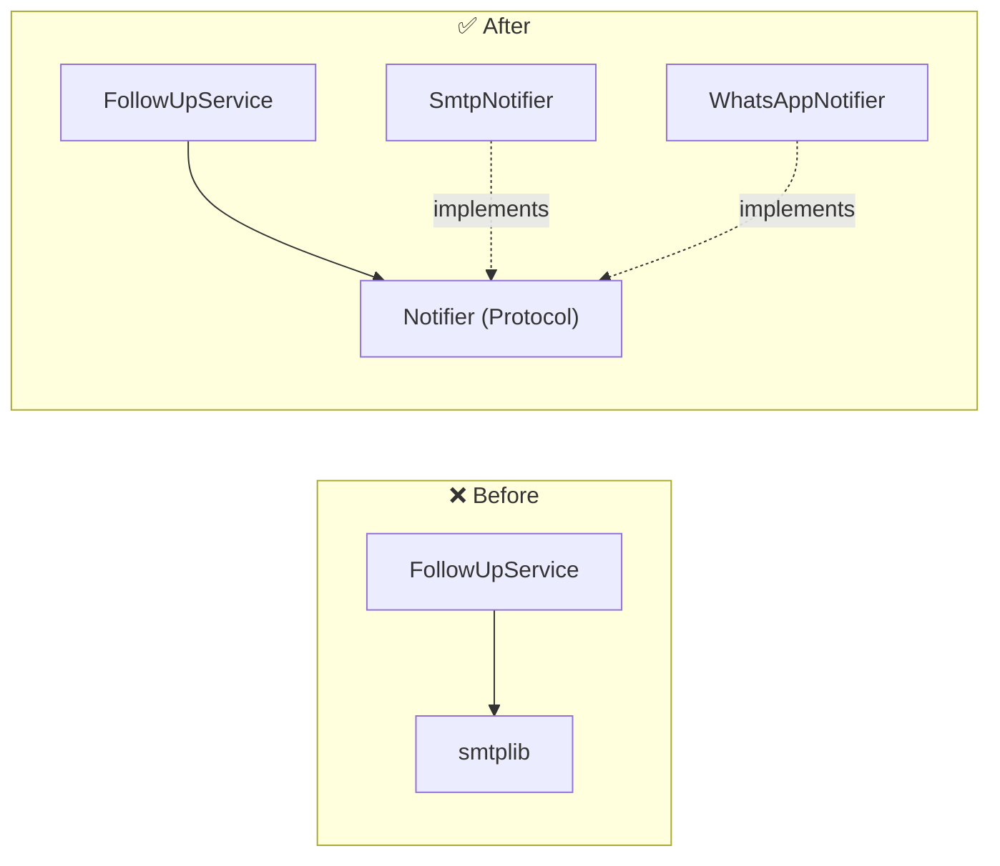

::part[Learn the Concept]{n="1"}

## 🎯 What you'll learn

- **S**ingle Responsibility, **O**pen/Closed, **L**iskov Substitution, **I**nterface Segregation, **D**ependency Inversion
- The *problem* each principle solves, with before/after Python code
- Python's tools for SOLID: duck typing, `typing.Protocol`, `abc.ABC`, dependency injection
- How SOLID connects to Stage A (coupling & cohesion) and to design patterns (Stage D)
- When SOLID is overkill

## 🧠 The big idea

SOLID is a set of **rules of thumb for where to draw lines** in your code so that a new requirement means **adding** code in one place, instead of **editing** code in many places.

Think of a power strip: devices don't care which wall socket powers the strip, and you can plug in a new device without rewiring the house. The strip and the plug shape are an **interface**; everything else is swappable.

## ❓ Why does this exist?

Object-oriented code tends to rot in predictable ways: classes that do everything, `if type == ...` chains that grow with every feature, subclasses that break when used like their parent, and business logic glued to a database or email library. SOLID names these problems so teams can spot and discuss them in code review.

## 💥 What happens if we DON'T care?

```python
def export(applications, format, path):
    if format == "csv":
        ...
    elif format == "json":
        ...
    elif format == "md":
        ...
    with open(path, "w") as f:      # rendering + saving in one function
        f.write(content)
```

- Adding Excel means editing this function (and risking CSV).
- Uploading to S3 instead of disk means editing it again.
- Testing the JSON output requires writing files.
- Two developers adding two formats get merge conflicts in the same function.

## 📖 How it works, step by step

### S — Single Responsibility Principle

> A module/class should have **one reason to change**.

"Reason to change" = one **actor** or concern: the finance team changes invoice rules, the ops team changes storage. Keep them apart.

```python
class ApplicationReport:        # ❌ three reasons to change
    def calculate_stats(self): ...
    def render_pdf(self): ...
    def email_to_user(self): ...
```

```python
def calculate_stats(applications) -> Stats: ...     # ✅ business rules
class PdfRenderer: ...                               # ✅ presentation
class EmailSender: ...                               # ✅ delivery
```

### O — Open/Closed Principle

> Software should be **open for extension, closed for modification**.

Add behavior by adding new code (a new class, a new registered handler), not by editing tested code.

```python
class CsvExporter:
    extension = "csv"
    def render(self, applications) -> str: ...

class JsonExporter:
    extension = "json"
    def render(self, applications) -> str: ...

def export_applications(applications, exporter, destination):
    destination.write(f"applications.{exporter.extension}", exporter.render(applications))
```

A new `ExcelExporter` doesn't touch `export_applications`. The `if/elif` chain is gone.

:::note[O/C is a target, not a law]
You can't make code closed against **every** change. Apply O/C to the axis that actually changes often (formats, payment providers, notification channels) — found by experience, not by guessing up front (YAGNI from Stage A).
:::

### L — Liskov Substitution Principle

> Anything that works with a base type must keep working with any subtype.

Subtypes must honor the **contract**: accept what the parent accepts, return what the parent promises, raise no surprising errors.

```python
class FileStorage:
    def save(self, name: str, content: str) -> None: ...

class ReadOnlyStorage(FileStorage):
    def save(self, name, content):
        raise NotImplementedError("read-only")   # ❌ breaks every caller that expects save() to work
```

Classic example: `Square(Rectangle)` — setting the width of a square also changes its height, surprising code written for rectangles. If "is-a" breaks the contract, don't inherit.

### I — Interface Segregation Principle

> Clients shouldn't depend on methods they don't use.

```python
class Repository(Protocol):          # ❌ one fat interface
    def get(self, id): ...
    def list(self): ...
    def add(self, item): ...
    def delete(self, id): ...
    def export_all_to_csv(self): ...
    def rebuild_search_index(self): ...
```

A report that only **reads** now depends on deletes and search indexing — and every fake in tests must implement six methods. Split into small role-based protocols: `ApplicationReader`, `ApplicationWriter`, `SearchIndexer`.

### D — Dependency Inversion Principle

> High-level policy shouldn't depend on low-level details. Both depend on **abstractions**.

```python
class FollowUpService:                     # ❌ business rule knows SMTP
    def run(self):
        smtplib.SMTP("smtp.gmail.com").sendmail(...)
```

```python
class Notifier(Protocol):
    def send(self, to: str, message: str) -> None: ...

class FollowUpService:                     # ✅ depends on an abstraction it owns
    def __init__(self, notifier: Notifier):
        self.notifier = notifier
```

The concrete `SmtpNotifier`, `WhatsAppNotifier` or `FakeNotifier` is **injected** from outside (the "composition root" — Stage E). This is what makes the Week 4 layered architecture testable.



### Python's tools

| Tool | Use |
|---|---|
| Duck typing | any object with the right methods works |
| `typing.Protocol` | document and type-check duck typing **without** inheritance (structural typing) |
| `abc.ABC` + `@abstractmethod` | force subclasses to implement methods (nominal typing) |
| Constructor injection | pass dependencies in `__init__` |
| Functions | a single-method interface is often just a callable: `clock: Callable[[], datetime]` |

## ⚖️ Trade-offs

| Choice | ✅ | ❌ |
|---|---|---|
| Small classes + protocols | easy to extend and test | more files; indirection makes code harder to follow for small scripts |
| `if/elif` on a type | obvious for 2–3 stable cases | grows into a change magnet |
| Injected dependencies | swappable, testable | need wiring code somewhere |
| `Protocol` | no inheritance needed, flexible | errors show up in the type checker, not at runtime |
| `ABC` | runtime enforcement | couples implementations to a base class |

## ✅ When to use it / 🚫 When NOT to use it

- ✅ Code that will live for years, is changed by several people, or has a clear axis of variation (formats, providers, channels).
- ✅ Business logic that must be tested without databases and networks.
- 🚫 A 50-line script or a prototype you'll throw away.
- 🚫 Creating interfaces with exactly one implementation "just in case" — wait for the second implementation or a testing need.

## 🏆 Best practices

- [ ] Describe each class's responsibility in one sentence **without "and"**.
- [ ] Replace growing `if type == ...` chains with polymorphism or a registry once there are 3+ variants or frequent changes.
- [ ] Define protocols **where they're used** (the consumer owns the abstraction), keep them small.
- [ ] Inject dependencies (clock, notifier, repository, HTTP client) through constructors or parameters.
- [ ] Keep subclasses contract-compatible; prefer composition when "is-a" feels forced (next lesson).
- [ ] Use `mypy`/`pyright` so protocol mismatches are caught before runtime.
- [ ] In code reviews, name the principle **and the concrete pain** ("adding a provider requires editing checkout — OCP").

## 🏭 How it's used in industry

- Payment integrations: `PaymentGateway` protocol with Midtrans, Xendit, Stripe adapters — switching providers doesn't touch checkout logic.
- Django/Flask extension points (storage backends, email backends, auth backends) are OCP + DIP in practice.
- AI apps: an `LLMClient` protocol lets teams switch between Claude, OpenAI or a local Ollama model and fake it in tests (Module 7).

## ⚠️ Common mistakes

- Reading SRP as "one method per class".
- Interfaces for everything, making simple code a maze.
- Subclassing to reuse code, then overriding methods to throw errors (LSP violation).
- Injecting dependencies but still importing and instantiating concrete classes deep inside functions.

:::revoshop
RevoShop's `app/integrations/midtrans.py` and `PaymentService` already separate the payment provider from routes. (1) Does `PaymentService` depend on the Midtrans module **directly**? What would change to add Xendit — which files and how many `if provider ==` branches? (2) Sketch a `PaymentGateway` Protocol with `create_transaction(...)` and `verify_notification(...)`, and where the concrete Midtrans adapter would be chosen. (3) Find one class in `app/services/` with more than one reason to change.
:::

::part[Explain & Design]{n="2"}

## 🗣️ Explain it

Explain Dependency Inversion to a teammate using the **power strip** analogy: what's the abstraction, what's plugged in, and why the laptop doesn't care whether electricity comes from PLN or a generator.

## 📐 Design it

CareerPilot sends notifications for due follow-ups. Today it's email; product wants WhatsApp next month and in-app notifications later. Users choose channels, some messages must go to **all** chosen channels, and tests must not send anything. Design the classes/protocols and say which SOLID principle each decision applies.

:::quiz
Show a possible design

```python
class Notifier(Protocol):                       # D + I: small abstraction owned by the domain
    def send(self, recipient: Recipient, message: Message) -> None: ...

class EmailNotifier:    ...                     # S: one channel each
class WhatsAppNotifier: ...
class InAppNotifier:    ...                     # O: new channels = new classes
class FakeNotifier:                             # tests record messages instead of sending
    sent: list[tuple[Recipient, Message]]

class MultiChannelNotifier:                     # composite: also a Notifier (L: same contract)
    def __init__(self, notifiers: list[Notifier]): ...
    def send(self, recipient, message):
        for notifier in self.notifiers: notifier.send(recipient, message)

class FollowUpService:                          # business rule, knows only Notifier
    def __init__(self, repository, notifier_for: Callable[[User], Notifier], clock): ...
```

- **S**: rules (who needs a follow-up) in `FollowUpService`; channel details in each notifier.
- **O**: WhatsApp is a new class plus one line in the wiring (`notifier_for` builds a `MultiChannelNotifier` from user preferences).
- **L**: every notifier (including the composite and fake) accepts the same inputs and doesn't raise "not supported".
- **I**: `Notifier` has one method; message templates are a separate concern.
- **D**: the service depends on `Notifier`; concrete classes are chosen in the composition root.
:::

### 📝 Self-review checklist

- [ ] Business rule has no channel-specific code
- [ ] Adding a channel doesn't modify existing classes
- [ ] Tests can run with fakes
- [ ] Each principle is tied to a concrete decision, not just named

::ai-review{task="design"}

::part[Toy Exercise]{n="3"}

:::exercise{path="exercises/architecture/c-oop-design/01-solid-exporter" ai="no-ai" title="From an if/elif exporter to SOLID"}
Replace a tangled `export(format, path)` with small exporter and destination classes behind two protocols. The tests add a brand-new HTML exporter without touching your code, check every exporter honors the same contract, and verify `export_applications` depends only on abstractions.
:::

:::hints
- `csv.DictWriter(buffer, fieldnames=..., lineterminator="\n")` quotes commas for you.
- Convert each application to a plain row dict once (`_row`) and reuse it in all exporters.
- `export_applications` is three lines: build the filename, render, write.
:::

## ✅ Quick check

:::quiz
What's the Single Responsibility Principle really about?

Keeping each module to one reason to change (one concern or actor), so changes for different reasons don't collide in the same code.
:::

:::quiz
How does Python let you apply Dependency Inversion without inheritance?

Define a `typing.Protocol` (or rely on duck typing) that the high-level code depends on, and pass any object with matching methods — no base class required.
:::

## 📖 Kamus (glossary)

| Term | Bahasa Indonesia |
|---|---|
| Single responsibility | Tanggung jawab tunggal |
| Open/closed | Terbuka untuk perluasan, tertutup untuk modifikasi |
| Liskov substitution | Substitusi Liskov — subtipe bisa menggantikan tipe induk |
| Interface segregation | Pemisahan antarmuka |
| Dependency inversion | Pembalikan ketergantungan |
| Protocol / interface | Protokol / antarmuka |

## 📚 Keep learning

- [Python docs: typing.Protocol](https://docs.python.org/3/library/typing.html#typing.Protocol)
- [Python docs: abc — Abstract Base Classes](https://docs.python.org/3/library/abc.html)
- [Martin Fowler: Inversion of Control Containers and the Dependency Injection pattern](https://martinfowler.com/articles/injection.html)
