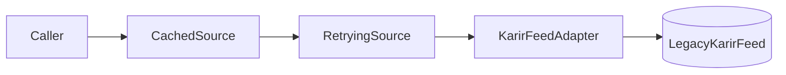

::part[Pelajari Konsepnya]{n="1"}

## 🎯 Yang akan kamu pelajari

- **Adapter**: membuat interface yang tidak sesuai terlihat seperti yang kode kamu harapkan
- **Decorator**: tambah tanggung jawab (caching, retry, logging) dengan membungkus objek yang tetap punya interface sama
- **Facade**: satu pintu masuk sederhana untuk sistem rumit
- **Proxy**: perantara yang mengontrol akses (izin, lazy loading, pemanggilan jauh)
- Perbedaan antara pola design "decorator" dan syntax `@decorator` Python
- Bagaimana pola ini bisa bertumpuk

## 🔤 Istilah penting

| Istilah | Artinya (sederhana) |
|---|---|
| **Adapter** | Pembungkus yang membuat satu interface terlihat seperti interface lain |
| **Decorator (pola)** | Pembungkus yang tambah perilaku tapi tetap punya interface sama |
| **Facade** | Satu pintu masuk sederhana untuk bagian-bagian yang rumit |
| **Proxy** | Perantara yang kontrol akses ke benda asli |
| **Interface** | Himpunan method yang dipanggil oleh kode lain |
| **Wrapping** | Membungkus satu objek di dalam objek lain |
| **Lazy loading** | Membuat atau ambil sesuatu hanya saat pertama kali dibutuhkan |

## 🧠 Ide besarnya

Keempat pola ini adalah **pembungkus**, dibedakan hanya berdasarkan tujuannya:

| Pola | Analogi perjalanan |
|---|---|
| **Adapter** | adapter colokan: charger Indonesia pas di soket UK |
| **Decorator** | casing ponsel punya baterai: masih ponsel, tapi tahan lebih lama |
| **Facade** | agen perjalanan: satu pangilan pesan pesawat, hotel, dan visa |
| **Proxy** | resepsionis hotel: tamu hanya bisa dihubungi lewat mereka, hanya kalau diizinkan |

## ❓ Kenapa ini penting

Jarang sekali kamu kontrol semua kode yang pakai. Gateway pembayaran, penyedia email, klien AI, dan modul lama semua punya bentuk sendiri — dan kamu butuh caching, retry, cek izin, dan logging di sekitar mereka tanpa menulis ulang kedua belah pihak.

Keempat pola adalah pembungkus, dan perbedaannya cuma **kenapa** kamu membungkus: untuk sesuaikan (adapter), untuk tambah (decorator), untuk sederhanakan (facade), atau untuk kontrol (proxy). Nama tujuannya itulah yang cegah codebase penuh kelas `XHelper2`.

## 📖 Langkah demi langkah

### 1. Adapter

```python
class KarirFeedAdapter:
    """Makes LegacyKarirFeed look like a JobSource."""
    def __init__(self, feed: LegacyKarirFeed):
        self._feed = feed

    def fetch(self) -> list[Job]:
        return [
            Job(id=f"karir-{item['lowongan_id']}", title=item["posisi"].strip(), company=item["perusahaan"].strip(),
                salary_max=parse_rupiah(item["gaji"]))
            for item in self._feed.get_listings()
        ]
```

Sisa app hanya tahu `JobSource.fetch() -> list[Job]`. Format asing hidup di **satu** kelas — "anti-corruption layer" dalam istilah domain-driven design.

### 2. Decorator (pola design)

Ingat perbedaannya dari syntax `@decorator` Python: itu bungkus **function**, ini bungkus **objek** yang tetap punya interface sama. Ide sama, level berbeda.

Interface masuk, interface keluar, perilaku tambah di sekitar panggilan:

```python
class RetryingSource:
    def __init__(self, inner: JobSource, attempts: int = 3):
        self._inner, self._attempts = inner, attempts

    def fetch(self) -> list[Job]:
        for attempt in range(1, self._attempts + 1):
            try:
                return self._inner.fetch()
            except ConnectionError:
                if attempt == self._attempts:
                    raise
```

```python
source = CachedSource(RetryingSource(KarirFeedAdapter(feed)), ttl_seconds=300, clock=time.monotonic)
```



Urutan penting: cache di luar retry berarti cache hit lewat retry sama sekali; retry di luar cache berarti retry pembacaan cache yang tidak perlu.

:::note[Pola vs syntax Python]
Syntax `@decorator` Python bungkus **function** saat definisi (`@functools.cache`, `@app.route`). **Pola Decorator** bungkus **objek** saat runtime dengan interface sama. Mereka bagikan idenya — tambah perilaku di sekitar sesuatu — dan kamu bisa implementasi pola dengan keduanya.
:::

### 3. Facade

```python
class JobBoards:
    def __init__(self, sources: dict[str, JobSource]):
        self._sources = sources

    def refresh(self) -> RefreshResult:
        # fetch all, isolate failures, deduplicate, count — callers see one method
        ...
```

Route atau job terjadwal panggil `boards.refresh()` dan tidak tahu ada adapter, cache, dan retry di bawahnya. Facade bagus untuk **pintu masuk use case** — kamu akan lihat lagi sebagai service layer (Stage E).

### 4. Proxy

Proxy terlihat sama dengan benda asli dari luar, dan itu yang bikin berguna — kode pemanggil tidak perlu berubah saat kamu tambah cek izin atau delay loading.

Interface sama seperti objek asli, tapi **kontrol akses** ke dalamnya:

| Jenis proxy | Contoh |
|---|---|
| **Protection** | sembunyikan gaji kecuali paket pengguna izinkan |
| **Virtual / lazy** | baca file CV besar hanya saat `.text` pertama kali diakses |
| **Remote** | objek lokal yang teruskan panggilan via HTTP/gRPC (klien SDK) |
| **Caching / smart reference** | tumpang tindih dengan decorator; tujuannya kontrol akses sumber daya mahal |

```python
class SalaryPrivacyProxy:
    def __init__(self, inner: JobSource, can_view_salaries: bool): ...
    def fetch(self):
        jobs = self._inner.fetch()
        return jobs if self._can_view else [replace(job, salary_max=None) for job in jobs]
```

Decorator vs proxy: struktur sama; **decorator tambah perilaku**, **proxy kontrol akses** ke subjek.

### Pilih setup kamu

Setiap opsi di sini adalah trade-off:

| Pola | ✅ | ❌ |
|---|---|---|
| Adapter | isolasi format asing; ganti vendor mudah | satu kelas lagi per integrasi |
| Decorator | gabung perilaku bebas; tanggung jawab tunggal | tumpukan pembungkus dalam sulit di-debug; urutan penting |
| Facade | API sederhana untuk use case umum | bisa jadi objek dewa kalau tumbuh tiap feature |
| Proxy | kontrol akses/lazy transparan | biaya tersembunyi (panggilan "sederhana" bisa kena network) |
| Inheritance sebagai ganti | objek lebih sedikit | kombinasi meledak (`RetryingCachedKarirSource`) |

- ✅ Adapter: setiap API pihak ketiga, SDK, atau modul lama yang core logic kamu pakai.
- ✅ Decorator: cross-cutting concern (retry, cache, metrik, rate limit, logging) di sekitar interface.
- ✅ Facade: use case yang koordinasi beberapa subsistem; API publik bersih untuk paket.
- ✅ Proxy: izin, lazy loading, panggilan jauh.
- 🚫 Bungkus hanya untuk rename method yang kamu miliki sepenuhnya — refactor kelas sebagai ganti.
- 🚫 Tumpukan pembungkus terlalu dalam hingga tidak ada yang tahu apa yang panggilan lakukan — dokumentasi rakit di satu tempat.

## ⚠️ Kesalahan umum

- Biarkan dict vendor (`item["gaji"]`) keluar dari adapter ke service dan template.
- Cache list yang bisa diubah dan kembalikan objek sama ke setiap pemanggil.
- Retry operasi yang bukan idempotent (buat pembayaran) tanpa idempotency key (Week 5).
- Facade yang expose internal (`boards.sources["karir"]._feed`) hingga pemanggil bypass.

:::revoshop
Buka `app/integrations/midtrans.py`: (1) Apakah itu **adapter** — nama field Midtrans tetap di dalamnya, atau service juga tangani payload Midtrans mentah (lihat `PaymentService.handle_notification`)? (2) Di mana `RetryingPaymentGateway` decorator cocok, dan panggilan Midtrans mana yang aman di-retry? (3) Apakah `PaymentService` bertindak sebagai **facade** untuk checkout? Daftar apa yang koordinasi.
:::

## 🏆 Praktik terbaik

- [ ] Masukkan **semua** pengetahuan format vendor ke adapter; ubah ke tipe domain kamu segera.
- [ ] Setiap pembungkus implementasi **protokol yang sama** seperti yang dibungkus, jadi pembungkus bisa bertumpuk.
- [ ] Rakit tumpukan pembungkus di **satu tempat** (factory / composition root), bukan sebar di call site.
- [ ] Inject clock dan sleep function ke pembungkus cache/retry jadi testable.
- [ ] Jaga facade tipis: koordinasi, jangan implementasi setiap aturan di dalamnya.
- [ ] Buat biaya tersembunyi terlihat di nama atau dokumen (`RemoteJobSource`, `LazyCv`).
- [ ] Kembalikan salinan dari cache jadi pemanggil tidak bisa ubah data cache.

::part[Jelaskan & Rancang]{n="2"}

## 🗣️ Jelaskan

Jelaskan perbedaan Adapter dan Decorator ke teman kerja pakai analogi adapter colokan dan casing baterai ponsel, lalu petakan masing-masing ke satu kelas yang kamu tulis untuk integrasi pembayaran.

## 📐 Rancang

Layanan AI CareerPilot panggil penyedia LLM untuk feedback CV. Syarat: (1) format response SDK tidak boleh keluar ke app; (2) retry saat rate limit dan timeout; (3) cache request sama untuk 24 jam; (4) pengguna paket gratis dapat max output lebih pendek; (5) route panggil satu method sederhana. Rancang kelas dan urutan rakit.

:::quiz
Tunjuk satu kemungkinan rancang

```python
class LLMClient(Protocol):
    def complete(self, request: CompletionRequest) -> Completion: ...   # our own types

class AnthropicAdapter:                  # (1) Adapter: SDK response → Completion(text, input_tokens, output_tokens)
class RetryingLLM:                       # (2) Decorator: retry RateLimit/Timeout with backoff + jitter
class CachedLLM:                         # (3) Decorator: key = hash(model, prompt, params), TTL 24 h
class PlanLimitedLLM:                    # (4) Proxy: clamps request.max_tokens by the user's plan

class CvFeedbackService:                 # (5) Facade: build prompt, call LLM, parse feedback, record usage
    def feedback_for(self, user, cv_text, job) -> Feedback: ...
```

**Rakit (composition root, per request untuk proxy paket):**

```python
base = CachedLLM(RetryingLLM(AnthropicAdapter(sdk_client)), ttl=86_400, clock=time.time, store=redis_cache)
service = CvFeedbackService(llm=PlanLimitedLLM(base, plan=user.plan))
```

**Penalaran urutan:** proxy paket di paling luar jadi limit berlaku sebelum cache key dihitung (request free dan pro berbeda); cache di luar retry jadi hit tidak pernah tunggu retry; adapter paling dalam jadi setiap pembungkus kerja dengan tipe kami sendiri. Test pakai `FakeLLMClient` ganti seluruh tumpukan.
:::

### 📝 Checklist self-review

- [ ] Tipe vendor berhenti di adapter
- [ ] Setiap concern adalah satu pembungkus dengan interface sama
- [ ] Urutan rakit ada alasannya
- [ ] Route panggil satu method facade

::ai-review{task="design"}

::part[Latihan Kecil]{n="3"}

:::exercise{path="exercises/architecture/d-design-patterns/02-structural" ai="no-ai" title="Sesuaikan, bungkus, lindungi, dan sederhanakan feed pekerjaan"}
Sesuaikan feed format lama Indonesia, tambah caching dan retry sebagai decorator bisa bertumpuk, lindungi gaji dengan proxy perlindungan, dan pasang facade yang hapus duplikat pekerjaan dan isolasi sumber gagal.
:::

:::hints
- `re.fullmatch(r"\s*Rp\s*([\d.]+)\s*", text)` ekstrak `12.000.000`; hapus titik sebelum `int()`.
- `CachedSource`: simpan `fetched_at` dan bandingkan `clock() - fetched_at >= ttl` untuk refresh; kembalikan `list(cached)`.
- `RetryingSource`: hanya catch `ConnectionError`; re-raise saat attempt terakhir.
- `JobBoards.refresh`: `dict.setdefault(job.id, job)` jaga pekerjaan pertama per id dalam urutan insert.
:::

## ✅ Cek cepat

:::quiz
Decorator dan Proxy sering terlihat sama di kode. Apa perbedaannya?

Tujuan: decorator tambah tanggung jawab (caching, retry, logging); proxy kontrol akses ke objek dasar (izin, lazy loading, akses jauh).
:::

:::quiz
Kenapa format pihak ketiga harus berhenti di adapter?

Agar sisa sistem hanya pakai tipe kamu sendiri; ubah atau ganti vendor hanya mempengaruhi satu kelas, bukan setiap service dan template.
:::


## 📚 Lanjut belajar

- [Refactoring.Guru — Structural patterns](https://refactoring.guru/design-patterns/structural-patterns)
- [Python docs: dataclasses.replace](https://docs.python.org/3/library/dataclasses.html#dataclasses.replace)
