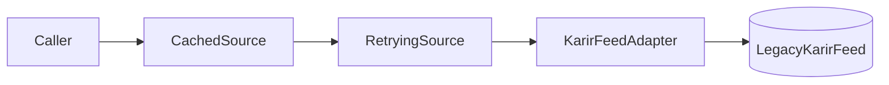

::part[Learn the Concept]{n="1"}

## 🎯 What you'll learn

- **Adapter**: make an incompatible interface look like the one your code expects
- **Decorator**: add responsibilities (caching, retries, logging) by wrapping an object with the same interface
- **Facade**: one simple entry point over a complicated subsystem
- **Proxy**: a stand-in that controls access (permissions, laziness, remote calls)
- The difference between the design pattern "decorator" and Python's `@decorator` syntax
- How these patterns stack

## 🔤 Key words

| Word | In simple words | Bahasa Indonesia |
|---|---|---|
| **Adapter** | A wrapper that makes one interface look like another | Penyesuai antarmuka |
| **Decorator (pattern)** | A wrapper that adds behaviour but keeps the same interface | Pembungkus penambah perilaku |
| **Facade** | One simple entry point over a complicated set of parts | Pintu depan yang sederhana |
| **Proxy** | A stand-in that controls access to the real thing | Perantara pengendali akses |
| **Interface** | The set of methods callers rely on | Kumpulan metode yang dipakai |
| **Wrapping** | Putting one object around another | Membungkus objek |
| **Lazy loading** | Creating or fetching something only when it's first needed | Dibuat saat dibutuhkan |

## 🧠 The big idea

All four are **wrappers**, distinguished by intent:

| Pattern | Travel analogy |
|---|---|
| **Adapter** | a plug adapter: your Indonesian charger fits a UK socket |
| **Decorator** | a phone case with a battery: still a phone, now lasts longer |
| **Facade** | a travel agent: one call books flight, hotel and visa |
| **Proxy** | a hotel receptionist: you reach guests only through them, and only if allowed |

## ❓ Why it matters

You rarely control every piece of code you use. Payment gateways, email providers, AI clients and legacy modules all have their own shapes — and you need caching, retries, permission checks and logging around them without rewriting either side.

All four patterns are wrappers, and the difference is only **why** you wrap: to fit (adapter), to add (decorator), to simplify (facade), or to control (proxy). Naming the intent is what stops a codebase full of `XHelper2` classes.

## 📖 Step by step

### 1. Adapter

```python
class KarirFeedAdapter:
    """Makes LegacyKarirFeed look like a JobSource."""
    def __init__(self, feed: LegacyKarirFeed):
        self._feed = feed

    def fetch(self) -> list[Job]:
        return [
            Job(id=f"karir-{item['lowongan_id']}", title=item["posisi"].strip(), company=item["perusahaan"].strip(),
                salary_max=parse_rupiah(item["gaji"]))
            for item in self._feed.get_listings()
        ]
```

The rest of the app only knows `JobSource.fetch() -> list[Job]`. The foreign format lives in **one** class — the "anti-corruption layer" in domain-driven design terms.

### 2. Decorator (the design pattern)

Note the difference from Python's `@decorator` syntax: that wraps a **function**, this wraps an **object** that keeps the same interface. Same idea, different level.

Same interface in, same interface out, extra behavior around the call:

```python
class RetryingSource:
    def __init__(self, inner: JobSource, attempts: int = 3):
        self._inner, self._attempts = inner, attempts

    def fetch(self) -> list[Job]:
        for attempt in range(1, self._attempts + 1):
            try:
                return self._inner.fetch()
            except ConnectionError:
                if attempt == self._attempts:
                    raise
```

```python
source = CachedSource(RetryingSource(KarirFeedAdapter(feed)), ttl_seconds=300, clock=time.monotonic)
```



Order matters: cache outside retry means a cache hit skips retries entirely; retry outside cache would retry cached reads needlessly.

:::note[Pattern vs Python syntax]
Python's `@decorator` syntax wraps **functions** at definition time (`@functools.cache`, `@app.route`). The **Decorator pattern** wraps **objects** at runtime with the same interface. They share the idea — adding behavior around something — and you can implement the pattern with either.
:::

### 3. Facade

```python
class JobBoards:
    def __init__(self, sources: dict[str, JobSource]):
        self._sources = sources

    def refresh(self) -> RefreshResult:
        # fetch all, isolate failures, deduplicate, count — callers see one method
        ...
```

A route or scheduled job calls `boards.refresh()` and doesn't know there are adapters, caches and retries underneath. Facades are great **entry points for use cases** — you'll see them again as the service layer (Stage E).

### 4. Proxy

A proxy looks identical to the real thing from outside, which is exactly what makes it useful — callers don't change when you add a permission check or delay the loading.

Same interface as the real object, but **controls access** to it:

| Proxy kind | Example |
|---|---|
| **Protection** | hide salaries unless the user's plan allows it |
| **Virtual / lazy** | load a large CV file only when `.text` is first accessed |
| **Remote** | a local object that forwards calls over HTTP/gRPC (SDK clients) |
| **Caching / smart reference** | overlaps with decorator; intent is controlling access to a costly resource |

```python
class SalaryPrivacyProxy:
    def __init__(self, inner: JobSource, can_view_salaries: bool): ...
    def fetch(self):
        jobs = self._inner.fetch()
        return jobs if self._can_view else [replace(job, salary_max=None) for job in jobs]
```

Decorator vs proxy: structure is identical; **decorator adds behavior**, **proxy controls access** to the subject.

### Choosing your setup

Every option here is a trade-off:

| Pattern | ✅ | ❌ |
|---|---|---|
| Adapter | isolates foreign formats; swap vendors easily | one more class per integration |
| Decorator | combine behaviors freely; single responsibility | deep wrapper stacks are harder to debug; order matters |
| Facade | simple API for common use cases | can become a god object if it grows every feature |
| Proxy | transparent access control/laziness | hidden costs (a "simple" call may hit the network) |
| Inheritance instead | fewer objects | combinations explode (`RetryingCachedKarirSource`) |

- ✅ Adapter: every third-party API, SDK or legacy module your core logic depends on.
- ✅ Decorator: cross-cutting concerns (retry, cache, metrics, rate limit, logging) around an interface.
- ✅ Facade: a use case that coordinates several subsystems; a clean public API for a package.
- ✅ Proxy: permissions, lazy loading, remote calls.
- 🚫 Wrapping just to rename methods you fully own — refactor the class instead.
- 🚫 Stacking wrappers so deep nobody knows what a call does — document the assembly in one place.

## ⚠️ Common mistakes

- Letting vendor dicts (`item["gaji"]`) leak past the adapter into services and templates.
- Caching mutable lists and returning the same object to every caller.
- Retrying non-idempotent operations (creating a payment) without idempotency keys (Week 5).
- Facades that expose their internals (`boards.sources["karir"]._feed`) so callers bypass them.

:::revoshop
Open `app/integrations/midtrans.py`: (1) Is it an **adapter** — do Midtrans-specific field names stay inside it, or do services also handle raw Midtrans payloads (look at `PaymentService.handle_notification`)? (2) Where would a `RetryingPaymentGateway` decorator fit, and which Midtrans calls are safe to retry? (3) Is `PaymentService` acting as a **facade** for checkout? List what it coordinates.
:::

## 🏆 Best practices

- [ ] Put **all** knowledge of a vendor format in its adapter; convert to your own domain types immediately.
- [ ] Every wrapper implements the **same protocol** as what it wraps, so wrappers stack.
- [ ] Assemble wrapper stacks in **one place** (factory / composition root), not scattered across call sites.
- [ ] Inject clocks and sleep functions into caching/retry wrappers so they're testable.
- [ ] Keep facades thin: coordinate, don't implement every rule inside.
- [ ] Make hidden costs visible in names or docs (`RemoteJobSource`, `LazyCv`).
- [ ] Return copies from caches so callers can't mutate cached data.

::part[Explain & Design]{n="2"}

## 🗣️ Explain it

Explain the difference between an Adapter and a Decorator to a teammate using the plug adapter and phone battery case analogies, then map each to one class you'd write for a payment integration.

## 📐 Design it

CareerPilot's AI service calls an LLM provider for CV feedback. Requirements: (1) the provider SDK's response format must not leak into the app; (2) retry on rate limits and timeouts; (3) cache identical requests for 24 hours; (4) free-plan users get a shorter max output; (5) routes should call one simple method. Design the classes and the assembly order.

:::quiz
Show a possible design

```python
class LLMClient(Protocol):
    def complete(self, request: CompletionRequest) -> Completion: ...   # our own types

class AnthropicAdapter:                  # (1) Adapter: SDK response → Completion(text, input_tokens, output_tokens)
class RetryingLLM:                       # (2) Decorator: retry RateLimit/Timeout with backoff + jitter
class CachedLLM:                         # (3) Decorator: key = hash(model, prompt, params), TTL 24 h
class PlanLimitedLLM:                    # (4) Proxy: clamps request.max_tokens by the user's plan

class CvFeedbackService:                 # (5) Facade: build prompt, call LLM, parse feedback, record usage
    def feedback_for(self, user, cv_text, job) -> Feedback: ...
```

**Assembly (composition root, per request for the plan proxy):**

```python
base = CachedLLM(RetryingLLM(AnthropicAdapter(sdk_client)), ttl=86_400, clock=time.time, store=redis_cache)
service = CvFeedbackService(llm=PlanLimitedLLM(base, plan=user.plan))
```

**Order reasoning:** the plan proxy is outermost so limits apply before the cache key is computed (a free and a pro request differ); cache outside retry so hits never wait for retries; the adapter innermost so every wrapper works with our own types. Tests use `FakeLLMClient` in place of the whole stack.
:::

### 📝 Self-review checklist

- [ ] Vendor types stop at the adapter
- [ ] Each concern is one wrapper with the same interface
- [ ] Assembly order justified
- [ ] Routes call one facade method

::ai-review{task="design"}

::part[Toy Exercise]{n="3"}

:::exercise{path="exercises/architecture/d-design-patterns/02-structural" ai="no-ai" title="Adapt, wrap, protect and simplify job sources"}
Adapt a legacy Indonesian-format feed, add caching and retries as stackable decorators, hide salaries with a protection proxy, and put a facade on top that deduplicates jobs and isolates failing sources.
:::

:::hints
- `re.fullmatch(r"\s*Rp\s*([\d.]+)\s*", text)` extracts `12.000.000`; remove dots before `int()`.
- `CachedSource`: store `fetched_at` and compare `clock() - fetched_at >= ttl` to refresh; return `list(cached)`.
- `RetryingSource`: only catch `ConnectionError`; re-raise on the last attempt.
- `JobBoards.refresh`: `dict.setdefault(job.id, job)` keeps the first job per id in insertion order.
:::

## ✅ Quick check

:::quiz
Decorator and Proxy often look identical in code. What's the difference?

Intent: a decorator adds responsibilities (caching, retries, logging); a proxy controls access to the underlying object (permissions, laziness, remote access).
:::

:::quiz
Why should third-party formats stop at the adapter?

So the rest of the system depends only on your own types; changing or replacing the vendor affects one class instead of every service and template.
:::


## 📚 Keep learning

- [Refactoring.Guru — Structural patterns](https://refactoring.guru/design-patterns/structural-patterns)
- [Python docs: dataclasses.replace](https://docs.python.org/3/library/dataclasses.html#dataclasses.replace)
