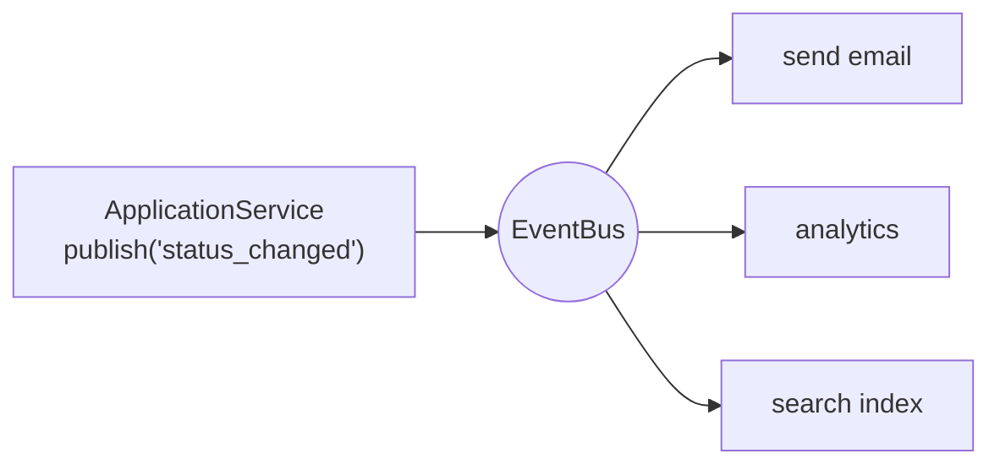

::part[Pelajari Konsepnya]{n="1"}

## 🎯 Yang akan kamu pelajari

- **Strategy**: algoritma yang bisa ditukar di balik satu interface (dan kenapa fungsi Python sering **adalah** strategi itu sendiri)
- **Observer**: pub/sub sehingga penerbit tidak perlu tahu siapa pelangganya
- **Command**: aksi sebagai objek — untuk undo/redo, antrian, ulang coba dan audit log
- Isolasi kesalahan di handler event
- Bagaimana pola-pola ini terhubung dengan yang akan kamu pakai: sorting key, signal, domain event, job queue, React state update

## 🔤 Istilah penting

| Istilah | Artinya (sederhana) |
|---|---|
| **Strategy** | Algoritma yang bisa ditukar di balik satu interface yang disepakati |
| **Observer (pub/sub)** | Satu penerbit, banyak pelanggan yang bereaksi ke sebuah event |
| **Event** | Pesan yang mengatakan "ini terjadi" |
| **Handler / subscriber** | Kode yang merespons sebuah event |
| **Command** | Aksi yang dijadikan objek bisa kamu simpan dan ulang |
| **Undo/redo** | Membatalkan atau mengulang command yang sudah disimpan |
| **Error isolation** | Satu handler gagal, yang lain tetap jalan |
| **Domain event** | Fakta bisnis seperti "OrderPaid" |

## 🧠 Ide besarnya

| Pola | Analogi sehari-hari |
|---|---|
| **Strategy** | memilih rute di Google Maps: tercepat, terpendek, hindari tol — perjalanan sama, algoritmanya beda |
| **Observer** | grup WhatsApp: pengirim post sekali; semua yang subscribe dapat; pengirim tidak perlu telpon satu per satu |
| **Command** | slip pesanan di rumah makan: pesanan ditulis, antri ke dapur, bisa dibatalkan, dan tertinggal catatan |

## ❓ Kenapa ini penting

Ketiga pola ini mengelola **siapa berbuat apa, dan siapa tahu siapa**:

- Strategy menghilangkan rantai `if mode == …` di sekitar algoritma.
- Observer biarkan penerbit mengumumkan sesuatu tanpa tahu siapa yang peduli — grup WhatsApp, bukan lima puluh telpon satu per satu.
- Command ubah aksi jadi benda yang bisa kamu antri, ulang, catat atau batalkan.

Tanpa mereka, satu fungsi berakhir tahu segalanya: cara mengurutkan, siapa email-i, cara catat audit log — dan setiap kebutuhan baru edit fungsi itu lagi.

## 📖 Langkah demi langkah

### 1. Strategy

Di Python fungsi biasa sering adalah seluruh polanya: kirim `key=by_salary` alih-alih buat hirarki kelas `SortStrategy`.

```python
class ScoringStrategy(Protocol):
    def score(self, job: dict) -> float: ...

class BySalary:
    def score(self, job): return job["salary_max"] or 0

class BySkillMatch:
    def __init__(self, my_skills): self.my_skills = {s.lower() for s in my_skills}
    def score(self, job):
        wanted = {s.lower() for s in job["skills"]}
        return len(wanted & self.my_skills) / len(wanted) if wanted else 0.0

def rank_jobs(jobs, strategy: ScoringStrategy):
    return sorted(jobs, key=lambda job: (-strategy.score(job), job["id"]))
```

Pengguna pilih "match terbaik" atau "gaji tertinggi" saat runtime; `rank_jobs` tidak pernah berubah.

**Jalan pintas Python**: strategy satu-metode bisa hanya **fungsi** — `sorted(jobs, key=score_fn)` adalah pola Strategy yang sudah tertanam di Python. Pakai kelas saat strategi butuh setup (seperti `my_skills`) atau beberapa metode.

### 2. Observer (pub/sub)

Bungkus setiap handler agar satu kegagalan tidak hentikan yang lain. Di grup chat, ponsel satu orang yang mati tidak boleh hentikan pesan sampai ke semua orang lain.

```python
class EventBus:
    def __init__(self):
        self._handlers = defaultdict(list)

    def subscribe(self, event_type, handler):
        self._handlers[event_type].append(handler)
        return lambda: self._handlers[event_type].remove(handler)   # unsubscribe

    def publish(self, event_type, payload):
        errors = []
        for handler in list(self._handlers[event_type]):
            try:
                handler(payload)
            except Exception as error:
                logger.exception("handler failed")
                errors.append(error)
        return errors
```



Keputusan rancang yang harus terang-terangan:
- **Error isolation**: satu subscriber gagal tidak boleh rusak yang lain atau penerbit.
- **Urutan**: jangan biarkan kebenaran bergantung urutan subscriber.
- **Sync vs async**: handler dalam-proses jalan dalam request; kerja lambat atau tidak andal (email, webhook) punya tempat di **antrian** (Modul 5).
- **Sesudah commit**: terbitkan domain event **sesudah** transaksi database selesai, atau subscriber bisa bertindak atas data yang dibatalkan.

### 3. Command

```python
class ChangeStatus:
    def __init__(self, board, application_id, new_status):
        self.board, self.application_id, self.new_status = board, application_id, new_status
        self._previous = None

    def execute(self):
        self._previous = self.board.statuses.get(self.application_id)
        self.board.statuses[self.application_id] = self.new_status

    def undo(self):
        self.board.statuses[self.application_id] = self._previous

class History:
    def run(self, command): command.execute(); self._done.append(command); self._undone.clear()
    def undo(self): ...
    def redo(self): ...
```

Yang command bisa buat:
- **Undo/redo** (editor, papan drag-and-drop).
- **Antrian**: seri command (`{"type": "send_reminder", "application_id": 7}`) dan biarkan worker jalankan nanti.
- **Audit log**: simpan setiap command yang jalan.
- **Ulang coba**: command yang gagal bisa dijalankan lagi (buat jadi idempoten).

Gaya CQRS (Command Query Responsibility Segregation) dan job queue seperti Celery (`send_reminder.delay(7)`) adalah objek command dalam skala besar.

### Pilih setup-mu

Setiap pilihan di sini ada trade-off:

| Pola | ✅ | ❌ |
|---|---|---|
| Strategy kelas | tukar algoritma, bisa setup, gampang test | berlebihan untuk satu algoritma tetap |
| Strategy sebagai fungsi | kode minimal | aneh dengan setup/state (pakai closure atau `functools.partial`) |
| Observer / event | penerbit lepas dari reaksi; gampang tambah fitur | kontrol alur tersirat ("siapa tangani ini?"); debug butuh log bagus |
| Direct call | terang-terangan dan sederhana | setiap reaksi baru edit yang panggil |
| Command object | undo, antri, catat, ulang | lebih banyak kelas; undo harus dirancang per command |

- ✅ Strategy: urutan/harga/nilai pengguna pilih, pilih penyedia, A/B test algoritma.
- ✅ Observer: efek samping yang berkembang seiring waktu (notif, analitik, cache tidak valid), perubahan state UI.
- ✅ Command: aksi UI yang bisa dibatalkan, job latar belakang, audit trail, operasi batch.
- 🚫 Event untuk satu langkah penting yang harus berhasil (misalnya charge pelanggan) — panggil langsung dan tangani error.
- 🚫 Event bus di aplikasi 200 baris di mana dua panggilan langsung lebih jelas.

## ⚠️ Kesalahan umum

- Event bus di mana handler terbitkan lebih banyak event yang picu handler lain… tidak ada yang bisa ikuti alur.
- Kirim objek ORM yang bisa diubah di event payload; handler ubah mereka tanpa diduga.
- Command yang `undo` tidak kembalikan state sebelumnya yang tepat (misalnya lupa nilai tidak ada dulu).
- Lupa bersihkan redo stack sesudah command baru.

:::revoshop
(1) Lihat `OrderService.update_status` dan `PaymentService._apply_order_status`: efek samping mana yang langsung terjadi saat order dibayar (stok, baris bayar, log)? Yang mana bisa jadi subscriber ke `order_paid` event, dan yang mana harus tetap di transaksi yang sama? (2) Daftar produk ada `sort_by` dan `order` — logika urutnya strategy, rantai `if`, atau `ORDER BY` SQL dibangun dinamis? (3) Migrasi Alembic adalah Command dengan `upgrade`/`downgrade`: buka satu di `migrations/versions/` dan cek apakah downgrade-nya benar-benar batalkan upgrade.
:::

## 🏆 Praktik terbaik

- [ ] Tentukan interface strategy dari **apa yang diperlukan pemanggil** (`score(job)`), jaga satu atau dua metode.
- [ ] Pakai fungsi biasa sebagai strategy kalau tidak perlu setup.
- [ ] Beri nama event **waktu lalu** (`application_status_changed`) dengan payload kecil, bisa serial (id, bukan objek ORM).
- [ ] Isolasi kegagalan subscriber dan catat dengan konteks; terbitkan sesudah commit.
- [ ] Pindah efek samping lambat keluar dari request: event → antrian → worker.
- [ ] Command simpan segalanya untuk jalankan **dan** batalkan; buat queued command jadi idempoten.
- [ ] Catat katalog event (nama event → payload → subscriber) agar alur tersirat tetap bisa ditemukan.

::part[Jelaskan & Rancang]{n="2"}

## 🗣️ Jelaskan

Jelaskan pola Observer dengan analogi grup WhatsApp, lalu jelaskan satu bahaya: apa yang terjadi kalau satu anggota grup punya ponsel yang "crash grup" setiap kali pesan tiba — dan bagaimana event bus cegah itu.

## 📐 Rancang

Saat aplikasi pindah ke **interview** di CareerPilot: (1) simpan perubahan status, (2) buat reminder kalender, (3) kirim email ucapan, (4) perbarui cache stat pengguna, (5) catat analitik. Papan di web app juga harus dukung **undo** beberapa detik sesudah drag-and-drop. Rancang bagian mana direct call, event, command, dan apa yang jalan di background worker.

:::quiz
Lihat contoh rancangan

**Command (klien + API)**: drag-and-drop buat `MoveApplication(application_id, from="applied", to="interview")`. Web app jaga short undo stack; "Undo" kirim command sebalik `MoveApplication(id, from="interview", to="applied")`, yang API validasi seperti transisi lain.

**Direct, transaksi sama** (harus berhasil bareng): `ApplicationService.move_status` perbarui status dan sisip status-history row, lalu commit. (1)

**Domain event sesudah commit**: `application_status_changed {application_id, user_id, from, to, occurred_at}` diterbitkan ke event bus.

**Subscriber**:
- Cache invalidasi stat — dalam-proses, cepat, kegagalan dicatat dan tidak berbahaya (cache rebuild saat baca lagi). (4)
- Antrian job latar belakang — handler dalam-proses kecil yang hanya antri:
  - `create_calendar_reminder` (worker, ulang coba, idempotency key = event id) (2)
  - `send_congratulation_email` (worker, rate-limited, tunda 30 detik agar **undo** cepat bisa batalkan) (3)
  - `track_analytics` (worker, fire-and-forget) (5)

**Interaksi undo**: job email tunda cek status aplikasi sebelum kirim; kalau bukan lagi `interview`, lewati. Pembuat reminder kalender jadi idempoten dan `status_changed` nanti balik ke `applied` antri penghapusannya.
:::

### 📝 Checklist review mandiri

- [ ] Perubahan data penting bukan dari event
- [ ] Event diterbitkan sesudah commit
- [ ] Efek lambat/tidak andal jalan di worker dengan ulang coba
- [ ] Undo adalah command divalidasi aturan yang sama

::ai-review{task="design"}

::part[Latihan Kecil]{n="3"}

:::exercise{path="exercises/architecture/d-design-patterns/03-strategy-observer-command" ai="no-ai" title="Pengurutnya, event bus, dan command yang bisa dibatalkan"}
Urutkan job dengan strategy scoring yang bisa ditukar, bangun event bus tetap jalan saat handler crash, dan buat command perubah status dan catatan dengan sejarah undo/redo penuh.
:::

:::hints
- `rank_jobs`: `sorted(jobs, key=lambda job: (-strategy.score(job), job["id"]))`.
- `EventBus.publish`: iterasi **salinan** dari daftar handler; `logger.exception` di dalam `except` catat traceback.
- `ChangeStatus.undo`: kalau tidak ada status sebelumnya, hapus key alih-alih set `None`.
- `History.run` harus bersihkan redo stack.
:::

## ✅ Cek cepat

:::quiz
Bagaimana `sorted(items, key=...)` adalah contoh pola Strategy?

Algoritma pengurutan tetap sama saat pemanggil kirim fungsi yang bisa ditukar untuk tentukan cara item dibanding.
:::

:::quiz
Kenapa domain event biasanya diterbitkan sesudah transaksi commit?

Kalau diterbitkan duluan, subscriber bisa bertindak (kirim email, perbarui cache) atas perubahan yang dibatalkan nanti.
:::


## 📚 Lanjut belajar

- [Refactoring.Guru — Behavioral patterns](https://refactoring.guru/design-patterns/behavioral-patterns)
- [Cosmic Python — Events and the Message Bus](https://www.cosmicpython.com/book/chapter_08_events_and_message_bus.html)
