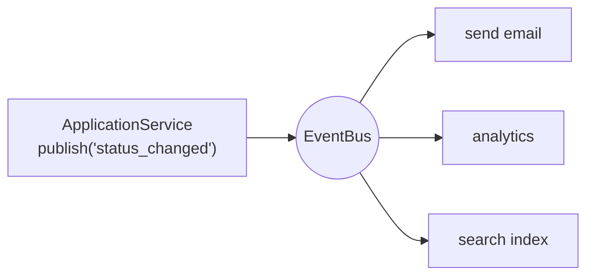

::part[Learn the Concept]{n="1"}

## 🎯 What you'll learn

- **Strategy**: interchangeable algorithms behind one interface (and why a Python function often *is* the strategy)
- **Observer**: publish/subscribe so the publisher doesn't know its subscribers
- **Command**: actions as objects — for undo/redo, queues, retries and audit logs
- Error isolation in event handlers
- How these map to things you'll use: sorting keys, signals, domain events, job queues, React state updates

## 🔤 Key words

| Word | In simple words | Bahasa Indonesia |
|---|---|---|
| **Strategy** | Swappable algorithms behind one agreed interface | Algoritma yang bisa ditukar |
| **Observer (pub/sub)** | One publisher, many subscribers who react to an event | Penerbit dan pelanggan |
| **Event** | A message saying "this happened" | Pesan kejadian |
| **Handler / subscriber** | Code that reacts to an event | Penanggap kejadian |
| **Command** | An action turned into an object you can store and replay | Aksi sebagai objek |
| **Undo/redo** | Reversing or repeating a stored command | Batal / ulangi |
| **Error isolation** | One failing handler not breaking the others | Kegagalan tidak menular |
| **Domain event** | A business fact like "OrderPaid" | Kejadian bisnis |

## 🧠 The big idea

| Pattern | Everyday analogy |
|---|---|
| **Strategy** | choosing a route in Google Maps: fastest, shortest, avoid tolls — same trip, different algorithm |
| **Observer** | a WhatsApp group: the sender posts once; everyone subscribed gets it; the sender doesn't call each person |
| **Command** | a restaurant order slip: the order is written down, queued for the kitchen, can be cancelled, and leaves a record |

## ❓ Why it matters

These three patterns manage **who does what, and who knows whom**:

- Strategy removes `if mode == …` chains from around algorithms.
- Observer lets a publisher announce something without knowing who cares — the WhatsApp group, not fifty phone calls.
- Command turns an action into a thing you can queue, retry, log or undo.

Without them, one function ends up knowing everything: how to sort, who to email, how to write the audit log — and every new requirement edits that same function.

## 📖 Step by step

### 1. Strategy

In Python a plain function is often the whole pattern: pass `key=by_salary` instead of building a `SortStrategy` class hierarchy.

```python
class ScoringStrategy(Protocol):
    def score(self, job: dict) -> float: ...

class BySalary:
    def score(self, job): return job["salary_max"] or 0

class BySkillMatch:
    def __init__(self, my_skills): self.my_skills = {s.lower() for s in my_skills}
    def score(self, job):
        wanted = {s.lower() for s in job["skills"]}
        return len(wanted & self.my_skills) / len(wanted) if wanted else 0.0

def rank_jobs(jobs, strategy: ScoringStrategy):
    return sorted(jobs, key=lambda job: (-strategy.score(job), job["id"]))
```

The user picks "best match" or "highest salary" at runtime; `rank_jobs` never changes.

**Pythonic shortcut**: a single-method strategy can just be a **function** — `sorted(jobs, key=score_fn)` is the Strategy pattern built into Python. Use classes when strategies need configuration (like `my_skills`) or several methods.

### 2. Observer (publish/subscribe)

Wrap each handler so one failure doesn't stop the rest. In a group chat, one person's phone being off shouldn't stop the message reaching everyone else.

```python
class EventBus:
    def __init__(self):
        self._handlers = defaultdict(list)

    def subscribe(self, event_type, handler):
        self._handlers[event_type].append(handler)
        return lambda: self._handlers[event_type].remove(handler)   # unsubscribe

    def publish(self, event_type, payload):
        errors = []
        for handler in list(self._handlers[event_type]):
            try:
                handler(payload)
            except Exception as error:
                logger.exception("handler failed")
                errors.append(error)
        return errors
```



Design decisions to make explicit:
- **Error isolation**: one failing subscriber shouldn't break others or the publisher.
- **Ordering**: don't let correctness depend on subscriber order.
- **Sync vs async**: in-process handlers run inside the request; slow or unreliable work (emails, webhooks) belongs in a **queue** (Module 5).
- **After commit**: publish domain events **after** the database transaction commits, or subscribers may act on data that gets rolled back.

### 3. Command

```python
class ChangeStatus:
    def __init__(self, board, application_id, new_status):
        self.board, self.application_id, self.new_status = board, application_id, new_status
        self._previous = None

    def execute(self):
        self._previous = self.board.statuses.get(self.application_id)
        self.board.statuses[self.application_id] = self.new_status

    def undo(self):
        self.board.statuses[self.application_id] = self._previous

class History:
    def run(self, command): command.execute(); self._done.append(command); self._undone.clear()
    def undo(self): ...
    def redo(self): ...
```

What commands enable:
- **Undo/redo** (editors, drag-and-drop boards).
- **Queues**: serialize a command (`{"type": "send_reminder", "application_id": 7}`) and let a worker execute it later.
- **Audit logs**: store every executed command.
- **Retries**: a failed command can be re-run (make it idempotent).

The CQRS style (Command Query Responsibility Segregation) and job queues like Celery (`send_reminder.delay(7)`) are command objects at scale.

### Choosing your setup

Every option here is a trade-off:

| Pattern | ✅ | ❌ |
|---|---|---|
| Strategy classes | swap algorithms, configurable, testable | overkill for one fixed algorithm |
| Strategy as function | minimal code | awkward with configuration/state (use closures or `functools.partial`) |
| Observer / events | publishers decoupled from reactions; easy to add features | control flow is implicit ("who handles this?"); debugging needs good logging |
| Direct calls | explicit and simple | every new reaction edits the caller |
| Command objects | undo, queue, log, retry | more classes; undo must be designed per command |

- ✅ Strategy: user-selectable ranking/pricing/scoring, provider selection, A/B testing algorithms.
- ✅ Observer: side effects that multiply over time (notifications, analytics, cache invalidation), UI state changes.
- ✅ Command: undoable UI actions, background jobs, audit trails, batch operations.
- 🚫 Events for a single, essential step that must succeed (e.g. charging the customer) — call it directly and handle errors.
- 🚫 An event bus in a 200-line app where two direct calls are clearer.

## ⚠️ Common mistakes

- An event bus where handlers publish more events that trigger other handlers… nobody can follow the flow.
- Passing mutable ORM objects in event payloads; handlers modify them unexpectedly.
- Commands whose `undo` doesn't restore the exact previous state (e.g. forgetting that the value didn't exist before).
- Forgetting to clear the redo stack after a new command.

:::revoshop
(1) Look at `OrderService.update_status` and `PaymentService._apply_order_status`: which side effects happen directly when an order is paid (stock, payment rows, logs)? Which of them could be subscribers to an `order_paid` event, and which must stay in the same transaction? (2) Product listing supports `sort_by` and `order` — is the sort logic a strategy, an `if` chain, or SQL `ORDER BY` built dynamically? (3) Alembic migrations are Commands with `upgrade`/`downgrade`: open one in `migrations/versions/` and check whether its downgrade truly undoes the upgrade.
:::

## 🏆 Best practices

- [ ] Define strategy interfaces by **what the caller needs** (`score(job)`), keep them to one or two methods.
- [ ] Use plain functions as strategies when no configuration is needed.
- [ ] Name events in the **past tense** (`application_status_changed`) with a small, serializable payload (ids, not ORM objects).
- [ ] Isolate subscriber failures and log them with context; publish after commit.
- [ ] Move slow side effects out of the request: event → queue → worker.
- [ ] Commands store everything needed to execute **and** undo; make queued commands idempotent.
- [ ] Document the event catalog (event name → payload → subscribers) so implicit flows stay discoverable.

::part[Explain & Design]{n="2"}

## 🗣️ Explain it

Explain the Observer pattern with the WhatsApp group analogy, then explain one danger: what happens if one group member's phone "crashes the group" every time a message arrives — and how the event bus prevents it.

## 📐 Design it

When an application moves to **interview** in CareerPilot: (1) store the status change, (2) create a calendar reminder, (3) send a congratulation email, (4) update the user's stats cache, (5) record analytics. The board in the web app must also support **undo** for a few seconds after a drag-and-drop. Design which parts are direct calls, events, commands, and what runs in a background worker.

:::quiz
Show a possible design

**Command (client + API)**: the drag-and-drop creates `MoveApplication(application_id, from="applied", to="interview")`. The web app keeps a short undo stack; "Undo" sends the inverse command `MoveApplication(id, from="interview", to="applied")`, which the API validates like any transition.

**Direct, same transaction** (must succeed together): `ApplicationService.move_status` updates the status and inserts the status-history row, then commits. (1)

**Domain event after commit**: `application_status_changed {application_id, user_id, from, to, occurred_at}` published to the event bus.

**Subscribers**:
- Stats cache invalidation — in-process, fast, failure is logged and harmless (cache rebuilds on next read). (4)
- Enqueue background jobs — tiny in-process handler that just enqueues:
  - `create_calendar_reminder` (worker, retries, idempotency key = event id) (2)
  - `send_congratulation_email` (worker, rate-limited, delayed 30 seconds so a quick **undo** can cancel it) (3)
  - `track_analytics` (worker, fire-and-forget) (5)

**Undo interaction**: the delayed email job checks the application's current status before sending; if it's no longer `interview`, it skips. Calendar reminder creation is idempotent and a later `status_changed` back to `applied` enqueues its deletion.
:::

### 📝 Self-review checklist

- [ ] Essential data changes are not event-driven
- [ ] Events published after commit
- [ ] Slow/unreliable effects run in workers with retries
- [ ] Undo is a command validated by the same rules

::ai-review{task="design"}

::part[Toy Exercise]{n="3"}

:::exercise{path="exercises/architecture/d-design-patterns/03-strategy-observer-command" ai="no-ai" title="Rankers, an event bus and undoable commands"}
Rank jobs with interchangeable scoring strategies, build an event bus that keeps working when a handler crashes, and implement status-change and note commands with a full undo/redo history.
:::

:::hints
- `rank_jobs`: `sorted(jobs, key=lambda job: (-strategy.score(job), job["id"]))`.
- `EventBus.publish`: iterate over a **copy** of the handler list; `logger.exception` inside `except` records the traceback.
- `ChangeStatus.undo`: if there was no previous status, remove the key instead of setting `None`.
- `History.run` must clear the redo stack.
:::

## ✅ Quick check

:::quiz
How is `sorted(items, key=...)` an example of the Strategy pattern?

The sorting algorithm stays the same while the caller supplies an interchangeable function that defines how items are compared.
:::

:::quiz
Why should domain events usually be published after the transaction commits?

If published before, subscribers might act (send emails, update caches) on changes that are later rolled back.
:::


## 📚 Keep learning

- [Refactoring.Guru — Behavioral patterns](https://refactoring.guru/design-patterns/behavioral-patterns)
- [Cosmic Python — Events and the Message Bus](https://www.cosmicpython.com/book/chapter_08_events_and_message_bus.html)
