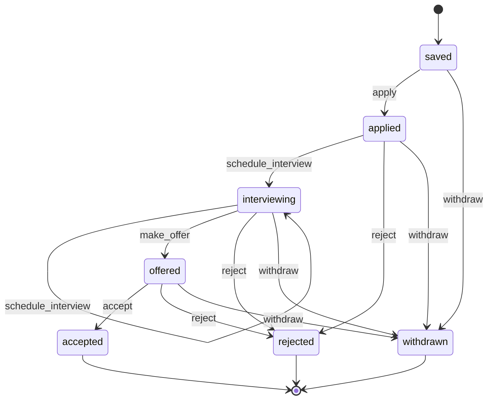

::part[Pelajari Konsepnya]{n="1"}

## 🎯 Yang akan kamu pelajari

- **State machine**: kondisi (status), event/aksi, transisi, kondisi akhir
- Tiga cara implementasi: rantai `if`, **tabel transisi**, dan **State pattern** (objek status)
- Kapan setiap cara adalah pilihan yang tepat
- **Template Method**: kerangka algoritma tetap dengan langkah yang bisa diganti dan hook
- Memakai `abc.ABC` untuk memaksa langkah wajib, dan alternatif komposisi (Strategy)

## 🔤 Istilah penting

| Istilah | Artinya (sederhana) |
|---|---|
| **State** | Situasi saat ini objek berada (pending, dibayar) |
| **Transition** | Perpindahan yang diizinkan dari satu kondisi ke kondisi lain |
| **Transition table** | Daftar perpindahan yang diizinkan, disimpan sebagai data |
| **State pattern** | Setiap kondisi jadi objeknya sendiri yang tahu apa yang bisa dilakukan |
| **Final state** | Kondisi akhir yang tidak bisa keluar (batal, dikembalikan) |
| **Template Method** | Urutan langkah tetap dengan bagian yang bisa diganti subclass |
| **Hook** | Langkah opsional yang boleh diisi atau tidak oleh subclass |
| **Abstract method** | Langkah yang *wajib* diisi oleh subclass |

## 🧠 Ide besarnya

**State**: lampu lalu lintas tidak punya buku aturan besar yang cek "kalau merah DAN tombol ditekan DAN…". Tiap lampu **tahu sendiri apa yang dikerjakan selanjutnya**: merah → hijau, hijau → kuning, kuning → merah. Ganti objek lampu sekarang, dan perilakunya berubah otomatis.

**Template Method**: kartu resep dengan langkah tetap — *siapkan bahan → masak → plating → sajikan* — di mana setiap restoran ngisi cara memasaknya sendiri. Urutannya tidak berubah; detailnya yang beda.

## ❓ Kenapa ini penting

Banyak objek bisnis punya **siklus hidup**: pesanan (pending → dibayar → dikirim), lamaran kerja (disimpan → dilamar → interview → ditawarkan), pembayaran, langganan, tiket support. Aturan seperti "tidak bisa terima tawaran yang tidak pernah diberikan" adalah inti dari bisnis — dan sering menjadi sumber bug.

Dan banyak proses berbagi **kerangka sama** dengan detail berbeda: impor lowongan dari papan berbeda, buat laporan di format berbeda, jalankan pipeline ML berbeda.

Tanpa alat ini, dua hal itu berubah menjadi rantai `if` panjang yang setiap kasus baru ubah, dan tidak ada yang bisa jawab "perubahan apa sebenarnya yang diizinkan?" tanpa baca seluruh file.

## 📖 Langkah demi langkah

### 1. Gambar state machine dulu



Diagram itu dokumentasi, rencana test (tiap panah = diizinkan, panah hilang = ditolak), dan sesuatu yang product manager bisa review.

### 2. Pilihan A — tabel transisi (data)

Untuk kebanyakan objek bisnis ini cukup, dan paling mudah di-review: perpindahan yang diizinkan adalah tabel yang siapa saja — termasuk product manager — bisa baca.

```python
TRANSITIONS = {
    ("saved", "apply"): "applied",
    ("applied", "schedule_interview"): "interviewing",
    ("interviewing", "make_offer"): "offered",
    ...
}

def fire(status, action):
    try:
        return TRANSITIONS[(status, action)]
    except KeyError:
        raise InvalidAction(f"cannot {action} when {status}") from None
```

✅ Pilih saat transisi cukup **perubahan status sederhana** tanpa perilaku spesifik per-kondisi. Mudah dilihat, disimpan di config, atau dicerminkan di database `CHECK` constraint. Kamu pakai gaya ini di Minggu 5 dan API Phase 2.

### 3. Pilihan B — State pattern (objek)

Saat kondisi bawa **perilaku dan data** (jumlah interview, jumlah tawaran, efek samping per transisi), beri setiap kondisi class sendiri:

```python
class State:
    name = "?"
    def apply(self, workflow):            self._invalid("apply")
    def schedule_interview(self, workflow): self._invalid("schedule_interview")
    def make_offer(self, workflow, amount): self._invalid("make_offer")
    def accept(self, workflow):            self._invalid("accept")
    # ... default: everything is invalid

class Interviewing(State):
    name = "interviewing"
    def schedule_interview(self, workflow):
        workflow.interview_rounds += 1
        workflow._move_to(Interviewing())
    def make_offer(self, workflow, amount):
        workflow.offer_amount = amount
        workflow._move_to(Offered())

class ApplicationWorkflow:
    def __init__(self):
        self._state = Saved()
    def make_offer(self, amount):
        self._state.make_offer(self, amount)      # delegate — no if-chain
```

- Setiap class status menjawab "apa yang bisa aku lakukan?" di satu tempat.
- Tambah "screening" = satu class baru + ubah status yang mengarah ke sana.
- Context (`ApplicationWorkflow`) tidak pernah bandingkan string status.

### 4. Lindungi aturan di mana-mana

Apapun implementasi yang kamu pilih, paksakan transisi di **satu** komponen domain, test seluruh matrix (setiap status × setiap aksi), dan dukung aturan penting dengan constraint database kalau bisa.

### 5. Template Method

```python
from abc import ABC, abstractmethod

class ApplicationReport(ABC):
    title = "Applications"                           # hook with a default

    def generate(self, applications):                # the template: fixed skeleton
        lines = [self.header()]
        lines += [self.row(app) for app in applications]
        lines.append(self.footer(applications))
        return "\n".join(lines)

    @abstractmethod
    def header(self): ...                            # required step

    @abstractmethod
    def row(self, app): ...

    def footer(self, applications):                  # optional step (hook)
        return f"Total: {len(applications)}"

class MarkdownReport(ApplicationReport):
    title = "Job Hunt"
    def header(self): return f"# {self.title}\n\n| Company | Role | Status |\n|---|---|---|"
    def row(self, app): return f"| {app['company']} | {app['role']} | {app['status']} |"
```

- `ABC` + `@abstractmethod` membuat instantiate subclass tidak lengkap gagal dengan `TypeError`.
- Base class memanggil subclass ("jangan panggil kami, kami yang panggil kamu" — Hollywood principle).

### 6. Template Method vs Strategy

Template Method paksakan urutan dan biarkan ubah langkah lewat subclass; Strategy kasih bagian berubah sebagai objek. Lebih suka cara kedua saat variasi banyak.

| | Template Method | Strategy |
|---|---|---|
| Mekanisme | inheritance: override langkah | composition: kasih objek/fungsi langkah |
| Berubah | beberapa langkah satu algoritma | satu algoritma/langkah |
| Tukar di runtime | tidak (pilih subclass) | ya |
| Coupling | subclass bergantung base class | longgar |

Contoh di framework: `unittest.TestCase` (`setUp` → test → `tearDown`), Flask `MethodView`, Django class-based views. Di kode milikmu sendiri, suka Strategy/composition saat langkah berubah independen (Stage C); pakai Template Method saat kerangka stabil dan langkah sedikit.

### Pilih setup-mu

Setiap pilihan di sini punya trade-off:

| Pilihan | ✅ | ❌ |
|---|---|---|
| Rantai `if` | cukup untuk 2–3 kondisi | aturan tersebar; mudah lupa kasus |
| Tabel transisi | ringkas, data-driven, mudah test/visualisasi | canggung saat kondisi perlu perilaku atau data |
| State pattern | perilaku per-kondisi di satu tempat; terbuka untuk kondisi baru | lebih banyak class; mungkin overkill untuk perubahan status murni |
| Library state machine (`transitions`, `python-statemachine`) | callback, diagram, guard | dependency dan kurva belajar |
| Template Method | paksakan urutan algoritma, hapus duplikasi | coupling inheritance; risiko fragile base class |

- ✅ State pattern: siklus hidup dengan perilaku spesifik kondisi (tawaran, jumlah interview, timer, efek samping).
- ✅ Tabel transisi: pipeline status sederhana (kebanyakan aplikasi CRUD).
- ✅ Template Method: proses multi-langkah stabil dengan beberapa langkah yang berubah, titik ekstensi framework.
- 🚫 Class status untuk boolean flag.
- 🚫 Template Method hirarkis lebih dalam satu level atau dengan banyak hook opsional.

## ⚠️ Kesalahan umum

- Set `application.status = "offered"` langsung di suatu route, bypass aturan.
- Lupa kondisi akhir, jadi aplikasi "rejected" masih bisa bergerak.
- Class status yang juga bandingkan string status (mengalahkan tujuan).
- Override template method sendiri di subclass dan ubah urutan langkah.

:::revoshop
Pesanan RevoShop punya status (`menunggu_pembayaran → diproses → dikirim → terkirim`, plus pembatalan). (1) `OrderService.update_status` impor `ALLOWED_TRANSITIONS`, `ROLE_ALLOWED_TARGET_STATUSES` dan `TERMINAL_STATUSES` — **tabel transisi** plus aturan role ✅. Cari di mana mereka didefinisikan dan bandingkan dengan constraint `CHECK` status di migrasi. Cek mana yang masih pakai `if role == ...` rantai? (2) Gambar diagram state dari kode. Ada transisi yang kode izinkan tapi bisnis tidak boleh (misalnya batalkan pesanan yang sudah dikirim)? (3) Method yang sama cek role **dan** transisi: urutan apa, dan apakah seller dapat error yang jelas untuk transisi tidak valid vs terlarang?
:::

## 🏆 Praktik terbaik

- [ ] **Gambar diagram state** dan review dengan product sebelum koding.
- [ ] Paksakan transisi di satu tempat; jangan pernah set `status` langsung dari route.
- [ ] Test **matrix lengkap** kondisi × aksi (parametrize).
- [ ] Buat aksi tidak valid raise domain error spesifik dengan pesan jelas; map ke `409` di API.
- [ ] Simpan audit trail transisi (tabel riwayat status).
- [ ] Cerminkan invariant penting di database (`CHECK` constraint, unique index).
- [ ] Untuk Template Method: tandai langkah wajib `@abstractmethod`, jangan override template method sendiri, jaga hook sedikit.

::part[Jelaskan & Rancang]{n="2"}

## 🗣️ Jelaskan

Jelaskan ke product manager kenapa "aplikasi bisa ditolak kapan saja sebelum diterima" lebih mudah dijamin dengan state machine daripada pernyataan `if` tersebar. Pakai analogi lampu lalu lintas.

## 📐 Rancang

CareerPilot tambah **subscriptions**: `trial` (14 hari) → `active` (dibayar) → `past_due` (pembayaran gagal, grace 7 hari) → `canceled`; user bisa batalkan kapan saja (akses lanjut sampai periode habis), aktifkan ulang saat `past_due` atau sebelum periode habis, dan trial yang habis tanpa pembayaran jadi `expired`. Webhook pembayaran dan scheduler harian trigger event. Pilih antara tabel transisi dan State pattern, gambar machine, dan list event dengan guard.

:::quiz
Lihat contoh rancangan

**Kondisi**: `trial`, `active`, `past_due`, `cancel_scheduled` (dibatalkan tapi periode belum habis), `canceled`, `expired`.

**Event** (dari webhook, aksi user, scheduler):
| Dari | Event | Guard | Ke |
|---|---|---|---|
| trial | `payment_succeeded` | — | active |
| trial | `trial_ended` (scheduler) | tidak ada pembayaran | expired |
| active | `payment_failed` | — | past_due (grace_until = sekarang + 7 h) |
| active | `cancel_requested` | — | cancel_scheduled |
| past_due | `payment_succeeded` | — | active |
| past_due | `grace_ended` (scheduler) | sekarang ≥ grace_until | canceled |
| cancel_scheduled | `reactivate_requested` | sekarang < period_end | active |
| cancel_scheduled | `period_ended` (scheduler) | — | canceled |

**Pilihan**: **State pattern** (atau tabel dengan fungsi guard) karena kondisi bawa data dan perilaku — `past_due` punya `grace_until` dan kirim reminder; `cancel_scheduled` masih kasih akses sampai `period_end`; setiap kondisi jawab `has_access(sekarang)` berbeda. Tabel murni tidak bisa ekspresikan `has_access` rapi.

**Keamanan**: webhook idempotent (event id), event scheduler aman dijalankan lagi (guard cek timestamp), setiap transisi dicatat di `subscription_events`, dan event tidak valid dicatat dan diabaikan (webhook) atau ditolak dengan `409` (aksi user).
:::

### 📝 Checklist review mandiri

- [ ] Setiap kondisi punya makna jelas dan aturan akses
- [ ] Event datang dari trigger nyata (webhook, user, scheduler)
- [ ] Guard tangani aturan berbasis waktu
- [ ] Idempotency untuk event webhook/scheduler yang terulang

::ai-review{task="design"}

::part[Latihan Kecil]{n="3"}

:::exercise{path="exercises/architecture/d-design-patterns/04-state-template-method" ai="no-ai" title="Siklus hidup aplikasi dengan objek status, dan template laporan"}
Implementasi alur kerja aplikasi di mana setiap kondisi adalah class dan alur kerja hanya delegate — test cek setiap kombinasi kondisi × aksi dan larang perbandingan string status di alur kerja. Lalu bangun template laporan dengan langkah abstrak dan dua laporan konkret.
:::

:::hints
- Beri base class `State` implementasi default untuk setiap aksi yang raise `InvalidAction`; kondisi konkret override hanya apa yang mereka izinkan.
- Class menengah bersama (misalnya `Open`) bisa implementasi `reject` dan `withdraw` sekali untuk semua kondisi non-final setelah saved.
- `workflow._move_to(status)` update kondisi dan append ke `history`.
- `class ApplicationReport(ABC)` dengan `@abstractmethod` di `header` dan `row`.
:::

## ✅ Cek cepat

:::quiz
Kapan tabel transisi lebih baik daripada State pattern?

Saat kondisi hanya label dengan transisi sederhana dan tidak ada perilaku atau data spesifik kondisi — tabel lebih ringkas dan mudah dibaca dan di-test.
:::

:::quiz
Apa yang ditambahkan `@abstractmethod` ke base class Template Method?

Ia cegah instantiate subclass yang tidak implementasi langkah wajib, gagal cepat dengan `TypeError`.
:::


## 📚 Lanjut belajar

- [Refactoring.Guru — State](https://refactoring.guru/design-patterns/state)
- [Refactoring.Guru — Template Method](https://refactoring.guru/design-patterns/template-method)
- [Library python-statemachine](https://python-statemachine.readthedocs.io/)

## 📣 Stage D selesai — bagikan

:::linkedin{type="concept"}
💡 Design pattern mulai masuk akal waktu aku buatnya untuk proyek sungguhan.

- Factory + registry → tambah format export tanpa ubah kode sekarang
- Adapter → format API partner aneh tidak bocor keluar class itu
- Decorator → cache dan retry bertumpuk di job source apa saja
- Observer → perubahan status trigger email dan analytics tanpa service tahu
- State → siklus hidup aplikasi di mana "rejected" tidak pernah dapat tawaran

Pelajaran terbesar: pattern adalah nama trade-off, bukan tujuan. Dict dan fungsi sering mengalahkan hirarkis class.

Pattern apa yang benar-benar kamu pakai setiap minggu? 👇

#DesignPatterns #SoftwareArchitecture #Python #LearningInPublic
:::
