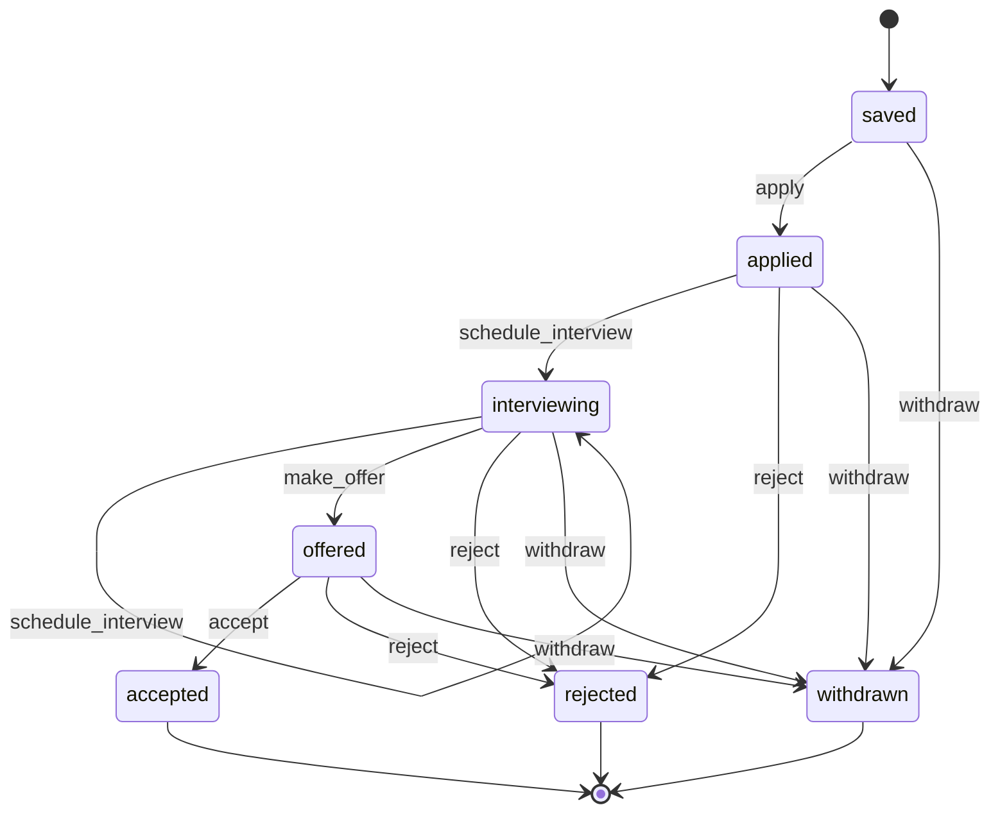

::part[Learn the Concept]{n="1"}

## 🎯 What you'll learn

- **State machines**: states, events/actions, transitions, final states
- Three implementations: `if` chains, **transition tables**, and the **State pattern** (state objects)
- When each implementation is the right choice
- **Template Method**: a fixed algorithm skeleton with overridable steps and hooks
- Using `abc.ABC` to force required steps, and the composition alternative (Strategy)

## 🧠 The big idea

**State**: a traffic light doesn't have a giant rulebook checking "if red and button pressed and…". Each light **knows what it does next**: red → green, green → yellow, yellow → red. Change the current light object, and the behavior changes with it.

**Template Method**: a recipe card with fixed steps — *prepare ingredients → cook → plate → serve* — where each restaurant fills in how to cook. The order never changes; the details do.

## ❓ Why does this exist?

Many business objects have a **lifecycle**: orders (pending → paid → shipped), job applications (saved → applied → interviewing → offered), payments, subscriptions, support tickets. Rules like "you can't accept an offer that doesn't exist" are the heart of the domain and a major source of bugs.

And many processes share a **skeleton** with varying details: importing jobs from different boards, generating reports in different formats, running different ML pipelines.

## 💥 What happens if we DON'T?

```python
def accept(self):
    if self.status == "offered":
        self.status = "accepted"
    elif self.status in ("saved", "applied", "interviewing"):
        raise InvalidAction("no offer yet")
    elif self.status == "rejected":
        raise InvalidAction("rejected")
    ...
# the same if-chain again in reject(), withdraw(), schedule_interview(), make_offer()…
```

Adding a state ("screening") means editing every method, and it's easy to forget one — the kind of bug found in production when a "rejected" application somehow gets an offer.

## 📖 How it works, step by step

### 1. Draw the state machine first



A diagram is documentation, a test plan (every arrow = allowed, every missing arrow = rejected), and something product managers can review.

### 2. Option A — transition table (data)

```python
TRANSITIONS = {
    ("saved", "apply"): "applied",
    ("applied", "schedule_interview"): "interviewing",
    ("interviewing", "make_offer"): "offered",
    ...
}

def fire(status, action):
    try:
        return TRANSITIONS[(status, action)]
    except KeyError:
        raise InvalidAction(f"cannot {action} when {status}") from None
```

✅ Best when transitions are **simple status changes** with no per-state behavior. Easy to visualize, store in config, or mirror in a database `CHECK` constraint. You used this style in Week 5 and the Phase 2 API.

### 3. Option B — the State pattern (objects)

When states carry **behavior and data** (interview rounds, offer amounts, side effects per transition), give each state a class:

```python
class State:
    name = "?"
    def apply(self, workflow):            self._invalid("apply")
    def schedule_interview(self, workflow): self._invalid("schedule_interview")
    def make_offer(self, workflow, amount): self._invalid("make_offer")
    def accept(self, workflow):            self._invalid("accept")
    # ... default: everything is invalid

class Interviewing(State):
    name = "interviewing"
    def schedule_interview(self, workflow):
        workflow.interview_rounds += 1
        workflow._move_to(Interviewing())
    def make_offer(self, workflow, amount):
        workflow.offer_amount = amount
        workflow._move_to(Offered())

class ApplicationWorkflow:
    def __init__(self):
        self._state = Saved()
    def make_offer(self, amount):
        self._state.make_offer(self, amount)      # delegate — no if-chain
```

- Each state class answers "what can I do?" in one place.
- Adding "screening" = one new class + changing the states that lead to it.
- The context (`ApplicationWorkflow`) never compares status strings.

### 4. Guarding the rules everywhere

Whatever implementation you choose, enforce transitions in **one** domain component, test the whole matrix (every state × every action), and back critical rules with database constraints when possible.

### 5. Template Method

```python
from abc import ABC, abstractmethod

class ApplicationReport(ABC):
    title = "Applications"                           # hook with a default

    def generate(self, applications):                # the template: fixed skeleton
        lines = [self.header()]
        lines += [self.row(app) for app in applications]
        lines.append(self.footer(applications))
        return "\n".join(lines)

    @abstractmethod
    def header(self): ...                            # required step

    @abstractmethod
    def row(self, app): ...

    def footer(self, applications):                  # optional step (hook)
        return f"Total: {len(applications)}"

class MarkdownReport(ApplicationReport):
    title = "Job Hunt"
    def header(self): return f"# {self.title}\n\n| Company | Role | Status |\n|---|---|---|"
    def row(self, app): return f"| {app['company']} | {app['role']} | {app['status']} |"
```

- `ABC` + `@abstractmethod` makes instantiating an incomplete subclass fail with `TypeError`.
- The base class calls the subclass ("don't call us, we'll call you" — the Hollywood principle).

### 6. Template Method vs Strategy

| | Template Method | Strategy |
|---|---|---|
| Mechanism | inheritance: override steps | composition: pass step objects/functions |
| Varies | several steps of one algorithm | one algorithm/step |
| Runtime swap | no (choose subclass) | yes |
| Coupling | subclass depends on base class | loose |

Framework examples: `unittest.TestCase` (`setUp` → test → `tearDown`), Flask's `MethodView`, Django class-based views. In your own code, prefer Strategy/composition when steps vary independently (Stage C); use Template Method when the skeleton is stable and steps are few.

## ⚖️ Trade-offs

| Choice | ✅ | ❌ |
|---|---|---|
| `if` chains | fine for 2–3 states | spreads rules; easy to miss cases |
| Transition table | concise, data-driven, easy to test/visualize | awkward when states need behavior or data |
| State pattern | per-state behavior in one place; open to new states | more classes; can be overkill for pure status changes |
| State machine library (`transitions`, `python-statemachine`) | callbacks, diagrams, guards | dependency and learning curve |
| Template Method | enforces algorithm order, removes duplication | inheritance coupling; fragile base class risk |

## ✅ When to use it / 🚫 When NOT to use it

- ✅ State pattern: lifecycles with state-specific behavior (offers, rounds, timers, side effects).
- ✅ Transition table: simple status pipelines (most CRUD apps).
- ✅ Template Method: stable multi-step processes with a few varying steps, framework extension points.
- 🚫 State classes for a boolean flag.
- 🚫 Template Method hierarchies deeper than one level or with many optional hooks.

## 🏆 Best practices

- [ ] **Draw the state diagram** and review it with product before coding.
- [ ] Enforce transitions in one place; never set `status` directly from routes.
- [ ] Test the **full matrix** of states × actions (parametrize).
- [ ] Make invalid actions raise a specific domain error with a clear message; map it to `409` in the API.
- [ ] Keep an audit trail of transitions (status history table).
- [ ] Mirror critical invariants in the database (`CHECK` constraints, unique indexes).
- [ ] For Template Method: mark required steps `@abstractmethod`, keep the template method itself non-overridden by convention, keep hooks few.

## 🏭 How it's used in industry

- E-commerce orders, payment intents (Stripe's PaymentIntent statuses), shipment tracking — all explicit state machines.
- Workflow engines (AWS Step Functions, Temporal) run state machines at scale.
- UI state machines (XState) manage complex front-end flows like checkout (Module 4).
- Test frameworks and web frameworks rely on template methods for lifecycle hooks.

## ⚠️ Common mistakes

- Setting `application.status = "offered"` directly somewhere in a route, bypassing the rules.
- Forgetting final states, so "rejected" applications can still move.
- State classes that also compare status strings (defeats the purpose).
- Overriding the template method itself in a subclass and changing the order of steps.

:::revoshop
RevoShop's orders have statuses (`waiting_for_payment → processing → shipped → delivered`, plus cancellation). (1) `OrderService.update_status` imports `ALLOWED_TRANSITIONS`, `ROLE_ALLOWED_TARGET_STATUSES` and `TERMINAL_STATUSES` — a **transition table** plus role rules ✅. Find where they're defined and compare them with the status CHECK constraint migration. Which checks still use `if role == ...` chains? (2) Draw the state diagram from the code. Are there transitions the code allows that the business shouldn't (e.g. cancelling a shipped order)? (3) The same method checks the role **and** the transition: in what order, and does a seller get a clear error for an invalid transition vs a forbidden one?
:::

::part[Explain & Design]{n="2"}

## 🗣️ Explain it

Explain to a product manager why "an application can be rejected at any point before it's accepted" is easier to guarantee with a state machine than with scattered `if` statements. Use the traffic light analogy.

## 📐 Design it

CareerPilot adds **subscriptions**: `trial` (14 days) → `active` (paid) → `past_due` (payment failed, 7-day grace) → `canceled`; users can cancel anytime (access continues until the period ends), reactivate while `past_due` or before period end, and trials that end without payment become `expired`. Payment webhooks and a daily scheduler trigger events. Choose between a transition table and the State pattern, draw the machine, and list the events and guards.

:::quiz
Show a possible design

**States**: `trial`, `active`, `past_due`, `cancel_scheduled` (canceled but period not over), `canceled`, `expired`.

**Events** (from webhooks, user actions, scheduler):
| From | Event | Guard | To |
|---|---|---|---|
| trial | `payment_succeeded` | — | active |
| trial | `trial_ended` (scheduler) | no payment | expired |
| active | `payment_failed` | — | past_due (grace_until = now + 7 d) |
| active | `cancel_requested` | — | cancel_scheduled |
| past_due | `payment_succeeded` | — | active |
| past_due | `grace_ended` (scheduler) | now ≥ grace_until | canceled |
| cancel_scheduled | `reactivate_requested` | now < period_end | active |
| cancel_scheduled | `period_ended` (scheduler) | — | canceled |

**Choice**: the **State pattern** (or a table with guard functions) because states carry data and behavior — `past_due` has `grace_until` and sends reminders; `cancel_scheduled` still grants access until `period_end`; each state answers `has_access(now)` differently. A pure table can't express `has_access` cleanly.

**Safety**: webhooks are idempotent (event ids), scheduler events are safe to re-run (guards check timestamps), every transition is recorded in `subscription_events`, and invalid events are logged and ignored (webhooks) or rejected with `409` (user actions).
:::

### 📝 Self-review checklist

- [ ] Every state has a clear meaning and access rule
- [ ] Events come from real triggers (webhook, user, scheduler)
- [ ] Guards handle time-based rules
- [ ] Idempotency for repeated webhook/scheduler events

::ai-review{task="design"}

::part[Toy Exercise]{n="3"}

:::exercise{path="exercises/architecture/d-design-patterns/04-state-template-method" ai="no-ai" title="An application lifecycle with state objects, and report templates"}
Implement an application workflow where each state is a class and the workflow only delegates — the tests check every state × action combination and forbid status-string comparisons in the workflow. Then build a report template with abstract steps and two concrete reports.
:::

:::hints
- Give the base `State` class a default implementation for every action that raises `InvalidAction`; concrete states override only what they allow.
- A shared intermediate class (e.g. `Open`) can implement `reject` and `withdraw` once for all non-final states after saved.
- `workflow._move_to(state)` updates the state and appends to `history`.
- `class ApplicationReport(ABC)` with `@abstractmethod` on `header` and `row`.
:::

## ✅ Quick check

:::quiz
When is a transition table better than the State pattern?

When states are just labels with simple allowed transitions and no state-specific behavior or data — the table is shorter and easier to read and test.
:::

:::quiz
What does `@abstractmethod` add to a Template Method base class?

It prevents instantiating subclasses that don't implement the required steps, failing early with a `TypeError`.
:::

## 📖 Kamus (glossary)

| Term | Bahasa Indonesia |
|---|---|
| State machine | Mesin status |
| Transition | Transisi — perpindahan status |
| Guard | Penjaga — syarat transisi |
| Final state | Status akhir |
| Template method | Metode templat — kerangka algoritma |
| Hook | Kait — langkah opsional yang bisa diubah |

## 📚 Keep learning

- [Refactoring.Guru — State](https://refactoring.guru/design-patterns/state)
- [Refactoring.Guru — Template Method](https://refactoring.guru/design-patterns/template-method)
- [python-statemachine library](https://python-statemachine.readthedocs.io/)

## 📣 Stage D done — share it

:::linkedin{type="concept"}
💡 Design patterns stopped feeling academic once I built them for a real project.

- Factory + registry → adding an export format without touching existing code
- Adapter → a partner API's weird format never leaks past one class
- Decorator → caching and retries stacked around any job source
- Observer → status changes trigger emails and analytics without the service knowing
- State → an application lifecycle where "rejected" can never get an offer

Biggest lesson: patterns are names for trade-offs, not goals. A dict and a function often beat a class hierarchy.

Which pattern do you actually use every week? 👇

#DesignPatterns #SoftwareArchitecture #Python #LearningInPublic
:::
