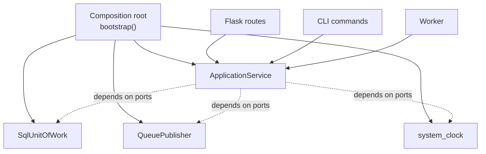

::part[Pelajari Konsepnya]{n="1"}

## 🎯 Yang akan kamu pelajari

- **Lapisan service**: satu method per kasus penggunaan, tidak bergantung pada HTTP
- **DTO**: apa yang service kembalikan (dan kenapa bukan ORM/domain object)
- **Domain error** di service, dipetakan ke HTTP status code di pinggir
- **Dependency injection** (constructor injection) dan **composition root**
- DI container vs fungsi biasa, dan `Depends` FastAPI
- Menerbitkan event setelah commit (menghubungkan Stage D Observer dengan Stage E)

## 🔤 Istilah penting

| Istilah | Artinya (sederhana) |
|---|---|
| **Service layer** | Satu method per kasus penggunaan, berisi aturan bisnis |
| **Use case** | Satu hal yang ingin dilakukan pengguna ("melamar pekerjaan") |
| **DTO** | Objek polos yang membawa data melintasi batas |
| **Domain error** | Jenis error sendiri, diterjemahkan ke HTTP di tepi |
| **Dependency injection** | Menyuntikkan apa yang dibutuhkan service ke dalamnya |
| **Constructor injection** | Disuntik saat objek dibuat |
| **Composition root** | Satu tempat yang merakit semuanya |
| **DI container** | Pustaka yang melakukan perakitan untuk kamu |

## 🧠 Ide besarnya

Sebuah rumah sakit punya **loket penerimaan** (rute), **dokter** (service) dan **apotek, lab, rekam medis** (infrastruktur). Resepsionis tidak mendiagnosa; dokter tidak peduli apakah pasien datang jalan kaki, telepon atau aplikasi; dan mana lab yang memproses tes darah diputuskan manajemen, bukan setiap dokter.

- **Lapisan service** = dokter: kasus penggunaan.
- **Rute/CLI/worker** = loket penerimaan yang berbeda untuk dokter yang sama.
- **Composition root** = manajemen memutuskan lab, apotek dan sistem rekam medis yang dipakai semua orang.

## ❓ Kenapa ini penting

Saat aplikasi berkembang, kasus penggunaan yang sama dipicu dari beberapa tempat: rute API, perintah CLI impor, worker terjadwal, panel admin, nanti agent AI (Modul 7). Kalau logika ada di rute, ia akan duplikasi atau tidak bisa dipakai ulang.

Dan kalau service membuat dependensinya sendiri di dalamnya (`SmtpClient()`, `datetime.now()`), ia tidak bisa di-test atau dikonfigurasi ulang — dokter membeli peralatan lab sendiri.

Letakkan kasus penggunaan di service, berikan alatnya, dan putuskan perakitan di satu tempat.

## 📖 Langkah demi langkah

### 1. Satu kasus penggunaan per method service

```python
class ApplicationService:
    def __init__(self, uow: UnitOfWork, publisher: EventPublisher, clock: Clock):
        self.uow, self.publisher, self.clock = uow, publisher, clock

    def move(self, user_id: int, application_id: int, new_status: str) -> dict:
        with self.uow:
            application = self.uow.applications.get(application_id)
            if application is None or application.user_id != user_id:
                raise ApplicationNotFound()
            previous = application.status
            application.move_to(new_status)            # domain rule
            application.updated_at = self.clock()
            self.uow.commit()
            dto = to_dto(application)
        self.publisher.publish("application_status_changed", {"application_id": application_id, "from": previous, "to": new_status})
        return dto
```

Service **mengorkestra**: muat → cek izin → terapkan aturan domain → simpan → terbitkan. Domain object menahan aturannya sendiri (`move_to`).

### 2. DTO di batas

Mengembalikan ORM object dari service membocorkan database ke semua yang memanggilnya — dan satu atribut lazy-load kemudian meledak di luar session.

Service mengembalikan **data polos** (dict atau dataclass kecil), bukan ORM/domain object:
- pemanggil tidak bisa secara tidak sengaja lazy-load atau mutasi keadaan persisten setelah transaksi,
- bentuk API bisa berbeda dari bentuk database,
- DTO yang sama bekerja untuk JSON, output CLI atau response tool LLM.

### 3. Domain error → HTTP di tepi

```python
class ApplicationNotFound(Exception): ...
class LimitReached(Exception): ...

# api.py — the only place that knows HTTP
app.register_error_handler(ApplicationNotFound, lambda e: error("not_found", 404))
app.register_error_handler(InvalidTransition, lambda e: error("invalid_transition", 409))
```

CLI memetakan error yang sama ke exit code dan pesan; worker memetakannya ke "jangan coba lagi".

### 4. Rute tipis

```python
@app.post("/users/<int:user_id>/applications/<int:application_id>/status")
def move(user_id, application_id):
    body = request.get_json(silent=True) or {}
    return jsonify(service.move(user_id, application_id, body.get("status", "")))
```

Parse → panggil → serialisasi. Kalau rute punya `if` tentang aturan bisnis, aturannya di tempat yang salah.

### 5. Dependency injection dan composition root

Satu tempat membangun objek: production merakit klien sungguhan, test merakit palsu, CLI merakit service yang sama dengan API. Tidak ada yang lain perlu tahu.

**Constructor injection**: dependensi adalah parameter, bukan hal yang service buat.

**Composition root**: satu tempat yang membangun object graph:

```python
def bootstrap(uow=None, publisher=None, clock=None) -> Container:
    return Container(
        applications=ApplicationService(
            uow=uow or SqlUnitOfWork(create_engine(settings.database_url)),
            publisher=publisher or QueuePublisher(redis_client),
            clock=clock or system_clock,
        )
    )

# production:  app = create_app(bootstrap())
# tests:       app = create_app(bootstrap(uow=FakeUnitOfWork(), publisher=RecordingPublisher(), clock=FixedClock(T0)))
```



### 6. Apakah aku butuh pustaka DI container?

| Opsi | Catatan |
|---|---|
| Fungsi `bootstrap()` polos | cukup untuk kebanyakan aplikasi Python; eksplisit dan bisa di-debug |
| Flask app factory + `app.extensions` | simpan container di app; rute membacanya |
| FastAPI `Depends` | injection per-request built-in (session, user saat ini, service) |
| `dependency-injector`, `punq`, `lagom` | berguna di aplikasi sangat besar; lebih banyak keajaiban untuk dipelajari |

:::fastapi
Di FastAPI, dependensi dideklarasikan sebagai parameter: `def move(..., service: ApplicationService = Depends(get_application_service))`. Test menggantinya dengan `app.dependency_overrides[get_application_service] = lambda: fake_service` — dependency injection built-in di framework.
:::

### Memilih setupmu

Setiap opsi di sini adalah trade-off:

| Pilihan | ✅ | ❌ |
|---|---|---|
| Service layer | kasus penggunaan bisa dipakai ulang, bisa di-test tanpa HTTP | layer lain; bisa jadi "pass-through" untuk CRUD sepele |
| Logika di rute | tercepat untuk aplikasi kecil | duplikasi, sulit di-test, terikat ke HTTP |
| DTO | kontrak API stabil, tidak bocor persistence | kode mapping |
| Constructor injection | eksplisit, bisa di-test | kode wiring; konstruktor panjang menandai class yang melakukan terlalu banyak |
| Pustaka DI container | kurang wiring manual di aplikasi besar | indirection, sulit lacak |
| Global module-level (`db`, `mail`) | nyaman di Flask | hidden dependency; test butuh patching |

- ✅ Kasus penggunaan dipanggil dari lebih dari satu entry point, atau punya aturan tidak sepele.
- ✅ Apa pun yang sentuh sistem eksternal (email, pembayaran, LLM) yang harus kamu palsu di test.
- 🚫 Method service yang hanya panggil `repository.get()` dan kembalikan — biarkan rute panggil helper query, atau terima wrapper tipis secara sadar untuk konsistensi.
- 🚫 Suntik fungsi utility polos (`slugify`) — hanya import.

## ⚠️ Kesalahan umum

- Menyuntik `request` atau Flask `g` ke service.
- Service mengembalikan ORM object yang rute lalu modifikasi.
- Menangkap exception di service dan kembalikan dict `{"error": ...}` (kekhawatiran HTTP bocor ke dalam).
- Membuat `datetime.now()`, `SmtpClient()` atau `requests.post` langsung di dalam method service.

:::revoshop
(1) Bandingkan rute RevoShop (mis. `app/routes/orders.py`) dengan `OrderService`: apakah rute punya aturan bisnis, atau hanya parse, panggil dan serialisasi? (2) Service adalah `@staticmethod` yang import repository dan `db` langsung — apa arti itu untuk dependency injection dan mock di `tests/unit`? (3) Sketsa `bootstrap()` untuk RevoShop yang membuat `OrderService(uow, payment_gateway, clock)` dan bagaimana `create_app()` memakainya.
:::

## 🏆 Praktik terbaik

- [ ] Satu method service per kasus penggunaan, diberi nama oleh niat (`move`, `add_application`, `import_jobs`).
- [ ] Service bergantung pada **protocol** (UoW, publisher, clock, LLM client), tidak pernah pada Flask/`request`.
- [ ] Kembalikan **DTO**; naikan **domain error**; petakan error ke HTTP/CLI di tepi.
- [ ] Buat rute hanya parse → panggil → serialisasi.
- [ ] Rakit semuanya di **satu composition root**; itu satu-satunya modul yang import adapter konkret.
- [ ] Suntik **clock** (dan randomness/id generator) untuk test deterministik.
- [ ] Terbitkan event **setelah** commit.
- [ ] Kalau konstruktor butuh 7+ dependensi, pisahkan service-nya.

::part[Jelaskan & Rancang]{n="2"}

## 🗣️ Jelaskan

Jelaskan ke rekan kerja kenapa aturan "pindahkan status aplikasi" harus hidup di service daripada rute Flask, dengan analogi rumah sakit — dan sebutkan dua entry point lain yang akan butuh aturan yang sama.

## 📐 Rancang

CareerPilot menambahkan **asisten AI** (Modul 7) yang bisa panggil tool seperti "list aplikasiku", "pindahkan aplikasi ke interview" dan "tulis draft email follow-up". Aksi yang sama ada sebagai endpoint REST dan CLI. Rancang lapisan service, DTO, error dan composition root sehingga tool AI, API dan CLI berbagi logika. Sertakan bagaimana kamu test panggilan tool AI tanpa panggil LLM.

:::quiz
Lihat contoh rancangan

**Service** (kasus penggunaan, tidak tahu HTTP/LLM):
- `ApplicationService.list(user_id, status=None) -> list[ApplicationDTO]`
- `ApplicationService.move(user_id, application_id, new_status) -> ApplicationDTO` (naik `ApplicationNotFound`, `InvalidTransition`)
- `FollowUpService.draft_email(user_id, application_id) -> DraftDTO` (bergantung pada port `LLMClient` + `ApplicationRepository`)

**Entry point** (adapter tipis):
- Rute REST → petakan error ke 404/409, DTO JSON.
- CLI → petakan error ke exit code 1 + pesan.
- **Adapter tool AI** → setiap tool punya JSON schema; handler validasi argumen, panggil service dengan **authenticated user id dari session (tidak pernah dari argumen LLM)**, kembalikan DTO sebagai JSON; domain error jadi pesan error tool yang bisa dijelaskan model ("Aplikasi itu sudah ditolak").

**Composition root** `bootstrap(settings, overrides)` bangun `SqlUnitOfWork`, `AnthropicAdapter` (wrapper Stage D: retry/cache), `QueuePublisher`, `system_clock`, dan service; API, CLI, worker dan agent runtime semua panggil `bootstrap()`.

**Test**: handler tool di-test dengan container palsu (`FakeUnitOfWork`, `FakeLLMClient`) dengan panggil handler langsung dengan argumen tool — tidak perlu LLM. Suite eval terpisah (Modul 7) cek model **memilih** tool yang benar.
:::

### 📝 Checklist review mandiri

- [ ] Satu implementasi setiap kasus penggunaan dibagi semua entry point
- [ ] Otorisasi pakai identitas terpercaya, bukan argumen dari model
- [ ] Error dipetakan per entry point
- [ ] Handler tool bisa di-test tanpa LLM

::ai-review{task="design"}

::part[Latihan Kecil]{n="3"}

:::exercise{path="exercises/architecture/e-backend-architecture/02-service-layer-di" ai="no-ai" title="Kasus penggunaan, composition root dan Flask API tipis"}
Tulis `ApplicationService` yang validasi, paksa batas free-plan, commit lewat unit of work dan terbitkan event hanya setelah commit; composition root `bootstrap()` dengan dependensi bisa di-override; dan adapter Flask yang rute-nya hanya terjemah HTTP. Test juga cek modul mana yang boleh import apa.
:::

:::hints
- Lakukan cek batas rencana **di dalam** `with self.uow:` jadi ia baca data yang sudah di-commit.
- Bangun DTO sebelum keluar blok `with`; terbitkan setelah itu.
- `bootstrap(uow=None, ...)`: `uow or adapters.InMemoryUnitOfWork()`.
- `app.register_error_handler(ExceptionType, handler)` buat rute bebas dari `try/except`.
:::

## ✅ Cek cepat

:::quiz
Apa itu composition root?

Satu tempat (mis. `bootstrap()` atau `create_app()`) di mana implementasi konkret dibuat dan disuntik ke service; kode lain hanya bergantung pada abstraksi.
:::

:::quiz
Kenapa service harus naik domain error daripada kembalikan response HTTP?

Jadi kasus penggunaan yang sama bekerja untuk entry point apa pun (API, CLI, worker, tool AI); setiap tepi petakan error ke formatnya sendiri (status code, exit code, pesan tool).
:::


## 📚 Lanjut belajar

- [Cosmic Python — Service Layer](https://www.cosmicpython.com/book/chapter_04_service_layer.html)
- [Cosmic Python — Dependency Injection (and Bootstrapping)](https://www.cosmicpython.com/book/chapter_13_dependency_injection.html)
- [Dokumentasi FastAPI: Dependencies](https://fastapi.tiangolo.com/tutorial/dependencies/)
