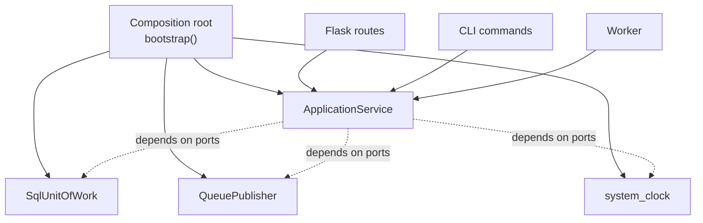

::part[Learn the Concept]{n="1"}

## 🎯 What you'll learn

- The **service layer**: one method per use case, independent of HTTP
- **DTOs**: what services return (and why not ORM/domain objects)
- **Domain errors** in services, mapped to HTTP status codes at the edge
- **Dependency injection** (constructor injection) and the **composition root**
- DI containers vs plain functions, and FastAPI's `Depends`
- Publishing events after commit (tying Stage D's Observer to Stage E)

## 🔤 Key words

| Word | In simple words | Bahasa Indonesia |
|---|---|---|
| **Service layer** | One method per use case, with the business rules | Lapisan kasus penggunaan |
| **Use case** | One thing a user wants to do ("apply to a job") | Satu tujuan pengguna |
| **DTO** | A plain object carrying data across a boundary | Objek pembawa data |
| **Domain error** | Your own error type, translated to HTTP at the edge | Kesalahan aturan bisnis |
| **Dependency injection** | Passing what a service needs into it | Menyuntikkan kebutuhan |
| **Constructor injection** | Passing those things when the object is created | Disuntik saat objek dibuat |
| **Composition root** | The one place that wires everything together | Titik perakitan |
| **DI container** | A library that does the wiring for you | Pustaka perakit |

## 🧠 The big idea

A hospital has a **reception desk** (routes), **doctors** (services) and **pharmacies, labs, records** (infrastructure). The receptionist doesn't diagnose; the doctor doesn't care whether a patient arrived by walk-in, phone or app; and which lab processes blood tests is decided by hospital management, not by each doctor.

- **Service layer** = the doctors: the use cases.
- **Routes/CLI/workers** = different reception desks for the same doctors.
- **Composition root** = management deciding which lab, pharmacy and records system everyone uses.

## ❓ Why it matters

As an app grows, the same use case gets triggered from several places: an API route, a CLI import command, a scheduled worker, an admin panel, later an AI agent tool (Module 7). If the logic lives in the route, it's either copied or impossible to reuse.

And if a service creates its own dependencies inside itself (`SmtpClient()`, `datetime.now()`), it can't be tested or reconfigured — the doctor buying their own lab equipment.

Put the use cases in services, pass their tools in, and decide the wiring in one place.

## 📖 Step by step

### 1. A use case per service method

```python
class ApplicationService:
    def __init__(self, uow: UnitOfWork, publisher: EventPublisher, clock: Clock):
        self.uow, self.publisher, self.clock = uow, publisher, clock

    def move(self, user_id: int, application_id: int, new_status: str) -> dict:
        with self.uow:
            application = self.uow.applications.get(application_id)
            if application is None or application.user_id != user_id:
                raise ApplicationNotFound()
            previous = application.status
            application.move_to(new_status)            # domain rule
            application.updated_at = self.clock()
            self.uow.commit()
            dto = to_dto(application)
        self.publisher.publish("application_status_changed", {"application_id": application_id, "from": previous, "to": new_status})
        return dto
```

The service **orchestrates**: load → check permissions → apply domain rules → persist → publish. Domain objects hold the rules themselves (`move_to`).

### 2. DTOs at the boundary

Returning ORM objects from a service leaks the database into everything that calls it — and one lazy-loaded attribute later blows up outside the session.

Services return **plain data** (dicts or small dataclasses), not ORM/domain objects:
- callers can't accidentally lazy-load or mutate persistent state after the transaction,
- the API shape can differ from the database shape,
- the same DTO works for JSON, CLI output or an LLM tool response.

### 3. Domain errors → HTTP at the edge

```python
class ApplicationNotFound(Exception): ...
class LimitReached(Exception): ...

# api.py — the only place that knows HTTP
app.register_error_handler(ApplicationNotFound, lambda e: error("not_found", 404))
app.register_error_handler(InvalidTransition, lambda e: error("invalid_transition", 409))
```

A CLI maps the same errors to exit codes and messages; a worker maps them to "don't retry".

### 4. Thin routes

```python
@app.post("/users/<int:user_id>/applications/<int:application_id>/status")
def move(user_id, application_id):
    body = request.get_json(silent=True) or {}
    return jsonify(service.move(user_id, application_id, body.get("status", "")))
```

Parse → call → serialize. If a route has an `if` about business rules, the rule is in the wrong place.

### 5. Dependency injection and the composition root

One place builds the objects: production wires real clients, tests wire fakes, the CLI wires the same services as the API. Nothing else needs to know.

**Constructor injection**: dependencies are parameters, not things the service creates.

**Composition root**: the single place that builds the object graph:

```python
def bootstrap(uow=None, publisher=None, clock=None) -> Container:
    return Container(
        applications=ApplicationService(
            uow=uow or SqlUnitOfWork(create_engine(settings.database_url)),
            publisher=publisher or QueuePublisher(redis_client),
            clock=clock or system_clock,
        )
    )

# production:  app = create_app(bootstrap())
# tests:       app = create_app(bootstrap(uow=FakeUnitOfWork(), publisher=RecordingPublisher(), clock=FixedClock(T0)))
```



### 6. Do I need a DI container library?

| Option | Notes |
|---|---|
| Plain `bootstrap()` function | enough for most Python apps; explicit and debuggable |
| Flask app factory + `app.extensions` | store the container on the app; routes read it |
| FastAPI `Depends` | built-in per-request injection (sessions, current user, services) |
| `dependency-injector`, `punq`, `lagom` | useful in very large apps; more magic to learn |

:::fastapi
In FastAPI, dependencies are declared as parameters: `def move(..., service: ApplicationService = Depends(get_application_service))`. Tests replace them with `app.dependency_overrides[get_application_service] = lambda: fake_service` — dependency injection built into the framework.
:::

### Choosing your setup

Every option here is a trade-off:

| Choice | ✅ | ❌ |
|---|---|---|
| Service layer | reusable use cases, testable without HTTP | another layer; can become a "pass-through" for trivial CRUD |
| Logic in routes | fastest to write for tiny apps | duplicated, hard to test, tied to HTTP |
| DTOs | stable API contracts, no leaking persistence | mapping code |
| Constructor injection | explicit, testable | wiring code; long constructors signal a class doing too much |
| DI container library | less manual wiring in huge apps | indirection, harder to trace |
| Module-level globals (`db`, `mail`) | convenient in Flask | hidden dependencies; tests need patching |

- ✅ Use cases called from more than one entry point, or with non-trivial rules.
- ✅ Anything touching external systems (email, payments, LLMs) you must fake in tests.
- 🚫 A service method that only calls `repository.get()` and returns it — let the route call a query helper, or accept the thin wrapper consciously for consistency.
- 🚫 Injecting pure utility functions (`slugify`) — just import them.

## ⚠️ Common mistakes

- Passing `request` or Flask `g` into services.
- Services returning ORM objects that routes then modify.
- Catching exceptions in services and returning `{"error": ...}` dicts (HTTP concerns leaking inward).
- Creating `datetime.now()`, `SmtpClient()` or `requests.post` directly inside service methods.

:::revoshop
(1) Compare a RevoShop route (e.g. `app/routes/orders.py`) with `OrderService`: does the route contain any business rules, or does it only parse, call and serialize? (2) Services are `@staticmethod`s that import repositories and `db` directly — what does that mean for dependency injection and for the mocks in `tests/unit`? (3) Sketch a `bootstrap()` for RevoShop that creates `OrderService(uow, payment_gateway, clock)` and how `create_app()` would use it.
:::

## 🏆 Best practices

- [ ] One service method per use case, named by intent (`move`, `add_application`, `import_jobs`).
- [ ] Services depend on **protocols** (UoW, publisher, clock, LLM client), never on Flask/`request`.
- [ ] Return **DTOs**; raise **domain errors**; map errors to HTTP/CLI at the edge.
- [ ] Keep routes to parse → call → serialize.
- [ ] Wire everything in **one composition root**; that's the only module importing concrete adapters.
- [ ] Inject the **clock** (and randomness/id generators) for deterministic tests.
- [ ] Publish events **after** commit.
- [ ] If a constructor needs 7+ dependencies, split the service.

::part[Explain & Design]{n="2"}

## 🗣️ Explain it

Explain to a teammate why the "move application status" rule should live in a service instead of the Flask route, using the hospital analogy — and name two other entry points that will need the same rule.

## 📐 Design it

CareerPilot adds an **AI assistant** (Module 7) that can call tools like "list my applications", "move application to interview" and "draft a follow-up email". The same actions exist as REST endpoints and a CLI. Design the service layer, DTOs, errors and composition root so the AI tools, API and CLI share logic. Include how you'd test an AI tool call without calling an LLM.

:::quiz
Show a possible design

**Services** (use cases, no HTTP/LLM knowledge):
- `ApplicationService.list(user_id, status=None) -> list[ApplicationDTO]`
- `ApplicationService.move(user_id, application_id, new_status) -> ApplicationDTO` (raises `ApplicationNotFound`, `InvalidTransition`)
- `FollowUpService.draft_email(user_id, application_id) -> DraftDTO` (depends on `LLMClient` port + `ApplicationRepository`)

**Entry points** (thin adapters):
- REST routes → map errors to 404/409, JSON DTOs.
- CLI → map errors to exit code 1 + message.
- **AI tool adapter** → each tool has a JSON schema; the handler validates arguments, calls the service with the **authenticated user id from the session (never from the LLM's arguments)**, returns the DTO as JSON; domain errors become tool error messages the model can explain ("That application is already rejected").

**Composition root** `bootstrap(settings, overrides)` builds `SqlUnitOfWork`, `AnthropicAdapter` (Stage D wrappers: retry/cache), `QueuePublisher`, `system_clock`, and the services; API, CLI, worker and agent runtime all call `bootstrap()`.

**Tests**: tool handlers are tested with a container of fakes (`FakeUnitOfWork`, `FakeLLMClient`) by calling the handler with tool arguments directly — no LLM needed. A separate eval suite (Module 7) checks that the model **chooses** the right tool.
:::

### 📝 Self-review checklist

- [ ] One implementation of each use case shared by all entry points
- [ ] Authorization uses trusted identity, not model-provided arguments
- [ ] Errors mapped per entry point
- [ ] Tool handlers testable without an LLM

::ai-review{task="design"}

::part[Toy Exercise]{n="3"}

:::exercise{path="exercises/architecture/e-backend-architecture/02-service-layer-di" ai="no-ai" title="Use cases, a composition root and a thin Flask API"}
Write an `ApplicationService` that validates, enforces a free-plan limit, commits through a unit of work and publishes events only after commit; a `bootstrap()` composition root with overridable dependencies; and a Flask adapter whose routes only translate HTTP. Tests also check which modules may import what.
:::

:::hints
- Do the plan-limit check **inside** `with self.uow:` so it reads committed data.
- Build the DTO before leaving the `with` block; publish after it.
- `bootstrap(uow=None, ...)`: `uow or adapters.InMemoryUnitOfWork()`.
- `app.register_error_handler(ExceptionType, handler)` keeps routes free of `try/except`.
:::

## ✅ Quick check

:::quiz
What is a composition root?

The single place (e.g. `bootstrap()` or `create_app()`) where concrete implementations are created and injected into services; the rest of the code depends only on abstractions.
:::

:::quiz
Why should services raise domain errors instead of returning HTTP responses?

So the same use case works for any entry point (API, CLI, worker, AI tool); each edge maps errors to its own format (status codes, exit codes, tool messages).
:::


## 📚 Keep learning

- [Cosmic Python — Service Layer](https://www.cosmicpython.com/book/chapter_04_service_layer.html)
- [Cosmic Python — Dependency Injection (and Bootstrapping)](https://www.cosmicpython.com/book/chapter_13_dependency_injection.html)
- [FastAPI docs: Dependencies](https://fastapi.tiangolo.com/tutorial/dependencies/)
