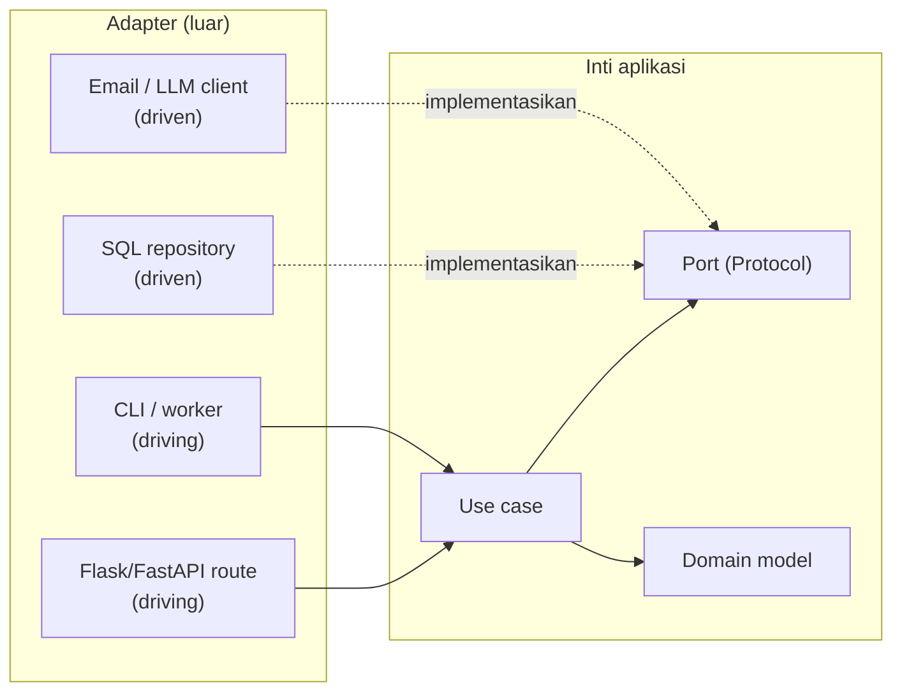

::part[Pelajari Konsepnya]{n="1"}

## 🎯 Yang akan kamu pelajari

- Arsitektur layered (Minggu 4) vs **Hexagonal** (ports & adapters) vs **Clean Architecture**
- **Dependency rule**: ketergantungan kode menunjuk ke dalam
- **Port** (interface yang dimiliki aplikasi) dan **adapter** (driving: HTTP/CLI; driven: DB/email/LLM)
- Struktur folder yang membuat batas jelas, dan pemeriksaan batas otomatis (`import-linter`)
- **Anti-pattern** backend: anemic domain, god service, leaky abstraction, distributed monolith, architecture astronautics
- Cara memilih **jumlah** arsitektur yang tepat untuk proyekmu

## 🔤 Istilah penting

| Istilah | Artinya (sederhana) |
|---|---|
| **Hexagonal architecture** | Inti logika dengan titik colokan di sekitarnya |
| **Port** | Kesepakatan (interface) yang dimiliki inti aplikasi |
| **Adapter** | Kode yang menghubungkan alat nyata ke sebuah port |
| **Driving adapter** | Sesuatu yang memanggil aplikasimu (HTTP, CLI) |
| **Driven adapter** | Sesuatu yang aplikasimu panggil (database, email, LLM) |
| **Dependency rule** | Ketergantungan kode menunjuk ke dalam, ke arah inti |
| **Anemic domain** | Objek dengan data tapi tanpa aturan bisnis |
| **Leaky abstraction** | Interface yang masih buka tutup alat di baliknya |
| **import-linter** | Alat yang merusak build kalau sebuah batas dilanggar |

## 🧠 Ide besarnya

Bayangkan sebuah **konsol game**. Konsol itu (logika intimu) punya **port**: port kontroler, port HDMI, port listrik. Apa pun yang sesuai dengan port itu bekerja — kontroler wireless, arcade stick, TV, projector. Konsol tidak berubah saat kamu membeli TV baru.

Hexagonal architecture membangun software sama caranya: inti menentukan port; dunia luar colokan lewat adapter.

## ❓ Kenapa ini penting

Framework, database dan vendor berubah lebih cepat daripada aturan bisnis. Tim sudah migrasi Flask → FastAPI, MySQL → PostgreSQL, SendGrid → SES, GPT → Claude — dan di codebase yang kusut setiap migrasi berarti menyentuh logika bisnis.

Membuat inti independen membuat pertukaran itu lokal, dan inti bisa ditest dalam milidetik. Analogi konsol berlaku: beli TV baru, konsol tetap.

Bahaya sebaliknya juga nyata — "architecture astronautics", di mana aplikasi kecil dapat lima layer dan dua belas interface yang tidak dibutuhkan siapa pun. Bagian terakhir materi ini tentang memilih jumlah **yang benar**.

## 📖 Cara kerjanya, langkah demi langkah

### 1. Dari layer ke heksagon

**Layered** (Minggu 4): routes → services → repositories → database. Sederhana dan bagus. Tapi service layer masih bergantung **ke bawah** pada concrete repositories/ORM.

**Hexagonal / Clean**: aplikasi **memiliki interface** untuk apa yang dibutuhkannya; infrastruktur menerapkannya. Ketergantungan menunjuk **ke dalam**:



### 2. Dependency rule

Satu kalimat: yang di dalam tidak boleh impor yang di luar. Aturan bisnis tidak boleh impor Flask, SQLAlchemy atau boto3 — ini adalah colokan, bukan konsol.

> Ketergantungan kode menunjuk hanya **ke dalam**. Layer dalam tidak tahu tentang layer luar.

| Layer | Berisi | Tahu tentang |
|---|---|---|
| **Domain** | entity, value object, aturan (`JobPosting`, `match_score`) | tidak ada lagi |
| **Application** | use case, port (`ImportJobs`, protokol `JobFeed`) | domain |
| **Adapter** | SQL repository, HTTP route, CLI, email/LLM client | application + domain |
| **Composition root** (entrypoint/bootstrap) | koneksi kabel | semuanya |

"Clean Architecture" (Robert C. Martin) dan "Onion Architecture" menggambar ide yang sama sebagai lingkaran konsentris dengan nama sedikit berbeda.

### 3. Port dan adapter

```python
# application/ports.py — owned by the core
class JobFeed(Protocol):
    def fetch_jobs(self) -> list[JobPosting]: ...

# adapters/json_feed.py — implements the port
class JsonFileFeed:
    def fetch_jobs(self) -> list[JobPosting]:
        return [JobPosting(...) for item in json.loads(self.path.read_text())]
```

- **Driving (primary) adapter** memanggil aplikasi: HTTP route, CLI, pekerjaan terjadwal, consumer message, alat agen AI.
- **Driven (secondary) adapter** dipanggil aplikasi lewat port: database, email, payment gateway, LLM API, penyimpanan file.

### 4. Struktur folder yang menunjukkan batas-batasnya

```text
careerpilot/
├── domain/            model.py, rules.py, errors.py
├── application/       ports.py, use_cases/ (import_jobs.py, move_application.py)
├── adapters/
│   ├── persistence/   sqlalchemy_repositories.py, unit_of_work.py
│   ├── notifications/ email.py, whatsapp.py
│   ├── llm/           anthropic_client.py
│   └── http/          flask_routes.py
└── entrypoints/       wsgi.py, cli.py, worker.py, bootstrap.py
```

Alternatif: **package by feature** (`applications/`, `jobs/`, `billing/`, masing-masing dengan domain/application/adapter sendiri). Codebase besar sering gabungin dua: fitur dulu, layer di dalamnya.

### 5. Enforce batas otomatis

Aturan yang tidak diperiksa siapa pun jadi saran. Pemeriksaan batas di CI mengubah "tolong jangan impor database di sini" jadi build yang gagal.

Aturan di README dibobol di bawah tekanan deadline. Otomatisasi:

```ini
# .importlinter
[importlinter:contract:layers]
name = Hexagonal layers
type = layers
layers =
    careerpilot.entrypoints
    careerpilot.adapters
    careerpilot.application
    careerpilot.domain
```

`lint-imports` di CI merusak build saat `domain` impor `adapters`. (Latihan handbook ini memakai pemeriksaan AST kecil untuk tujuan yang sama.)

### 6. Framework mana yang pergi?

- Flask/FastAPI: **adapter** (route) + entrypoint (app factory).
- SQLAlchemy model: **adapter** (persistence) — atau terima ORM model sebagai domain untuk pragmatisme (trade-off yang didokumentasikan).
- Pydantic/marshmallow schema: di **tepi** untuk validasi/serialisasi; domain bisa pakai dataclass.

### 7. Anti-pattern untuk dikenali

| Anti-pattern | Gejala | Perbaikan |
|---|---|---|
| **Anemic domain model** | entity adalah tas field; semua aturan hidup di service besar | pindahkan aturan ke object domain (`application.move_to`) |
| **God service** | `ApplicationService` dengan 40 method dan 12 dependency | bagi berdasar use case/fitur |
| **Leaky abstraction** | repository mengembalikan `Query`; service bangun SQL | kembalikan domain object; tambah method repository spesifik |
| **Framework coupling** | `request` / `current_app` dipakai di dalam service | berikan nilai/port |
| **Shared mutable global** | toko level modul, singleton | inject lewat composition root |
| **Distributed monolith** | "microservice" yang harus deploy bersama dan bagikan satu database | modular monolith dulu; bagi hanya di batas nyata (Module 5) |
| **Architecture astronautics** | 6 layer dan 20 interface untuk aplikasi CRUD | cocokkan arsitektur ke kompleksitas; YAGNI |
| **Big ball of mud** | tidak ada batas sama sekali | perkenalkan seam secara bertahap (strangler approach) |

### 8. Berapa banyak arsitektur yang kamu butuh?

| Proyek | Struktur yang disarankan |
|---|---|
| Prototype, hackathon, CRUD kecil | satu modul atau Flask blueprint dengan ORM di route |
| Typical product API (RevoShop, CareerPilot Phase 2) | **layered**: route → service → repository, DI untuk eksternal service |
| Domain kaya, banyak integrasi, hidup lama, beberapa entry point (CareerPilot Phase 3–7) | **hexagonal** inti dengan port untuk LLM, pembayaran, notifikasi, penyimpanan |
| Banyak tim, scaling independen | modular monolith → service di sepanjang bounded context |

### Memilih pengaturanmu

Setiap pilihan di sini adalah trade-off:

| Pilihan | ✅ | ❌ |
|---|---|---|
| Layered | sederhana, familiar, cukup untuk kebanyakan API | logika bisnis masih terikat pada pilihan persistence |
| Hexagonal/Clean | inti independen framework dan vendor; sangat testable | lebih interface, mapping dan file; kurva belajar |
| ORM model sebagai domain | kode mapping lebih sedikit | domain bergantung SQLAlchemy; test butuh setup lebih |
| Package by layer | batas teknis jelas | fitur menyebar ke banyak folder |
| Package by feature | fitur kohesif | batas antar fitur butuh aturan sendiri |

- ✅ Produk jangka panjang dengan aturan berarti dan beberapa sistem eksternal (pembayaran, LLM, notifikasi).
- ✅ Saat logika yang sama harus jalan dari API, CLI, worker dan agent.
- 🚫 Prototype jangka pendek atau CRUD sederhana — kirim dengan sederhana dan refactor saat rasa sakit muncul.
- 🚫 Sebagai alasan menunda pengiriman: arsitektur harus melayani pengiriman.

## ⚠️ Kesalahan umum

- Buat port untuk semuanya, termasuk pure helper function.
- Adapter yang berisi aturan bisnis ("jika pekerjaan remote, skor +10" di dalam JSON parser).
- Domain object impor Pydantic/SQLAlchemy "hanya untuk kemudahan" tanpa memutuskan secara sadar.
- Panggilnya "clean architecture" sementara service masih `import requests`.

:::revoshop
Petakan RevoShop ke heksagon: (1) Folder mana yang driving adapter (`routes/`), driven adapter (`repositories/`, `integrations/midtrans.py`), application (`services/`), domain (`models/`?)? (2) Domain adalah SQLAlchemy model dengan `to_dict()` — pilihan pragmatis; apa biayanya? (3) Tulis kontrak layer `.importlinter` untuk RevoShop dan jalankan `uv tool run --from import-linter lint-imports` (atau pikirkan): impor mana yang akan langgar aturan hari ini? (4) Pilih satu anti-pattern dari tabel yang RevoShop tunjukkan dan satu yang dihindarinya.
:::

## 🏆 Praktik terbaik

- [ ] Tulis **dependency rule** dan **enforce di CI** (import-linter atau test).
- [ ] Jaga domain bebas I/O dan framework; letakkan aturan di entity/value object.
- [ ] Tentukan port **di application layer**, dibentuk oleh apa yang use case butuh.
- [ ] Satu composition root per process (web, worker, CLI) — satu-satunya tempat adapter konkret bertemu.
- [ ] Map di tepi: request schema → command/DTO → domain → DTO → response.
- [ ] Lebih suka **modular monolith** dengan batas jelas sebelum microservice.
- [ ] Catat keputusan berarti sebagai **ADR** (Architecture Decision Record) singkat: konteks, keputusan, akibat.
- [ ] Refactor menuju batas secara bertahap; jangan tulis ulang.

::part[Jelaskan & Rancang]{n="2"}

## 🗣️ Jelaskan

Jelaskan hexagonal architecture ke founder non-teknis memakai analogi konsol game, lalu jelaskan kenapa ia membuat pergantian dari satu email provider ke yang lain menjadi pekerjaan sehari bukan sebulan.

## 📐 Rancang

CareerPilot Phase 3 tambah service AI yang skor CV lawan pekerjaan. Persyaratan: endpoint FastAPI dan worker latar belakang; CV disimpan di S3 (folder lokal di development); embedding dari API embedding; skor disimpan di PostgreSQL; provider LLM bisa berubah. Rancang heksagon: konsep domain, use case, port, driving dan driven adapter, composition root, dan satu aturan batas yang kamu enforce di CI.

:::quiz
Tunjukkan rancangan yang mungkin

**Domain**: `Cv` (id, owner, text), `JobDescription`, `MatchScore` (nilai 0–100, alasan), aturan seperti `combine(skill_overlap, semantic_similarity)`.

**Application (use case)**: `UploadCv`, `ScoreCvAgainstJob`, `ExplainScore`.

**Port** (di `application/ports.py`):
- `CvStorage.save(owner_id, file) -> CvRef`, `load_text(ref) -> str`
- `EmbeddingModel.embed(texts) -> list[Vector]`
- `LLMClient.complete(request) -> Completion`
- `ScoreRepository.add(score)`, `latest_for(cv_id, job_id)`
- `UnitOfWork`, `Clock`, `EventPublisher`

**Driving adapter**: FastAPI route (upload, score, explain), consumer worker antrean (`score_requested` event), CLI untuk backfill.

**Driven adapter**: `S3CvStorage` / `LocalFolderCvStorage`; `OpenAIEmbeddings` / `LocalSentenceTransformers`; `AnthropicClient` dibungkus retry/cache decorator; `SqlScoreRepository` + `SqlUnitOfWork`; `SqsPublisher`.

**Composition root**: `api_bootstrap(settings)` dan `worker_bootstrap(settings)` pilih adapter dari setting (`STORAGE=s3|local`, `LLM_PROVIDER=...`).

**CI rule** (import-linter layer): `entrypoint → adapter → application → domain`; plus kontrak "forbidden": `careerpilot_ai.application` dan `.domain` tidak boleh impor `boto3`, `openai`, `anthropic`, `fastapi`, `sqlalchemy`.
:::

### 📝 Checklist review mandiri

- [ ] Vendor SDK hanya di adapter
- [ ] Port dibentuk oleh use case
- [ ] Composition root terpisah per process
- [ ] Aturan batas konkret dan bisa diotomatisasi

::ai-review{task="design"}

::part[Latihan Kecil]{n="3"}

:::exercise{path="exercises/architecture/e-backend-architecture/03-hexagonal" ai="no-ai" title="Refactor paket kusut ke port dan adapter"}
Paket job-recommendation yang bekerja punya ketergantungan menunjuk arah salah: I/O di domain, adapter diimpor use case, global state. Refactor — file sama — supaya dependency rule berlaku (diperiksa analisis import), use case terima port yang diinjeksi, dan CLI jadi composition root. Behavior test menjalankan use case dengan fake dan CLI end to end.
:::

:::hints
- Mulai dari `application/ports.py`: tulis tiga Protocol yang use case butuh.
- Ubah `import_jobs(path)` jadi class `ImportJobs(feed, store)` dengan `__call__`.
- Pindahkan parsing file dari domain ke `adapters/json_feed.py`; hapus impor notifier dari domain.
- CLI buat `InMemoryJobStore()`, `JsonFileFeed(path)` dan `ConsoleNotifier(stream)` dan berikan masuk.
:::

## ✅ Cek cepat

:::quiz
Nyatakan dependency rule dalam satu kalimat.

Ketergantungan kode menunjuk ke dalam saja: domain tahu tidak tentang application, dan tidak satupun tahu tentang adapter, framework atau infrastruktur.
:::

:::quiz
Apa bedanya driving adapter dan driven adapter?

Driving adapter memanggil masuk aplikasi (HTTP route, CLI, worker); driven adapter dipanggil aplikasi lewat port (database, email, LLM atau client pembayaran).
:::


## 📚 Lanjut belajar

- [Alistair Cockburn: Hexagonal Architecture](https://alistair.cockburn.us/hexagonal-architecture/)
- [Dokumentasi import-linter](https://import-linter.readthedocs.io/)
- [Martin Fowler: AnemicDomainModel](https://martinfowler.com/bliki/AnemicDomainModel.html)

## 📣 Stage E selesai — bagikan

:::linkedin{type="concept"}
🏛️ Aku refactor proyek Python kecil ke port & adapter — dan test jadi 10× lebih sederhana.

Sebelum: domain baca file JSON, use case buat storage sendiri, dan toko global bocor antar test.

Sesudah:
- Domain: aturan murni (tanpa I/O, tanpa framework)
- Application: use case + Protocol untuk apa yang mereka butuh
- Adapter: JSON feed, in-memory store, console notifier
- CLI: satu-satunya tempat yang menyambung semuanya

Test sekarang cek arah impor otomatis, jadi batas tidak bisa tenang erosi.

Trade-off yang jujur: lebih banyak file. Untuk aplikasi CRUD, struktur layered sederhana cukup — aku pakai ini saat aturan bisnis dan integrasi tumbuh.

#SoftwareArchitecture #CleanArchitecture #Python #LearningInPublic
:::
