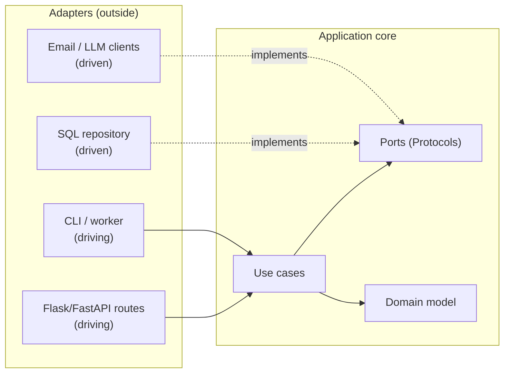

::part[Learn the Concept]{n="1"}

## 🎯 What you'll learn

- Layered architecture (Week 4) vs **Hexagonal** (ports & adapters) vs **Clean Architecture**
- The **dependency rule**: source code dependencies point inward
- **Ports** (interfaces owned by the application) and **adapters** (driving: HTTP/CLI; driven: DB/email/LLM)
- Folder structures that make boundaries visible, and **automated** boundary checks (`import-linter`)
- Backend **anti-patterns**: anemic domain, god service, leaky abstractions, distributed monolith, architecture astronautics
- How to choose the *amount* of architecture for your project

## 🔤 Key words

| Word | In simple words | Bahasa Indonesia |
|---|---|---|
| **Hexagonal architecture** | Core logic with plug-in points around it | Arsitektur inti dan colokan |
| **Port** | An interface the core owns and others must fit | Kesepakatan colokan |
| **Adapter** | Code that plugs a real tool into a port | Penghubung ke alat nyata |
| **Driving adapter** | Something that calls your app (HTTP, CLI) | Pemanggil aplikasi |
| **Driven adapter** | Something your app calls (database, email, LLM) | Yang dipanggil aplikasi |
| **Dependency rule** | Source code dependencies point inwards, towards the core | Arah ketergantungan ke dalam |
| **Anemic domain** | Objects with data but no rules, so rules scatter | Objek tanpa aturan |
| **Leaky abstraction** | An interface that still exposes the tool behind it | Abstraksi yang bocor |
| **import-linter** | A tool that fails the build when a boundary is crossed | Pemeriksa batas impor |

## 🧠 The big idea

Picture a **game console**. The console (your core logic) has **ports**: controller ports, an HDMI port, a power port. Anything that fits the port works — a wireless controller, an arcade stick, a TV, a projector. The console never changes when you buy a new TV.

Hexagonal architecture builds software the same way: the core defines ports; the outside world plugs in through adapters.

## ❓ Why it matters

Frameworks, databases and vendors change faster than business rules. Teams have migrated Flask → FastAPI, MySQL → PostgreSQL, SendGrid → SES, GPT → Claude — and in a tangled codebase every one of those migrations means touching business logic.

Keeping the core independent makes those swaps local, and lets the core be tested in milliseconds. The console analogy holds: buy a new TV, keep the console.

The opposite danger is real too — "architecture astronautics", where a small app gets five layers and twelve interfaces nobody needs. The last section of this lesson is about choosing the right *amount*.

## 📖 Step by step

### 1. From layers to hexagon

**Layered** (Week 4): routes → services → repositories → database. Simple and good. But the service layer still depends **downward** on concrete repositories/ORM.

**Hexagonal / Clean**: the application **owns interfaces** for what it needs; infrastructure implements them. Dependencies point **inward**:



### 2. The dependency rule

One sentence: the inside may not import the outside. Business rules must not import Flask, SQLAlchemy or boto3 — those are plugs, not the console.

> Source code dependencies only point **inward**. Inner layers know nothing about outer layers.

| Layer | Contains | Knows about |
|---|---|---|
| **Domain** | entities, value objects, rules (`JobPosting`, `match_score`) | nothing else |
| **Application** | use cases, ports (`ImportJobs`, `JobFeed` protocol) | domain |
| **Adapters** | SQL repositories, HTTP routes, CLI, email/LLM clients | application + domain |
| **Composition root** (entrypoint/bootstrap) | wiring | everything |

"Clean Architecture" (Robert C. Martin) and "Onion Architecture" draw the same idea as concentric circles with slightly different names.

### 3. Ports and adapters

```python
# application/ports.py — owned by the core
class JobFeed(Protocol):
    def fetch_jobs(self) -> list[JobPosting]: ...

# adapters/json_feed.py — implements the port
class JsonFileFeed:
    def fetch_jobs(self) -> list[JobPosting]:
        return [JobPosting(...) for item in json.loads(self.path.read_text())]
```

- **Driving (primary) adapters** call the application: HTTP routes, CLI, scheduled jobs, message consumers, AI agent tools.
- **Driven (secondary) adapters** are called by the application through ports: databases, email, payment gateways, LLM APIs, file storage.

### 4. A folder structure that shows the boundaries

```text
careerpilot/
├── domain/            model.py, rules.py, errors.py
├── application/       ports.py, use_cases/ (import_jobs.py, move_application.py)
├── adapters/
│   ├── persistence/   sqlalchemy_repositories.py, unit_of_work.py
│   ├── notifications/ email.py, whatsapp.py
│   ├── llm/           anthropic_client.py
│   └── http/          flask_routes.py
└── entrypoints/       wsgi.py, cli.py, worker.py, bootstrap.py
```

Alternative: **package by feature** (`applications/`, `jobs/`, `billing/`, each with its own domain/application/adapters). Big codebases often combine both: features first, layers inside.

### 5. Enforce boundaries automatically

A rule nobody checks becomes a suggestion. A boundary check in CI turns "please don't import the database here" into a failing build.

Rules in a README get broken under deadline pressure. Automate them:

```ini
# .importlinter
[importlinter:contract:layers]
name = Hexagonal layers
type = layers
layers =
    careerpilot.entrypoints
    careerpilot.adapters
    careerpilot.application
    careerpilot.domain
```

`lint-imports` in CI fails the build when `domain` imports `adapters`. (This handbook's exercises use small AST checks for the same purpose.)

### 6. Where do frameworks go?

- Flask/FastAPI: **adapters** (routes) + entrypoints (app factory).
- SQLAlchemy models: **adapters** (persistence) — or accept ORM models as your domain for pragmatism (a documented trade-off).
- Pydantic/marshmallow schemas: at the **edges** for validation/serialization; the domain can use dataclasses.

### 7. Anti-patterns to recognize

| Anti-pattern | Symptom | Fix |
|---|---|---|
| **Anemic domain model** | entities are bags of fields; all rules live in huge services | move rules into domain objects (`application.move_to`) |
| **God service** | `ApplicationService` with 40 methods and 12 dependencies | split by use case/feature |
| **Leaky abstraction** | repository returns `Query`; services build SQL | return domain objects; add specific repository methods |
| **Framework coupling** | `request` / `current_app` used deep inside services | pass values/ports in |
| **Shared mutable globals** | module-level stores, singletons | inject via composition root |
| **Distributed monolith** | "microservices" that must deploy together and share one database | modular monolith first; split only along real boundaries (Module 5) |
| **Architecture astronautics** | 6 layers and 20 interfaces for a CRUD app | match architecture to complexity; YAGNI |
| **Big ball of mud** | no boundaries at all | introduce seams gradually (strangler approach) |

### 8. How much architecture do you need?

| Project | Suggested structure |
|---|---|
| Prototype, hackathon, tiny CRUD | single module or Flask blueprints with ORM in routes |
| Typical product API (RevoShop, CareerPilot Phase 2) | **layered**: routes → services → repositories, DI for external services |
| Rich domain, many integrations, long life, several entry points (CareerPilot Phases 3–7) | **hexagonal** core with ports for LLM, payments, notifications, storage |
| Many teams, independent scaling | modular monolith → services along bounded contexts |

### Choosing your setup

Every option here is a trade-off:

| Choice | ✅ | ❌ |
|---|---|---|
| Layered | simple, familiar, enough for most APIs | business logic still coupled to persistence choices |
| Hexagonal/Clean | framework- and vendor-independent core; very testable | more interfaces, mapping and files; learning curve |
| ORM models as domain | less mapping code | domain depends on SQLAlchemy; tests need more setup |
| Package by layer | clear technical boundaries | a feature spreads across many folders |
| Package by feature | cohesive features | boundaries between features need their own rules |

- ✅ Long-lived products with meaningful rules and several external systems (payments, LLMs, notifications).
- ✅ When the same logic must run from API, CLI, workers and agents.
- 🚫 Short-lived prototypes or simple CRUD — ship it simply and refactor when the pain appears.
- 🚫 As a reason to delay shipping: architecture should serve delivery.

## ⚠️ Common mistakes

- Creating ports for everything, including pure helper functions.
- Adapters that contain business rules ("if the job is remote, score +10" inside the JSON parser).
- Domain objects importing Pydantic/SQLAlchemy "just for convenience" without deciding it consciously.
- Calling it "clean architecture" while services still `import requests`.

:::revoshop
Map RevoShop to the hexagon: (1) Which folders are driving adapters (`routes/`), driven adapters (`repositories/`, `integrations/midtrans.py`), application (`services/`), domain (`models/`?)? (2) The domain is SQLAlchemy models with `to_dict()` — a pragmatic choice; what's its cost? (3) Write an `.importlinter` layers contract for RevoShop and run `uv tool run --from import-linter lint-imports` (or reason it through): which imports would break the rule today? (4) Pick one anti-pattern from the table that RevoShop shows and one it avoids.
:::

## 🏆 Best practices

- [ ] Write down the **dependency rule** and **enforce it in CI** (import-linter or tests).
- [ ] Keep the domain free of I/O and frameworks; put rules on entities/value objects.
- [ ] Define ports **in the application layer**, shaped by what use cases need.
- [ ] One composition root per process (web, worker, CLI) — the only place concrete adapters meet.
- [ ] Map at the edges: request schema → command/DTO → domain → DTO → response.
- [ ] Prefer a **modular monolith** with clear boundaries before microservices.
- [ ] Record significant decisions as short **ADRs** (Architecture Decision Records): context, decision, consequences.
- [ ] Refactor toward boundaries incrementally; don't rewrite.

::part[Explain & Design]{n="2"}

## 🗣️ Explain it

Explain hexagonal architecture to a non-technical founder using the game console analogy, then explain why it made switching from one email provider to another a one-day task instead of a one-month project.

## 📐 Design it

CareerPilot Phase 3 adds an AI service that scores CVs against jobs. Requirements: FastAPI endpoints and a background worker; CVs stored in S3 (local folder in development); embeddings from an embedding API; scores stored in PostgreSQL; the LLM provider may change. Design the hexagon: domain concepts, use cases, ports, driving and driven adapters, composition roots, and one boundary rule you'd enforce in CI.

:::quiz
Show a possible design

**Domain**: `Cv` (id, owner, text), `JobDescription`, `MatchScore` (value 0–100, reasons), rules like `combine(skill_overlap, semantic_similarity)`.

**Application (use cases)**: `UploadCv`, `ScoreCvAgainstJob`, `ExplainScore`.

**Ports** (in `application/ports.py`):
- `CvStorage.save(owner_id, file) -> CvRef`, `load_text(ref) -> str`
- `EmbeddingModel.embed(texts) -> list[Vector]`
- `LLMClient.complete(request) -> Completion`
- `ScoreRepository.add(score)`, `latest_for(cv_id, job_id)`
- `UnitOfWork`, `Clock`, `EventPublisher`

**Driving adapters**: FastAPI routes (upload, score, explain), a queue consumer worker (`score_requested` events), a CLI for backfills.

**Driven adapters**: `S3CvStorage` / `LocalFolderCvStorage`; `OpenAIEmbeddings` / `LocalSentenceTransformers`; `AnthropicClient` wrapped in retry/cache decorators; `SqlScoreRepository` + `SqlUnitOfWork`; `SqsPublisher`.

**Composition roots**: `api_bootstrap(settings)` and `worker_bootstrap(settings)` choose adapters by settings (`STORAGE=s3|local`, `LLM_PROVIDER=...`).

**CI rule** (import-linter layers): `entrypoints → adapters → application → domain`; plus a "forbidden" contract: `careerpilot_ai.application` and `.domain` may not import `boto3`, `openai`, `anthropic`, `fastapi`, `sqlalchemy`.
:::

### 📝 Self-review checklist

- [ ] Vendor SDKs only in adapters
- [ ] Ports shaped by use cases
- [ ] Separate composition roots per process
- [ ] A concrete, automatable boundary rule

::ai-review{task="design"}

::part[Toy Exercise]{n="3"}

:::exercise{path="exercises/architecture/e-backend-architecture/03-hexagonal" ai="no-ai" title="Refactor a tangled package into ports and adapters"}
A working job-recommendation package has its dependencies pointing the wrong way: I/O in the domain, adapters imported by use cases, global state. Refactor it — same files — so the dependency rule holds (checked by import analysis), use cases accept injected ports, and the CLI becomes the composition root. Behavior tests run the use cases with fakes and the CLI end to end.
:::

:::hints
- Start with `application/ports.py`: write the three Protocols the use cases need.
- Turn `import_jobs(path)` into a class `ImportJobs(feed, store)` with `__call__`.
- Move file parsing from the domain into `adapters/json_feed.py`; delete the notifier import from the domain.
- The CLI creates `InMemoryJobStore()`, `JsonFileFeed(path)` and `ConsoleNotifier(stream)` and passes them in.
:::

## ✅ Quick check

:::quiz
State the dependency rule in one sentence.

Source code dependencies point inward only: the domain knows nothing about the application, and neither knows about adapters, frameworks or infrastructure.
:::

:::quiz
What's the difference between a driving and a driven adapter?

Driving adapters call into the application (HTTP routes, CLI, workers); driven adapters are called by the application through ports (databases, email, LLM or payment clients).
:::


## 📚 Keep learning

- [Alistair Cockburn: Hexagonal Architecture](https://alistair.cockburn.us/hexagonal-architecture/)
- [import-linter documentation](https://import-linter.readthedocs.io/)
- [Martin Fowler: AnemicDomainModel](https://martinfowler.com/bliki/AnemicDomainModel.html)

## 📣 Stage E done — share it

:::linkedin{type="concept"}
🏛️ I refactored a small Python project into ports & adapters — and the tests got 10× simpler.

Before: the domain read JSON files, use cases created their own storage, and a global store leaked between tests.

After:
- Domain: pure rules (no I/O, no frameworks)
- Application: use cases + Protocols for what they need
- Adapters: JSON feed, in-memory store, console notifier
- CLI: the single place that wires everything together

A test now checks the import direction automatically, so the boundaries can't quietly erode.

The honest trade-off: more files. For a CRUD app, a simple layered structure is enough — I'd use this where business rules and integrations grow.

#SoftwareArchitecture #CleanArchitecture #Python #LearningInPublic
:::
