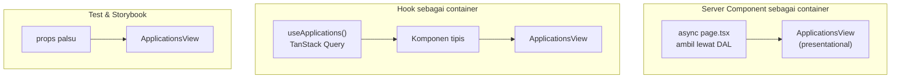

::part[Pelajari Konsepnya]{n="1"}

## 🎯 Yang akan kamu pelajari

- Pemisahan **container/presentational** dan masalah yang dipecahkannya
- Membuat model UI state sebagai **discriminated union** (`loading | error | ready`)
- **Menyuntik** data loader ke dalam container (dependency injection untuk frontend)
- Bentuk modern: **Server Component sebagai container**, hooks sebagai "container tanpa component"
- Test setiap bagian, dan pakai presentational component di Storybook
- Kapan pemisahan membantu dan kapan itu hanya formalitas

## 🔤 Istilah penting

| Istilah | Artinya (sederhana) |
|---|---|
| **Presentational component** | Komponen yang hanya menampilkan apa yang diberikan; tidak mengambil data |
| **Container component** | Komponen yang mengambil data dan menangani state, lalu mengirimnya ke bawah |
| **Props** | Nilai yang dikirim ke dalam komponen |
| **UI state** | Situasi layar sedang apa: loading, error, atau ready |
| **Discriminated union** | Tipe yang punya satu field yang menentukan bentuk mana yang dipakai |
| **Injected loader** | Fungsi pengambil data yang disuntik ke dalam komponen |
| **Server Component** | Komponen yang jalan di server — bentuk container hari ini |
| **Storybook** | Alat untuk melihat komponen terpisah dengan data palsu |

## 🧠 Ide besarnya

Bayangkan **TV** dan **kotak kabel**. TV-nya (presentational) hanya menampilkan sinyal apa pun yang diterima — tidak tahu apakah dari kabel, laptop atau game console. Kotak kabel (container) tahu di mana dapat channel, menangani langganan dan error, lalu mengirim sinyal ke TV.

Kamu bisa test TV dengan generator sinyal apa saja, dan ganti kotak kabel dengan streaming stick tanpa membeli TV baru.

## ❓ Kenapa ini penting

Komponen yang sekaligus mengambil data, mengubah data, menangani error dan render itu sulit untuk:

- **di-test** — setiap test butuh mock `fetch` dan tunggu pekerjaan async
- **dipakai ulang** — daftar kartu yang sama butuh dari endpoint berbeda di dashboard, dan di Storybook dari data palsu
- **dibaca** — markup tersembunyi di tengah effects dan error handling.

Memisahkannya itu TV dan kotak kabel: TV bekerja dengan sinyal apa pun, dan kamu bisa ganti kotak tanpa membeli TV baru.

Tidak selalu worth it — untuk komponen kecil yang mengambil satu hal, pemisahan itu hanya formalitas.

## 📖 Langkah demi langkah

### 1. Modelkan state secara eksplisit

Memberi nama state (`loading | error | ready`) menghilangkan keluarga bug besar: kamu tidak bisa render data yang belum ada, karena tipe tidak izin.

```ts
export type ViewState =
  | { kind: "loading" }
  | { kind: "error"; message: string }
  | { kind: "ready"; items: Item[] };
```

Discriminated union membuat state mustahil jadi mustahil (tidak ada "loading **dan** error") dan TypeScript memaksa setiap state ditangani.

### 2. Presentational: props masuk, markup keluar

```tsx
type Props = { state: ViewState; status: string; onStatusChange(status: string): void; onRetry(): void };

export function ApplicationsView({ state, status, onStatusChange, onRetry }: Props) {
  return (
    <section>
      <StatusSelect value={status} onChange={onStatusChange} />
      {state.kind === "loading" && <p role="status">Loading applications…</p>}
      {state.kind === "error" && <div role="alert">{state.message} <button onClick={onRetry}>Retry</button></div>}
      {state.kind === "ready" && (state.items.length === 0 ? <EmptyState /> : <ApplicationList items={state.items} />)}
    </section>
  );
}
```

Aturan jempol: tidak ada fetch, tidak ada global store, tidak ada router; local UI state (hover, menu terbuka) boleh.

### 3. Container: state, effects, kabel penghubung

```tsx
"use client";
export function ApplicationsContainer({ loadApplications }: { loadApplications(status: string, signal: AbortSignal): Promise<Item[]> }) {
  const [status, setStatus] = useState("all");
  const [state, setState] = useState<ViewState>({ kind: "loading" });
  const [attempt, setAttempt] = useState(0);

  useEffect(() => {
    const controller = new AbortController();
    setState({ kind: "loading" });
    loadApplications(status, controller.signal).then(
      (items) => !controller.signal.aborted && setState({ kind: "ready", items }),
      () => !controller.signal.aborted && setState({ kind: "error", message: "Couldn't load applications" }),
    );
    return () => controller.abort();
  }, [status, attempt, loadApplications]);

  return <ApplicationsView state={state} status={status} onStatusChange={setStatus} onRetry={() => setAttempt((n) => n + 1)} />;
}
```

Loader **disuntik**: production meneruskan `applicationsClient.list`; test meneruskan yang palsu dengan waktu bisa dikontrol. (Teruskan fungsi yang **stabil** — arrow inline akan fetch ulang setiap render.)

### 4. Bentuk modern dari ide yang sama

Pola tidak hilang — bergerak. Server Component atau custom hook adalah container; komponen yang terima props dan render markup tetap TV.



```tsx
// app/(app)/applications/page.tsx — a Server Component is a natural container
export default async function ApplicationsPage({ searchParams }: PageProps<"/applications">) {
  const filters = parseJobFilters(await searchParams);
  const items = await getApplications(filters);         // DAL, server-only
  return <ApplicationsView state={{ kind: "ready", items }} … />;
}
```

Dengan TanStack Query, `useApplications(status)` **adalah** logika container; komponen jadi adapter satu baris dari query state ke `ViewState`.

### Memilih setup kamu

Setiap pilihan di sini ada trade-off:

| | ✅ | ❌ |
|---|---|---|
| Pisah | view murni, bisa di-test; reuse; Storybook-friendly; sumber data bisa berubah | lebih banyak file dan props; indirection untuk komponen kecil |
| Semua-dalam-satu | cepat untuk komponen kecil, sekali pakai | sulit di-test dan ubah saat berkembang |
| Server Component container | data di server, nol client JS untuk loading | hanya untuk data yang ada saat request |

- ✅ View dengan beberapa state (loading/error/empty/ready) atau dipakai di lebih dari satu tempat.
- ✅ Komponen style system yang harus render di Storybook dengan data palsu.
- 🚫 Komponen 15-baris yang dipakai sekali — pemisahan tambah noise.
- 🚫 Jangan bikin "container" yang hanya teruskan props — biarkan page atau hook lakukan.

## ⚠️ Kesalahan umum

- Presentational component yang diam-diam panggil `useRouter` atau store "hanya untuk satu hal".
- Boolean soup: `isLoading`, `isError`, `data` yang bisa kontradiksi.
- Teruskan fungsi loader inline ke container yang bergantung padanya → fetch ulang tanpa henti.
- Pisah semuanya, termasuk komponen tanpa state.

## 🏆 Praktik terbaik

- [ ] Modelkan async UI sebagai discriminated union; tangani setiap `kind`.
- [ ] Presentational component: hanya props, tidak ada fetch data atau global store.
- [ ] Container (atau hook/Server Component) punya data, effects dan kabel penghubung — dan tidak render apa pun lagi.
- [ ] Suntik dependency (loader, client) untuk bisa di-test; jaganya agar stabil.
- [ ] Pilih Server Component sebagai container di App Router kalau data diketahui saat request.
- [ ] Tulis story/test untuk setiap view state.

::part[Jelaskan & Rancang]{n="2"}

## 🗣️ Jelaskan

Jelaskan analogi TV dan kotak kabel ke rekan kerja, lalu jelaskan bagaimana halaman Server Component memainkan peran "kotak kabel" di Next.js.

## 📐 Rancang

Dashboard **CareerPilot** menampilkan stat card, chart pipeline dan daftar aktivitas terbaru. Stat dan aktivitas datang dari API saat request; chart update live kalau user menggerakkan aplikasi di board (TanStack Query). Rancang container dan presentational component: nama, props (sebagai tipe TypeScript), mana yang Server/Client Component, dan bagaimana kamu tunjukkan di Storybook.

:::quiz
Lihat rancangan yang mungkin

```ts
// presentational (no data loading)
type StatsCardsProps = { total: number; active: number; byStatus: Record<Status, number> };
type ActivityListProps = { state: { kind: "ready"; items: Activity[] } | { kind: "empty" } };
type PipelineChartProps = { state: ViewState<Record<Status, number>>; onBarClick?: (status: Status) => void };

// containers
// app/(app)/dashboard/page.tsx      SERVER  getStats(), getRecentActivity() → <StatsCards/>, <ActivityList/>
// components/pipeline-chart-live.tsx CLIENT  useQuery(["stats"]) (initialData from the page) → <PipelineChart state=…/>
```

- `PipelineChartLive` terima `initialStats` dari halaman server (tidak ada loading flash) dan subscribe ke TanStack Query sehingga mutasi board (`invalidateQueries(["stats"])`) update-nya.
- Storybook: `StatsCards` (biasa / nol / angka besar), `ActivityList` (ready / empty), `PipelineChart` (loading / error / ready / satu status saja).
- Test: presentational lewat Testing Library dengan props; `PipelineChartLive` dengan QueryClient wrapper dan MSW.
:::

### 📝 Checklist review mandiri

- [ ] View render dari props saja
- [ ] Setiap container punya satu tanggungjawab data
- [ ] Setiap view state punya story atau test

::ai-review{task="design"}

::part[Latihan Kecil]{n="3"}

:::exercise{path="exercises/web/architecture/g-frontend-patterns/01-container-presentational" ai="no-ai" title="Pisahkan komponen yang kacau"}
Refactor komponen yang mengambil data dan render menjadi `ApplicationsView` hanya props (loading, error dengan retry, empty, list) dan `ApplicationsContainer` dengan loader yang disuntik, abort handling dan retry.
:::

:::hints
- Tulis view dulu dan test dengan state buatan.
- Retry bisa counter di dependency effect.
- File view hanya import type dari React (atau tidak sama sekali).
:::

## ✅ Cek cepat

:::quiz
Kenapa menyuntik `loadApplications` membuat container lebih mudah di-test daripada panggil `fetch` di dalamnya?

Test meneruskan yang palsu yang resolve, reject atau tunggu persis kapan test mau — tidak ada global `fetch` mock, tidak ada detail jaringan, race-condition test deterministik.
:::

:::quiz
Apakah halaman Server Component yang mengambil data dan render `<ApplicationsView items={…} />` itu container?

Ya — punya data loading dan teruskan plain props ke presentational component. Itu bentuk paling umum pola di App Router.
:::


## 📚 Lanjut belajar

- [Dan Abramov: Presentational and Container Components (dengan update 2019)](https://medium.com/@dan_abramov/smart-and-dumb-components-7ca2f9a7c7d0)
- [patterns.dev: Container/Presentational pattern](https://www.patterns.dev/react/presentational-container-pattern/)
- Dokumentasi Next.js (bundled): Server and Client Component
