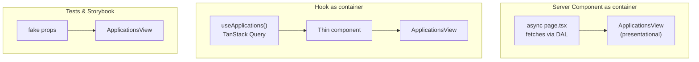

::part[Learn the Concept]{n="1"}

## 🎯 What you'll learn

- The **container/presentational** split and the problem it solves
- Modeling UI states as a **discriminated union** (`loading | error | ready`)
- **Injecting** data loaders into containers (dependency injection for the frontend)
- The modern form: **Server Components as containers**, hooks as "containers without components"
- Testing each half, and using presentational components in Storybook
- When the split helps and when it's ceremony

## 🧠 The big idea

A **TV** and a **cable box**. The TV (presentational) only shows whatever signal it receives — it doesn't know if it's from cable, a laptop or a game console. The cable box (container) knows where to get channels, handles subscriptions and errors, and sends a signal to the TV.

You can test a TV with any signal generator, and swap the cable box for a streaming stick without buying a new TV.

## ❓ Why does this exist?

Components that fetch, transform, handle errors and render in one place are hard to:
- **test** — every test needs a mocked `fetch` and waits for async code;
- **reuse** — the same card list is needed on the dashboard (from a different endpoint) and in a Storybook story (from fake data);
- **change** — moving data loading to a Server Component or TanStack Query means rewriting the markup too.

The pattern was popularized by Dan Abramov in 2015. Hooks changed *how* we write containers, but the idea of separating data/behavior from rendering still underpins modern React (Server Components, headless UI libraries).

## 💥 What happens if we DON'T?

```tsx
"use client";
export function TangledApplications() {
  const [status, setStatus] = useState("all");
  const [items, setItems] = useState(null);
  const [error, setError] = useState(false);
  useEffect(() => {
    fetch(`/api/applications?status=${status}`).then((r) => r.json()).then(setItems).catch(() => setError(true));
  }, [status]);   // race conditions, no retry, error never resets
  return (/* 60 lines of markup mixed with the state above */);
}
```

The designer asks for an "empty state" illustration — you have to understand fetching to change a picture.

## 📖 How it works, step by step

### 1. Model the states explicitly

```ts
export type ViewState =
  | { kind: "loading" }
  | { kind: "error"; message: string }
  | { kind: "ready"; items: Item[] };
```

A discriminated union makes impossible states impossible (no "loading **and** error") and TypeScript forces every state to be handled.

### 2. Presentational: props in, markup out

```tsx
type Props = { state: ViewState; status: string; onStatusChange(status: string): void; onRetry(): void };

export function ApplicationsView({ state, status, onStatusChange, onRetry }: Props) {
  return (
    <section>
      <StatusSelect value={status} onChange={onStatusChange} />
      {state.kind === "loading" && <p role="status">Loading applications…</p>}
      {state.kind === "error" && <div role="alert">{state.message} <button onClick={onRetry}>Retry</button></div>}
      {state.kind === "ready" && (state.items.length === 0 ? <EmptyState /> : <ApplicationList items={state.items} />)}
    </section>
  );
}
```

Rules of thumb: no fetching, no global stores, no router; local UI state (a hover, an open menu) is fine.

### 3. Container: state, effects, wiring

```tsx
"use client";
export function ApplicationsContainer({ loadApplications }: { loadApplications(status: string, signal: AbortSignal): Promise<Item[]> }) {
  const [status, setStatus] = useState("all");
  const [state, setState] = useState<ViewState>({ kind: "loading" });
  const [attempt, setAttempt] = useState(0);

  useEffect(() => {
    const controller = new AbortController();
    setState({ kind: "loading" });
    loadApplications(status, controller.signal).then(
      (items) => !controller.signal.aborted && setState({ kind: "ready", items }),
      () => !controller.signal.aborted && setState({ kind: "error", message: "Couldn't load applications" }),
    );
    return () => controller.abort();
  }, [status, attempt, loadApplications]);

  return <ApplicationsView state={state} status={status} onStatusChange={setStatus} onRetry={() => setAttempt((n) => n + 1)} />;
}
```

The loader is **injected**: production passes `applicationsClient.list`; tests pass a fake with controllable timing. (Pass a **stable** function — an inline arrow would refetch on every render.)

### 4. The modern shapes of the same idea



```tsx
// app/(app)/applications/page.tsx — a Server Component is a natural container
export default async function ApplicationsPage({ searchParams }: PageProps<"/applications">) {
  const filters = parseJobFilters(await searchParams);
  const items = await getApplications(filters);         // DAL, server-only
  return <ApplicationsView state={{ kind: "ready", items }} … />;
}
```

With TanStack Query, `useApplications(status)` **is** the container logic; the component becomes a one-line adapter from query state to `ViewState`.

## ⚖️ Trade-offs

| | ✅ | ❌ |
|---|---|---|
| Split | pure, testable views; reuse; Storybook-friendly; data source can change | more files and props; indirection for tiny components |
| All-in-one | quick for small, one-off components | hard to test and change as it grows |
| Server Component container | data on the server, zero client JS for loading | only for data available at request time |

## ✅ When to use it / 🚫 When NOT to use it

- ✅ Views with several states (loading/error/empty/ready) or used in more than one place.
- ✅ Design-system style components that should render in Storybook with fake data.
- 🚫 A 15-line component used once — splitting adds noise.
- 🚫 Don't create "containers" that only forward props — let the page or hook do it.

## 🏆 Best practices

- [ ] Model async UI as a discriminated union; handle every `kind`.
- [ ] Presentational components: props only, no data fetching or global stores.
- [ ] Containers (or hooks/Server Components) own data, effects and wiring — and render nothing else.
- [ ] Inject dependencies (loaders, clients) for testability; keep them stable.
- [ ] Prefer Server Components as containers in the App Router when data is known at request time.
- [ ] Write stories/tests for each view state.

## 🏭 How it's used in industry

- Design systems (and Storybook) depend on presentational components that render from props alone.
- Headless UI libraries (Radix, React Aria, TanStack Table) separate behavior from rendering — the same principle at library scale.
- In App Router codebases, "fetch in the page, render in components" is the common default.

## ⚠️ Common mistakes

- Presentational components that secretly call `useRouter` or a store "just for one thing".
- Boolean soup: `isLoading`, `isError`, `data` that can contradict each other.
- Passing an inline loader function to a container that depends on it → infinite refetch.
- Splitting everything, including components with no state.

::part[Explain & Design]{n="2"}

## 🗣️ Explain it

Explain the TV and cable box analogy to a teammate, then explain how a Server Component page plays the "cable box" role in Next.js.

## 📐 Design it

The CareerPilot **dashboard** shows stats cards, a pipeline chart and a recent-activity list. Stats and activity come from the API at request time; the chart updates live when the user moves an application on the board (TanStack Query). Design the containers and presentational components: names, props (as TypeScript types), which ones are Server/Client Components, and how you'd show them in Storybook.

:::quiz
Show a possible design

```ts
// presentational (no data loading)
type StatsCardsProps = { total: number; active: number; byStatus: Record<Status, number> };
type ActivityListProps = { state: { kind: "ready"; items: Activity[] } | { kind: "empty" } };
type PipelineChartProps = { state: ViewState<Record<Status, number>>; onBarClick?: (status: Status) => void };

// containers
// app/(app)/dashboard/page.tsx      SERVER  getStats(), getRecentActivity() → <StatsCards/>, <ActivityList/>
// components/pipeline-chart-live.tsx CLIENT  useQuery(["stats"]) (initialData from the page) → <PipelineChart state=…/>
```

- `PipelineChartLive` receives `initialStats` from the server page (no loading flash) and subscribes to TanStack Query so board mutations (`invalidateQueries(["stats"])`) update it.
- Storybook: `StatsCards` (typical / zeros / large numbers), `ActivityList` (ready / empty), `PipelineChart` (loading / error / ready / one status only).
- Tests: presentational via Testing Library with props; `PipelineChartLive` with a QueryClient wrapper and MSW.
:::

### 📝 Self-review checklist

- [ ] Views render from props alone
- [ ] Each container has one data responsibility
- [ ] Every view state has a story or test

::ai-review{task="design"}

::part[Toy Exercise]{n="3"}

:::exercise{path="exercises/web/architecture/g-frontend-patterns/01-container-presentational" ai="no-ai" title="Split a tangled component"}
Refactor a component that fetches and renders into a props-only `ApplicationsView` (loading, error with retry, empty, list) and an `ApplicationsContainer` with an injected loader, abort handling and retry.
:::

:::hints
- Write the view first and test it with hand-made states.
- Retry can be a counter in the effect's dependencies.
- The view file should import only types from React (or nothing).
:::

## ✅ Quick check

:::quiz
Why does injecting `loadApplications` make the container easier to test than calling `fetch` inside it?

The test passes a fake that resolves, rejects or waits exactly when the test wants — no global `fetch` mocking, no network details, deterministic race-condition tests.
:::

:::quiz
Is a Server Component page that fetches data and renders `<ApplicationsView items={…} />` a container?

Yes — it owns data loading and passes plain props to a presentational component. It's the App Router's most common form of the pattern.
:::

## 📖 Kamus (glossary)

| Term | Bahasa Indonesia |
|---|---|
| Presentational component | Komponen tampilan (hanya dari props) |
| Container component | Komponen pengelola data dan state |
| Discriminated union | Tipe gabungan dengan penanda jenis |
| Dependency injection | Menyuntikkan dependensi dari luar |
| Separation of concerns | Pemisahan tanggung jawab |
| Storybook | Katalog komponen UI terisolasi |

## 📚 Keep learning

- [Dan Abramov: Presentational and Container Components (with 2019 update)](https://medium.com/@dan_abramov/smart-and-dumb-components-7ca2f9a7c7d0)
- [patterns.dev: Container/Presentational pattern](https://www.patterns.dev/react/presentational-container-pattern/)
- Next.js docs (bundled): Server and Client Components
