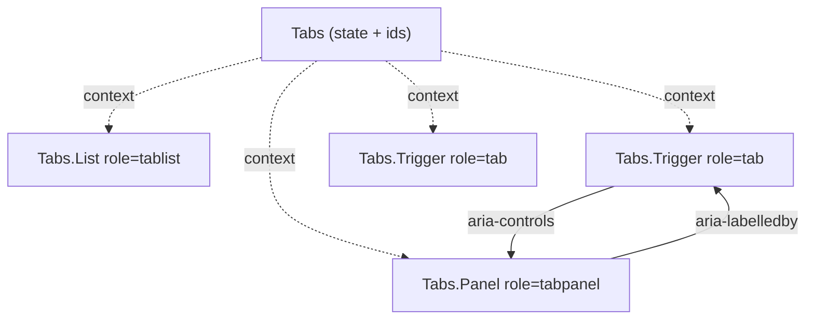

::part[Pelajari Konsepnya]{n="1"}

## 🎯 Yang akan kamu pelajari

- Masalah **prop explosion** di komponen yang bisa dipakai ulang
- **Compound components**: root yang memegang state plus bagian-bagian yang membacanya dari context
- Gaya API: `Tabs.Trigger` (static property) vs `TabsTrigger` (named export)
- Root terkontrol/tidak terkontrol (dengan `useControllableState`)
- Aksesibilitas: `useId`, ARIA relationship, dukungan keyboard dengan **roving tabindex**
- Pesan error yang membantu kalau bagian dipakai di luar root
- Alternatif: slot, render prop, `asChild`

## 🔤 Istilah penting

| Istilah | Artinya (sederhana) |
|---|---|
| **Compound components** | Kelompok komponen yang bekerja bersama untuk satu fitur |
| **Prop explosion** | Komponen bertambah terus prop untuk setiap kebutuhan baru |
| **Root component** | Bagian luar yang memegang state bersama |
| **Context** | Cara bagian-bagian membaca state bersama |
| **Part** | Satu potongan dari kelompok (`Tabs.Trigger`) |
| **`useId`** | Pembuat id unik yang cocok di server dan browser |
| **ARIA relationship** | Atribut yang memberitahu screen reader mana mengendalikan apa |
| **Roving tabindex** | Panah geser fokus dalam grup; Tab geser lewat |

## 🧠 Ide besarnya

Bayangkan **HTML `<select>` dan `<option>`**: kamu tidak menulis `options={[…]}` ke `<select>` — kamu letakkan `<option>` di dalamnya, dan mereka bekerja bersama. Compound components memberikan komponen-mu rasanya sama: `<Tabs>` dengan `<Tabs.List>`, `<Tabs.Trigger>` dan `<Tabs.Panel>` di dalamnya, diatur sesuai yang halaman butuhkan.

## ❓ Kenapa ini penting

Komponen yang "bisa diatur" dimulai dengan `tabs={[{label, content}]}`. Lalu seseorang butuh ikon, terus badge, lalu tab yang di-disable, lalu panel yang ada di tempat lain di layout, terus class berbeda untuk tab yang aktif — jadi kamu tambah `renderLabel`, `badgeFor`, `disabledTabs`, `activeClassName`, `panelWrapper`. Setiap desain baru menambah prop, dan komponennya berubah menjadi panel pengaturan yang tidak ada yang mengerti.

Compound components balikkan itu: root memegang state, dan pemanggil atur bagian-bagiannya — persis seperti cara HTML sudah kerja dengan `<select>` dan `<option>`.

## 📖 Langkah demi langkah

### 1. Bentuknya

```tsx
<Tabs defaultValue="notes" onValueChange={track}>
  <Tabs.List aria-label="Application sections">
    <Tabs.Trigger value="notes"><NoteIcon /> Notes <Badge>3</Badge></Tabs.Trigger>
    <Tabs.Trigger value="files" disabled>Files</Tabs.Trigger>
  </Tabs.List>
  <Tabs.Panel value="notes"><Notes /></Tabs.Panel>
  <Tabs.Panel value="files"><Files /></Tabs.Panel>
</Tabs>
```

Pemanggil mengontrol markup dan urutan; komponen mengontrol **state dan aksesibilitas**.

### 2. Root punya state, context membagikannya

```tsx
const TabsContext = createContext<{ baseId: string; selected?: string; select(v: string): void } | null>(null);

function useTabsContext(part: string) {
  const ctx = useContext(TabsContext);
  if (!ctx) throw new Error(`Tabs.${part} must be used inside <Tabs>`);
  return ctx;
}

function TabsRoot({ value, defaultValue, onValueChange, children }: TabsProps) {
  const [selected, setSelected] = useControllableState({ value, defaultValue, onChange: onValueChange });
  const baseId = useId();                                     // unique per instance, SSR-safe
  return <TabsContext.Provider value={{ baseId, selected, select: setSelected }}>{children}</TabsContext.Provider>;
}
```

### 3. Bagian membaca context dan kawat ARIA

Di sini aksesibilitas jadi gratis untuk pemanggil: bagian-bagian menyambung id yang benar sendiri, jadi screen reader dapat hubungan yang pas tanpa siapa pun harus ingat untuk menambahnya.

```tsx
function Trigger({ value, disabled, children }: TriggerProps) {
  const { baseId, selected, select } = useTabsContext("Trigger");
  const isSelected = selected === value;
  return (
    <button
      type="button" role="tab" id={`${baseId}-tab-${value}`}
      aria-selected={isSelected} aria-controls={`${baseId}-panel-${value}`}
      tabIndex={isSelected ? 0 : -1}                           // roving tabindex
      disabled={disabled} onClick={() => select(value)} onKeyDown={moveWithArrows}
    >{children}</button>
  );
}

function Panel({ value, children }: PanelProps) {
  const { baseId, selected } = useTabsContext("Panel");
  if (selected !== value) return null;
  return <div role="tabpanel" id={`${baseId}-panel-${value}`} aria-labelledby={`${baseId}-tab-${value}`} tabIndex={0}>{children}</div>;
}

export const Tabs = Object.assign(TabsRoot, { List, Trigger, Panel });
```



### 4. Keyboard: roving tabindex

Pola WAI-ARIA untuk Tab: **Tab** masuk ke daftar tab (hanya tab yang dipilih yang punya `tabIndex=0`) terus ke panel; **Panah** bergerak antar tab; **Home/End** loncat ke awal/akhir; tab yang di-disable dilewat. Dengan *automatic activation*, fokus ke tab akan pilih tab itu; *manual activation* butuh Enter/Space (lebih bagus kalau panel mahal untuk dimuat).

### 5. Gaya export

Dua gaya ini sama bagusnya — `Tabs.Trigger` terbaca bagus, sementara `TabsTrigger` export terpisah lebih ramah bundler dan auto-import. Pilih satu dan tetap konsisten.

| Gaya | Contoh | Catatan |
|---|---|---|
| Static property | `Tabs.Trigger` | mudah ditemukan; butuh hati-hati dengan batas `"use client"` dan tree-shaking |
| Named export | `TabsTrigger` (shadcn/ui) | kerja bagus dengan Server Components yang import bagian client; import jelas |
| Namespace import | `import * as Tabs from "@radix-ui/react-tabs"` → `Tabs.Root` | Gaya Radix |

### 6. Pola komposisi terkait

- **Slot / `asChild`**: `<Dialog.Trigger asChild><Button/></Dialog.Trigger>` gabungkan perilaku ke elemenmu.
- **Render prop**: `<Combobox>{({ open }) => …}</Combobox>` expose state internal untuk render kustom.
- **Prop getter** (hook): `getTabProps(value)` — varian headless dari materi sebelumnya.

### Memilih setup-mu

Setiap opsi di sini ada trade-off:

| | ✅ | ❌ |
|---|---|---|
| Compound components | markup fleksibel, terbaca, aksesibilitas terpusat | lebih banyak bagian untuk dipelajari; bagian harus di dalam root |
| Config prop (`tabs=[…]`) | ringkas untuk kasus sederhana, mudah generate dari data | prop explosion untuk apa pun yang kustom |
| Headless hook | kontrol maksimal | pemanggil harus kawat ARIA sendiri |

- ✅ Komponen dengan bagian terkait: tab, accordion, menu, select, dialog, stepper, card dengan header/body/footer.
- ✅ Komponen design-system yang dipakai di banyak layout berbeda.
- 🚫 Komponen daun sederhana (`<Badge tone="success">`) — prop lebih jelas.
- 🚫 Membangun ulang widget kompleks (combobox, date picker) dari awal di tim produk — pakai Radix/React Aria.

## ⚠️ Kesalahan umum

- Pakai index array untuk cocokkan trigger dan panel (rusak kalau bagian diurutkan ulang) — pakai `value` eksplisit.
- Setiap tab bisa fokus dengan Tab (tanpa roving tabindex) → pengguna keyboard tab-tab through 10 tab.
- Id yang hard-coded → duplikat kalau komponen muncul dua kali.
- Andalkan `React.Children.map` untuk inject prop — rusak dengan fragment dan komponen pembungkus; pakai context.

## 🏆 Praktik terbaik

- [ ] Root punya state (terkontrol + tidak terkontrol); bagian baca lewat context private.
- [ ] Lempar error jelas kalau bagian dipakai di luar root-nya.
- [ ] Generate id dengan `useId`; kawat `aria-controls` / `aria-labelledby`.
- [ ] Implementasikan pola keyboard WAI-ARIA untuk widget; test dengan Testing Library.
- [ ] Pass through prop asli (`aria-label`, `className`) dengan `...props`.
- [ ] Memoize nilai context kalau bagiannya banyak atau mahal.
- [ ] Prefer primitif yang sudah teruji (Radix, React Aria) untuk widget kompleks; bangun sendiri untuk belajar atau kasus sederhana.

::part[Jelaskan & Rancang]{n="2"}

## 🗣️ Jelaskan

Jelaskan analogi `<select>`/`<option>`, terus jelaskan ke teman kenapa roving tabindex membuat tab lebih cepat untuk pengguna keyboard.

## 📐 Rancang

Rancang compound **`Stepper`** untuk wizard 3-langkah "Tambah aplikasi" CareerPilot: bagian, apa yang root punya, ARIA role/atribut, perilaku keyboard, bagaimana langkah bisa block "Berikutnya" sampai valid, dan pakai terkontrol dengan React Hook Form.

:::quiz
Lihat contoh rancangan

```tsx
<Stepper value={step} onValueChange={setStep} canContinue={canContinue}>
  <Stepper.List aria-label="Add application">
    <Stepper.Step value="company">Company</Stepper.Step>
    <Stepper.Step value="role">Role</Stepper.Step>
    <Stepper.Step value="skills">Skills</Stepper.Step>
  </Stepper.List>
  <Stepper.Panel value="company"><CompanyFields /></Stepper.Panel>
  <Stepper.Panel value="role"><RoleFields /></Stepper.Panel>
  <Stepper.Panel value="skills"><SkillsFields /></Stepper.Panel>
  <Stepper.Previous>Back</Stepper.Previous>
  <Stepper.Next>Next</Stepper.Next>
</Stepper>
```

- **Root** punya `value` (bisa dikontrol), nilai langkah terurutkan yang didaftar `Stepper.Step`, set `completed`, dan `canContinue(current) => Promise<boolean>` (e.g. `() => form.trigger(fieldsFor(step))`).
- **List** adalah `<ol>`; setiap **Step** render `aria-current="step"` untuk yang sekarang, label "completed" visual hidden, dan jadi tombol hanya untuk langkah yang sudah selesai (tidak bisa melompat maju).
- **Berikutnya** tunggu `canContinue`; kalau gagal fokus ke field invalid pertama; di langkah terakhir jadi tombol submit. **Sebelumnya** di-disable di langkah pertama.
- **Panel** render hanya langkah sekarang tapi simpan nilai di RHF (`shouldUnregister: false`); geser fokus ke panel heading saat langkah berubah (umumkan progres).
- Error kalau bagian di luar `<Stepper>`; id dari `useId`.
:::

### 📝 Checklist review mandiri

- [ ] State di root, markup di pemanggil
- [ ] Manajemen fokus saat ganti langkah
- [ ] Hook validasi daripada aturan hard-coded

::ai-review{task="design"}

::part[Latihan Kecil]{n="3"}

:::exercise{path="exercises/web/architecture/g-frontend-patterns/03-compound-components" ai="no-ai" title="Accessible compound Tabs"}
Bangun `Tabs`, `Tabs.List`, `Tabs.Trigger` dan `Tabs.Panel` dengan context, mode terkontrol dan tidak terkontrol, id unik, kawat ARIA, roving tabindex dan dukungan keyboard panah/Home/End yang lewati tab di-disable.
:::

:::hints
- Query tab yang aktif dari elemen list (`querySelectorAll('[role="tab"]:not([disabled])')`) di handler key.
- Fokus ke tab target dan pilih (automatic activation).
- Pakai `useId()` di root, terus derive id tab dan panel dari itu plus `value`.
:::

## ✅ Cek cepat

:::quiz
Kenapa pakai context daripada `React.Children.map` + `cloneElement` untuk kirim nilai terpilih ke trigger?

Pemetaan anak hanya menjangkau anak langsung; bungkus trigger di `<Tooltip>` atau fragment rusak. Context menjangkau kedalaman apa pun dan simpan bagian bebas dari struktur.
:::

:::quiz
`aria-controls` pada tab tunjuk ke apa, dan kenapa penting?

Id panel yang ditunjukkannya. Teknologi bantu bisa umumkan dan navigasi hubungan tab dengan panel.
:::


## 📚 Lanjut belajar

- [WAI-ARIA APG: Pola Tab](https://www.w3.org/WAI/ARIA/apg/patterns/tabs/)
- [Radix Primitif: Tab](https://www.radix-ui.com/primitives/docs/components/tabs)
- [patterns.dev: Pola compound](https://www.patterns.dev/react/compound-pattern/)
